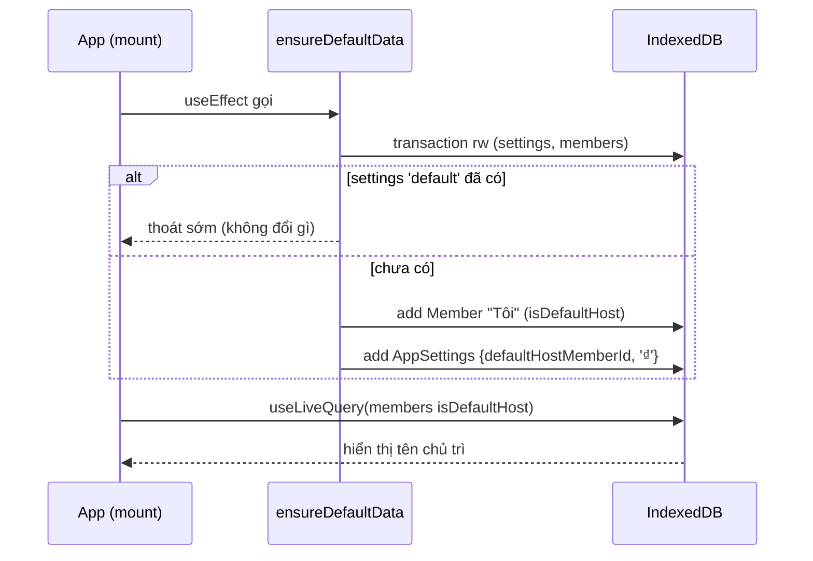
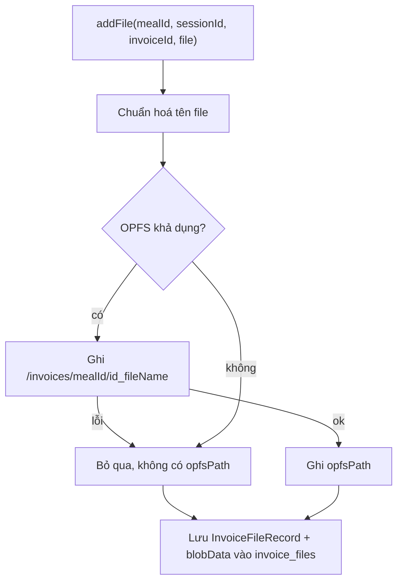

# Epic 1 — System Analysis (SA)

**Epic 1**: Khởi tạo Nền tảng, Hệ màu USD Green & Lớp Lưu trữ Local · **Trạng thái**: đã triển khai (code tại `app/`)

Tài liệu đi cùng: [BR](./BR.md) · [Kiến trúc & Data model](../01-architecture-and-data-model.md)

---

### B.1. Công nghệ
Vite 8 · React 19 · TypeScript 6 · Tailwind CSS 3 · Dexie 4 + `dexie-react-hooks` · lucide-react · Vitest + fake-indexeddb + jsdom.

### B.2. Cấu trúc mã nguồn

```text
app/
├─ tailwind.config.js        # token màu USD, font
├─ vite.config.ts            # cấu hình vitest (jsdom)
└─ src/
   ├─ index.css              # Tailwind + component classes (.card, .btn-*, .money, .badge-active)
   ├─ App.tsx                # shell: header, trang mẫu, gọi ensureDefaultData
   ├─ types/index.ts         # toàn bộ interface (theo 01-architecture §3)
   ├─ db/
   │  ├─ db.ts               # class UsdSplitDB, export `db`
   │  ├─ normalize.ts        # normalizeName()
   │  ├─ seed.ts             # ensureDefaultData()
   │  └─ db.test.ts
   └─ services/
      ├─ fileStorageService.ts
      └─ fileStorageService.test.ts
```

### B.3. Thành phần & trách nhiệm

| Thành phần | Trách nhiệm | Phụ thuộc |
| :--- | :--- | :--- |
| `types` | Định nghĩa kiểu dữ liệu dùng chung cho mọi Epic | — |
| `db` | Mở IndexedDB `usd-split`, khai báo bảng và index | `types`, Dexie |
| `normalize` | Chuẩn hoá chuỗi tìm kiếm tiếng Việt | — |
| `seed` | Tạo hồ sơ chủ app + settings (idempotent) | `db`, `normalize` |
| `fileStorageService` | CRUD file hoá đơn trên OPFS + Blob | `db`, `types` |
| `App` | Gọi seed khi mount, hiển thị chủ trì qua `useLiveQuery` | `db`, `seed` |

### B.4. Thiết kế dữ liệu IndexedDB (DB `usd-split`, version 1)

| Bảng | Kiểu | Khoá chính + index |
| :--- | :--- | :--- |
| `meals` | `Meal` | `id`, `date`, `status`, `updatedAt` |
| `sessions` | `SessionKeo` | `id`, `mealId`, `orderIndex` |
| `invoices` | `Invoice` | `id`, `mealId`, `sessionId` |
| `items` | `InvoiceItem` | `id`, `mealId`, `sessionId`, `invoiceId` |
| `members` | `Member` | `id`, `normalizedName`, `lastUsedAt` |
| `invoice_files` | `InvoiceFileRecord` | `id`, `mealId`, `sessionId`, `invoiceId` |
| `settings` | `AppSettings` | `id` (cố định `'default'`) |

Ghi chú thiết kế:
- Index `mealId` trên `sessions`, `invoices`, `items`, `invoice_files` phục vụ xoá hàng loạt khi xoá/lưu trữ bữa (Epic 3, 7).
- `PaymentGroup`, `settlementStatuses`, `archivedSummary` nằm nhúng trong `Meal`, không có bảng riêng.
- Khoá là UUID (`crypto.randomUUID`). Ngày lưu dạng chuỗi ISO.

### B.5. Luồng xử lý

**Khởi động & seed**


**Thêm file hoá đơn**


**Đọc / xoá**
- `getFileBlob`: đọc OPFS trước, lỗi hoặc không có → dùng `blobData`.
- `deleteFile` / `deleteFilesBy{Invoice,Session,Meal}`: xoá file OPFS (nếu có `opfsPath`) rồi xoá bản ghi; theo bữa còn xoá đệ quy thư mục `/invoices/<mealId>`.

### B.6. Giao diện lập trình (API nội bộ)

| Hàm | Mô tả |
| :--- | :--- |
| `ensureDefaultData(): Promise<void>` | Seed idempotent |
| `normalizeName(s): string` | Bỏ dấu, thường, `đ→d`, trim |
| `addFile(input): Promise<InvoiceFileRecord>` | Thêm file, `input.ocrRawText?` tuỳ chọn |
| `getFileBlob(id): Promise<Blob \| undefined>` | Đọc nội dung |
| `downloadFile(id): Promise<boolean>` | Tải về qua object URL; `false` nếu thiếu dữ liệu |
| `deleteFile(id)` | Xoá 1 file |
| `deleteFilesByInvoice(id)` / `...BySession(id)` / `...ByMeal(id)` | Xoá hàng loạt |
| `listFilesByInvoice(id)` | Liệt kê, sắp theo `createdAt` |
| `getTotalStorageBytes()` | Tổng dung lượng file |

### B.7. Yêu cầu phi chức năng

| Nhóm | Yêu cầu | Hiện trạng |
| :--- | :--- | :--- |
| Bền vững | Dữ liệu còn sau F5 | Đạt (test đóng/mở lại DB) |
| Tương thích | Trình duyệt không có OPFS vẫn chạy | Đạt qua Blob fallback |
| Hiệu năng | Build gọn | JS 323 kB (gzip 103 kB) |
| Bảo mật/riêng tư | Dữ liệu chỉ ở trình duyệt người dùng | Không gửi ra ngoài (trừ tải font Google Fonts) |
| Khả dụng | Focus ring rõ, tương phản chữ/nền cao | Có `focus-visible` ring `usd-green-600` |

### B.8. Rủi ro & hạn chế đã biết

| Mục | Mô tả | Hướng xử lý |
| :--- | :--- | :--- |
| Đường OPFS mới test thủ công trên 1 trình duyệt | Test tự động chạy trên jsdom (không có OPFS), chỉ phủ Blob fallback; đường OPFS đã chạy thủ công trên trình duyệt trong app (thêm, đọc, xoá theo bữa đều đạt) | Thử thêm trên Safari/Firefox; cân nhắc e2e (Playwright) |
| Lưu Blob trùng | Mỗi file nằm 2 nơi (OPFS + IndexedDB) → tốn gấp đôi dung lượng | Chấp nhận để đảm bảo tương thích; xem lại nếu dung lượng thành vấn đề |
| Xoá bản ghi vs file | Xoá không nằm trong 1 transaction với OPFS; có thể sót file nếu gián đoạn | Bổ sung bước dọn mồ côi khi khởi động (Epic 7) |
| Phụ thuộc Google Fonts | Offline lần đầu dùng font dự phòng | Tự host font hoặc cache bằng service worker (PWA) |
| Chưa có migration | DB đang ở version 1 | Thêm `version(n).upgrade` khi đổi schema |
| Tiền tệ | `currencySymbol` mặc định `₫` theo seed | Cho đổi trong màn hình cài đặt (sau) |

### B.9. Ma trận truy vết kiểm thử

| User Story | BR | Kiểm thử |
| :-: | :-: | :--- |
| US-1.1 | BR-1.2 | `vite build` + đã xem giao diện trên trình duyệt (xanh lá, nền kem, số thẳng cột) |
| US-1.2 | BR-1.3 | `db.test.ts` (persist qua close/open) |
| US-1.3 | BR-1.4, 1.7 | `fileStorageService.test.ts` (thêm, đọc, xoá lẻ, xoá theo bữa — đường Blob) + chạy thủ công đường OPFS trên trình duyệt (đạt) |
| US-1.4 | BR-1.5, 1.6 | `db.test.ts` (tạo 1 lần, gọi 2 lần không trùng) |

### B.10. Việc còn lại để đóng Epic 1
1. Kiểm tra F5 giữ dữ liệu (AC-2) và thử đường OPFS trên Safari/Firefox (AC-3).
