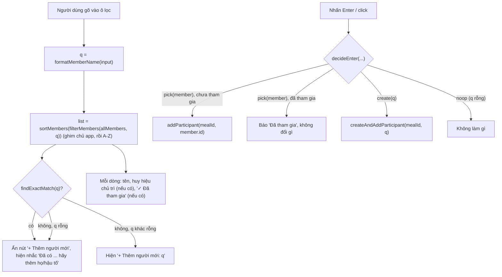
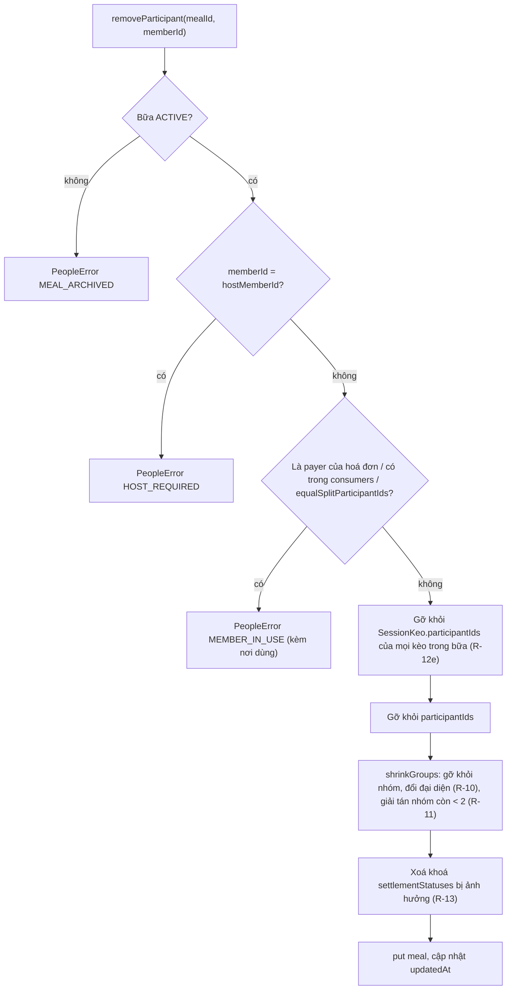
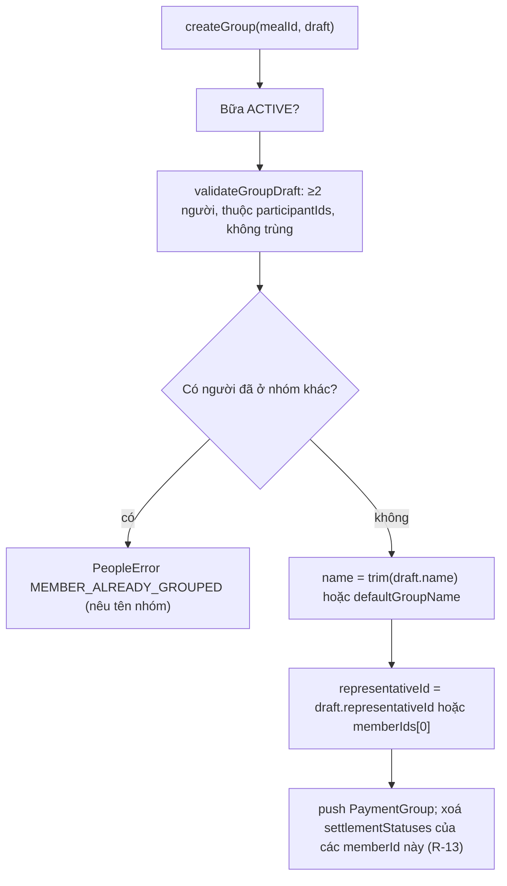

# Epic 2 — System Analysis (SA)

**Epic 2**: Quản lý Danh bạ Thành viên, Quick Filter (A-Z), Chủ trì & Nhóm Thanh toán · **Trạng thái**: đã triển khai (code tại `app/`); build, lint và 92 test tự động đạt; kiểm thử thủ công trên trình duyệt **chưa thực hiện**

Tài liệu đi cùng: [BR](./BR.md) · [Kiến trúc & Data model](../01-architecture-and-data-model.md) · [Nghiệp vụ §4–5](../02-business-logic-and-algorithms.md) · [UI §4.3](../03-ui-ux-and-design-system.md)

---

### B.1. Công nghệ
Dùng lại stack Epic 1: React 19 · TypeScript · Tailwind · Dexie 4 + `dexie-react-hooks` · lucide-react · Vitest + fake-indexeddb + jsdom. **Không thêm thư viện cho phần logic.** Kiểm thử component (Q-5 đã chốt) thêm vào devDependencies: `@testing-library/react@16.3.0`, `@testing-library/dom@10.4.0`, `@testing-library/user-event@14.6.1`.

Lưu ý khi test component: Vitest chưa bật `globals`, nên RTL không tự dọn DOM; mỗi file component phải có `afterEach(cleanup)`. Dự án **không** dùng `jest-dom`; assert bằng `textContent` và `queryBy… === null`.

Sắp xếp A-Z: `Intl.Collator('vi')` có sẵn trong trình duyệt và Node (ICU đầy đủ).

### B.2. Cấu trúc mã nguồn

```text
app/src/
├─ types/index.ts                  # không đổi (Member, Meal, PaymentGroup đã đủ trường)
├─ db/
│  ├─ db.ts, seed.ts               # không đổi (không nâng version schema)
│  ├─ normalize.ts                 # THÊM cleanName, formatMemberName, hasDiacritics, MEMBER_NAME_MAX
│  └─ normalize.test.ts            # 13 test
├─ domain/                         # THUẦN, không chạm DB
│  ├─ memberFilter.ts              # sortMembers, filterMembers, findExactMatch, findDiacriticVariants, allocateKey, decideEnter
│  ├─ memberFilter.test.ts         # 22 test
│  ├─ paymentGroupRules.ts         # defaultGroupName, validateGroupDraft, shrinkGroups
│  └─ paymentGroupRules.test.ts    # 10 test
├─ services/
│  ├─ peopleErrors.ts              # PeopleError + PeopleErrorCode
│  ├─ memberService.ts             # validateMemberName, avatarColorFor, findMemberByName, getOrCreateMember, renameMember
│  ├─ memberService.test.ts        # 10 test
│  ├─ mealPeopleService.ts         # initMealPeople, add/create/remove participant, setHost, create/update/dissolve group, hasPaidStatusAffected
│  └─ mealPeopleService.test.ts    # 22 test
├─ hooks/
│  ├─ useMembers.ts                # danh bạ đã xếp (sortMembers) qua useLiveQuery
│  └─ useMealPeople.ts             # bữa + participants + host + groups (kèm members) qua useLiveQuery
├─ components/people/
│  ├─ MemberQuickFilter.tsx        # combobox ARIA: lọc, Enter, mũi tên, "+ Thêm người mới", "Đã tham gia"
│  ├─ MemberQuickFilter.test.tsx   # 9 test (gồm bỏ qua Enter khi IME đang ghép)
│  ├─ ParticipantList.tsx          # chip người tham gia (avatar chữ cái inline), nút bỏ, hiện lỗi chặn
│  ├─ HostSelector.tsx             # radio group chọn chủ trì trong số người tham gia
│  ├─ HostSelector.test.tsx        # 3 test (ghi DB thật)
│  ├─ PaymentGroupPanel.tsx        # danh sách nhóm + sửa / giải tán / tạo
│  ├─ PaymentGroupDialog.tsx       # tạo / sửa nhóm (người ở nhóm khác bị vô hiệu hoá)
│  └─ PaymentGroupDialog.test.tsx  # 3 test (ghi DB thật)
├─ pages/PeopleSandbox.tsx         # ĐÃ XOÁ ở Epic 3 (thay bằng MealWorkspacePage); từng là bữa nháp "Bữa thử nghiệm (Epic 2)" + đổi tên chủ app (BR-2.7); thay bằng màn bữa ở Epic 3
└─ App.tsx                         # header Epic 1 + PeopleSandbox (thay hoá đơn mẫu)
```

### B.3. Thành phần & trách nhiệm

| Thành phần | Trách nhiệm | Phụ thuộc |
| :--- | :--- | :--- |
| `normalize.cleanName` / `formatMemberName` | Áp R-1: `cleanName` trim, gộp khoảng trắng, kiểm độ dài; `formatMemberName(raw)` = `cleanName` rồi viết thường toàn chuỗi (`toLocaleLowerCase('vi')`) và viết hoa chữ cái đầu mỗi từ (từ bắt đầu sau khoảng trắng hoặc `-`, `toLocaleUpperCase('vi')`). Là **cổng duy nhất** tạo ra `Member.name` | `normalizeName` |
| `domain/memberFilter` | Sắp ghim + A-Z (R-3), lọc theo R-4, tìm khớp chính xác và khớp khác dấu (R-2), cấp khoá `normalizedName` không trùng (`allocateKey`), quyết định hành vi `Enter` (R-6). Không chạm DB | `normalizeName` |
| `domain/paymentGroupRules` | Tên nhóm mặc định, kiểm hợp lệ nhóm (R-9), co nhóm khi mất người (R-10, R-11). Hàm thuần trên mảng `PaymentGroup` | `services/peopleErrors` (ném lỗi) |
| `memberService` | Tạo/tìm người theo tên hiển thị (R-2a), cấp khoá không trùng (R-2b), đổi tên hồ sơ, gán `avatarColor`. `getOrCreateMember` **không tự mở transaction**: chỉ gọi từ trong transaction có `db.members` | `db`, `normalize`, `domain/memberFilter` |
| `mealPeopleService` | Mọi thay đổi người/chủ trì/nhóm của một bữa, mỗi hàm là **một transaction** có đủ bảng liên quan (R-7, R-14); bỏ người kiểm tra `invoices`/`items` (R-12) | `db`, `memberService`, `domain/*` |
| `useMembers` | Trả danh bạ đã xếp (ghim chủ app, A-Z), cập nhật tức thì khi DB đổi | `db`, `memberFilter` |
| `useMealPeople` | Trả `meal`, `participants` (đã xếp), `host`, `groups` kèm `members`; `null` nếu không có bữa | `db`, `memberFilter` |
| `MemberQuickFilter` | UI R-4/5/6; gọi `onPick(member)` / `onCreate(name)` do cha truyền vào; quyết định Enter lấy từ `decideEnter` | `memberFilter` |
| `PaymentGroupPanel/Dialog` | UI tạo, sửa, giải tán nhóm; hiển thị lỗi R-9 | `mealPeopleService` |
| `HostSelector` | Chọn chủ trì trong số người tham gia | `mealPeopleService` |

Quy ước: component chỉ giao tiếp với DB qua hook (đọc) và `mealPeopleService` (ghi). Không gọi `db` trực tiếp trong component.

### B.4. Thiết kế dữ liệu

**Không đổi schema, không nâng version Dexie.** `Member`, `Meal.participantIds`, `Meal.hostMemberId`, `Meal.paymentGroups`, `Meal.settlementStatuses` đã đủ trường (Epic 1 / file 01 §3.1–3.2). Lý do không thêm index: số người trong danh bạ nhỏ (tối đa vài trăm) nên lọc và xếp trong bộ nhớ; truy vấn "bữa nào có người X" chưa cần (xem R-15).

Ràng buộc toàn vẹn (service giữ, DB không tự ép) cho mỗi `Meal` ACTIVE:

| # | Bất biến |
| :-: | :--- |
| I-1 | `participantIds` không trùng; mọi id tồn tại trong `members` |
| I-2 | `hostMemberId ∈ participantIds` |
| I-3 | Mỗi `PaymentGroup.memberIds` có ≥ 2 id, đều thuộc `participantIds`, không trùng nhau |
| I-4 | Một `memberId` xuất hiện trong tối đa một nhóm |
| I-5 | `representativeId ∈ memberIds` của nhóm đó |
| I-6 | Khoá của `settlementStatuses` chỉ gồm `memberId` ∈ `participantIds` chưa vào nhóm, hoặc `paymentGroupId` còn tồn tại (Epic 6 ghi, Epic 2 dọn theo R-13) |
| I-7 | `Member.normalizedName` duy nhất trong toàn danh bạ (có thể mang hậu tố số `an`, `an2`… theo R-2b); không có hai `Member` cùng tên hiển thị (so sánh không phân biệt hoa/thường, phân biệt dấu) |

Lưu ý: `normalizedName` giờ là **khoá tìm kiếm duy nhất**, không còn là chuỗi bỏ dấu thuần như mô tả ở [Epic 1 R-4](../epic-1/BR.md). Hồ sơ cũ đã seed (`chu app (toi)`) vẫn hợp lệ. Cần ghi chú sang Epic 1 BR khi đóng Epic 2.

`Member.avatarColor`: chọn theo băm của `normalizedName` từ dải 6 màu xanh USD (`#1B4332`, `#2D6A4F`, `#40916C`, `#52796F`, `#3A5A40`, `#386641`) để cùng một người luôn cùng màu, không cần lưu trạng thái bổ sung. Hồ sơ chủ app giữ `#2D6A4F` đã seed.

### B.5. Luồng xử lý chính

**Quick Filter: gõ, chọn, tạo mới**


**Thêm người mới vào bữa (nguyên tử)**
```mermaid
sequenceDiagram
    participant UI as MemberQuickFilter
    participant S as mealPeopleService
    participant D as IndexedDB
    UI->>S: createAndAddParticipant(mealId, raw)
    S->>D: tx rw (meals, members)
    S->>D: get meal; kiểm ACTIVE (R-14)
    S->>D: tìm member có tên hiển thị giống hệt cả dấu (R-2a)
    alt đã có
        S-->>S: dùng member cũ, created = false
    else chưa có
        S->>D: allocateKey: normalizedName không trùng (an, an2, ...) (R-2b)
        S->>D: add Member mới (avatarColor theo băm của khoá)
    end
    S->>D: put meal.participantIds += id (nếu chưa có); lastUsedAt = now
    S-->>UI: { member, created }
    D-->>UI: useLiveQuery tự cập nhật danh sách
```

**Bỏ người khỏi bữa**


**Tạo / sửa nhóm thanh toán**


### B.6. Giao diện lập trình nội bộ

**Lỗi**: `class PeopleError extends Error { code: PeopleErrorCode; detail?: Record<string, unknown> }` với

| `code` | Khi nào |
| :--- | :--- |
| `MEAL_NOT_FOUND` | `mealId` không tồn tại |
| `MEAL_ARCHIVED` | Bữa `ARCHIVED` (R-14) |
| `INVALID_NAME` | Tên rỗng / quá 50 ký tự (R-1), tên nhóm quá 80 ký tự |
| `DUPLICATE_NAME` | Đổi tên thành tên đã có (cùng dấu) của người khác (R-2a); `detail.existingMemberId` |
| `MEMBER_NOT_FOUND` | `memberId` không có trong danh bạ |
| `NOT_PARTICIPANT` | Thao tác với người chưa tham gia bữa (đặt chủ trì, vào nhóm) |
| `HOST_REQUIRED` | Bỏ người chủ trì khỏi bữa (R-8) |
| `MEMBER_IN_USE` | Bỏ người đang gắn với hoá đơn/món (R-12); `detail.reasons` liệt kê `payer` / `consumer` / `equalSplit` |
| `GROUP_NOT_FOUND` | `groupId` không có trong bữa |
| `GROUP_TOO_SMALL` | Nhóm < 2 người |
| `NOT_IN_GROUP` | *(thêm khi code)* Đại diện nhóm không thuộc nhóm đó (R-10); `detail.memberId` |
| `MEMBER_ALREADY_GROUPED` | Người đã ở nhóm khác; `detail.groupId`, `detail.groupName`, `detail.memberId` |

Mọi hàm ghi là `async`, chạy trong một transaction và **không ghi gì** nếu ném lỗi (vì lỗi làm transaction rollback).

**`domain/memberFilter.ts`** (thuần)

| Hàm | Mô tả |
| :--- | :--- |
| `sortMembers(members: Member[]): Member[]` | R-3: người `isDefaultHost` đứng đầu, còn lại `Intl.Collator('vi')` theo `name`, hoà thì theo `createdAt`. Trả mảng mới, không đổi mảng vào |
| `filterMembers(members, query: string): Member[]` | R-4. Khớp trên `normalizedName`; trả đã qua `sortMembers` |
| `findExactMatch(members, query): Member \| undefined` | R-2a: `query` đã qua `formatMemberName`, so sánh bằng tên hiển thị (NFC) |
| `findDiacriticVariants(members, query): Member[]` | R-2b/R-6c: người có cùng dạng không dấu với `query` (không tính khoá hậu tố) nhưng khác dấu |
| `allocateKey(members, rawName, selfId?): string` | R-2b: `base = normalizeName(rawName)`; trả `base` nếu chưa ai dùng, nếu không trả `base2`, `base3`… nhỏ nhất còn trống; bỏ qua `selfId` khi đổi tên |
| `decideEnter({ query, members, highlightedId, participantIds }): EnterAction` | R-6. `EnterAction` = `{type:'pick', member}` · `{type:'already', member}` · `{type:'create', name}` · `{type:'noop'}`. Thứ tự quyết định theo R-6: dòng đang chọn → khớp chính xác → (từ khoá không dấu và có người khác dấu) chọn người đầu tiên → tạo mới. `name` trong `create` đã qua `formatMemberName`, cũng là chuỗi hiển thị trên nút "+ Thêm người mới" |

**`domain/paymentGroupRules.ts`** (thuần)

| Hàm | Mô tả |
| :--- | :--- |
| `defaultGroupName(memberNames: string[]): string` | `A + B + C` (R-9) |
| `validateGroupDraft({ memberIds, participantIds, existingGroups, ignoreGroupId?, names }): void` | Ném `PeopleError` theo `GROUP_TOO_SMALL`, `NOT_PARTICIPANT`, `MEMBER_ALREADY_GROUPED`. *(thêm `names` so với thiết kế ban đầu để thông báo lỗi có tên người)* |
| `shrinkGroups(groups, removedMemberIds): { groups, dissolvedGroupIds }` | R-10, R-11. *(trả thêm `dissolvedGroupIds` để dọn khoá R-13)* |

**`services/memberService.ts`**

| Hàm | Mô tả |
| :--- | :--- |
| `findMemberByName(name): Promise<Member \| undefined>` | Theo tên hiển thị đã `formatMemberName`, cùng dấu (R-2a) |
| `getOrCreateMember(rawName, now): Promise<{member: Member; created: boolean}>` | *(đổi chữ ký: nhận `now` để mọi bản ghi của một thao tác dùng cùng một thời điểm)* Không mở transaction; chỉ dùng trong transaction của `mealPeopleService`. Lưu `name = formatMemberName(name)` (R-1) và `normalizedName = allocateKey(...)` (R-2b); nếu đã có người cùng tên hiển thị (R-2a) thì trả người đó, `created = false`, không ghi đè |
| `renameMember(id, name): Promise<Member>` | Lưu `name = formatMemberName(name)` + `normalizedName`; `INVALID_NAME` nếu rỗng; `DUPLICATE_NAME` nếu trùng tên hiển thị của người khác; khoá chỉ cấp lại (`allocateKey` với `selfId`) khi dạng không dấu của tên đổi |

**`services/mealPeopleService.ts`** (tham số đầu luôn là `mealId`)

| Hàm | Mô tả |
| :--- | :--- |
| `initMealPeople(): Promise<{participantIds: string[]; hostMemberId: string}>` | Giá trị khởi tạo cho **Epic 3** khi tạo bữa: host = `defaultHostMemberId`, participants = `[host]` (R-8) |
| `addParticipant(mealId, memberId)` | Thêm; đã có thì no-op (idempotent); cập nhật `lastUsedAt` |
| `createAndAddParticipant(mealId, rawName)` | Luồng B.5; trả `{member, created}` |
| `removeParticipant(mealId, memberId)` | Luồng B.5. Transaction gồm `meals`, `sessions`, `invoices`, `items`; ngoài các kiểm tra chặn còn tự gỡ người khỏi `participantIds` của các kèo trong bữa (R-12e, thêm khi làm Epic 3). Có 2 test: gỡ đúng kèo của bữa này và không đụng bữa khác; không đổi gì khi bị chặn bởi hoá đơn |
| `setHost(mealId, memberId)` | `NOT_PARTICIPANT` nếu người đó chưa tham gia |
| `createGroup(mealId, {name?, memberIds, representativeId?})` | Trả `PaymentGroup` |
| `updateGroup(mealId, groupId, {name?, memberIds?, representativeId?})` | Đổi thành phần phải qua `validateGroupDraft` với `ignoreGroupId = groupId`; dọn khoá R-13 cho cả người cũ lẫn mới |
| `dissolveGroup(mealId, groupId)` | Xoá nhóm và khoá `settlementStatuses[groupId]` |
| `hasPaidStatusAffected(meal, memberIds, groupId?)` | Hàm đọc để UI hỏi xác nhận trước khi gọi các hàm trên (R-13) |

**Hook**

| Hook | Trả về |
| :--- | :--- |
| `useMembers()` | `Member[]` A-Z, `undefined` khi đang tải |
| `useMealPeople(mealId)` | `{ meal, participants: Member[] (A-Z), host: Member, groups: Array<PaymentGroup & {members: Member[]}> } \| undefined` |

**Component chính**

| Component | Props | Hành vi |
| :--- | :--- | :--- |
| `MemberQuickFilter` | `members`, `participantIds`, `onPick(m)`, `onCreate(name)`, `disabled?` | *(không có `hostMemberId`: chủ app được ghim qua `isDefaultHost` trong `sortMembers`)* Combobox ARIA (`role="combobox"`, `aria-activedescendant`), phím `↑ ↓ Enter Esc`; `Enter` và click đều đi qua `decideEnter`; sau khi chọn/tạo xoá ô. Chưa có `autoFocus` và chưa giữ focus sau khi tạo |
| `ParticipantList` | `meal`, `participants`, `readOnly?` | *(đổi: nhận `meal` để kiểm R-13, tự gọi `removeParticipant`)* Hỏi `window.confirm` khi người bị bỏ đang có tick; hiện lỗi `MEMBER_IN_USE` (kèm lý do) và `HOST_REQUIRED` |
| `HostSelector` | `mealId`, `participants`, `hostMemberId`, `readOnly?` | *(đổi: tự gọi `setHost`, không có `onChange`)* Radio group, chỉ gồm người tham gia |
| `PaymentGroupPanel` | `meal`, `groups`, `participants`, `readOnly?` | Liệt kê nhóm, nút sửa / giải tán (giải tán có hỏi xác nhận nếu có tick), `+ Tạo nhóm thanh toán` |
| `PaymentGroupDialog` | `meal`, `participants`, `group?`, `onClose` | Tick chọn thành viên (người đã ở nhóm khác bị vô hiệu kèm tên nhóm), nhập tên (≤ 80), chọn đại diện; khi đổi thành phần có tick thì hỏi xác nhận |

Giao diện tuân [03 §4.3](../03-ui-ux-and-design-system.md): chủ trì có huy hiệu vàng `usd-gold-600` (icon `Crown`), nhóm có icon `Users`, nút dùng `btn-primary` / `btn-secondary`. Các nút và ô nhập có chiều cao tối thiểu 44 px. *Chưa làm: `MemberAvatar` riêng (avatar nằm inline trong `ParticipantList`), `autoFocus` và giữ focus sau khi thêm.*

### B.7. Yêu cầu phi chức năng

| Nhóm | Yêu cầu |
| :--- | :--- |
| Bền vững | Mọi thay đổi ghi qua transaction; F5 không mất người/nhóm (AC-4) |
| Hiệu năng | Lọc trong bộ nhớ, mục tiêu < 16 ms với 500 người; không gọi DB mỗi phím gõ (dữ liệu lấy từ `useMembers`) |
| Tương thích | `Intl.Collator('vi')` trên Safari/Chrome/Firefox hiện hành; nếu môi trường không có locale `vi` thì rơi về `'und'` và ghi vào B.8 |
| Khả dụng | Điều khiển hoàn toàn bằng bàn phím; ARIA combobox; thông báo lỗi dạng text, không chỉ dựa vào màu; vùng chạm ≥ 44 px trên di động |
| Bảo mật/riêng tư | Tên người chỉ lưu cục bộ; chuỗi tên hiển thị qua React (tự thoát HTML), không dùng `dangerouslySetInnerHTML` |
| Bảo trì | Logic quyết định nằm ở `domain/*` (thuần, dễ test), component chỉ ghép nối |

### B.8. Rủi ro, hạn chế & câu hỏi mở

| Mục | Mô tả | Hướng xử lý |
| :--- | :--- | :--- |
| Trùng tên / khác dấu | Hai người thật cùng tên cùng dấu không lưu được, phải tự thêm họ hoặc hậu tố; `An`/`Ân` là hai người và dùng khoá `an`/`an2` | Giao diện nhắc cách phân biệt khi gõ tên đã có (R-2a); `Enter` với từ khoá không dấu ưu tiên người có dấu đã có (R-6c) để tránh tạo nhầm |
| Khoá `an2` lộ ra khi tìm | Gõ `an2` mới ra người thứ hai; người dùng không biết hậu tố | Hậu tố chỉ là khoá nội bộ, không hiển thị; người dùng tìm theo tên có dấu thông thường. Nếu gây khó hiểu thì tách hẳn trường khoá khỏi `normalizedName` (cần nâng schema) |
| Quy tắc cũ của Epic 1 | `normalizedName` từng được mô tả là chuỗi bỏ dấu thuần | Ghi chú lại trong [Epic 1 BR R-4](../epic-1/BR.md) khi đóng Epic 2 (chưa làm) |
| Collator `vi` | Nếu trình duyệt thiếu dữ liệu locale, thứ tự `Đ` có thể sai | Đã kiểm trên Node (`Cường` < `Dung` < `Đạt`); chưa kiểm trên Safari/Firefox |
| `MEMBER_IN_USE` dựa trên dữ liệu giả | Hoá đơn/món chỉ có từ Epic 4–5; test ghi bản ghi giả vào `invoices`/`items` | Đã kiểm đủ ba nhánh `payer`, `consumer`, `equalSplit`; kiểm lại với dữ liệu thật khi Epic 4–5 xong |
| Dọn `settlementStatuses` | Tick thanh toán là dữ liệu của Epic 6; Epic 2 xoá khoá khi nhóm đổi | Có xác nhận ở UI (R-13) bằng `window.confirm`; Epic 6 phải dùng cùng quy ước khoá |
| Hộp xác nhận `window.confirm` | Hộp thoại hệ thống, không đúng giao diện USD | Chấp nhận cho bản thử nghiệm; thay bằng modal khi làm Epic 3 |
| Kiểm thủ công chưa đủ | Đã mở `PeopleSandbox` trên dev server (Chrome): thêm, chốt bằng Enter, đổi chủ trì, tạo nhóm đều đạt. Chưa kiểm bàn phím thuần, màn hình hẹp, F5 | Hoàn tất các mục còn lại ở B.10 trước khi đóng Epic |
| Dữ liệu thử trong trình duyệt | Bản thử nghiệm lưu trong IndexedDB của trình duyệt có vài tên thử (`Binh`, `Bình`, `Bìnhbinh`, `Hương`, `Thảo`) | Chỉ là dữ liệu cục bộ của trình duyệt, không ảnh hưởng mã nguồn; xoá bằng cách xoá dữ liệu site hoặc khi Epic 3 thay trang thử |
| Tên người dài / ký tự lạ | Emoji, ký tự điều khiển | R-1 giới hạn 50 ký tự; `cleanName` bỏ ký tự điều khiển (`\p{C}`) |
| Chưa có màn hình bữa | Epic 3 mới tạo bữa thật | Q-1: dùng `PeopleSandbox` làm chỗ thử, Epic 3 thay thế |

**Câu hỏi mở và quyết định đã chốt** (anh đã xác nhận Q-1, Q-3, Q-5, Q-6, Q-7 theo mặc định; Q-2, Q-4 do anh chỉnh):

| Mã | Câu hỏi | Quyết định |
| :-: | :--- | :--- |
| Q-1 | Epic 3 chưa có, Epic 2 thử ở đâu? | Trang `PeopleSandbox` tạo một bữa nháp (`Bữa thử nghiệm (Epic 2)`), gắn 3 khối người / chủ trì / nhóm. Epic 3 thay bằng màn bữa thật và xoá trang này |
| Q-2 | Hai người cùng `normalizedName` có coi là một người không (R-2)? | Không lưu cùng tên cùng dấu. Khác dấu là người khác, khoá có hậu tố số (`an`, `an2`) |
| Q-3 | Có cần màn hình quản lý danh bạ ở Epic 2 không? | Không; chỉ đổi tên "Tôi" (BR-2.7) |
| Q-4 | Có ghim "Tôi" lên đầu danh sách chọn không (R-3)? | Có ghim; những người còn lại xếp A-Z |
| Q-5 | Thêm `@testing-library/react` + `user-event`? | Có, chỉ devDependencies |
| Q-6 | Đổi nhóm làm mất tick "Đã thanh toán" (R-13)? | Có, kèm hộp xác nhận khi có người đã tick |
| Q-7 | Gõ không dấu `binh` + `Enter` khi có `Bình` thì chọn `Bình` (R-6c)? | Có, không tạo người thứ hai; muốn tạo người khác dấu thì click nút hoặc dùng mũi tên |

### B.9. Ma trận truy vết kiểm thử

Kết quả chạy thật ngày 2026-10-19 bằng `npm run build`, `npm run lint`, `npx vitest run` trong `app/`. Kiểm thủ công trên trình duyệt (dev server, Chrome) đã làm một phần, xem cột Kết quả.

| User Story | BR | Kiểm thử | Kết quả |
| :-: | :-: | :--- | :-: |
| US-2.1 | BR-2.1, 2.5, 2.10, 2.11 | `mealPeopleService.test.ts`: thêm người vào danh bạ và bữa; không thêm trùng; bữa `ARCHIVED` bị từ chối (AC-9); chặn `HOST_REQUIRED`; chặn `MEMBER_IN_USE` đủ ba nhánh `payer`, `consumer`, `equalSplit`; bỏ người gỡ khỏi nhóm và giải tán nhóm còn 1 người (AC-8) | Đạt (22 test cho US-2.1/2.3/2.4) |
| US-2.1 | BR-2.1 | `memberService.test.ts`: tái dùng người theo tên (AC-5); tạo `An`/`Ân`/`Ấn` → `an`/`an2`/`an3` (AC-5c); `An2` thật không đụng khoá; tên luôn capitalized (AC-5b); đổi tên giữ/cấp lại khoá đúng; `DUPLICATE_NAME`; dữ liệu còn sau đóng/mở DB (AC-4) | Đạt (9 test) |
| US-2.1 | BR-2.1 | `db/normalize.test.ts`: `formatMemberName` (`bình`, `BÌNH`, `văn an`, `anh-tuấn`, `đạt`, `ĐẠT`), `cleanName`, `hasDiacritics`, `normalizeName` | Đạt (13 test) |
| US-2.2 | BR-2.2, 2.3 | `domain/memberFilter.test.ts`: thứ tự A-Z tiếng Việt (AC-1); lọc không dấu `binh`/`dat`; từ khoá rỗng; "Tôi" luôn đứng đầu (AC-5d) | Đạt (22 test, gồm cả US-2.2 phần quyết định Enter) |
| US-2.2 | BR-2.4, 2.5 | `domain/memberFilter.test.ts` (`decideEnter` đủ nhánh R-6); `components/people/MemberQuickFilter.test.tsx`: gõ rồi Enter tạo người (AC-2), click "+ Thêm mới", Enter với người đã có chọn người cũ, báo "đã tham gia", đánh dấu "Đã tham gia", mũi tên | Đạt (8 test). **Chưa kiểm** giữ focus và xoá ô sau khi thêm |
| US-2.3 | BR-2.6, 2.7 | `mealPeopleService.test.ts`: `setHost` chỉ nhận người tham gia (`NOT_PARTICIPANT`); đổi chủ trì ở bữa A không đổi bữa B (AC-6); `initMealPeople` trả chủ app. `memberService.test.ts`: đổi tên chủ app giữ `isDefaultHost`. `HostSelector.test.tsx`: chỉ liệt kê người tham gia; chọn ghi vào DB; khoá khi chỉ đọc | Đạt (3 test HostSelector) |
| US-2.4 | BR-2.8, 2.9 | `domain/paymentGroupRules.test.ts` (10 test): tên mặc định, < 2 người, không trùng, không phải người tham gia, người đã ở nhóm khác (AC-3), co nhóm, đổi đại diện (R-10), tự giải tán (AC-7). `mealPeopleService.test.ts`: tạo/sửa/giải tán nhóm; xoá khoá R-13 | Đạt |
| US-2.4 | BR-2.8, 2.9 | `PaymentGroupDialog.test.tsx`: người ở nhóm khác bị vô hiệu kèm tên nhóm (AC-3); tạo nhóm ghi đúng thành viên và tên mặc định vào DB; chưa đủ 2 người thì không cho lưu | Đạt (3 test) |
| US-2.2 | BR-2.4 | Kiểm thủ công trên dev server (Chrome): gõ `Thảo` + Enter tạo người; gõ lại `Thảo` báo "đã tham gia"; đổi chủ trì sang `Bình` cập nhật huy hiệu; tạo nhóm `Cường + Dung` hiện trong danh sách | Đạt một phần (chưa kiểm bàn phím thuần, di động, F5) |
| Cả 4 US | tất cả | `npm run build` (tsc -b + vite build) | Đạt |
| Cả 4 US | tất cả | `npm run lint` (oxlint) | Đạt, không cảnh báo |
| Cả 4 US | tất cả | `npm test` toàn bộ | Đạt: 102/102 (Epic 2: 92, Epic 1: 10) |
| Cả 4 US | tất cả | Kiểm thủ công đầy đủ `PeopleSandbox`: bàn phím thuần, di động, F5 (AC-1…AC-9) | **Chưa thực hiện đầy đủ** |

### B.10. Việc còn lại để đóng Epic
1. **Kiểm thủ công còn lại**: Quick Filter chỉ bằng bàn phím (không chuột), trên màn hình hẹp (≤ 375 px), F5 giữ danh bạ (AC-4), sửa và giải tán nhóm, bữa đã lưu trữ khoá thao tác (AC-9, cần Epic 3 để tạo bữa lưu trữ). Cập nhật cột "Kết quả" B.9.
2. ~~Bổ sung test còn thiếu~~ — đã làm: `HostSelector`, `PaymentGroupDialog`, đổi tên chủ app giữ `isDefaultHost`, nhánh `consumer`/`equalSplit`.
3. Giữ focus ô lọc sau khi thêm để thêm liên tiếp (UI §4.3 muốn; hiện chưa làm).
3b. **Đã sửa khi kiểm thủ công**: Enter dùng để chốt ký tự của bộ gõ tiếng Việt (IME) không còn tạo người (`isComposing`). Có test trong `MemberQuickFilter.test.tsx`.
4. Cập nhật [Epic 1 BR R-4](../epic-1/BR.md): `normalizedName` là khoá duy nhất có hậu tố số (xem I-7 ở B.4).
5. Cập nhật BR: đánh dấu các `AC-k` đã kiểm chứng; chưa đánh dấu những mục chưa kiểm thủ công.
6. Bàn giao cho Epic 3: dùng `initMealPeople()` khi tạo bữa; thay `PeopleSandbox` bằng màn bữa thật và nhúng 3 khối người / chủ trì / nhóm vào Khu vực 1.
7. Bàn giao cho Epic 4–5: kiểm lại `MEMBER_IN_USE` với dữ liệu thật (cả ba nhánh).
8. Bàn giao cho Epic 6: dùng cùng quy ước khoá `settlementStatuses` (memberId lẻ, groupId cho nhóm).
