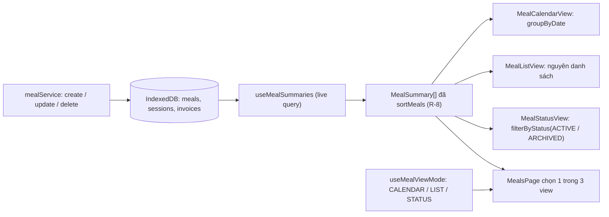
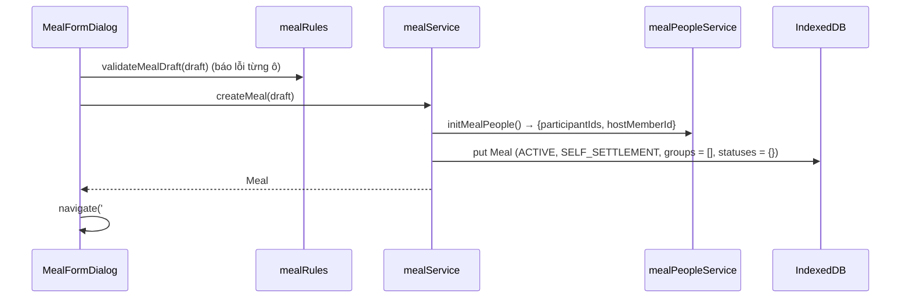
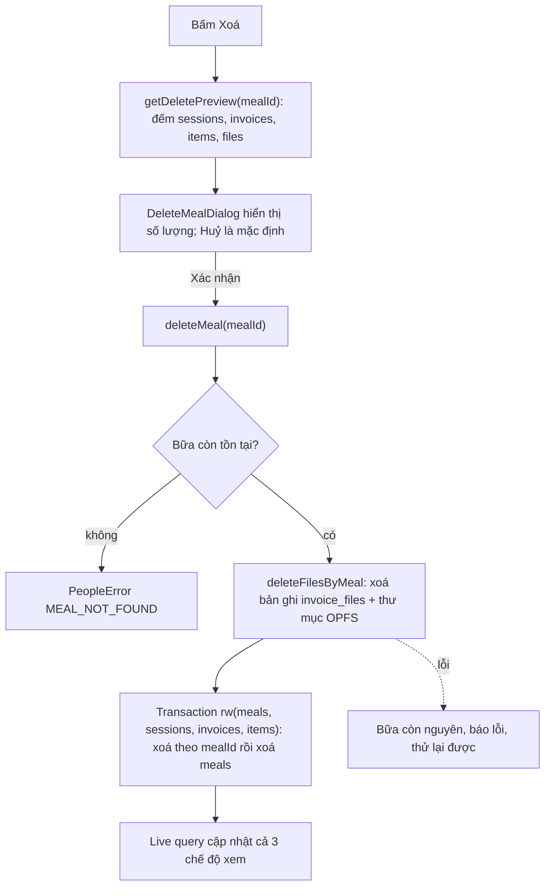
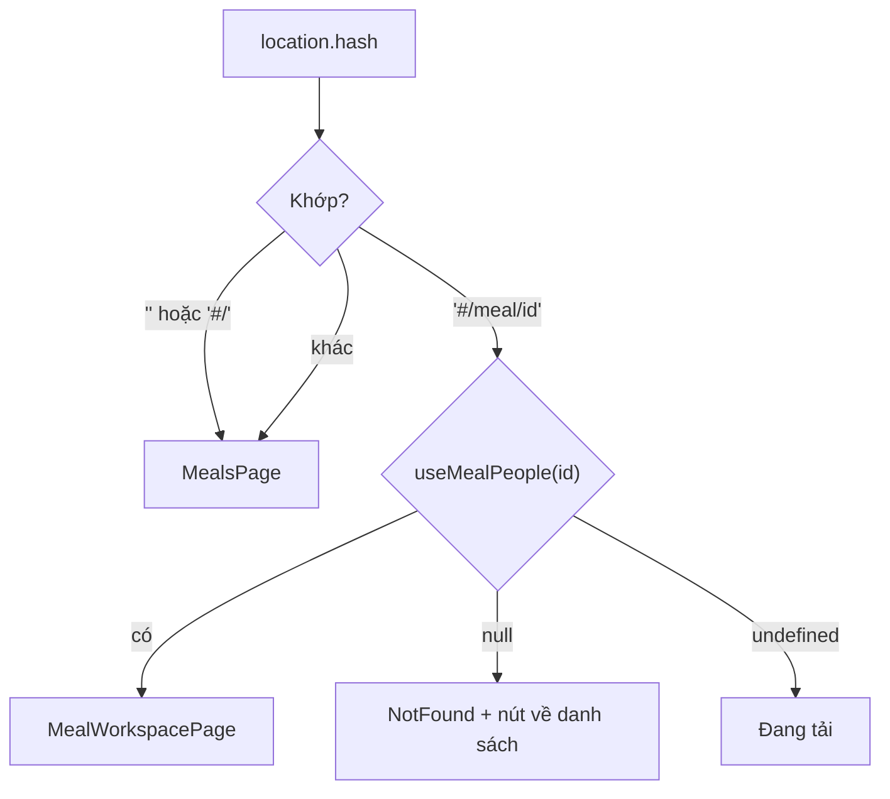

# Epic 3 — System Analysis (SA)

**Epic 3**: Hệ thống Quản lý Bữa (CRUD & 3 Chế độ Xem: Lịch, Danh sách, Loại) · **Trạng thái**: đã triển khai (code tại `app/`); build, lint và 174 test tự động đạt; kiểm thủ công trên trình duyệt mới làm một phần, xem B.9–B.10

Tài liệu đi cùng: [BR](./BR.md) · [Kiến trúc & Data model](../01-architecture-and-data-model.md) · [Nghiệp vụ](../02-business-logic-and-algorithms.md) · [UI §4.1–4.2](../03-ui-ux-and-design-system.md) · [Epic 2 SA](../epic-2/SA.md)

---

### B.1. Công nghệ
Dùng lại stack hiện có: React 19 · TypeScript · Tailwind · Dexie 4 + `dexie-react-hooks` · lucide-react · Vitest + fake-indexeddb + jsdom + Testing Library. **Không thêm thư viện nào** (kể cả thư viện router và lịch):

- **Điều hướng**: hash routing tự viết (~40 dòng, hook `useHashRoute`) vì chỉ có hai màn hình. `#/…` tránh xung đột với tham số `?snapshot=` của Epic 8 và không cần cấu hình máy chủ (PWA tĩnh).
- **Lịch**: tự dựng lưới tháng bằng hàm thuần `buildMonthGrid`; tránh thư viện lịch nặng và khó chỉnh theo giao diện USD.
- **Ngày**: dùng chuỗi `YYYY-MM-DD` (đúng `Meal.date`) và `Date` cục bộ; **không** dùng `toISOString().slice(0,10)` cho ngày (lệch UTC; `PeopleSandbox` hiện làm vậy, sẽ bị xoá).
- **Định dạng**: `Intl.NumberFormat('vi-VN')` cho tiền, hàm tự viết cho ngày `dd/mm/yyyy` và thứ trong tuần.
- **Modal**: phần tử `<dialog>` gốc (`showModal()` cho sẵn focus trap, `Esc`, lớp phủ). jsdom chưa hỗ trợ đầy đủ `showModal`; test sẽ bổ sung polyfill nhỏ trong file setup (xem B.8).

### B.2. Cấu trúc mã nguồn

```text
app/src/
├─ types/index.ts                     # THÊM MealSummary, MealViewMode (không đổi interface đã có)
├─ db/db.ts                           # không đổi (không nâng version schema)
├─ lib/
│  ├─ dates.ts                        # MỚI: todayLocal, isValidYmd, formatDateVi, buildMonthGrid, shiftMonth, weekdayLabels
│  ├─ dates.test.ts                   # gồm cả test formatMoney
│  └─ money.ts                        # MỚI: formatMoney
├─ domain/
│  ├─ mealRules.ts                    # MỚI, THUẦN: cleanMealTitle, defaultMealTitle, validateMealDraft, sortMeals,
│  │                                  #   groupByDate, paymentEntities, summarizeMeal, filterByStatus
│  └─ mealRules.test.ts
├─ services/
│  ├─ peopleErrors.ts                 # THÊM mã INVALID_TITLE, INVALID_DATE, INVALID_NOTE
│  ├─ mealService.ts                  # MỚI: createMeal, updateMealInfo, getDeletePreview, deleteMeal
│  └─ mealService.test.ts
├─ hooks/
│  ├─ useMealSummaries.ts             # MỚI: MealSummary[] đã xếp (useLiveQuery trên meals/sessions/invoices)
│  ├─ useHashRoute.ts                 # MỚI: route hiện tại + navigate()
│  ├─ useMealViewMode.ts              # MỚI: chế độ xem + lưu localStorage (try/catch)
│  └─ useMealPeople.ts                # không đổi
├─ components/
│  ├─ ui/
│  │  ├─ Modal.tsx                    # MỚI: <dialog> có tiêu đề, đóng bằng Esc, trả focus
│  │  ├─ ConfirmDialog.tsx            # MỚI: xác nhận, Huỷ là mặc định (R-7, BR-3.12)
│  │  └─ Modal.test.tsx
│  ├─ meals/
│  │  ├─ MealViewSwitcher.tsx         # MỚI: 3 tab chế độ xem (role="tablist")
│  │  ├─ MealCard.tsx                 # MỚI: thẻ bữa dùng chung cho List/Status/khung ngày
│  │  ├─ MealCalendarView.tsx         # MỚI: lưới lịch + khung bữa trong ngày
│  │  ├─ MealListView.tsx             # MỚI
│  │  ├─ MealStatusView.tsx           # MỚI
│  │  ├─ MealFormDialog.tsx           # MỚI: tạo / sửa (dùng chung)
│  │  ├─ DeleteMealDialog.tsx         # MỚI: xác nhận kèm số lượng sẽ mất
│  │  └─ *.test.tsx                   # test component (mục B.9)
│  ├─ profile/MyProfileDialog.tsx     # MỚI: đổi tên "Tôi" (chuyển từ HostNameEditor của PeopleSandbox)
│  └─ people/                         # SỬA nhỏ: ParticipantList, PaymentGroupPanel, PaymentGroupDialog
│                                     #   thay window.confirm bằng ConfirmDialog (BR-3.12)
├─ pages/
│  ├─ MealsPage.tsx                   # MỚI: tiêu đề + switcher + 1 trong 3 view + nút "+ Tạo bữa"
│  ├─ MealWorkspacePage.tsx           # MỚI: thanh đầu bữa + Khu vực 1 (Epic 2) + ô giữ chỗ Khu vực 2, 3
│  └─ PeopleSandbox.tsx               # XOÁ (Epic 2 đã hẹn Epic 3 thay thế)
└─ App.tsx                            # SỬA: header + chọn trang theo route + nút Hồ sơ của tôi
```

### B.3. Thành phần & trách nhiệm

| Thành phần | Trách nhiệm | Phụ thuộc |
| :--- | :--- | :--- |
| `lib/dates` | Mọi phép tính ngày thuần: kiểm tra `YYYY-MM-DD` có thật (R-2), hôm nay theo giờ địa phương, định dạng hiển thị, dựng lưới tháng tuần bắt đầu Thứ 2 (R-12), cộng/trừ tháng | không |
| `lib/money` | `formatMoney(n)` → `1.620.000 ₫`, số nguyên VNĐ | `Intl` |
| `domain/mealRules` | Chuẩn hoá và kiểm hợp lệ tên/ngày/ghi chú (R-1…R-3), thứ tự bữa (R-8), thực thể thanh toán và tiến độ (R-10), tóm tắt bữa từ dữ liệu thô (R-9, R-11), gom bữa theo ngày cho lịch. **Không chạm DB** | `lib/dates`, `services/peopleErrors` |
| `mealService` | Vòng đời bữa: tạo (R-4), sửa (R-5), xem trước dữ liệu bị xoá (R-7), xoá dây chuyền (R-6). Mỗi hàm ghi là một transaction trừ phần xoá file | `db`, `mealPeopleService.initMealPeople`, `fileStorageService.deleteFilesByMeal`, `mealRules` |
| `useMealSummaries` | Đọc `meals`, đếm `sessions`, cộng `invoices.totalAmount` theo bữa trong **một** live query, trả `MealSummary[]` đã `sortMeals`. Là **nguồn duy nhất** cho cả ba chế độ xem (BR-3.7, BR-3.8) | `db`, `mealRules` |
| `useHashRoute` | Phân tích `location.hash` thành `{ name: 'home' } \| { name: 'meal', id } \| { name: 'notFound' }`, `navigate(path)`, lắng nghe `hashchange` | không |
| `useMealViewMode` | Đọc/ghi `usd-split.mealView` trong `localStorage` bọc try/catch; mặc định `LIST` (R-16) | không |
| `Modal` / `ConfirmDialog` | Hộp thoại dùng chung: tiêu đề có nhãn ARIA, `Esc` đóng, trả focus về nút gọi, nút Huỷ focus mặc định | `<dialog>` |
| `MealCalendarView` | Lưới lịch, chọn ngày, khung bữa trong ngày, nút "+ Tạo bữa mới cho ngày này" | `buildMonthGrid`, `groupByDate`, `MealCard` |
| `MealListView`, `MealStatusView` | Danh sách thẻ theo R-8; tab theo R-15 | `MealCard` |
| `MealCard` | Hiển thị tóm tắt (ngày, tên, huy hiệu trạng thái, số kèo, số người, tổng tiền, tiến độ) và nút Mở / Xoá | `formatMoney`, `formatDateVi` |
| `MealFormDialog` | Form tạo/sửa; kiểm tra bằng `validateMealDraft` để báo lỗi từng ô trước khi gọi service; nhận `initialDate` | `mealService` |
| `DeleteMealDialog` | Gọi `getDeletePreview` hiển thị số lượng, rồi `deleteMeal` | `mealService` |
| `MealWorkspacePage` | Dùng `useMealPeople(id)`; bố cục UI §4.2; Khu vực 1 gắn `MemberQuickFilter`, `ParticipantList`, `HostSelector`, `PaymentGroupPanel` (props như `PeopleSandbox` cũ); `readOnly` khi `ARCHIVED` | Epic 2, `useMembers` |
| `MyProfileDialog` | Đổi tên hồ sơ "Tôi" qua `renameMember` | `memberService` |

Quy ước giữ nguyên Epic 2: component chỉ đọc DB qua hook và chỉ ghi qua service; không gọi `db` trực tiếp trong component.

### B.4. Thiết kế dữ liệu

**Không đổi schema, không nâng version Dexie.** `Meal` (file 01 §3.2) đã đủ trường; các index `meals.date`, `meals.status`, `sessions.mealId`, `invoices.mealId`, `items.mealId`, `invoice_files.mealId` đã có từ Epic 1 và đủ cho xoá dây chuyền. Lọc/gom bữa chạy trong bộ nhớ vì số bữa nhỏ (mục tiêu 1.000 bữa, B.7).

Kiểu thêm vào `types/index.ts` (chỉ kiểu hiển thị, không lưu DB):

```typescript
export type MealViewMode = 'CALENDAR' | 'LIST' | 'STATUS';

export interface MealSummary {
  meal: Meal;
  sessionCount: number;      // R-11
  participantCount: number;  // R-11
  totalAmount: number;       // R-9 (0 nếu chưa có chi phí)
  hasCost: boolean;          // false → hiển thị "Chưa có chi phí"
  paidCount: number;         // R-10
  entityCount: number;       // R-10
}
```

Bất biến cho mọi `Meal` do Epic 3 tạo, cộng thêm với I-1…I-6 của Epic 2:

| # | Bất biến |
| :-: | :--- |
| I-E3-1 | `title` đã qua `cleanMealTitle`, độ dài 1–100 (sau khi áp tên mặc định); `date` là `YYYY-MM-DD` hợp lệ trong [2000-01-01, 2099-12-31]; `note` hoặc vắng mặt hoặc 1–500 ký tự |
| I-E3-2 | Sau `deleteMeal`: không còn bản ghi nào có `mealId` đó ở `sessions`, `invoices`, `items`, `invoice_files`, và không còn thư mục OPFS `/invoices/<mealId>` |
`localStorage`: khoá `usd-split.mealView` ∈ `CALENDAR | LIST | STATUS`. Giá trị lạ → dùng mặc định. Đây là tiện ích theo thiết bị, không phải dữ liệu nghiệp vụ nên không đưa vào `settings` và không cần nâng schema.

### B.5. Luồng xử lý chính

**Dữ liệu chảy từ DB đến ba chế độ xem (BR-3.7)**


**Tạo bữa**


**Xoá bữa dây chuyền (R-6)**

Lý do xoá file trước: nếu xoá DB trước rồi xoá file lỗi thì file OPFS thành "mồ côi" không còn bản ghi nào trỏ tới để dọn. Xoá file trước thì tệ nhất là bữa mất ảnh nhưng còn nguyên để thử xoá lại.

**Điều hướng**


**Dựng lưới lịch (R-12)**: `buildMonthGrid(year, month)` lấy ngày 1 của tháng, lùi về Thứ 2 gần nhất làm ô đầu, sinh tuần liên tiếp cho đến khi phủ hết ngày cuối tháng; mỗi ô `{ ymd, day, inMonth, isToday }`. Tất cả tính bằng thành phần năm/tháng/ngày của `Date` cục bộ rồi định dạng thủ công thành `YYYY-MM-DD`.

### B.6. Giao diện lập trình nội bộ

**Lỗi**: dùng lại `PeopleError` của Epic 2 để UI chỉ cần một bộ xử lý lỗi; thêm 3 mã:

| `code` | Khi nào |
| :--- | :--- |
| `INVALID_TITLE` | Tên bữa quá 100 ký tự (tên rỗng **không** lỗi vì có tên mặc định, R-1) |
| `INVALID_DATE` | Ngày không đúng `YYYY-MM-DD`, không có thật, hoặc ngoài [2000-01-01, 2099-12-31] (R-2) |
| `INVALID_NOTE` | Ghi chú quá 500 ký tự (R-3) |

`MEAL_NOT_FOUND`, `MEAL_ARCHIVED` đã có. Mọi hàm ghi trong B.6 chạy trong transaction và không ghi gì nếu ném lỗi (trừ `deleteMeal`, xem R-6).

**`lib/dates.ts`** (thuần)

| Hàm | Mô tả |
| :--- | :--- |
| `todayLocal(now = new Date()): string` | `YYYY-MM-DD` theo giờ địa phương |
| `isValidYmd(s: string): boolean` | Đúng định dạng `^\d{4}-\d{2}-\d{2}$` và là ngày có thật (kiểm bằng cách dựng `Date` rồi so lại các thành phần); không kiểm khoảng |
| `formatDateVi(ymd): string` | `19/10/2026` |
| `buildMonthGrid(year, month): CalendarDay[]` | Lưới tuần bắt đầu Thứ 2; `month` 1–12 |
| `shiftMonth(year, month, delta): {year, month}` | Cộng/trừ tháng, qua năm đúng |
| `WEEKDAY_LABELS` | `['T2','T3','T4','T5','T6','T7','CN']` |

**`domain/mealRules.ts`** (thuần)

| Hàm | Mô tả |
| :--- | :--- |
| `cleanMealTitle(raw): string` | R-1: trim, gộp khoảng trắng, bỏ ký tự điều khiển; **không** đổi hoa/thường |
| `defaultMealTitle(ymd): string` | `Bữa 19/10/2026` |
| `validateMealDraft(draft: { title: string; date: string; note?: string }): { title: string; date: string; note?: string }` | Trả bản đã chuẩn hoá (tên mặc định nếu rỗng, `note` bỏ nếu rỗng); ném `INVALID_TITLE` / `INVALID_DATE` / `INVALID_NOTE`. UI dùng để báo lỗi từng ô trước khi lưu |
| `sortMeals<T extends { date: string; createdAt: string }>(items: T[]): T[]` | R-8; trả mảng mới |
| `groupByDate(summaries): Map<string, MealSummary[]>` | Cho lịch; mỗi nhóm giữ thứ tự R-8 |
| `paymentEntities(meal): string[]` | R-10: `paymentGroups.map(id)` cộng các `participantIds` chưa thuộc nhóm nào |
| `summarizeMeal({ meal, sessionCount, invoices }): MealSummary` | R-9…R-11. `ACTIVE`: `totalAmount = Σ invoice.totalAmount`, `hasCost = invoices.length > 0`; `ARCHIVED`: từ `archivedSummary` (`hasCost = archivedSummary !== undefined`). Tiến độ đếm `isPaid` theo `settlementStatuses` hoặc `entitiesSummary` |

**`services/mealService.ts`**

| Hàm | Mô tả |
| :--- | :--- |
| `createMeal(draft: MealDraft, now = new Date()): Promise<Meal>` | `validateMealDraft`, `initMealPeople()`, `put` bản ghi R-4 trong một transaction; trả `Meal` |
| `updateMealInfo(mealId, draft): Promise<Meal>` | Đọc bữa; `MEAL_NOT_FOUND` / `MEAL_ARCHIVED`; áp `validateMealDraft`; chỉ ghi `title`, `date`, `note`, `updatedAt` (không đụng trường khác) |
| `getDeletePreview(mealId): Promise<{ sessions: number; invoices: number; items: number; files: number }>` | Đếm theo index `mealId`; `MEAL_NOT_FOUND` nếu không có bữa |
| `deleteMeal(mealId): Promise<void>` | Luồng B.5. Cho phép cả `ACTIVE` lẫn `ARCHIVED`. Thành viên danh bạ không bị đụng |

**Hook**

| Hook | Trả về |
| :--- | :--- |
| `useMealSummaries()` | `MealSummary[]` đã `sortMeals`; `undefined` khi đang tải. Live query một lần đọc `meals`, `sessions` (đếm theo `mealId`), `invoices` (cộng theo `mealId`) |
| `useHashRoute()` | `{ route, navigate(path: string): void }` |
| `useMealViewMode()` | `[mode: MealViewMode, setMode]`; ghi `localStorage` trong try/catch |

**Component chính**

| Component | Props | Hành vi |
| :--- | :--- | :--- |
| `Modal` | `open`, `title`, `onClose`, `children` | `<dialog>`; `showModal()` khi `open`; `Esc`/nút đóng gọi `onClose`; trả focus về phần tử đã mở |
| `ConfirmDialog` | `open`, `title`, `message`, `confirmLabel`, `tone?: 'danger'`, `onConfirm`, `onCancel` | Nút Huỷ được focus mặc định (R-7); `onConfirm` có thể async, hiện trạng thái đang xử lý và lỗi |
| `MealCard` | `summary`, `onOpen`, `onDelete` | Huy hiệu `Đang hoạt động` (`badge-active`) / `Đã lưu trữ` (vàng `usd-gold-600`, icon khoá); số tiền dùng lớp `money` |
| `MealCalendarView` | `summaries`, `onCreateForDate(ymd)`, `onOpen`, `onDelete` | State cục bộ: `year`, `month`, `selectedYmd` (mặc định hôm nay); R-12…R-14 |
| `MealListView` | `summaries`, `onOpen`, `onDelete` | R-8, R-18 (trạng thái rỗng) |
| `MealStatusView` | `summaries`, `onOpen`, `onDelete` | R-15; `role="tablist"` |
| `MealFormDialog` | `mode: 'create' \| 'edit'`, `meal?`, `initialDate?`, `onClose`, `onSaved(meal)` | Ô Tên (placeholder là tên mặc định), ô Ngày (`<input type="date">` min/max theo R-2), ô Ghi chú; lỗi hiển thị dạng text cạnh ô |
| `DeleteMealDialog` | `mealId`, `title`, `date`, `onClose`, `onDeleted` | Tải preview rồi hiện câu "Sẽ xoá vĩnh viễn: n kèo, n hoá đơn, n món, n file ảnh. Không thể hoàn tác." |
| `MealWorkspacePage` | `mealId` | UI §4.2: thanh đầu + Khu vực 1 (khối Epic 2) + hai ô giữ chỗ "Danh sách Kèo — sẽ có ở Epic 4" và "Bảng quyết toán — sẽ có ở Epic 6"; không có nút Lưu trữ (Epic 7) |

Giao diện tuân [03 §2–4](../03-ui-ux-and-design-system.md): header `usd-green-900` + đường vàng, thẻ giấy `.card`, nút `btn-primary` / `btn-secondary` / `btn-danger`, số tiền font tabular; các nút và ô nhập cao tối thiểu 44 px; không dùng màu làm tín hiệu duy nhất (trạng thái luôn kèm chữ).

### B.7. Yêu cầu phi chức năng

| Nhóm | Yêu cầu |
| :--- | :--- |
| Bền vững | Tạo/sửa là một transaction; F5 không mất bữa; chế độ xem được nhớ (R-16) |
| Hiệu năng | Với 1.000 bữa, tính `MealSummary` và dựng một chế độ xem < 50 ms; ô lịch chỉ render bữa của đúng 35–42 ngày hiển thị (lọc bằng `groupByDate`, không lọc lại từng ô) |
| Tương thích | `<dialog>`, `Intl` và `localStorage` có sẵn ở Safari/Chrome/Firefox hiện hành; không dùng API mới hơn; `<input type="date">` rơi về ô văn bản `YYYY-MM-DD` nếu trình duyệt không hỗ trợ (R-2 vẫn kiểm) |
| Khả dụng | Điều khiển hoàn toàn bằng bàn phím: tab chế độ xem dùng `←/→`; lưới lịch là `role="grid"` với `↑↓←→` đổi ngày chọn, `Enter` chọn; hộp thoại `Esc` đóng; trạng thái hiển thị bằng chữ + biểu tượng; vùng chạm ≥ 44 px; không cuộn ngang ở 375 px |
| Bảo mật/riêng tư | Dữ liệu chỉ lưu cục bộ; tên/ghi chú hiển thị qua React (tự thoát HTML), không `dangerouslySetInnerHTML`; hash route chỉ nhận `id` dạng UUID, giá trị lạ → `notFound` |
| Bảo trì | Mọi quyết định (kiểm hợp lệ, sắp xếp, tóm tắt, lưới ngày) nằm ở `domain/` và `lib/` thuần, component chỉ ghép nối |

### B.8. Rủi ro, hạn chế & câu hỏi mở

| Mục | Mô tả | Hướng xử lý |
| :--- | :--- | :--- |
| Múi giờ | `Meal.date` là chuỗi ngày cục bộ; thiết bị đổi múi giờ thì "hôm nay" đổi, ngày của bữa cũ không đổi | Chấp nhận (đúng bản chất "bữa theo ngày"); không dùng UTC cho ngày; có test `todayLocal` với giờ sát nửa đêm |
| Tổng tiền/tiến độ chưa có dữ liệu thật | Hoá đơn (Epic 4), tick thanh toán (Epic 6), `archivedSummary` (Epic 7) chưa có | Công thức R-9, R-10 kiểm bằng dữ liệu giả lập ghi trực tiếp vào bảng; kiểm lại bằng dữ liệu thật khi Epic 4–7 xong (ghi vào B.10) |
| Tiến độ thanh toán thô | Đếm cả thực thể số dư 0 (R-10) | Epic 6 tinh chỉnh `paymentEntities`/`summarizeMeal`; đã ghi hạn chế trong BR |
| Đọc toàn bộ `sessions`/`invoices` | `useMealSummaries` quét hai bảng đầy đủ | Ổn với quy mô cá nhân; nếu chậm thì thêm đếm/tổng vào `Meal` (cần nâng schema) hoặc đọc theo `mealId` của tháng đang xem |
| Dùng lại `PeopleError` cho lỗi bữa | Tên lớp lệch nghĩa ("People") | Chấp nhận để UI có một bộ xử lý lỗi; đổi tên thành `AppError` là việc dọn dẹp riêng nếu muốn |
| jsdom và `<dialog>` | jsdom chưa cài đủ `showModal()`/`close()` | Bổ sung polyfill tối giản trong setup của Vitest; nếu vẫn khó thì `Modal` rơi về `div role="dialog"` trong môi trường test. Kiểm bàn phím thật trên trình duyệt (B.10) |
| Bữa nháp Epic 2 còn lại | Người dùng đã chạy Epic 2 có bữa `Bữa thử nghiệm (Epic 2)` trong IndexedDB | R-19: coi như bữa thường, người dùng tự xoá |
| Hash route và Epic 8 | Snapshot dùng `?snapshot=` hoặc `#/snapshot/<chuỗi>` (file 01 §3.7) | `useHashRoute` chừa nhánh `snapshot` để Epic 8 mở rộng; nếu Epic 8 chọn `#/snapshot/…` thì thêm một route, không phải đổi cấu trúc |
| `localStorage` bị chặn | Chế độ riêng tư / chặn dữ liệu site | try/catch, rơi về mặc định (R-16) |
| Kiểm thủ công | Chưa thực hiện vì chưa có code | B.10 |

**Người tham gia từng kèo (yêu cầu bổ sung của anh)**: mỗi kèo có `participantIds` riêng ⊆ người trong bữa và chia tiền chỉ tính trên họ. Thay đổi dữ liệu chung đã ghi ở [01 §3.3](../01-architecture-and-data-model.md), [02 §1.0](../02-business-logic-and-algorithms.md), [03 §4.2](../03-ui-ux-and-design-system.md), [04](../04-epics-and-roadmap.md) (US-4.1b). Tác động tới Epic 3: kiểu `SessionKeo` thêm trường (không đổi schema Dexie vì không có index mới); `deleteMeal` xoá kèo nên danh sách người đi theo; `removeParticipant` tự gỡ người khỏi các kèo (Epic 2 R-12e, đã code + 2 test). UI chọn người tham gia kèo, kiểm tra payer/consumer/equalSplit ⊆ kèo là việc của Epic 4–5. Giả định em đã chọn: `equalSplitParticipantIds` của hoá đơn vẫn có thể tick bớt nhưng luôn ⊆ người tham gia kèo.

**Câu hỏi đã chốt** (anh xác nhận toàn bộ theo mặc định):

| Mã | Câu hỏi | Quyết định |
| :-: | :--- | :--- |
| Q-1 | Chế độ xem mặc định khi mở app lần đầu là gì? Spec thứ tự "Lịch, Danh sách, Loại" nhưng chưa nói mặc định | **Danh sách** (mới → cũ): hữu ích nhất trên di động, ít thao tác nhất; sau đó nhớ lựa chọn lần trước |
| Q-2 | Tạo bữa xong có chuyển thẳng vào màn chi tiết không? | **Có**, vì bước kế tiếp luôn là thêm người |
| Q-3 | Điều hướng bằng hash route tự viết, không thêm thư viện router? | **Có** (`#/` và `#/meal/<id>`), tránh thêm phụ thuộc cho 2 màn hình |
| Q-4 | Tên bữa để trống có tự đặt `Bữa dd/mm/yyyy` hay bắt buộc nhập? | **Tự đặt** (R-1) cho nhanh |
| Q-5 | Có cho tạo bữa ở ngày tương lai (bữa dự kiến) không? | **Có** (R-2) |
| Q-6 | Màn hình hẹp, ô lịch chỉ hiện chấm + số bữa, xem chi tiết ở khung bên dưới (R-12)? | **Có** |
| Q-7 | Thay toàn bộ `window.confirm` của Epic 2 bằng modal của app trong Epic này (BR-3.12)? | **Có**, Epic 2 đã hẹn việc này ở Epic 3 |
| Q-8 | Đổi tên hồ sơ "Tôi" đặt ở đâu khi bỏ `PeopleSandbox`? | Nút "Hồ sơ của tôi" trên header, mở hộp thoại nhỏ (BR-3.11) |
| Q-9 | Bữa nháp `Bữa thử nghiệm (Epic 2)` cũ có tự xoá không? | **Không tự xoá**, để người dùng quyết (R-19) |
| Q-10 | Chưa có nút "Lưu trữ bữa" ở Epic 3, nên không có cách tạo bữa `ARCHIVED` bằng giao diện để thử. Chấp nhận kiểm thử bữa lưu trữ bằng test tự động (ghi bản ghi `ARCHIVED` thẳng vào DB) và chờ Epic 7 để kiểm thủ công? | **Chấp nhận** |

### B.9. Ma trận truy vết kiểm thử

Kết quả chạy thật ngày 2026-10-19 trong `app/`: `npm run build` đạt; `npx oxlint` thoát mã 0; `npx vitest run` **174/174 đạt** (17 file; Epic 3 thêm 70 test, Epic 2 thêm 2 test cho R-12e, Epic 1–2 giữ nguyên 102 test, chạy lặp 5 lần không flaky). Kiểm thủ công trên dev server (trình duyệt trong app, cổng 5174, IndexedDB trống) chỉ ở các mục ghi rõ "trình duyệt".

| User Story | BR | Kiểm thử | Kết quả |
| :-: | :-: | :--- | :-: |
| US-3.1 | BR-3.1, 3.2 | `lib/dates.test.ts` (13 test, gồm cả `formatMoney`): `isValidYmd`/`isYmdInRange`, `todayLocal` sát nửa đêm (AC-14). `domain/mealRules.test.ts` (14): `cleanMealTitle`, tên mặc định, mọi nhánh `INVALID_*`. `services/mealService.test.ts` (11): `createMeal` đúng R-4 và host = "Tôi" (AC-3, AC-4), hai bữa độc lập; `updateMealInfo` chỉ đổi 3 trường + `updatedAt`, từ chối `ARCHIVED`/không tồn tại (AC-5). `pages/MealsPage.test.tsx`: tạo bữa qua giao diện rồi mở, lỗi từng ô khi ngày sai. `pages/MealWorkspacePage.test.tsx`: sửa thông tin | Đạt (tự động). Trình duyệt: tạo bữa bằng bàn phím, ngày mặc định hôm nay, tên mặc định hiện làm placeholder: đạt |
| US-3.1 | BR-3.3 | `mealService.test.ts`: `deleteMeal` xoá `sessions`, `invoices`, `items`, `invoice_files` của bữa, giữ nguyên bữa khác và `members` (AC-2); xoá bữa `ARCHIVED`; bữa không có con; `getDeletePreview` đếm đúng; `MEAL_NOT_FOUND`. `MealsPage.test.tsx`: hộp xác nhận nêu số kèo, Huỷ focus mặc định, Huỷ không xoá, xác nhận xoá | Đạt (tự động). Trình duyệt: xoá bằng bàn phím (`Esc` đóng và trả focus, `Tab`+`Enter` xoá), IndexedDB còn 0 bữa và nguyên 2 thành viên: đạt. **Chưa kiểm**: xoá file ảnh vật lý trong OPFS thật (chưa có hoá đơn/ảnh để thử), nhánh `deleteFilesByMeal` lỗi giữa chừng |
| US-3.1 | BR-3.9, 3.10, 3.11 | `MealWorkspacePage.test.tsx` (7): tiêu đề, chủ trì, tổng chi, khối Quick Filter; thêm người trong bữa thật (AC-10); bữa `ARCHIVED` chỉ đọc nhưng xoá được (AC-8); bữa không tồn tại hiện thông báo và nút về danh sách; `MyProfileDialog` đổi tên và từ chối tên trùng (AC-11) | Đạt (tự động). Trình duyệt: mở `#/meal/<id>`, thêm "Bình", F5 vẫn còn bữa và người (AC-9, AC-4 của Epic 2): đạt. **Chưa kiểm trong trình duyệt**: đổi tên "Tôi", đường dẫn tới bữa không tồn tại |
| US-3.1 | BR-3.12 | `components/ui/Modal.test.tsx` (6): `Esc`/nút Đóng, trả focus, Huỷ focus mặc định, lỗi từ `onConfirm` hiện trong hộp. `MealWorkspacePage.test.tsx`: bỏ người đã tick thanh toán dùng `ConfirmDialog` và không gọi `window.confirm` (AC-12). Test Epic 2 không phải sửa vì không test nhánh `window.confirm` | Đạt (tự động). Trình duyệt: `<dialog>` modal thật (`:modal` đúng), Huỷ focus mặc định, `Esc` đóng: đạt |
| US-3.2 | BR-3.4 | `dates.test.ts`: `buildMonthGrid` (bắt đầu Thứ 2, 4/5/6 hàng, tháng 2 nhuận), `shiftMonth` qua năm. `MealsPage.test.tsx`: đánh dấu ngày có bữa kèm tên, khung ngày liệt kê cả bữa lưu trữ, "Tạo bữa mới cho ngày này" điền sẵn ngày, đổi tháng và "Hôm nay", phím mũi tên đổi ngày (AC-6) | Đạt (tự động). Trình duyệt: lưới tháng 10/2026 đúng (19/10 là Thứ 2, ô có nhãn bữa, tô ngày chọn), bản 375 px hiện chấm số bữa: đạt. **Chưa kiểm trong trình duyệt**: đổi tháng/năm, tạo bữa từ ngày chọn |
| US-3.3 | BR-3.5, 3.8 | `mealRules.test.ts`: `sortMeals` (mới → cũ, cùng ngày theo `createdAt`), `summarizeMeal` (R-9…R-11, gồm bữa lưu trữ), `paymentEntities`. `MealsPage.test.tsx`: thứ tự thẻ và các trường (AC-7), trạng thái rỗng | Đạt (tự động). Tổng tiền và tiến độ mới kiểm bằng dữ liệu giả lập vì chưa có hoá đơn thật |
| US-3.4 | BR-3.6, 3.10 | `MealsPage.test.tsx`: tab Đang hoạt động/Đã lưu trữ kèm số đếm, bữa lưu trữ có Xoá và không có Sửa, tab lưu trữ rỗng có lời giải thích (AC-8) | Đạt (tự động). Trình duyệt: tab "Đang hoạt động (1) / Đã lưu trữ (0)" ở 375 px: đạt. Chưa có bữa `ARCHIVED` thật để thử trong trình duyệt (cần Epic 7) |
| US-3.2–3.4 | BR-3.7 | `MealsPage.test.tsx`: tạo/đổi tên bữa ở nền thì cả ba chế độ cập nhật ngay (AC-1); chế độ xem được nhớ sau khi mở lại (AC-9). `hooks/viewHooks.test.ts` (6): `parseRoute` (giá trị lạ → danh sách), `readViewMode` mặc định `LIST` và chịu được `localStorage` ném lỗi | Đạt (tự động). Trình duyệt: chọn Lịch, F5 vẫn ở Lịch: đạt |
| Epic 2 R-12e | BR-2.10 | `mealPeopleService.test.ts` (+2): bỏ người gỡ họ khỏi `participantIds` mọi kèo của bữa đó, không đụng kèo bữa khác; bị chặn bởi hoá đơn thì danh sách kèo giữ nguyên | Đạt (tự động) |
| Cả 4 US | tất cả | `npm run build`, `npx oxlint`, `npx vitest run` toàn bộ | Đạt: build thành công, lint mã 0, 174/174 test |
| AC-13 | phi chức năng | Trình duyệt 375 px trên trang Lịch và Loại: không cuộn ngang (`scrollWidth` = 375), không có nút/ô nào thấp hơn 44 px; sửa nhãn tab "Danh sách" bị xuống dòng | Đạt cho hai trang này. **Chưa kiểm** ở 375 px: màn chi tiết bữa, các hộp thoại tạo/sửa |

### B.10. Việc còn lại để đóng Epic
1. **Kiểm thủ công còn thiếu** (xem cột Kết quả B.9): đổi tháng/năm và tạo bữa từ ngày chọn trên Lịch; sửa thông tin bữa và đổi tên "Tôi" trong trình duyệt; đường dẫn tới bữa không tồn tại; màn chi tiết và hộp thoại ở 375 px; điều khiển Lịch hoàn toàn bằng bàn phím; Safari/Firefox (mới chỉ chạy trình duyệt trong app).
2. **Chờ Epic khác để kiểm bằng dữ liệu thật**: xoá bữa có hoá đơn và ảnh thật kèm file OPFS vật lý (Epic 4), tổng tiền và tiến độ thanh toán (Epic 4, 6), bữa `ARCHIVED` thật (Epic 7). Nhánh lỗi giữa chừng của `deleteFilesByMeal` chưa có test.
3. Test `MealsPage` kiểm trực tiếp qua giao diện; chưa có test riêng cho từng component (`MealCard`, `MealCalendarView`…) và test riêng `MyProfileDialog` ngoài một ca trong `MealWorkspacePage.test.tsx`. Chấp nhận vì đã phủ qua trang; bổ sung nếu component bị tách ra dùng chỗ khác.
4. Dọn tài liệu khi đóng: đánh dấu việc bàn giao Epic 2 #6 đã xong (dùng `initMealPeople()`, thay `PeopleSandbox`, thay `window.confirm`) và ghi chú ở Epic 1 BR R-4 về `normalizedName` (việc Epic 2 còn nợ).
5. Bàn giao: **Epic 4** thêm Kèo vào Khu vực 2, kèm chọn người tham gia từng kèo (`SessionKeo.participantIds`, mặc định cả bữa, US-4.1b) và kiểm tra payer/consumer/equalSplit ⊆ người trong kèo; **Epic 6** gắn Quyết toán vào Khu vực 3 và tinh chỉnh `paymentEntities`; **Epic 7** thêm nút Lưu trữ và ghi `archivedSummary`; **Epic 8** thêm route snapshot vào `useHashRoute`.
