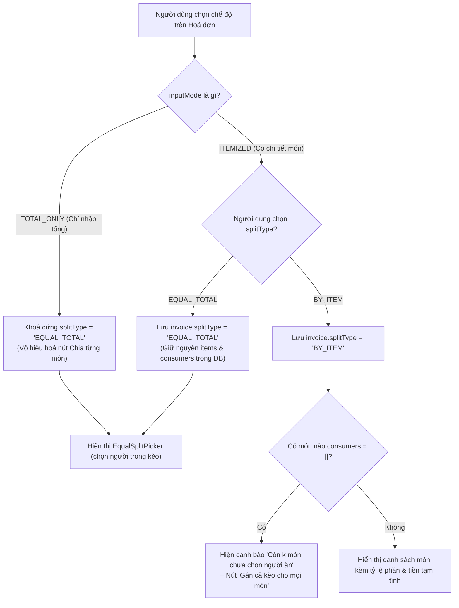
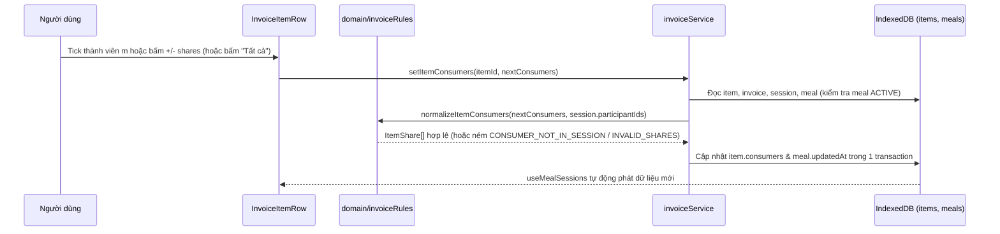
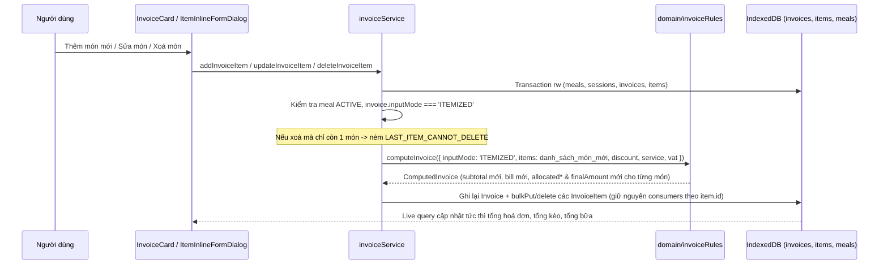

# Epic 5 — System Analysis (SA)

**Epic 5**: Quản lý Món (Tầng 3), Chế độ Chia tiền (Chia từng món / Chia tổng) & Người ứng tiền · **Trạng thái**: Đã triển khai (còn kiểm thủ công trên trình duyệt ở 375 px trước khi đóng)

Tài liệu đi cùng: [BR](./BR.md) · [Kiến trúc & Data model](../01-architecture-and-data-model.md) · [Nghiệp vụ §1–2](../02-business-logic-and-algorithms.md) · [UI §4.2, §4.4](../03-ui-ux-and-design-system.md) · [Epic 4 SA](../epic-4/SA.md)

---

### B.1. Công nghệ / thư viện sử dụng
Dùng lại toàn bộ stack hiện có: React 19 · TypeScript · Tailwind CSS (hệ màu USD Green) · Dexie 4 + `dexie-react-hooks` · `lucide-react` · Vitest + `fake-indexeddb` + jsdom + Testing Library. **Không thêm bất kỳ thư viện mới nào.**

- **Tính toán phân bổ tiền món**: Tái sử dụng `computeBill` và `allocateInvoiceItems` trong `domain/billMath.ts` cùng `computeInvoice` trong `domain/invoiceRules.ts` (đã xây dựng ở Epic 4).
- **Đồng bộ giao diện thời gian thực**: Hook `useMealSessions(mealId)` (Epic 4) đã trả về `SessionView[]` gồm `session`, `invoices: Array<{ invoice, items }>`, `total`, `hasCost` qua `useLiveQuery`; mọi cập nhật trên bảng `invoices` và `items` ở Epic 5 tự động phản ánh lên UI mà không cần state đệm ngoài DB.

### B.2. Cấu trúc mã nguồn

```text
app/src/
├─ types/index.ts                              # Không đổi (Invoice, InvoiceItem, ItemShare đã đủ trường)
├─ db/db.ts                                    # Không đổi (không nâng version schema Dexie)
├─ domain/
│  ├─ invoiceRules.ts                          # SỬA: bổ sung kiểm tra splitType, equalSplitParticipantIds,
│  │                                           #   consumers/shares (normalizeItemConsumers, validateEqualSplit,
│  │                                           #   previewItemConsumerShares, countUnassignedItems)
│  └─ invoiceRules.test.ts                     # SỬA: thêm unit test cho các quy tắc R-1…R-8, R-11 của Epic 5
├─ services/
│  ├─ peopleErrors.ts                          # SỬA: thêm mã SPLIT_TYPE_LOCKED, EQUAL_SPLIT_EMPTY,
│  │                                           #   SPLIT_MEMBER_NOT_IN_SESSION, CONSUMER_NOT_IN_SESSION,
│  │                                           #   INVALID_SHARES, ITEM_NOT_FOUND, LAST_ITEM_CANNOT_DELETE
│  ├─ invoiceService.ts                        # SỬA: mở rộng createInvoice/updateInvoice nhận splitType &
│  │                                           #   equalSplitParticipantIds; thêm setInvoicePayer,
│  │                                           #   setInvoiceSplitType, setEqualSplitParticipants,
│  │                                           #   addInvoiceItem, updateInvoiceItem, deleteInvoiceItem,
│  │                                           #   setItemConsumers, setAllItemsConsumers
│  └─ invoiceService.test.ts                   # SỬA: thêm test tích hợp cho toàn bộ hàm mới của Epic 5
├─ components/
│  ├─ sessions/
│  │  └─ SessionCard.tsx                       # SỬA: thay dòng hoá đơn rút gọn bằng <InvoiceCard/> mở rộng Tầng 3
│  └─ invoices/
│     ├─ InvoiceFormDialog.tsx                 # SỬA: cho phép chọn splitType (khoá khi TOTAL_ONLY) lúc tạo/sửa
│     ├─ InvoiceCard.tsx                       # MỚI: thẻ hoá đơn trong kèo (người ứng, chuyển chế độ chia,
│     │                                        #   chọn người chia đều hoặc danh sách món Tầng 3)
│     ├─ EqualSplitPicker.tsx                  # MỚI: chọn người chia đều (equalSplitParticipantIds ⊆ P_s)
│     ├─ InvoiceItemRow.tsx                    # MỚI: dòng món Tầng 3 + gán người ăn (tick + chỉnh shares) + sửa/xoá
│     ├─ ItemInlineFormDialog.tsx              # MỚI: hộp thoại nhỏ thêm / sửa nhanh 1 món sau khi lưu hoá đơn
│     └─ InvoiceCard.test.tsx                  # MỚI: test tương tác Tầng 3, chế độ chia, người ứng, gán người ăn
```

### B.3. Thành phần & trách nhiệm

| Thành phần | Trách nhiệm | Phụ thuộc |
| :--- | :--- | :--- |
| `domain/invoiceRules` | Hàm thuần kiểm tra ràng buộc `inputMode` ↔ `splitType` (R-2, R-3), kiểm tra `equalSplitParticipantIds` $\subseteq P_s$ (R-4), chuẩn hoá và kiểm tra `ItemShare[]` (`shares` nguyên dương, không trùng, $\subseteq P_s$, R-5), tính số tiền tạm tính mỗi người trên 1 món (R-11), đếm số món chưa có người ăn (R-6). **Không chạm DB/DOM** | `domain/billMath`, `lib/dates`, `services/peopleErrors` |
| `services/invoiceService` | Thực thi các giao dịch ghi nguyên tử cho hoá đơn và món: đổi người ứng (`setInvoicePayer`), đổi cách chia (`setInvoiceSplitType`), đổi danh sách chia đều (`setEqualSplitParticipants`), thêm/sửa/xoá món đơn lẻ kèm tính lại phân bổ toàn hoá đơn (`addInvoiceItem`, `updateInvoiceItem`, `deleteInvoiceItem`), cập nhật người ăn và số phần của một món hoặc toàn bộ món trong hoá đơn (`setItemConsumers`, `setAllItemsConsumers`) | `db`, `domain/invoiceRules`, `services/mealPeopleService` (`loadActiveMeal`), `services/peopleErrors` |
| `components/invoices/InvoiceCard` | Hiển thị chi tiết 1 hoá đơn trong `SessionCard`: chọn nhanh Người ứng tiền (BR-5.1), thanh chuyển chế độ `BY_ITEM` / `EQUAL_TOTAL` (khoá khi `TOTAL_ONLY`, BR-5.2, BR-5.4), cảnh báo số món chưa gán người ăn (BR-5.8), hiển thị `EqualSplitPicker` hoặc danh sách `InvoiceItemRow` + nút "+ Thêm món" | `services/invoiceService`, `EqualSplitPicker`, `InvoiceItemRow`, `ItemInlineFormDialog`, `ConfirmDialog` |
| `components/invoices/EqualSplitPicker` | Hiển thị các pill thành viên thuộc kèo ($P_s$) để tick/bỏ tick vào `equalSplitParticipantIds`, nút "Chọn tất cả ($|P_s|$)", và hiển thị số tiền tạm tính mỗi người ($T_{\text{invoice}} / N$) | `services/invoiceService`, `lib/money` |
| `components/invoices/InvoiceItemRow` | Hiển thị 1 món (tên, SL $\times$ đơn giá, điều chỉnh phân bổ, `finalAmount`); khi `splitType === 'BY_ITEM'` hiển thị bộ chọn người ăn (các pill thành viên trong kèo, nút "Tất cả", bộ tăng/giảm `shares` $- / +$ khi người đó được chọn, số tiền tạm tính của từng người); nút Sửa / Xoá món | `domain/invoiceRules`, `services/invoiceService`, `lib/money` |
| `components/invoices/ItemInlineFormDialog` | Modal thêm mới hoặc sửa một món (`name`, `quantity`, `unitPrice`, `rawAmount` tuỳ chọn) của hoá đơn `ITEMIZED` đã lưu | `Modal`, `services/invoiceService`, `lib/money` |
| `components/invoices/InvoiceFormDialog` | Mở rộng form tạo/sửa hoá đơn của Epic 4: hiển thị lựa chọn `splitType` (`BY_ITEM` / `EQUAL_TOTAL`), tự động chuyển và khoá ở `EQUAL_TOTAL` khi đang chọn tab `TOTAL_ONLY` | `Modal`, `services/invoiceService`, `domain/invoiceRules` |

### B.4. Thiết kế dữ liệu

**Không đổi schema, không nâng version Dexie, không đổi interface trong `types/index.ts`.**
Các bảng `invoices` và `items` cùng các kiểu `Invoice`, `InvoiceItem`, `ItemShare`, `InvoiceInputMode`, `InvoiceSplitType` đã được định nghĩa đầy đủ từ Epic 1 & Epic 4 ([01 §3.3–3.4](../01-architecture-and-data-model.md)).

Các bất biến dữ liệu (Invariants) do Epic 5 thiết lập và duy trì:

| Mã | Bất biến |
| :-: | :--- |
| **I-E5-1** | `invoice.payerMemberId ∈ session.participantIds` với mọi hoá đơn thuộc kèo `session`. |
| **I-E5-2** | `invoice.inputMode === 'TOTAL_ONLY' ⇒ invoice.splitType === 'EQUAL_TOTAL'` và số bản ghi `items` của `invoice.id` bằng `0`. |
| **I-E5-3** | `invoice.equalSplitParticipantIds ⊆ session.participantIds`, không có phần tử trùng, và `invoice.equalSplitParticipantIds.length >= 1`. |
| **I-E5-4** | Với mọi `item` thuộc `invoice`: `item.consumers` không có `memberId` trùng; mọi `c.memberId ∈ session.participantIds`; mọi `c.shares` là số nguyên thoả `1 <= c.shares <= 999`. |
| **I-E5-5** | Sau mọi thao tác thêm/sửa/xoá món đơn lẻ trên hoá đơn `ITEMIZED`, luôn có ít nhất 1 món, `orderIndex` liên tục `0..M-1`, và $\sum_{i} \text{finalAmount}_i = \text{invoice.totalAmount}$ tuyệt đối (R-7, R-8). |

### B.5. Luồng xử lý chính

**5.1. Chuyển đổi chế độ nhập & chế độ chia tiền (`inputMode` ↔ `splitType`)**


**5.2. Gán người ăn và điều chỉnh số phần (`shares`) cho món (US-5.4)**


**5.3. Thêm / Sửa / Xoá một món sau khi hoá đơn đã lưu (R-7, R-8)**


### B.6. Giao diện lập trình nội bộ

**Mã lỗi bổ sung vào `services/peopleErrors.ts` (`PeopleErrorCode`)**:

| `code` | Khi nào ném |
| :--- | :--- |
| `SPLIT_TYPE_LOCKED` | Đặt `splitType = 'BY_ITEM'` hoặc thao tác món đơn lẻ trên hoá đơn có `inputMode === 'TOTAL_ONLY'` (R-2) |
| `EQUAL_SPLIT_EMPTY` | Danh sách `equalSplitParticipantIds` rỗng (R-4) |
| `SPLIT_MEMBER_NOT_IN_SESSION` | Có ID trong `equalSplitParticipantIds` không thuộc `session.participantIds` (R-1, R-4) |
| `CONSUMER_NOT_IN_SESSION` | Có `memberId` trong `consumers` không thuộc `session.participantIds` (R-1, R-5) |
| `INVALID_SHARES` | `shares` không phải số nguyên hoặc $< 1$ hoặc $> 999$ (R-5) |
| `ITEM_NOT_FOUND` | Không tìm thấy `InvoiceItem` theo `itemId` |
| `LAST_ITEM_CANNOT_DELETE` | Xoá món duy nhất còn lại của một hoá đơn `ITEMIZED` (R-8) |

**Hàm thuần bổ sung vào `domain/invoiceRules.ts`**:

```ts
export const MAX_ITEM_SHARES = 999;

/** Kiểm tra ràng buộc inputMode và splitType (R-2, R-3). */
export function resolveSplitType(inputMode: InvoiceInputMode, requested?: InvoiceSplitType): InvoiceSplitType;

/** Kiểm tra và khử trùng lặp equalSplitParticipantIds ⊆ sessionParticipantIds (R-4). */
export function validateEqualSplit(
  equalSplitIds: string[],
  sessionParticipantIds: string[],
): string[];

/** Chuẩn hoá danh sách người ăn của 1 món: bỏ shares === 0, kiểm tra ⊆ sessionParticipantIds và 1 <= shares <= 999 (R-5). */
export function normalizeItemConsumers(
  consumers: ItemShare[],
  sessionParticipantIds: string[],
): ItemShare[];

/** Tính số tiền tạm tính (làm tròn đồng) và tổng số phần của từng người trên 1 món để hiển thị UI (R-11). */
export function previewItemConsumerShares(
  finalAmount: number,
  consumers: ItemShare[],
): Array<{ memberId: string; shares: number; totalShares: number; approxAmount: number }>;

/** Đếm số món chưa có người ăn khi hoá đơn ở chế độ BY_ITEM (R-6, BR-5.8). */
export function countUnassignedItems(
  splitType: InvoiceSplitType,
  items: ReadonlyArray<Pick<InvoiceItem, 'consumers'>>,
): number;
```

**Hàm dịch vụ bổ sung / mở rộng trong `services/invoiceService.ts`**:

```ts
// Mở rộng InvoiceDraft (tương thích ngược với Epic 4: nếu không truyền thì mặc định như cũ):
export interface InvoiceDraft extends InvoiceRulesDraft {
  id?: string;
  sessionId: string;
  payerMemberId: string;
  splitType?: InvoiceSplitType;               // Mặc định: 'EQUAL_TOTAL'
  equalSplitParticipantIds?: string[];        // Mặc định: session.participantIds
  autoNameSession?: boolean;
}

/** Đổi nhanh người ứng tiền của hoá đơn (BR-5.1, R-1). */
export function setInvoicePayer(invoiceId: string, payerMemberId: string): Promise<Invoice>;

/** Chuyển chế độ chia tiền BY_ITEM <-> EQUAL_TOTAL; từ chối nếu TOTAL_ONLY (BR-5.2, BR-5.4, R-2, R-3). */
export function setInvoiceSplitType(invoiceId: string, splitType: InvoiceSplitType): Promise<Invoice>;

/** Cập nhật danh sách người chia đều của hoá đơn (BR-5.5, R-4). */
export function setEqualSplitParticipants(invoiceId: string, memberIds: string[]): Promise<Invoice>;

/** Thêm 1 món vào cuối hoá đơn ITEMIZED và tính lại phân bổ toàn hoá đơn (BR-5.3, R-7). */
export function addInvoiceItem(
  invoiceId: string,
  itemDraft: Omit<ItemDraft, 'id'> & { consumers?: ItemShare[] },
): Promise<InvoiceResult>;

/** Sửa thông tin 1 món trong hoá đơn ITEMIZED (giữ nguyên consumers) và tính lại phân bổ (BR-5.3, R-7). */
export function updateInvoiceItem(
  itemId: string,
  patch: Omit<ItemDraft, 'id'>,
): Promise<InvoiceResult>;

/** Xoá 1 món khỏi hoá đơn ITEMIZED (chặn nếu là món cuối cùng) và tính lại phân bổ (BR-5.3, R-7, R-8). */
export function deleteInvoiceItem(itemId: string): Promise<InvoiceResult>;

/** Gán danh sách người ăn + số phần cho 1 món (BR-5.6, BR-5.7, R-5). */
export function setItemConsumers(itemId: string, consumers: ItemShare[]): Promise<InvoiceItem>;

/** Gán nhanh cùng một danh sách người ăn (shares = 1) cho mọi món (hoặc chỉ các món đang trống) của hoá đơn (BR-5.6, R-6). */
export function setAllItemsConsumers(
  invoiceId: string,
  memberIds: string[],
  mode?: 'ALL_ITEMS' | 'UNASSIGNED_ONLY',
): Promise<InvoiceItem[]>;
```

**Component UI chính**:

| Component | Props chính | Hành vi |
| :--- | :--- | :--- |
| `InvoiceCard` | `row: InvoiceRow`, `index: number`, `session: SessionKeo`, `sessionMembers: Member[]`, `readOnly: boolean`, `onEditInvoice: () => void`, `onDeleteInvoice: () => void`, `onError: (msg: string) => void` | Hiển thị header hoá đơn (tên quán, ngày, tổng tiền, nút sửa/xoá hoá đơn), ô chọn nhanh Người ứng tiền (`<select>` hoặc pill trong `sessionMembers`), bộ nút chuyển `Chia từng món` / `Chia đều theo tổng` (nút `Chia từng món` bị `disabled` kèm chú thích khi `inputMode === 'TOTAL_ONLY'`), và phần thân: `EqualSplitPicker` (nếu `EQUAL_TOTAL`) hoặc danh sách `InvoiceItemRow` + nút `+ Thêm món` (nếu `BY_ITEM` hoặc khi người dùng mở xem chi tiết món) |
| `EqualSplitPicker` | `invoice: Invoice`, `sessionMembers: Member[]`, `readOnly: boolean`, `onError: (msg: string) => void` | Các nút pill `aria-pressed` cho từng thành viên trong kèo; nút "Chọn tất cả"; hiển thị mức chia tạm tính `formatMoney(Math.round(invoice.totalAmount / count))` mỗi người |
| `InvoiceItemRow` | `item: InvoiceItem`, `splitType: InvoiceSplitType`, `sessionMembers: Member[]`, `readOnly: boolean`, `canDelete: boolean`, `onEdit: () => void`, `onDelete: () => void`, `onError: (msg: string) => void` | Hiển thị tên món, `quantity × unitPrice`, dòng phụ nếu có giảm giá/phí DV/VAT phân bổ, `finalAmount`. Nếu `splitType === 'BY_ITEM'`: hiển thị nút chọn người ăn (pill), nút "Tất cả", và với mỗi người đã chọn có cụm chỉnh số phần `[-]` `shares` `[+]` kèm tiền tạm tính |
| `ItemInlineFormDialog` | `invoiceId: string`, `existing?: InvoiceItem`, `onClose: () => void`, `onSaved: () => void` | Hộp thoại thêm hoặc sửa nhanh 1 món (Tên món, Số lượng, Đơn giá, Thành tiền tuỳ chọn) |

### B.7. Yêu cầu phi chức năng

| Nhóm | Yêu cầu |
| :--- | :--- |
| **Bền vững & Nguyên tử** | Mọi thao tác thêm/sửa/xoá món hoặc đổi chế độ chia đều chạy trong transaction của IndexedDB; không bao giờ xảy ra trạng thái `Σ item.finalAmount !== invoice.totalAmount` |
| **Hiệu năng** | Tick chọn người ăn hoặc tăng/giảm `shares` phản hồi dưới 16 ms trên UI; tính lại phân bổ cho hoá đơn 50 món dưới 5 ms |
| **Khả dụng (A11y & Mobile)** | Mọi nút pill chọn người, nút `[-]` / `[+]` chỉnh `shares`, nút chuyển `splitType` có kích thước vùng chạm tối thiểu $44 \times 44\text{ px}$; dùng `aria-pressed` cho nút bật/tắt người ăn và `aria-label` rõ ràng (VD: `"Tăng số phần của Bình cho món Bia Tiger"`); không cuộn ngang ở màn hình $375\text{ px}$ |
| **Bảo mật & Toàn vẹn** | Không nhận dữ liệu thành viên ngoài `session.participantIds`; thoát HTML tự động qua React |

### B.8. Rủi ro & hạn chế đã biết

| # | Rủi ro / Hạn chế | Hướng xử lý |
| :-: | :--- | :--- |
| 1 | Hoá đơn đã tạo từ Epic 4 đều đang có `splitType = 'EQUAL_TOTAL'` và `consumers = []` | Hoàn toàn tương thích: khi người dùng chuyển hoá đơn sang `BY_ITEM`, UI hiện ngay cảnh báo món chưa có người ăn (BR-5.8) kèm nút 1 chạm "Gán cả kèo cho mọi món" (`setAllItemsConsumers`) |
| 2 | Sai số làm tròn khi hiển thị tiền tạm tính từng người trên 1 món (`previewItemConsumerShares`) | Hiển thị rõ là số tạm tính (đã làm tròn đồng để người dùng nhẩm nhanh); bảng quyết toán cuối bữa ở Epic 6 cộng dồn số thực (`float`) trên toàn bữa rồi mới làm tròn và bù $\pm 1\text{đ}$ theo đúng [02 §1.2](../02-business-logic-and-algorithms.md) |
| 3 | Mật độ thông tin trên màn hình hẹp ($375\text{ px}$) khi 1 món có 8–10 người ăn và đều hiện bộ chỉnh `shares` | Các pill người chưa chọn hiển thị gọn; chỉ những người **đã được tick ăn món đó** mới hiện cụm `[-]` `s phần` `[+]` hoặc mở dòng phụ ngay bên dưới món để không tràn ngang |
| 4 | Sửa hoá đơn bằng `InvoiceFormDialog` (Epic 4) sau khi đã gán `consumers` ở Epic 5 | `invoiceService.updateInvoice` (Epic 4) đã ghép món theo `item.id` để bảo toàn `consumers`; Epic 5 giữ nguyên cơ chế này và bổ sung kiểm tra lọc bỏ những `consumer.memberId` không còn trong kèo (nếu có) |

### B.9. Ma trận truy vết kiểm thử

| User Story | BR | Bài kiểm thử dự kiến | Trạng thái |
| :-: | :-: | :--- | :-: |
| US-5.1 | BR-5.1, BR-5.9 | `invoiceService.test.ts`: `setInvoicePayer` đổi người ứng hợp lệ, từ chối người ngoài kèo (`PAYER_NOT_IN_SESSION`) và bữa `ARCHIVED` (`MEAL_ARCHIVED`). `InvoiceCard.test.tsx`: đổi người ứng ngay trên thẻ hoá đơn | Đạt (`invoiceService.test`: setInvoicePayer; `InvoiceCard.test`: đổi người ứng trên thẻ) |
| US-5.2 | BR-5.2, BR-5.3, BR-5.9 | `invoiceRules.test.ts`: `resolveSplitType` khoá `TOTAL_ONLY -> EQUAL_TOTAL`. `invoiceService.test.ts`: `setInvoiceSplitType` ném `SPLIT_TYPE_LOCKED` khi `TOTAL_ONLY`; `addInvoiceItem` / `updateInvoiceItem` / `deleteInvoiceItem` tính lại đúng `totalAmount` và `allocated*`, giữ nguyên `consumers`, chặn xoá món cuối (`LAST_ITEM_CANNOT_DELETE`). `InvoiceCard.test.tsx`: thêm/sửa/xoá món trên UI, `ConfirmDialog` khi xoá món đã có người ăn | Đạt (`invoiceService.test`: SPLIT_TYPE_LOCKED, add/update/deleteInvoiceItem, LAST_ITEM; `invoiceRules.test`: resolveSplitType) |
| US-5.3 | BR-5.4, BR-5.5, BR-5.8 | `invoiceRules.test.ts`: `validateEqualSplit`, `countUnassignedItems`. `invoiceService.test.ts`: chuyển `BY_ITEM <-> EQUAL_TOTAL` bảo toàn `consumers`; `setEqualSplitParticipants` từ chối danh sách rỗng (`EQUAL_SPLIT_EMPTY`) hoặc người ngoài kèo (`SPLIT_MEMBER_NOT_IN_SESSION`). `InvoiceCard.test.tsx`: đổi qua lại 2 chế độ chia và tick chọn người trong `EqualSplitPicker` | Đạt (`invoiceRules.test`: validateEqualSplit, countUnassignedItems; `invoiceService.test`; `InvoiceCard.test`: đổi chế độ và tick người chia đều) |
| US-5.4 | BR-5.6, BR-5.7, BR-5.8 | `invoiceRules.test.ts`: `normalizeItemConsumers` (bỏ `shares=0`, chặn trùng, chặn ngoài kèo, chặn `shares < 1` hoặc `> 999`), `previewItemConsumerShares`. `invoiceService.test.ts`: `setItemConsumers`, `setAllItemsConsumers` (`ALL_ITEMS` & `UNASSIGNED_ONLY`), tích hợp với `setSessionParticipants` chặn bỏ người đang là `consumer` (`SESSION_MEMBER_IN_USE`). `InvoiceCard.test.tsx`: tick người ăn, chỉnh `shares`, bấm "Tất cả", kiểm tra cảnh báo món chưa gán | Đạt (`invoiceRules.test`: normalizeItemConsumers, previewItemConsumerShares; `invoiceService.test`: setItemConsumers, setAllItemsConsumers; `InvoiceCard.test`: shares, cảnh báo) |

### B.10. Việc còn lại để đóng Epic
1. Kiểm thủ công trên trình duyệt ở 375 px và bằng bàn phím cho Tầng 3 (`InvoiceCard`, `InvoiceItemRow`, `ItemInlineFormDialog`) — **chưa thực hiện**.
2. Viết test component cho `ItemInlineFormDialog` (thêm/sửa món trên UI) và khoá chỉ đọc khi `ARCHIVED` ở tầng giao diện — **chưa thực hiện**.

**Lệch so với thiết kế đã ghi nhận khi triển khai**
- `InvoiceCard` gắn nút "Gán cả kèo cho các món trống" (`setAllItemsConsumers`, chế độ `UNASSIGNED_ONLY`) thay cho "Gán cả kèo cho mọi món", để không ghi đè người ăn đã chọn.
- Hoá đơn `ITEMIZED` ở chế độ `EQUAL_TOTAL` vẫn hiện danh sách món để sửa; chỉ ẩn bộ chọn người ăn.
- Dùng thêm `setItemConsumers`/`setAllItemsConsumers` ghi trực tiếp, không qua `InvoiceFormDialog`; `InvoiceFormDialog` chỉ chọn `splitType`.
