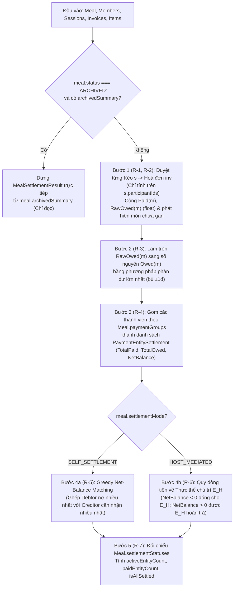
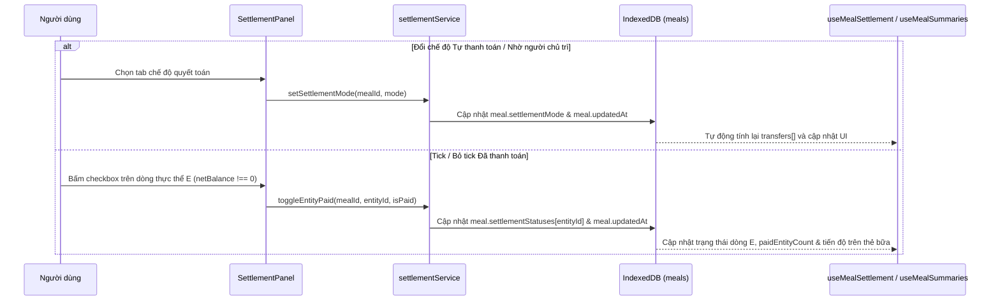

# Epic 6 — System Analysis (SA)

**Epic 6**: Động cơ Tính toán Chia tiền theo Bữa, 2 Chế độ Quyết toán & Tick Thanh toán · **Trạng thái**: Đã triển khai (còn kiểm thủ công trên trình duyệt ở 375 px trước khi đóng)

Tài liệu đi cùng: [BR](./BR.md) · [Kiến trúc & Data model](../01-architecture-and-data-model.md) · [Nghiệp vụ §1, §5–7.1](../02-business-logic-and-algorithms.md) · [UI §4.2 (Khu vực 3)](../03-ui-ux-and-design-system.md) · [Epic 5 SA](../epic-5/SA.md)

---

### B.1. Công nghệ / thư viện sử dụng
Dùng lại toàn bộ stack hiện có: React 19 · TypeScript · Tailwind CSS · Dexie 4 + `dexie-react-hooks` · `lucide-react` · Vitest + `fake-indexeddb` + jsdom + Testing Library. **Không thêm thư viện mới.**

- Toàn bộ động cơ tính toán chia tiền 3 tầng, gom nhóm thanh toán và giải thuật quyết toán (`SELF_SETTLEMENT` / `HOST_MEDIATED`) được viết bằng **hàm thuần TypeScript** trong `domain/settlementEngine.ts`, không phụ thuộc IndexedDB hay React, để dùng chung cho:
  1. Màn hình chi tiết bữa (`MealWorkspacePage` — Epic 6).
  2. Tiến độ thanh toán ở danh sách bữa (`useMealSummaries` — Epic 3/6).
  3. Đóng gói `ArchivedMealSummary` khi lưu trữ bữa (Epic 7).
  4. Tính toán và hiển thị trên `SnapshotViewer` chỉ đọc (Epic 8).

### B.2. Cấu trúc mã nguồn

```text
app/src/
├─ types/index.ts                              # SỬA: thêm các kiểu kết quả tính toán quyết toán dùng chung
│                                              #   (MemberBreakdown, PaymentEntitySettlement, SettlementTransfer,
│                                              #   MealSettlementResult)
├─ db/db.ts                                    # Không đổi
├─ domain/
│  ├─ settlementEngine.ts                      # MỚI, THUẦN: computeMealSettlement, computeSelfSettlementTransfers,
│  │                                           #   computeHostMediatedTransfers
│  ├─ settlementEngine.test.ts                 # MỚI: unit test toàn diện cho R-1…R-7 (chia lẻ, gom nhóm, P2P, chủ trì)
│  ├─ mealRules.ts                             # SỬA: cập nhật summarizeMeal nhận thêm dữ liệu sessions & items
│  │                                           #   để tính tiến độ thanh toán chuẩn theo thực thể có netBalance !== 0 (BR-6.9)
│  └─ mealRules.test.ts                        # SỬA: thêm test tiến độ thanh toán tinh chỉnh
├─ services/
│  ├─ settlementService.ts                     # MỚI: setSettlementMode, toggleEntityPaid, setAllEntitiesPaid
│  ├─ settlementService.test.ts                # MỚI: test ghi DB cho chế độ quyết toán & tick thanh toán
│  └─ peopleErrors.ts                          # SỬA: thêm mã ENTITY_NOT_FOUND, INVALID_SETTLEMENT_MODE
├─ hooks/
│  ├─ useMealSettlement.ts                     # MỚI: live query đọc meal + members + sessions + invoices + items
│  │                                           #   và trả về MealSettlementResult
│  └─ useMealSummaries.ts                      # SỬA: truyền thêm sessions & items vào summarizeMeal (BR-6.9)
├─ components/
│  └─ settlement/
│     ├─ SettlementPanel.tsx                   # MỚI: Khu vực 3 trên MealWorkspacePage (chuyển chế độ, cảnh báo
│     │                                        #   món chưa gán, bảng thực thể + tick thanh toán, danh sách chuyển khoản)
│     ├─ EntitySettlementRow.tsx               # MỚI: dòng thực thể (cá nhân/nhóm), ứng/chi/chênh lệch, checkbox Đã TT
│     ├─ TransferInstructionList.tsx           # MỚI: danh sách hướng dẫn chuyển tiền ("A chuyển cho B: X ₫")
│     ├─ MemberBreakdownDialog.tsx             # MỚI: modal giải trình chi tiết từng khoản ứng & ăn của thành viên (BR-6.2)
│     └─ SettlementPanel.test.tsx              # MỚI: test giao diện Khu vực 3
└─ pages/
   └─ MealWorkspacePage.tsx                    # SỬA: thay ô giữ chỗ Khu vực 3 bằng <SettlementPanel/>
```

### B.3. Thành phần & trách nhiệm

| Thành phần | Trách nhiệm | Phụ thuộc |
| :--- | :--- | :--- |
| `domain/settlementEngine` | Tính toán thuần toàn bộ kết quả quyết toán của một Bữa từ `{ meal, members, sessions, invoices, items }`: chi tiết từng thành viên (`MemberBreakdown`), làm tròn phần dư lớn nhất (R-3), gộp thực thể thanh toán (`PaymentEntitySettlement`, R-4), sinh lệnh chuyển tiền theo `SELF_SETTLEMENT` (R-5) và `HOST_MEDIATED` (R-6), kiểm tra `isAllSettled` (R-7). **Không chạm DB/DOM** | `types` |
| `domain/mealRules` | Cập nhật `summarizeMeal` để dùng kết quả `computeMealSettlement` (khi có dữ liệu kèo/hoá đơn/món) nhằm chỉ đếm các thực thể có `netBalance !== 0` vào tiến độ thanh toán (BR-6.9) | `domain/settlementEngine`, `lib/dates`, `services/peopleErrors` |
| `services/settlementService` | Ghi vào bảng `meals` trong transaction: đổi `settlementMode` (`setSettlementMode`), bật/tắt trạng thái `isPaid` của một thực thể (`toggleEntityPaid`), hoặc đánh dấu nhanh tất cả thực thể đã thanh toán (`setAllEntitiesPaid`) | `db`, `services/mealPeopleService` (`loadActiveMeal`), `domain/mealRules`, `services/peopleErrors` |
| `hooks/useMealSettlement` | Đọc thời gian thực `meal`, `members`, `sessions`, `invoices`, `items` của `mealId` qua `useLiveQuery` và gọi `computeMealSettlement` | `db`, `domain/settlementEngine` |
| `components/settlement/SettlementPanel` | Hiển thị Khu vực 3: nút chuyển `Tự thanh toán` / `Nhờ người chủ trì`, hộp cảnh báo nếu còn món chưa gán người ăn (BR-6.8), bảng thực thể (`EntitySettlementRow`), hướng dẫn chuyển tiền (`TransferInstructionList`), và chỗ gắn nút Chia sẻ (Epic 8) | `useMealSettlement`, `services/settlementService`, `MemberBreakdownDialog` |
| `components/settlement/MemberBreakdownDialog` | Hiển thị bảng giải trình chi tiết cho 1 thành viên hoặc 1 nhóm thanh toán: danh sách hoá đơn đã ứng và danh sách từng kèo $\rightarrow$ hoá đơn $\rightarrow$ món đã tiêu dùng kèm công thức chia | `Modal`, `lib/money` |

### B.4. Thiết kế dữ liệu

**Không đổi schema IndexedDB, không nâng version Dexie.**
Bảng `meals` đã có sẵn các trường `settlementMode: SettlementMode`, `paymentGroups: PaymentGroup[]`, `settlementStatuses: Record<string, { isPaid: boolean; paidAt?: string }>` và `archivedSummary?: ArchivedMealSummary` từ Epic 1 ([01 §3.2, §3.6](../01-architecture-and-data-model.md)).

Bổ sung các interface kết quả tính toán (chỉ dùng trong bộ nhớ, không lưu bảng mới) vào `types/index.ts`:

```typescript
export interface MemberChargeLine {
  sessionId: string;
  sessionName: string;
  invoiceId: string;
  vendorName?: string;
  kind: 'EQUAL_TOTAL' | 'BY_ITEM';
  itemName?: string;           // Có khi kind === 'BY_ITEM'
  shares?: number;             // Số phần của thành viên ở món này
  totalShares?: number;        // Tổng số phần của món hoặc số người chia đều hoá đơn
  sourceAmount: number;        // totalAmount của hoá đơn (nếu EQUAL_TOTAL) hoặc finalAmount của món
  rawCost: number;             // Số thực trước làm tròn cuối bữa
}

export interface MemberBreakdown {
  memberId: string;
  memberName: string;
  paidInvoices: Array<{
    invoiceId: string;
    sessionId: string;
    sessionName: string;
    vendorName?: string;
    amount: number;
  }>;
  chargeLines: MemberChargeLine[];
  totalPaid: number;           // Số nguyên đồng
  rawOwed: number;             // Số thực cộng dồn trước làm tròn
  totalOwed: number;           // Số nguyên đồng sau làm tròn & bù ±1đ (R-3)
  netBalance: number;          // totalPaid - totalOwed
}

export interface PaymentEntitySettlement {
  entityId: string;            // memberId (cá nhân lẻ) hoặc paymentGroupId (nhóm)
  entityName: string;          // Tên cá nhân hoặc tên nhóm
  isGroup: boolean;
  memberIds: string[];
  memberNames: string[];
  representativeId?: string;
  totalPaid: number;           // Σ Paid(m)
  totalOwed: number;           // Σ Owed(m)
  netBalance: number;          // totalPaid - totalOwed (+ nhận lại, - trả thêm, 0 cân bằng)
  isPaid: boolean;             // true nếu netBalance === 0 hoặc settlementStatuses[entityId]?.isPaid === true
  paidAt?: string;
}

export interface SettlementTransfer {
  fromEntityId: string;
  fromEntityName: string;
  toEntityId: string;
  toEntityName: string;
  amount: number;              // Số nguyên đồng > 0
}

export interface MealSettlementResult {
  mealId: string;
  status: MealStatus;
  settlementMode: SettlementMode;
  hostMemberId: string;
  hostEntityId: string;        // Thực thể chứa hostMemberId
  totalMealAmount: number;     // Tổng mọi hoá đơn trong bữa
  assignedAmount: number;      // Tổng tiền đã có người nhận chia
  unassignedAmount: number;    // Tổng tiền của các món BY_ITEM chưa có người ăn (R-2)
  unassignedItemCount: number; // Số món BY_ITEM chưa có người ăn
  memberBreakdowns: MemberBreakdown[];
  entities: PaymentEntitySettlement[];
  transfers: SettlementTransfer[];
  activeEntityCount: number;   // Số thực thể có netBalance !== 0
  paidEntityCount: number;     // Số thực thể có netBalance !== 0 đã tick isPaid
  isAllSettled: boolean;       // Điều kiện mở khoá Lưu trữ bữa cho Epic 7 (R-7)
}
```

### B.5. Luồng xử lý chính

**5.1. Pipeline tính toán Quyết toán toàn Bữa (`computeMealSettlement`)**


**5.2. Chuyển chế độ quyết toán & Tick chọn "Đã thanh toán"**


### B.6. Giao diện lập trình nội bộ

**Mã lỗi bổ sung vào `services/peopleErrors.ts`**:

| `code` | Khi nào ném |
| :--- | :--- |
| `ENTITY_NOT_FOUND` | `entityId` truyền vào `toggleEntityPaid` không phải là nhóm thanh toán hay thành viên độc lập của bữa |
| `INVALID_SETTLEMENT_MODE` | Giá trị `settlementMode` không thuộc `'SELF_SETTLEMENT' \| 'HOST_MEDIATED'` |

**`domain/settlementEngine.ts` (Hàm thuần)**:

```ts
export interface SettlementEngineInput {
  meal: Meal;
  members: ReadonlyArray<Member>;
  sessions: ReadonlyArray<SessionKeo>;
  invoices: ReadonlyArray<Invoice>;
  items: ReadonlyArray<InvoiceItem>;
}

/** Tính toàn bộ bảng quyết toán, thực thể, lệnh chuyển tiền và trạng thái hoàn tất của bữa (R-1…R-8). */
export function computeMealSettlement(input: SettlementEngineInput): MealSettlementResult;

/** Thuật toán Greedy Net-Balance Matching cho chế độ Tự thanh toán (R-5, 02 §6.1). */
export function computeSelfSettlementTransfers(
  entities: ReadonlyArray<Pick<PaymentEntitySettlement, 'entityId' | 'entityName' | 'netBalance'>>,
): SettlementTransfer[];

/** Thuật toán quy đầu mối về Thực thể chủ trì cho chế độ Nhờ người chủ trì (R-6, 02 §6.2). */
export function computeHostMediatedTransfers(
  entities: ReadonlyArray<Pick<PaymentEntitySettlement, 'entityId' | 'entityName' | 'netBalance'>>,
  hostEntityId: string,
): SettlementTransfer[];
```

**`services/settlementService.ts`**:

```ts
/** Đổi chế độ quyết toán của bữa (BR-6.5). Từ chối nếu bữa ARCHIVED. */
export function setSettlementMode(mealId: string, mode: SettlementMode): Promise<Meal>;

/** Ghi nhận hoặc bỏ ghi nhận trạng thái Đã thanh toán cho một thực thể (BR-6.7, R-7). */
export function toggleEntityPaid(
  mealId: string,
  entityId: string,
  isPaid: boolean,
  now?: Date,
): Promise<Meal>;

/** Đánh dấu nhanh tất cả các thực thể đang truyền vào là đã thanh toán (tiện ích khi chốt sổ). */
export function setAllEntitiesPaid(
  mealId: string,
  entityIds: string[],
  isPaid: boolean,
  now?: Date,
): Promise<Meal>;
```

**Component UI chính**:

| Component | Props chính | Hành vi |
| :--- | :--- | :--- |
| `SettlementPanel` | `meal: Meal`, `readOnly: boolean`, `actionsSlot?: ReactNode` | Khu vực 3 của `MealWorkspacePage`: hiển thị bộ chuyển chế độ `Tự thanh toán` / `Nhờ người chủ trì (<Tên chủ trì>)`, cảnh báo món chưa gán (nếu `unassignedItemCount > 0`), bảng `EntitySettlementRow`, khối `TransferInstructionList`, và `actionsSlot` (để Epic 7/8 gắn nút Lưu trữ / Chia sẻ) |
| `EntitySettlementRow` | `entity: PaymentEntitySettlement`, `readOnly: boolean`, `onTogglePaid: (paid: boolean) => void`, `onOpenBreakdown: () => void` | Hiển thị tên cá nhân hoặc nhóm (kèm biểu tượng nhóm và danh sách thành viên con), `Ứng: X ₫`, `Chi: Y ₫`, `NetBalance` (`+` xanh lá / `-` đỏ / `0` cân bằng), nút xem giải trình chi tiết, và checkbox `Đã thanh toán` (ẩn/khoá nếu `netBalance === 0` hoặc `readOnly`) |
| `TransferInstructionList` | `transfers: SettlementTransfer[]`, `settlementMode: SettlementMode`, `hasCost: boolean` | Liệt kê rõ từng dòng lệnh chuyển khoản: `<fromEntityName> chuyển cho <toEntityName>: <formatMoney(amount)>` |
| `MemberBreakdownDialog` | `open: boolean`, `breakdown: MemberBreakdown \| null`, `onClose: () => void` | Hộp thoại giải trình chi tiết các hoá đơn đã ứng và từng dòng chi phí (`EQUAL_TOTAL` / `BY_ITEM`) của thành viên |

### B.7. Yêu cầu phi chức năng

| Nhóm | Yêu cầu |
| :--- | :--- |
| **Độ chính xác toán học** | Tuyệt đối không thất thoát 1 đồng nào: $\sum \text{Owed}(m) = T_{\text{assigned}}$, và khi mọi món đã có người ăn thì $\sum \text{NetBalance}(E) = 0$ và tổng tiền các lệnh chuyển khoản ở `SELF_SETTLEMENT` bằng đúng $\sum_{\text{NetBalance}(E) > 0} \text{NetBalance}(E)$ |
| **Hiệu năng** | `computeMealSettlement` chạy dưới $5\text{ ms}$ cho một bữa có 20 thành viên, 10 kèo, 30 hoá đơn và 300 món |
| **Khả dụng (A11y & Mobile)** | Checkbox "Đã thanh toán" và nút mở giải trình có vùng chạm $\ge 44 \times 44\text{ px}$; số dư âm/dương ngoài màu sắc (`usd-green-700` / `usd-red-600`) luôn kèm dấu `+` / `-` và nhãn chữ (`Nhận lại` / `Phải trả` / `Đã cân bằng`); bảng không cuộn ngang ở màn hình $375\text{ px}$ |

### B.8. Rủi ro & hạn chế đã biết

| # | Rủi ro / Hạn chế | Hướng xử lý |
| :-: | :--- | :--- |
| 1 | Khi bữa có món `BY_ITEM` chưa được gán người ăn (`unassignedAmount > 0`), tổng tiền đã ứng ($T_{\text{meal}}$) lớn hơn tổng tiền đã phân bổ ($T_{\text{assigned}}$), nên $\sum \text{NetBalance}(E) = \text{unassignedAmount} > 0$ | Trong `computeSelfSettlementTransfers` và `computeHostMediatedTransfers`, thuật toán ghép cặp vẫn chạy an toàn với điều kiện dừng `while (creditors.length > 0 && debtors.length > 0)` (không bao giờ lặp vô tận), đồng thời UI hiện cảnh báo nổi bật yêu cầu gán người ăn cho các món còn sót (R-2, BR-6.8) |
| 2 | Người chủ trì (`hostMemberId`) nằm trong một `PaymentGroup` (ví dụ cặp đôi vợ chồng chủ trì) | Theo [02 §6.2](../02-business-logic-and-algorithms.md) và R-6, cả nhóm $E_H$ chứa chủ trì đóng vai trò là đầu mối thu/chi trong chế độ `HOST_MEDIATED`, tránh việc 2 người trong cùng một nhóm thanh toán lại phải chuyển tiền cho nhau |
| 3 | Thay đổi hoá đơn/món ở Khu vực 2 sau khi đã tick "Đã thanh toán" ở Khu vực 3 | Nếu một thực thể sau khi sửa hoá đơn chuyển sang `netBalance === 0` thì tự coi là đã cân bằng; nếu vẫn `netBalance !== 0` thì giữ trạng thái tick hoặc người dùng tự bỏ tick (riêng việc thêm/bỏ thành viên khỏi nhóm thanh toán đã tự xoá `settlementStatuses` liên quan từ Epic 2 R-13) |

### B.9. Ma trận truy vết kiểm thử

| User Story | BR | Bài kiểm thử dự kiến | Trạng thái |
| :-: | :-: | :--- | :-: |
| US-6.1 | BR-6.1, BR-6.2, BR-6.8 | `settlementEngine.test.ts`: tính `Paid(m)` và `Owed(m)` qua nhiều kèo/hoá đơn (`EQUAL_TOTAL` + `BY_ITEM` có `shares` khác nhau); người không thuộc `session.participantIds` có chi phí bằng 0 ở kèo đó (AC-5); chia lẻ cho 3, 6, 7 người và bù phần dư $\pm 1\text{đ}$ khớp 100% tổng hoá đơn (AC-1); phát hiện `unassignedItemCount` & `unassignedAmount` (AC-7). `SettlementPanel.test.tsx`: mở `MemberBreakdownDialog` xem giải trình (AC-6) | Đạt (`settlementEngine.test`; cảnh báo chưa gán: dữ liệu kiểm, hiển thị chưa có test riêng) |
| US-6.2 | BR-6.3, BR-6.6 | `settlementEngine.test.ts`: gom nhiều thành viên vào `PaymentGroup`, kiểm tra `totalPaid`, `totalOwed`, `netBalance` của nhóm bằng tổng các thành viên con (AC-2); thành viên lẻ giữ nguyên thực thể riêng | Đạt (`settlementEngine.test`: gom nhóm) |
| US-6.3 | BR-6.4, BR-6.6 | `settlementEngine.test.ts`: `computeSelfSettlementTransfers` tối ưu số giao dịch với nhiều chủ nợ và nhiều con nợ, tổng tiền chuyển khớp tuyệt đối tổng dư dương (AC-1, AC-3) | Đạt (`settlementEngine.test`: `computeSelfSettlementTransfers`) |
| US-6.4 | BR-6.5, BR-6.6 | `settlementEngine.test.ts`: `computeHostMediatedTransfers` khi chủ trì đứng lẻ và khi chủ trì thuộc một `PaymentGroup`; con nợ chuyển cho chủ trì, chủ trì hoàn trả cho người ứng dư. `settlementService.test.ts` & `SettlementPanel.test.tsx`: đổi qua lại 2 chế độ quyết toán (AC-3) | Đạt (`settlementEngine.test`: `computeHostMediatedTransfers`; `SettlementPanel.test`: đổi chế độ ghi DB) |
| US-6.5 | BR-6.7, BR-6.9 | `settlementService.test.ts`: `toggleEntityPaid`, `setAllEntitiesPaid`, chặn khi bữa `ARCHIVED`. `mealRules.test.ts`: `summarizeMeal` chỉ đếm thực thể có `netBalance !== 0` vào tiến độ thanh toán (AC-8). `SettlementPanel.test.tsx`: tick/bỏ tick checkbox trên UI (AC-4) | Đạt (`settlementService.test`; `SettlementPanel.test`; `mealRules.test`: BR-6.9) |

### B.10. Việc còn lại để đóng Epic
1. Kiểm thủ công trên trình duyệt ở 375 px cho Khu vực 3 của một bữa thật (đã kiểm bản snapshot dùng cùng component hiển thị) — **chưa thực hiện**.
2. Thêm test cho cảnh báo món chưa gán trên Khu vực 3 và mở giải trình từ màn bữa — **chưa thực hiện**.

**Lệch so với thiết kế đã ghi nhận khi triển khai**
- `SettlementPanel` nhận `meal`, `readOnly`, `actionsSlot` và tự gọi `useMealSettlement`, thay vì nhận `MealSettlementResult` từ ngoài.
- `MemberBreakdownDialog` nhận `breakdowns: MemberBreakdown[]` (một thực thể nhóm có nhiều thành viên) thay vì một `breakdown`.
- Tick "Đã thanh toán" dùng `toggleEntityPaid` và `setAllEntitiesPaid` (nút "Đánh dấu tất cả đã thanh toán").
- Bữa đã lưu trữ dựng kết quả từ `archivedSummary` trong `computeMealSettlement` (không cần truy vấn bảng đã xoá).
