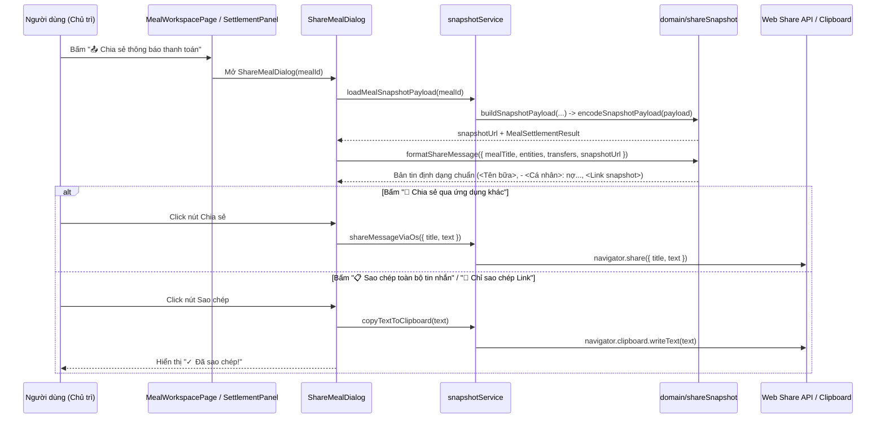
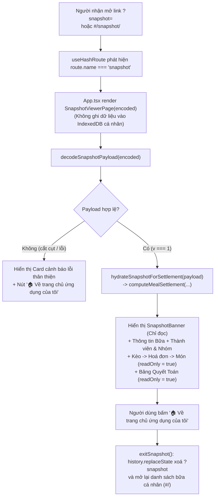

# Epic 8 — System Analysis (SA)

**Epic 8**: Chia sẻ Thông báo Thanh toán qua Ứng dụng khác & Custom URL Snapshot (Read-Only) · **Trạng thái**: Đã triển khai (còn kiểm thủ công trên thiết bị thật trước khi đóng)

Tài liệu đi cùng: [BR](./BR.md) · [Kiến trúc & Data model §3.7](../01-architecture-and-data-model.md) · [Nghiệp vụ §8](../02-business-logic-and-algorithms.md) · [UI §4.2, §4.6, §4.7](../03-ui-ux-and-design-system.md) · [Epic 6 SA](../epic-6/SA.md) · [Epic 7 SA](../epic-7/SA.md)

---

### B.1. Công nghệ / thư viện sử dụng
Dùng lại stack hiện có (React 19 · TypeScript · Tailwind CSS · Dexie 4 · `lucide-react` · Vitest + `fake-indexeddb` + jsdom + Testing Library) và **khai báo trực tiếp 1 thư viện đã có sẵn trong `node_modules` và tài liệu kiến trúc ([README §3](../README.md))**:

| Thư viện / Web API | Dùng cho | Ghi chú |
| :--- | :--- | :--- |
| `lz-string` (`^1.5.0`) | Nén và giải nén chuỗi JSON `MealSnapshotPayload` thành chuỗi Base64URL an toàn cho URL (`compressToEncodedURIComponent` / `decompressFromEncodedURIComponent`) | Đã có sẵn kiểu TypeScript đi kèm (`lz-string/typings/lz-string.d.ts`), dung lượng cực nhẹ (~2 KB gzipped), chạy hoàn toàn client-side |
| Web Share API (`navigator.share`) | Mở menu chia sẻ gốc của iOS / Android / macOS để gửi tin nhắn thanh toán sang Zalo, Messenger, Telegram, SMS... | Kiểm tra tính khả dụng tại runtime (`canUseWebShare()`) |
| Clipboard API (`navigator.clipboard.writeText`) | Sao chép 1 chạm toàn bộ tin nhắn hoặc riêng đường dẫn Snapshot URL | Kèm fallback `<textarea>` + `document.execCommand('copy')` nếu ngữ cảnh trình duyệt không cấp quyền `navigator.clipboard` |

### B.2. Cấu trúc mã nguồn

```text
app/
├─ package.json                                # SỬA: khai báo trực tiếp "lz-string": "^1.5.0" trong dependencies
└─ src/
   ├─ types/index.ts                           # SỬA: đồng bộ MealSnapshotPayload với 01-architecture §3.7
   │                                           #   (bổ sung discount*, service*, allocatedDiscountAmount,
   │                                           #   allocatedServiceAmount, orderIndex?, archivedPayerSummary?)
   ├─ db/db.ts                                 # Không đổi (không nâng version schema Dexie)
   ├─ domain/
   │  ├─ shareSnapshot.ts                      # MỚI, THUẦN: buildSnapshotPayload, encodeSnapshotPayload,
   │  │                                        #   decodeSnapshotPayload, buildSnapshotUrl,
   │  │                                        #   hydrateSnapshotForSettlement, formatEntityShareLabel,
   │  │                                        #   formatShareMessage
   │  └─ shareSnapshot.test.ts                 # MỚI: unit test mã hoá/giải mã, kiểm lỗi dữ liệu hỏng,
   │                                           #   định dạng tin nhắn cá nhân & nhóm (<Cá nhân> + <cá nhân>)
   ├─ services/
   │  ├─ snapshotService.ts                    # MỚI: loadMealSnapshotPayload(mealId), shareMessageViaOs,
   │  │                                        #   copyTextToClipboard
   │  ├─ snapshotService.test.ts               # MỚI: test đọc DB tạo snapshot cho cả bữa ACTIVE & ARCHIVED
   │  └─ peopleErrors.ts                       # SỬA: thêm mã INVALID_SNAPSHOT, SHARE_FAILED
   ├─ hooks/
   │  ├─ useHashRoute.ts                       # SỬA: nhận diện tham số ?snapshot=<data> hoặc #/snapshot/<data>
   │  │                                        #   và hỗ trợ exitSnapshot() xoá ?snapshot về #/
   │  └─ viewHooks.test.ts                     # SỬA: thêm test parseRoute với snapshot URL
   ├─ components/
   │  └─ share/
   │     ├─ ShareMealDialog.tsx                # MỚI: hộp thoại xem trước tin nhắn, lọc khoản chưa trả,
   │     │                                     #   gửi qua ứng dụng khác & sao chép nhanh (UI §4.6)
   │     ├─ SnapshotBanner.tsx                 # MỚI: thanh trạng thái "👁️ CHẾ ĐỘ XEM SNAPSHOT (CHỈ ĐỌC)"
   │     │                                     #   + nút "🏠 Về trang chủ ứng dụng của tôi" (UI §4.7)
   │     └─ ShareMealDialog.test.tsx           # MỚI: test hộp thoại chia sẻ, Web Share API & Clipboard
   ├─ pages/
   │  ├─ SnapshotViewerPage.tsx                # MỚI: màn hình xem Snapshot chỉ đọc (hoàn toàn tách biệt DB)
   │  ├─ SnapshotViewerPage.test.tsx           # MỚI: test hiển thị 3 tầng chỉ đọc & xử lý link hỏng
   │  └─ MealWorkspacePage.tsx                 # SỬA: gắn nút "📤 Chia sẻ thông báo thanh toán" &
   │                                           #   "🔗 Sao chép Link Snapshot" vào Khu vực 3 (SettlementPanel)
   └─ App.tsx                                  # SỬA: điều hướng sang SnapshotViewerPage khi route là snapshot
```

### B.3. Thành phần & trách nhiệm

| Thành phần | Trách nhiệm | Phụ thuộc |
| :--- | :--- | :--- |
| `domain/shareSnapshot` | Toàn bộ hàm thuần: dựng `MealSnapshotPayload` từ dữ liệu bữa (`buildSnapshotPayload`), nén/giải nén bằng `lz-string` kèm kiểm tra schema an toàn (`encodeSnapshotPayload`, `decodeSnapshotPayload`), chuyển đổi `MealSnapshotPayload` thành đầu vào cho `computeMealSettlement` (`hydrateSnapshotForSettlement`), và định dạng bản tin thông báo thanh toán chuẩn (`formatEntityShareLabel`, `formatShareMessage`). **Không chạm DB/DOM** | `lz-string`, `domain/settlementEngine`, `lib/money`, `services/peopleErrors`, `types` |
| `services/snapshotService` | Đọc `meal`, `members`, `sessions`, `invoices`, `items` của một `mealId` từ IndexedDB để tạo `MealSnapshotPayload` & URL (`loadMealSnapshotPayload`); bọc lời gọi `navigator.share` (`shareMessageViaOs`) và `navigator.clipboard` (`copyTextToClipboard`) | `db`, `domain/shareSnapshot`, `services/peopleErrors` |
| `hooks/useHashRoute` | Phát hiện `?snapshot=<encoded>` trên `window.location.search` hoặc `#/snapshot/<encoded>` trên `window.location.hash` để trả về route `{ name: 'snapshot', encoded: string }`; cung cấp hàm `exitSnapshot()` xoá `?snapshot` bằng `history.replaceState` và điều hướng về `#/` | Không |
| `components/share/ShareMealDialog` | Hiển thị hộp thoại chia sẻ (UI §4.6): khung xem trước tin nhắn, tuỳ chọn lọc "Chỉ hiện người chưa thanh toán", nút "📲 Chia sẻ qua ứng dụng khác", nút "📋 Sao chép toàn bộ tin nhắn" và nút "🔗 Chỉ sao chép Link Snapshot" | `Modal`, `domain/shareSnapshot`, `services/snapshotService` |
| `pages/SnapshotViewerPage` | Giải mã `encoded` từ URL; nếu lỗi thì hiển thị thông báo lỗi kèm nút về trang chủ (BR-8.4); nếu hợp lệ thì hiển thị `SnapshotBanner` và toàn bộ thông tin Bữa $\rightarrow$ Thành viên/Nhóm $\rightarrow$ Kèo/Hoá đơn/Món $\rightarrow$ Bảng quyết toán ở chế độ `readOnly = true` tuyệt đối mà không đọc/ghi IndexedDB (BR-8.2, BR-8.3) | `domain/shareSnapshot`, `domain/settlementEngine`, `SnapshotBanner`, `SettlementPanel` |

### B.4. Thiết kế dữ liệu

**Không đổi schema IndexedDB, không nâng version Dexie.**
Đồng bộ hoá interface `MealSnapshotPayload` trong `app/src/types/index.ts` cho khớp hoàn toàn với [01-architecture-and-data-model.md §3.7](../01-architecture-and-data-model.md) (bổ sung các trường giảm giá, phí phục vụ và thứ tự món đã thêm từ Epic 4, cùng `representativeId` và `archivedPayerSummary`):

```typescript
export interface MealSnapshotPayload {
  v: 1;
  exportedAt: string;
  meal: {
    title: string;
    date: string;
    note?: string;
    status: MealStatus;
    settlementMode: SettlementMode;
    hostMemberId: string;
  };
  members: Array<{
    id: string;
    name: string;
    avatarColor: string;
  }>;
  paymentGroups: Array<{
    id: string;
    name: string;
    memberIds: string[];
    representativeId?: string;
  }>;
  sessions: Array<{
    id: string;
    name: string;
    orderIndex: number;
    participantIds: string[];
    archivedTotalAmount?: number;
    archivedPayerSummary?: Array<{
      memberId: string;
      paidAmount: number;
    }>;
    invoices: Array<{
      id: string;
      vendorName?: string;
      invoiceDate?: string;
      payerMemberId: string;
      inputMode: InvoiceInputMode;
      splitType: InvoiceSplitType;
      equalSplitParticipantIds: string[];
      subtotalAmount: number;
      discountMode: AdjustmentMode;
      discountValue: number;
      discountAmount: number;
      serviceMode: AdjustmentMode;
      serviceValue: number;
      serviceAmount: number;
      vatMode: VatMode;
      vatValue: number;
      vatAmount: number;
      totalAmount: number;
      items: Array<{
        name: string;
        quantity: number;
        unitPrice: number;
        rawAmount: number;
        allocatedDiscountAmount: number;
        allocatedServiceAmount: number;
        allocatedVatAmount: number;
        finalAmount: number;
        orderIndex?: number;
        consumers: ItemShare[];
      }>;
    }>;
  }>;
  settlementStatuses: Record<string, {
    isPaid: boolean;
    paidAt?: string;
  }>;
  archivedSummary?: ArchivedMealSummary;
}
```

> [!NOTE]
> **Tương thích ngược khi giải mã (`decodeSnapshotPayload`)**: Nếu một payload `v: 1` thiếu các trường tuỳ chọn như `discountMode` hoặc `serviceMode`, bộ giải mã tự động gán giá trị mặc định an toàn (`'NONE'`, `0`) để không báo lỗi giả.

### B.5. Luồng xử lý chính

**5.1. Tạo Snapshot URL, Định dạng Tin nhắn & Chia sẻ (US-8.1, US-8.3, US-8.4)**


**5.2. Mở Custom URL Snapshot ở Chế độ Chỉ Đọc (US-8.2)**


### B.6. Giao diện lập trình nội bộ

**Mã lỗi bổ sung vào `services/peopleErrors.ts`**:

| `code` | Khi nào ném |
| :--- | :--- |
| `INVALID_SNAPSHOT` | Chuỗi `?snapshot=` rỗng, không giải nén được bằng `lz-string`, lỗi JSON, sai `v !== 1`, hoặc thiếu trường bắt buộc (R-2, BR-8.4) |
| `SHARE_FAILED` | Không thể chia sẻ hoặc sao chép vào Clipboard |

**`domain/shareSnapshot.ts` (Hàm thuần)**:

```ts
/** Đóng gói toàn bộ dữ liệu 1 bữa (bỏ ảnh nhị phân) thành MealSnapshotPayload (R-1). */
export function buildSnapshotPayload(
  input: SettlementEngineInput & { exportedAt?: string },
): MealSnapshotPayload;

/** Nén MealSnapshotPayload thành chuỗi Base64URL bằng LZString.compressToEncodedURIComponent (R-2). */
export function encodeSnapshotPayload(payload: MealSnapshotPayload): string;

/** Giải nén và kiểm tra tính hợp lệ của chuỗi snapshot; ném PeopleError('INVALID_SNAPSHOT') nếu hỏng (R-2). */
export function decodeSnapshotPayload(encoded: string): MealSnapshotPayload;

/** Tạo đường dẫn Custom URL đầy đủ chứa ?snapshot=<encoded> (R-2). */
export function buildSnapshotUrl(
  payload: MealSnapshotPayload,
  baseLocation?: Pick<Location, 'origin' | 'pathname'>,
): string;

/** Chuyển đổi MealSnapshotPayload thành dữ liệu đầu vào trong bộ nhớ để tái sử dụng computeMealSettlement và UI. */
export function hydrateSnapshotForSettlement(payload: MealSnapshotPayload): SettlementEngineInput;

/**
 * Hiển thị tên thực thể theo chuẩn tin nhắn chia sẻ (R-3):
 * - Cá nhân: "<Tên>"
 * - Nhóm thanh toán: "<Cá nhân 1> + <Cá nhân 2> + ..."
 */
export function formatEntityShareLabel(
  entity: Pick<PaymentEntitySettlement, 'entityName' | 'isGroup' | 'memberNames'>,
): string;

export interface FormatShareMessageInput {
  mealTitle: string;
  entities: ReadonlyArray<PaymentEntitySettlement>;
  transfers: ReadonlyArray<SettlementTransfer>;
  snapshotUrl: string;
  /** Nếu true, bỏ qua dòng nợ của những thực thể đã tick isPaid === true (R-4). */
  onlyUnpaid?: boolean;
  /** Map tên người nhận hiển thị khi thực thể nhận là nhóm của chủ trì (R-3). */
  recipientLabelByEntityId?: Record<string, string>;
}

/**
 * Định dạng bản tin thông báo thanh toán chuẩn (US-8.3, R-4):
 * <Tên bữa>
 * - <Cá nhân>: nợ <cá nhân> <số tiền>, nợ <cá nhân> <số tiền>
 * - <Cá nhân> + <cá nhân>: nợ <cá nhân> <số tiền>
 * <Link snapshot>
 */
export function formatShareMessage(input: FormatShareMessageInput): string;
```

**`services/snapshotService.ts`**:

```ts
export interface LoadedMealSnapshot {
  payload: MealSnapshotPayload;
  encoded: string;
  snapshotUrl: string;
  settlement: MealSettlementResult;
}

/** Đọc dữ liệu bữa từ IndexedDB, tạo payload, chuỗi nén, URL và kết quả quyết toán. */
export function loadMealSnapshotPayload(mealId: string): Promise<LoadedMealSnapshot>;

/** Kiểm tra trình duyệt có hỗ trợ Web Share API không. */
export function canUseWebShare(): boolean;

/** Gọi navigator.share; trả về false nếu người dùng tự đóng hộp chia sẻ (AbortError). */
export function shareMessageViaOs(data: { title: string; text: string }): Promise<boolean>;

/** Sao chép văn bản vào Clipboard (navigator.clipboard kèm fallback execCommand). */
export function copyTextToClipboard(text: string): Promise<void>;
```

### B.7. Yêu cầu phi chức năng

| Nhóm | Yêu cầu |
| :--- | :--- |
| **Kích thước URL nén** | Với một bữa điển hình (8 thành viên, 3 kèo, 4 hoá đơn, 25 món), chuỗi `encoded` sau khi nén bằng `lz-string` có độ dài khoảng $800 - 1.500\text{ ký tự}$, nằm gọn trong giới hạn URL của mọi trình duyệt hiện hành (Chrome/Safari/Firefox/Edge hỗ trợ $> 32.000\text{ ký tự}$) và các ứng dụng nhắn tin (Zalo, Messenger, Telegram) |
| **Cô lập dữ liệu & Bảo mật** | `decodeSnapshotPayload` kiểm tra nghiêm ngặt kiểu dữ liệu từng trường sau `JSON.parse`; không dùng `eval` hay `dangerouslySetInnerHTML`; không ghi dữ liệu từ URL vào IndexedDB hay `localStorage` |
| **Khả dụng (A11y & Mobile)** | Khung xem trước tin nhắn dùng font dễ đọc, cho phép bôi đen tự do; nút sao chép có thông báo `role="status"` cho trình đọc màn hình; thanh `SnapshotBanner` cố định nổi bật ở đầu trang để người xem luôn biết mình đang ở chế độ chỉ đọc |

### B.8. Rủi ro & hạn chế đã biết

| # | Rủi ro / Hạn chế | Hướng xử lý |
| :-: | :--- | :--- |
| 1 | Một số ứng dụng chat tự ngắt dòng hoặc cắt bớt URL nếu URL chứa ký tự đặc biệt | Sử dụng `LZString.compressToEncodedURIComponent` chỉ sinh các ký tự an toàn trong tập `A-Z`, `a-z`, `0-9`, `+`, `-`, `$` và đặt `<Link snapshot>` nằm riêng biệt trên dòng cuối cùng của tin nhắn |
| 2 | Người dùng mở link `?snapshot=...` rồi bấm nút điều hướng nội bộ trong trang | `useHashRoute` kiểm tra cả `window.location.search` (`?snapshot=`) và `window.location.hash` (`#/snapshot/`); hàm `exitSnapshot()` chủ động dọn sạch `search` bằng `window.history.replaceState(null, '', window.location.pathname + '#/')` rồi phát sự kiện cập nhật route |
| 3 | Bữa rất lớn (ví dụ đi du lịch dài ngày có > 150 món trong 1 bữa) khiến URL dài trên $6.000\text{ ký tự}$ | Hiển thị cảnh báo nhẹ trong `ShareMealDialog` nếu độ dài URL vượt $4.000\text{ ký tự}$ và gợi ý gửi qua ứng dụng chat hỗ trợ tin nhắn dài (Zalo, Telegram) hoặc lưu trữ bữa khi đã quyết toán xong |
| 4 | `navigator.share` hoặc `navigator.clipboard` không khả dụng trong ngữ cảnh HTTP không bảo mật (khi dev qua IP LAN) | `canUseWebShare()` ẩn hoặc chuyển nút chia sẻ hệ thống sang sao chép; `copyTextToClipboard` có fallback tạo `<textarea>` ẩn và `document.execCommand('copy')` |

### B.9. Ma trận truy vết kiểm thử

| User Story | BR | Bài kiểm thử dự kiến | Trạng thái |
| :-: | :-: | :--- | :-: |
| US-8.1 | BR-8.1, BR-8.4 | `shareSnapshot.test.ts`: `buildSnapshotPayload` → `encodeSnapshotPayload` → `decodeSnapshotPayload` khôi phục đúng 100% thông tin bữa `ACTIVE` (có món, giảm giá, phí phục vụ, VAT, nhóm) và bữa `ARCHIVED` (`archivedSummary`) (AC-1); không chứa dữ liệu ảnh `Blob`; ném `INVALID_SNAPSHOT` khi chuỗi rỗng, bị cắt cụt, sai JSON hoặc sai `v` (AC-5). `snapshotService.test.ts`: `loadMealSnapshotPayload` từ DB | Đạt (`shareSnapshot.test`: round-trip, không chứa ảnh, INVALID_SNAPSHOT; `snapshotService.test`: từ DB ACTIVE và ARCHIVED) |
| US-8.2 | BR-8.2, BR-8.3, BR-8.4 | `SnapshotViewerPage.test.tsx` & `viewHooks.test.ts`: mở `?snapshot=<encoded>` và `#/snapshot/<encoded>` hiển thị đúng `SnapshotBanner`, danh sách thành viên, nhóm, kèo, hoá đơn, món và bảng quyết toán (AC-1, AC-6); không có bất kỳ nút thêm/sửa/xoá/tick nào hoạt động và IndexedDB cá nhân vẫn trống (AC-2); link hỏng hiện thông báo lỗi và nút về trang chủ (AC-5) | Đạt (`SnapshotViewerPage.test`; `viewHooks.test`: parseRoute cho ?snapshot= và #/snapshot/) |
| US-8.3 | BR-8.5 | `shareSnapshot.test.ts`: `formatEntityShareLabel` và `formatShareMessage` xuất đúng mẫu `<Tên bữa>`, dòng cá nhân `- Bình: nợ An 150.000 ₫, nợ Phương 80.000 ₫`, dòng nhóm `- Cường + Dung: nợ An 420.000 ₫`, dòng cuối `<Link snapshot>` ở cả chế độ `SELF_SETTLEMENT` và `HOST_MEDIATED`, cùng tuỳ chọn `onlyUnpaid` (AC-3) | Đạt (`shareSnapshot.test`: formatEntityShareLabel, formatShareMessage, hostRecipientLabels) |
| US-8.4 | BR-8.6 | `ShareMealDialog.test.tsx`: mở hộp thoại chia sẻ từ Khu vực 3, kiểm tra nội dung Preview Box, bấm "Chia sẻ qua ứng dụng khác" gọi `navigator.share` (mock), xử lý êm khi `AbortError`, bấm "Sao chép toàn bộ tin nhắn" và "Chỉ sao chép Link Snapshot" ghi đúng vào Clipboard và hiện trạng thái đã sao chép (AC-4) | Đạt bằng mock (`ShareMealDialog.test`) |

### B.10. Việc còn lại để đóng Epic
1. Kiểm chia sẻ qua menu hệ điều hành trên thiết bị thật (iOS/Android) và kiểm sao chép trong ngữ cảnh không HTTPS — **chưa thực hiện** (đã kiểm bằng mock).
2. Kiểm trình duyệt ở 375 px cho hộp thoại chia sẻ (`ShareMealDialog`) — **chưa thực hiện**.

**Lệch so với thiết kế đã ghi nhận khi triển khai**
- `parseRoute(hash, search)` nhận thêm tham số `search`; `?snapshot=` được ưu tiên hơn mọi route khác. `+` trong chuỗi nén được khôi phục vì `URLSearchParams` đổi thành khoảng trắng.
- `exitSnapshot()` phát `hashchange` thủ công vì `history.replaceState` không tự phát sự kiện.
- `ShareMealAction` (nút mở hộp thoại) được gắn vào `actionsSlot` của Khu vực 3 cùng `ArchiveMealAction`.
- `SnapshotViewerPage` tái sử dụng `EntitySettlementRow` (chế độ chỉ đọc), `TransferInstructionList` và `MemberBreakdownDialog`.
- Khi mở link, `App` vẫn chạy `ensureDefaultData()` (ghi hồ sơ "Tôi" mặc định của chính người xem nếu chưa có). Không có dữ liệu từ snapshot nào được ghi vào IndexedDB.
- Dùng `encodeURIComponent` khi đặt chuỗi nén vào `?snapshot=`.
