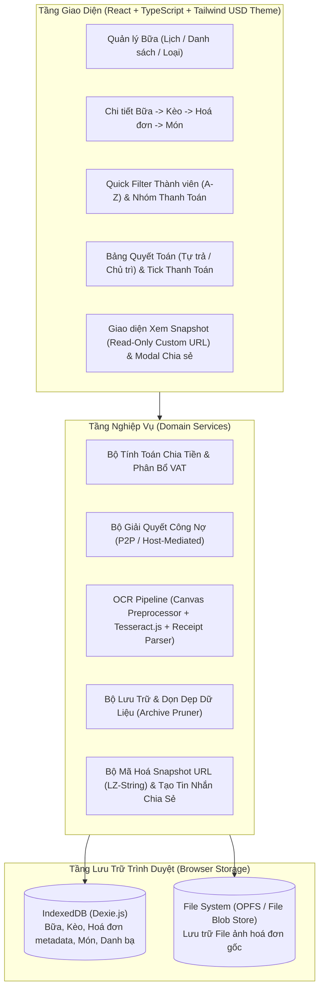
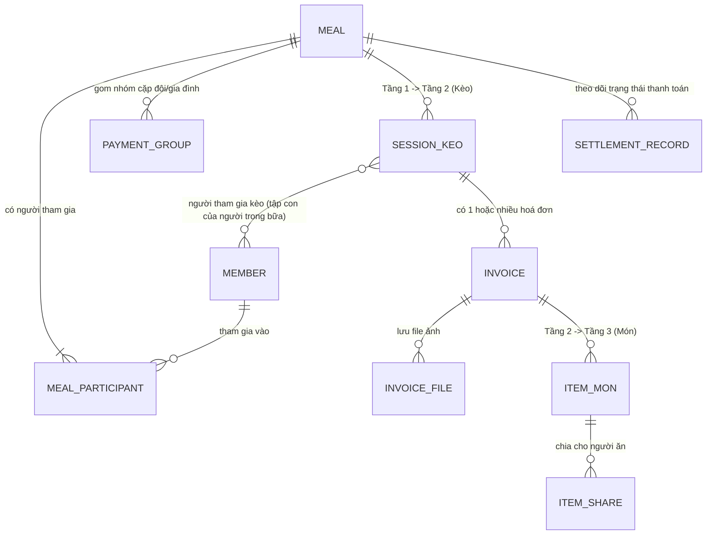

# 01. Kiến Trúc Hệ Thống & Mô Hình Dữ Liệu (Architecture & Data Model)

## 1. Kiến trúc tổng thể (Client-Side Architecture)

Ứng dụng hoạt động hoàn toàn trên trình duyệt (**100% Client-Side Single Page Application / PWA**), không yêu cầu backend server hay kết nối mạng để tính toán và lưu trữ.



---

## 2. Sơ đồ Thực thể Liên kết (Entity-Relationship Diagram)

Hệ thống quản lý dữ liệu xoay quanh cấu trúc phân cấp **3 tầng chính (Bữa -> Kèo -> Món)** kết hợp với **Hoá đơn (Invoice)**, **Thành viên (Member)** và **Nhóm thanh toán (PaymentGroup)**.



---

## 3. Chi tiết Schema Dữ liệu (TypeScript Interfaces & IndexedDB Tables)

### 3.1. Cấu hình Hệ thống & Danh bạ Thành viên (`members`)

Mọi người từng được thêm vào bất kỳ bữa nào đều được lưu vào bảng `members` toàn cục để tái sử dụng nhanh ở các bữa sau qua thanh **Quick Filter (A-Z)**.

```typescript
export interface AppSettings {
  id: 'default';
  defaultHostMemberId: string; // ID của "Tôi" mặc định
  currencySymbol: string;      // Mặc định: '₫' hoặc 'VNĐ'
  createdAt: string;
}

export interface Member {
  id: string;                  // UUID
  name: string;                // Tên hiển thị (VD: "An Nguyễn", "Bình Trần")
  normalizedName: string;      // Chuỗi bỏ dấu viết thường dùng cho Quick Filter & Sort A-Z
  isDefaultHost?: boolean;     // Đánh dấu đây là hồ sơ "Tôi"
  avatarColor: string;         // Mã màu badge đại diện (trong dải màu USD/Emerald)
  createdAt: string;           // ISO Date
  lastUsedAt: string;          // ISO Date (phục vụ thống kê/gợi ý)
}
```

---

### 3.2. Tầng 1: Bữa (`meals`)

Đại diện cho một ngày/cuộc đi ăn chơi của nhóm bạn.

```typescript
export type MealStatus = 'ACTIVE' | 'ARCHIVED';

export type SettlementMode = 'SELF_SETTLEMENT' | 'HOST_MEDIATED';

export interface PaymentGroup {
  id: string;                  // UUID
  mealId: string;              // Thuộc bữa nào
  name: string;                // Tên nhóm (VD: "Gia đình An - Bình", "Cặp đôi C - D")
  memberIds: string[];         // Danh sách memberId gộp chung (tối thiểu 2 người trong bữa)
  representativeId?: string;   // Người đại diện đứng tên thanh toán của nhóm
}

export interface Meal {
  id: string;                  // UUID
  title: string;               // Tên bữa (VD: "Đi ăn cuối tuần Đà Lạt", "Tất niên nhóm ĐH")
  date: string;                // Ngày của bữa (Định dạng YYYY-MM-DD để filter theo Lịch)
  note?: string;               // Ghi chú thêm
  status: MealStatus;          // 'ACTIVE' (Còn hoạt động) | 'ARCHIVED' (Đã lưu trữ)
  
  // Thành viên & Chủ trì trong bữa
  participantIds: string[];    // Danh sách memberId tham gia bữa này
  hostMemberId: string;        // Người chủ trì bữa này (mặc định lấy defaultHostMemberId)
  
  // Cấu hình thanh toán của bữa
  settlementMode: SettlementMode; // 'SELF_SETTLEMENT' (Tự thanh toán) | 'HOST_MEDIATED' (Nhờ người chủ trì)
  paymentGroups: PaymentGroup[];  // Các nhóm gom thanh toán (cặp đôi/gia đình) trong bữa
  
  // Trạng thái tick chọn đã thanh toán
  // Key là ID của Thực thể thanh toán (memberId cá nhân lẻ hoặc paymentGroupId)
  settlementStatuses: Record<string, {
    isPaid: boolean;
    paidAt?: string;
  }>;

  // Dữ liệu tổng hợp giữ lại sau khi Lưu trữ (Archive Snapshot)
  archivedSummary?: ArchivedMealSummary;

  createdAt: string;
  updatedAt: string;
  archivedAt?: string;
}
```

---

### 3.3. Tầng 2: Kèo (`sessions`) & Hoá đơn (`invoices`)

- **Kèo (`Session`)**: Đại diện cho từng nơi/điểm thanh toán trong một Bữa (VD: Kèo 1: Quán Lẩu, Kèo 2: Trà sữa, Kèo 3: Karaoke).
- **Hoá đơn (`Invoice`)**: Mỗi Kèo có thể có **1 hoặc nhiều hoá đơn** (VD: gọi thêm lượt 2 tính bill riêng, hoặc 2 bàn thanh toán 2 bill trong cùng 1 quán).

```typescript
export interface SessionKeo {
  id: string;                  // UUID
  mealId: string;              // Khóa ngoại trỏ tới Meal
  name: string;                // Tên kèo / Địa điểm (VD: "Kèo 1 - Lẩu Bò Gỗ", "Kèo 2 - Karaoke Nice")
  orderIndex: number;          // Thứ tự kèo trong bữa

  // Người tham gia kèo: tập con của Meal.participantIds, có thể là tất cả hoặc chỉ một số người.
  // Mọi phép chia tiền của kèo (EQUAL_TOTAL và BY_ITEM) chỉ tính trên những người này.
  // Kèo mới mặc định gồm toàn bộ người đang có trong bữa; người thêm vào bữa sau đó KHÔNG tự vào kèo cũ.
  participantIds: string[];

  // Khi bữa chuyển sang ARCHIVED, toàn bộ invoices và items bị xoá,
  // chỉ giữ lại tổng chi phí của kèo tại trường này:
  archivedTotalAmount?: number;
  archivedPayerSummary?: Array<{
    memberId: string;
    paidAmount: number;
  }>;

  createdAt: string;
}

export type InvoiceInputMode = 'ITEMIZED' | 'TOTAL_ONLY';
export type InvoiceSplitType = 'BY_ITEM' | 'EQUAL_TOTAL';
export type AdjustmentMode = 'NONE' | 'PERCENTAGE' | 'FIXED_AMOUNT';
export type VatMode = AdjustmentMode;

export interface Invoice {
  id: string;                  // UUID
  mealId: string;              // Khóa ngoại trỏ tới Meal (để truy vấn/xoá nhanh khi Archive)
  sessionId: string;           // Khóa ngoại trỏ tới SessionKeo
  
  vendorName?: string;         // Tên quán nhận diện từ OCR hoặc tự nhập
  invoiceDate?: string;        // Ngày in trên hoá đơn (OCR nhận diện hoặc tự nhập)
  
  // Người ứng tiền thanh toán hoá đơn này
  // "Ứng trước": MỘT người thanh toán TOÀN BỘ hoá đơn này. Người này không bị trừ tiền ở từng món;
  // phần của những người còn lại được ghi thành công nợ với họ khi kết toán (xem 02, mục 5).
  payerMemberId: string;       // ID thành viên đã trả tiền cho hoá đơn này
  
  // Chế độ nhập & Chia tiền của hoá đơn
  inputMode: InvoiceInputMode; // 'ITEMIZED' (Có danh sách món) | 'TOTAL_ONLY' (Chỉ nhập tổng tiền)
  splitType: InvoiceSplitType; // 'BY_ITEM' (Chia từng món) | 'EQUAL_TOTAL' (Chia đều theo tổng)
  // Ràng buộc: Nếu inputMode === 'TOTAL_ONLY' => splitType BẮT BUỘC là 'EQUAL_TOTAL'

  // Danh sách người tham gia chia đều (nếu splitType === 'EQUAL_TOTAL')
  // Luôn là tập con của SessionKeo.participantIds; mặc định bằng đúng danh sách người tham gia kèo,
  // có thể tick bớt nếu có người không dùng hoá đơn này (không thể thêm người ngoài kèo)
  equalSplitParticipantIds: string[];

  // Giá trị tiền: tiền hàng → giảm giá → phí phục vụ → VAT (công thức ở 02, mục 2)
  subtotalAmount: number;      // Tiền hàng trước mọi điều chỉnh (tổng các món hoặc số nhập ở tab chỉ tổng)
  discountMode: AdjustmentMode;  // Giảm giá cả bill: Không / Theo % / Số tiền
  discountValue: number;         // % (VD: 10) hoặc số tiền (VD: 50000)
  discountAmount: number;        // Số tiền giảm thực tế, ≥ 0 (là số trừ đi)
  serviceMode: AdjustmentMode;   // Phí phục vụ cả bill
  serviceValue: number;
  serviceAmount: number;         // Số tiền phí phục vụ thực tế, ≥ 0
  vatMode: VatMode;            // Không VAT / Theo % (VD: 8%, 10%) / Số tiền VAT cố định
  vatValue: number;            // Giá trị % (VD: 8) hoặc số tiền tuyệt đối (VD: 45000)
  vatAmount: number;           // Số tiền VAT quy đổi thực tế
  totalAmount: number;         // Tổng thanh toán = subtotalAmount − discountAmount + serviceAmount + vatAmount

  // Liên kết tới các File ảnh hoá đơn đã lưu
  fileIds: string[];           // Danh sách ID file hoá đơn trong File Storage

  createdAt: string;
}
```

---

### 3.4. Tầng 3: Món (`items`)

Đại diện cho từng món cụ thể trong một Hoá đơn (khi `inputMode === 'ITEMIZED'`).

```typescript
export interface ItemShare {
  memberId: string;            // Người sử dụng món này
  shares: number;              // Số phần/hệ số chia (Mặc định = 1 cho chia đều; có thể chỉnh thành 2, 3...)
}

export interface InvoiceItem {
  id: string;                  // UUID
  mealId: string;              // Khóa ngoại trỏ tới Meal (để xoá hàng loạt khi Archive bữa)
  sessionId: string;           // Khóa ngoại trỏ tới SessionKeo
  invoiceId: string;           // Khóa ngoại trỏ tới Invoice
  
  name: string;                // Tên món (VD: "Bò mỹ nhúng lẩu", "Bia Tiger x10")
  quantity: number;            // Số lượng hiển thị trên bill (VD: 2)
  unitPrice: number;           // Đơn giá (VD: 150000)
  rawAmount: number;           // Thành tiền chưa VAT (quantity * unitPrice hoặc nhập trực tiếp)
  
  // Phần giảm giá, phí phục vụ, VAT của hoá đơn được phân bổ vào món (phương pháp phần dư lớn nhất, 02 mục 2)
  allocatedDiscountAmount: number; // Số trừ đi, ≥ 0
  allocatedServiceAmount: number;
  allocatedVatAmount: number;  // Tiền VAT được tự động phân bổ vào món này (nếu hoá đơn có VAT)
  finalAmount: number;         // rawAmount − allocatedDiscountAmount + allocatedServiceAmount + allocatedVatAmount
  orderIndex?: number;         // Thứ tự dòng món trong hoá đơn (không cần index Dexie)

  // Danh sách người ăn món này và tỷ lệ phần
  consumers: ItemShare[];
}
```

---

### 3.5. Lưu trữ File Hoá đơn (`invoice_files` & OPFS)

Đáp ứng yêu cầu: *"Toàn bộ hoá đơn được lưu thành file, có thể thêm/xoá hoá đơn"* và *"Xoá hết toàn bộ hoá đơn khi lưu trữ bữa"*:

```typescript
export interface InvoiceFileRecord {
  id: string;                  // UUID
  mealId: string;              // Thuộc bữa nào
  sessionId: string;           // Thuộc kèo nào
  invoiceId: string;           // Thuộc hoá đơn nào
  fileName: string;            // Tên file chuẩn hoá (VD: "bill_keo1_20261019_01.jpg")
  mimeType: string;            // image/jpeg, image/png, image/webp
  sizeBytes: number;           // Dung lượng file đã lưu (sau nén)
  originalSizeBytes?: number;  // Dung lượng ảnh gốc trước khi nén (để hiện "trước → sau")
  compression?: CompressionPreset; // Mức nén đã dùng; app luôn dùng BALANCED
  opfsPath?: string;           // Đường dẫn file trong Origin Private File System (/invoices/<mealId>/<fileName>)
  blobData?: Blob;             // Lưu trực tiếp File/Blob trong IndexedDB (đảm bảo tương thích 100% trình duyệt)
  ocrRawText?: string;         // Văn bản thô OCR của ảnh (lưu sau khi quét; có giá trị thì không quét lại, và dùng để phát hiện ảnh trùng)
  createdAt: string;
}
```

#### Cơ chế Quản lý File Hoá đơn:
1. **Thêm File**: Khi người dùng chụp ảnh hoặc chọn file ảnh cho một hoá đơn, ảnh được **nén trước khi lưu ở mức Cân bằng cố định** (cạnh dài tối đa 2000 px, JPEG chất lượng 0,80; BR-4.16), sau đó **tự quét OCR** và lưu văn bản vào `ocrRawText` của ảnh (dùng để khỏi quét lại và để phát hiện ảnh trùng, BR-4.17, BR-4.18). Bản nén được ghi thành file vật lý trong thư mục ảo OPFS `/invoices/<mealId>/<fileId>_<fileName>` (đồng thời lưu `Blob` dự phòng trong bảng `invoice_files`), cho phép tải file về máy hoặc mở xem bất cứ lúc nào. Bản gốc không được giữ. Giới hạn: 40 MB/ảnh trước nén, 10 ảnh/hoá đơn, định dạng JPEG/PNG/WebP.
2. **Xoá File đơn lẻ**: Người dùng có thể xoá một file ảnh khỏi hoá đơn -> hệ thống xoá file khỏi OPFS và xoá bản ghi trong `invoice_files`.
3. **Xoá Hoá đơn / Kèo / Bữa**: Tự động xoá toàn bộ các file hoá đơn liên quan để giải phóng bộ nhớ.
4. **Lưu trữ Bữa (Archive)**: Tự động xoá sạch toàn bộ file trong `/invoices/<mealId>/`, xoá toàn bộ bản ghi `invoices`, `invoice_files`, và `items` của bữa đó, chỉ giữ lại thông tin chi phí từng kèo và bảng quyết toán trong `Meal.archivedSummary`.

---

### 3.6. Snapshot Dữ liệu khi Bữa đã Lưu trữ (`ArchivedMealSummary`)

Khi một Bữa chuyển sang trạng thái `ARCHIVED`, hoá đơn và ảnh bị xoá bỏ (các món vẫn được giữ), và người dùng vẫn xem lại được chi phí từng kèo và kết quả thanh toán của bữa đó:

```typescript
export interface ArchivedMealSummary {
  totalMealAmount: number;
  sessionsSummary: Array<{
    sessionId: string;
    sessionName: string;
    totalAmount: number;
    invoiceCount: number; // Số lượng hoá đơn từng có trước khi xoá
  }>;
  entitiesSummary: Array<{
    entityId: string;     // memberId hoặc paymentGroupId
    entityName: string;
    isGroup: boolean;
    memberNames: string[];
    totalPaid: number;    // Tổng tiền đã ứng
    totalOwed: number;    // Tổng tiền phải chi
    netBalance: number;   // Chênh lệch (+ được nhận lại, - phải trả thêm)
    isPaid: boolean;
  }>;
  transfers: Array<{
    fromEntityName: string;
    toEntityName: string;
    amount: number;
  }>;
}
```

---

### 3.7. Cấu trúc Dữ liệu Snapshot Custom URL (`MealSnapshotPayload`)

Đáp ứng yêu cầu: *"Thêm tính năng snapshot là 1 custom URL chứa toàn bộ thông tin của 1 bữa, nhưng người mở snapshot không thể thay đổi thông tin bữa đó"*:

Vì ứng dụng chạy hoàn toàn Client-side (không có Backend Database chung), **Custom URL Snapshot** được thiết kế theo cơ chế **Self-Contained Compressed URL State**:
- Toàn bộ thông tin của 1 Bữa (Thông tin bữa, Thành viên, Nhóm thanh toán, Kèo, Hoá đơn, Món, và Kết quả quyết toán) được đóng gói thành một đối tượng JSON tối ưu `MealSnapshotPayload`, nén bằng thuật toán **LZ-String (`compressToEncodedURIComponent`)** và gắn vào URL dạng:
  `https://<domain>/?snapshot=<chuỗi_mã_hoá_nén>` (hoặc `#/snapshot/<chuỗi_mã_hoá_nén>`).
- Khi bất kỳ ai mở URL này trên trình duyệt của họ:
  1. Ứng dụng giải nén chuỗi `snapshot` trực tiếp từ URL thành `MealSnapshotPayload`.
  2. Hiển thị toàn bộ thông tin chi tiết của Bữa (từ danh sách người tham gia, nhóm thanh toán, từng kèo, từng hoá đơn, từng món cho tới bảng quyết toán cuối bữa).
  3. **Chế độ Chỉ Đọc Tuyệt Đối (Strict Read-Only Mode)**: Dữ liệu từ Snapshot URL chỉ được render trên bộ nhớ tạm (In-memory Viewer), hoàn toàn tách biệt với Database cá nhân của người xem và **vô hiệu hoá 100% thao tác chỉnh sửa/thêm/xoá**.

```typescript
export interface MealSnapshotPayload {
  v: 1;                        // Phiên bản schema snapshot
  exportedAt: string;          // Thời điểm tạo snapshot (ISO Date)
  meal: {
    title: string;
    date: string;
    note?: string;
    status: MealStatus;
    settlementMode: SettlementMode;
    hostMemberId: string;
  };
  members: Array<{
    id: string;
    name: string;
    avatarColor: string;
  }>;
  paymentGroups: Array<{
    id: string;
    name: string;
    memberIds: string[];
  }>;
  sessions: Array<{
    id: string;
    name: string;
    orderIndex: number;
    participantIds: string[];
    archivedTotalAmount?: number;
    invoices: Array<{
      id: string;
      vendorName?: string;
      invoiceDate?: string;
      payerMemberId: string;
      inputMode: InvoiceInputMode;
      splitType: InvoiceSplitType;
      equalSplitParticipantIds: string[];
      subtotalAmount: number;
      discountMode: AdjustmentMode;
      discountValue: number;
      discountAmount: number;
      serviceMode: AdjustmentMode;
      serviceValue: number;
      serviceAmount: number;
      vatMode: VatMode;
      vatValue: number;
      vatAmount: number;
      totalAmount: number;
      items: Array<{
        name: string;
        quantity: number;
        unitPrice: number;
        rawAmount: number;
        allocatedDiscountAmount: number;
        allocatedServiceAmount: number;
        allocatedVatAmount: number;
        finalAmount: number;
        orderIndex?: number;
        consumers: ItemShare[];
      }>;
    }>;
  }>;
  settlementStatuses: Record<string, {
    isPaid: boolean;
    paidAt?: string;
  }>;
  archivedSummary?: ArchivedMealSummary;
}
```

