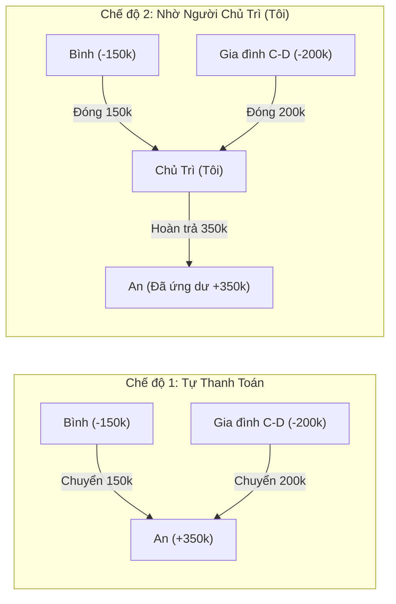

# 02. Nghiệp Vụ Tính Toán, OCR, VAT & Thuật Toán Quyết Toán (Business Logic & Algorithms)

Tài liệu này mô tả chi tiết các quy tắc nghiệp vụ, công thức toán học và thuật toán xử lý của ứng dụng.

---

## 1. Quy tắc Nhập Hoá Đơn & Chia Tiền ở Tầng Hoá Đơn / Món

### 1.0. Người tham gia Kèo (phạm vi chia tiền)
Mỗi **Kèo (`SessionKeo`)** có danh sách **người tham gia kèo** `participantIds` $P_s$, là tập con của người tham gia Bữa (có thể bằng toàn bộ hoặc chỉ một số người). **Mọi phép chia tiền của kèo chỉ tính trên $P_s$**:
- Chia đều theo tổng: $N = |P_s|$ hoặc số người được tick trong $P_s$ (`equalSplitParticipantIds` $\subseteq P_s$, mặc định $= P_s$).
- Chia từng món: người ăn của mỗi món $C_i \subseteq P_s$.
- Người ứng tiền của hoá đơn thuộc $P_s$.
- Người không thuộc $P_s$ không phát sinh khoản nợ nào từ kèo đó, kể cả khi họ có trong Bữa.
- Kèo mới mặc định $P_s$ = toàn bộ người đang có trong Bữa; người được thêm vào Bữa sau khi kèo đã tạo không tự vào kèo cũ.
- Kèo có hoá đơn thì $P_s$ không được rỗng; muốn bỏ một người ra khỏi kèo thì người đó không được đang là người ứng, người ăn hay người chia đều của hoá đơn/món trong kèo.

Mỗi **Kèo (`SessionKeo`)** chứa $K \ge 1$ **Hoá đơn (`Invoice`)**. Mỗi hoá đơn phải được gán một **Người ứng tiền (`payerMemberId`)** và hoạt động theo một trong hai chế độ nhập:

### 1.1. Chế độ 1: Chỉ nhập Tổng tiền (`inputMode = 'TOTAL_ONLY'`)
- Người dùng chỉ nhập một con số tổng tiền của hoá đơn (có thể kèm VAT nếu chưa cộng).
- **Ràng buộc bắt buộc**: Hệ thống tự động khoá `splitType = 'EQUAL_TOTAL'` (**Chia tiền đều theo tổng**), không cho phép chọn chia theo từng món.
- Tổng tiền sau VAT của hoá đơn $T_{\text{invoice}}$ được chia đều cho $N$ thành viên tham gia hoá đơn đó (`equalSplitParticipantIds` $\subseteq P_s$, xem 1.0):
  $$\text{Cost}(m) = \frac{T_{\text{invoice}}}{N}$$

### 1.2. Chế độ 2: Nhập Chi tiết từng Món (`inputMode = 'ITEMIZED'`)
Khi hoá đơn có danh sách các món $i \in \{1, \dots, M\}$ (từ OCR hoặc nhập tay), người dùng có quyền lựa chọn 1 trong 2 cách chia cho hoá đơn đó:

1. **Lựa chọn A — Chia đều theo tổng (`splitType = 'EQUAL_TOTAL'`)**:
   - Dù có danh sách món để đối chiếu bill, tổng tiền cuối cùng của hoá đơn $T_{\text{invoice}}$ vẫn được chia đều cho $N$ người tham gia hoá đơn.
2. **Lựa chọn B — Chia theo từng món (`splitType = 'BY_ITEM'`)**:
   - Mỗi món $i$ có giá gốc chưa thuế là $R_i = \text{quantity}_i \times \text{unitPrice}_i$.
   - Sau khi cộng VAT phân bổ (xem Mục 2), giá cuối cùng của món $i$ là $F_i$.
   - Món $i$ có danh sách người cùng ăn $C_i = \{(m, s_{i,m})\}$, trong đó $s_{i,m} > 0$ là số phần của thành viên $m$ (mặc định nếu chỉ tick chọn chia đều thì $s_{i,m} = 1$ cho mọi $m \in C_i$).
   - Tổng số phần của món $i$:
     $$S_i = \sum_{m \in C_i} s_{i,m}$$
   - Số tiền thành viên $m$ phải trả cho món $i$:
     $$\text{Cost}_i(m) = F_i \times \frac{s_{i,m}}{S_i}$$

> [!NOTE]
> **Xử lý sai số làm tròn (Rounding Remainder)**:
> Trong tiền tệ VNĐ, các phép chia cho 3, 6, 7... có thể tạo số lẻ thập phân. Hệ thống giữ độ chính xác số thực (`float`) trong suốt quá trình cộng dồn qua các món và các kèo của cả Bữa, và chỉ làm tròn đến đơn vị đồng (hoặc 100đ/1.000đ tuỳ chọn) ở bước xuất bảng quyết toán cuối cùng, đồng thời bù phần lệch $\pm 1\text{đ}$ vào người đầu tiên để đảm bảo **Tổng tiền cần thu luôn bằng chính xác 100% Tổng tiền đã ứng**.

---

## 2. Giảm Giá, Phí Phục Vụ, VAT & Phân Bổ Vào Món

Mọi tiền trong hoá đơn là **số nguyên đồng**; mỗi khoản được tính theo đúng thứ tự dưới đây (R-8 của Epic 4):

1. **Tiền hàng** $S$: tổng thành tiền gốc các món $R_i = \text{quantity}_i \times \text{unitPrice}_i$ (hoặc số nhập ở tab *Chỉ nhập tổng tiền*).
2. **Giảm giá** $D$ trên $S$ (`discountMode`: `NONE` / `PERCENTAGE` / `FIXED_AMOUNT`); yêu cầu $0 \le D < S$. Tiền hàng sau giảm: $N = S - D$.
3. **Phí phục vụ** $C$ tính trên $N$ (`serviceMode`).
4. **VAT** $V$ tính trên $N + C$ (`vatMode`). Với `PERCENTAGE`: $V = \text{round}\big((N+C) \times p / 100\big)$.
5. **Tổng thanh toán**: $T = N + C + V$.

Với `PERCENTAGE`, phép làm tròn là *nửa lên*; với `FIXED_AMOUNT`, số tiền là số người dùng nhập (hoặc OCR đọc từ bill). Khi bill ghi **cả % và số tiền** cho cùng một khoản, ưu tiên **số tiền** để khớp đúng bill.

> [!NOTE]
> Một số quán tính VAT chỉ trên tiền hàng, không gồm phí phục vụ. Khi đó hãy dùng `FIXED_AMOUNT` với số VAT ghi trên bill. Đây là giả định thứ tự tính đã chốt (D-1, Epic 4).

**Phân bổ vào từng món** (tuần tự, để mỗi khoản cộng lại đúng số của hoá đơn):

$$d_i = \text{alloc}(D, R_i), \quad n_i = R_i - d_i, \quad c_i = \text{alloc}(C, n_i), \quad v_i = \text{alloc}(V, n_i + c_i)$$

$$F_i = n_i + c_i + v_i$$

trong đó $\text{alloc}(X, w_i)$ chia $X$ theo tỷ lệ trọng số $w_i$ bằng số nguyên: mỗi mục nhận $\lfloor X \cdot w_i / \sum w \rfloor$, phần dư còn lại (tối đa 1đ mỗi mục) được cộng cho các mục có phần thập phân lớn nhất, hoà thì mục đứng trước. Phép nhân dùng `BigInt` để không tràn số.

Kết quả đảm bảo tuyệt đối:
$$\sum_i d_i = D, \quad \sum_i c_i = C, \quad \sum_i v_i = V, \quad \sum_i F_i = T$$

**Ví dụ** (tiền hàng 550.000, giảm 10%, phí phục vụ 5%, VAT 8%): $D = 55.000$, $N = 495.000$, $C = 24.750$, $V = 41.580$, $T = 561.330$.

---

## 3. Thuật toán OCR Nhận Diện Hoá Đơn Offline (`Tesseract.js`)

Toàn bộ pipeline OCR (xử lý ảnh, nhận diện hai lượt, bộ phân tích và đối soát tổng) được tách thành tài liệu riêng: **[ocr-pipeline.md](./ocr-pipeline.md)**.

---

## 4. Quản Lý Danh Bạ & Quick Filter Chọn Người (A-Z)

1. **Lưu trữ tự động**: Bất kỳ tên người mới nào được thêm vào một Bữa đều được lưu ngay vào bảng `members` trong IndexedDB.
2. **Sắp xếp Alphabet (A-Z)**:
   - Sử dụng `Intl.Collator('vi', { sensitivity: 'base' })` để sắp xếp danh sách tên chuẩn bảng chữ cái Tiếng Việt (An $\rightarrow$ Ánh $\rightarrow$ Bình $\rightarrow$ Cường $\rightarrow$ Đạt...).
3. **Cơ chế Quick Filter (Gõ tới đâu lọc tới đó)**:
   - Chuẩn hoá cả chuỗi tìm kiếm và tên thành viên qua hàm bỏ dấu Tiếng Việt (`removeVietnameseTones(str).toLowerCase()`).
   - Khi người dùng gõ `"an"`, hệ thống lập tức lọc ra `"An"`, `"Anh"`, `"Ẩn"`, `"Văn An"` theo thời gian thực.
   - **Tạo mới tức thì**: Nếu từ khoá đang gõ chưa khớp chính xác (exact match) với thành viên nào trong danh bạ, dòng đầu tiên/cuối cùng trong dropdown hiển thị nút: **`+ Thêm người mới: "<Từ khoá đang gõ>"`** (nhấn `Enter` hoặc click để tạo và thêm thẳng vào bữa).

---

## 5. Gom Nhóm Thanh Toán (Cặp Đôi / Gia Đình) & Tính Toán Theo Bữa

### 5.1. Tổng hợp chi phí cá nhân trên toàn Bữa
> **Quy tắc "ứng trước"**: mỗi hoá đơn có đúng **một** người ứng, người đó trả **toàn bộ** $T_{inv}$ (không phải một phần). Việc ứng không làm đổi phần phải chi của ai; chênh lệch chỉ xuất hiện khi kết toán: người ứng được ghi có $T_{inv}$, mỗi người ăn bị ghi nợ phần $\text{Cost}_{inv}(m)$, nên những người còn lại nợ người ứng phần của mình.

Trong một Bữa $B$, xét tất cả các Kèo $s \in B$ và tất cả các Hoá đơn $inv \in s$:
- **Tổng tiền thành viên $m$ đã ứng trước (`paidByMember`)**:
  $$\text{Paid}(m) = \sum_{\substack{inv \in B \\ \text{payer}(inv) = m}} T_{inv}$$
- **Tổng tiền thành viên $m$ đã tiêu dùng (`owedByMember`)**:
  $$\text{Owed}(m) = \sum_{inv \in B} \text{Cost}_{inv}(m)$$

### 5.2. Ánh xạ sang Thực Thể Thanh Toán (`PaymentEntity`) — Hỗ trợ Gom Nhóm
Một Bữa có thể cấu hình các **Nhóm thanh toán (`PaymentGroup`)** cho cặp đôi hoặc gia đình (VD: Nhóm *"Gia đình A & B"* gồm thành viên $A$ và $B$).
- Những thành viên **không thuộc nhóm nào** là một `PaymentEntity` độc lập: $E = \{m\}$.
- Những thành viên **thuộc cùng một nhóm** $G$ được gộp lại thành một `PaymentEntity` duy nhất: $E_G = \{m_1, m_2, \dots\}$.
- Với mỗi Thực thể thanh toán $E$:
  $$\text{TotalPaid}(E) = \sum_{m \in E} \text{Paid}(m)$$
  $$\text{TotalOwed}(E) = \sum_{m \in E} \text{Owed}(m)$$
  $$\text{NetBalance}(E) = \text{TotalPaid}(E) - \text{TotalOwed}(E)$$

Ý nghĩa của $\text{NetBalance}(E)$:
- $\text{NetBalance}(E) > 0$: Thực thể $E$ đã ứng dư, **cần được nhận lại** số tiền này.
- $\text{NetBalance}(E) < 0$: Thực thể $E$ chi nhiều hơn ứng, **cần phải trả thêm** $|\text{NetBalance}(E)|$.
- $\text{NetBalance}(E) = 0$: Đã cân bằng, không cần trả hay nhận thêm.

---

## 6. Hai Chế Độ Quyết Toán Cuối Bữa (Settlement Modes)

Người dùng có thể chuyển đổi qua lại tức thì giữa 2 chế độ quyết toán cho mỗi Bữa:

### 6.1. Chế độ 1: Tự Thanh Toán (`SELF_SETTLEMENT`)
Mục tiêu: Liệt kê rõ từng cá nhân/nhóm phải chuyển khoản trực tiếp cho ai đã ứng tiền, sao cho tổng số giao dịch chuyển khoản là tối thiểu.

**Thuật toán Tối ưu dòng tiền (Greedy Net-Balance Matching)**:
1. Chia các Thực thể thanh toán thành 2 tập:
   - Tập **Người nhận lại tiền (Creditors)**: $\mathcal{C} = \{E \mid \text{NetBalance}(E) > 0\}$, sắp xếp giảm dần theo $\text{NetBalance}$.
   - Tập **Người phải trả tiền (Debtors)**: $\mathcal{D} = \{E \mid \text{NetBalance}(E) < 0\}$, sắp xếp giảm dần theo $|\text{NetBalance}|$.
2. Lặp khi cả $\mathcal{C}$ và $\mathcal{D}$ đều khác rỗng:
   - Lấy $D \in \mathcal{D}$ đang nợ nhiều nhất (số tiền nợ $d = |\text{NetBalance}(D)|$) và $C \in \mathcal{C}$ đang cần nhận nhiều nhất (số tiền cần nhận $c = \text{NetBalance}(C)$).
   - Tạo lệnh thanh toán: **$D$ trả cho $C$ số tiền $x = \min(d, c)$**.
   - Cập nhật $d \leftarrow d - x$ và $c \leftarrow c - x$.
   - Loại bỏ thực thể có số dư về $0$ khỏi tập tương ứng.

### 6.2. Chế độ 2: Nhờ Người Chủ Trì (`HOST_MEDIATED`)
Mục tiêu: Mọi khoản thanh toán quy về một mối là **Người chủ trì ($H$)** (mặc định là Chủ app, hoặc thành viên được chọn làm chủ trì của bữa đó).
- Nếu Người chủ trì $H$ nằm trong một Nhóm thanh toán $E_H$, thì $E_H$ đóng vai trò là đầu mối chủ trì (hoặc chính cá nhân $H$ nếu $H$ đứng lẻ).
- Với mọi Thực thể thanh toán $E \neq E_H$:
  - **Nếu $\text{NetBalance}(E) < 0$ (Thiếu tiền)**: Tạo khoản phải thu $\rightarrow$ **$E$ chuyển cho Người chủ trì ($H$) số tiền $|\text{NetBalance}(E)|$**.
  - **Nếu $\text{NetBalance}(E) > 0$ (Đã ứng dư)**: Tạo khoản phải trả lại $\rightarrow$ **Người chủ trì ($H$) chuyển trả lại cho $E$ số tiền $\text{NetBalance}(E)$**.



---

## 7. Trạng Thái Thanh Toán & Quy Trình Lưu Trữ Bữa (Archive Lifecycle)

### 7.1. Tick chọn Đã Thanh Toán
- Trong bảng quyết toán của Bữa, mỗi Cá nhân thanh toán hoặc Nhóm thanh toán (có $\text{NetBalance} \neq 0$) có một ô checkbox **"Đã thanh toán"**.
- Khi người dùng tick vào, hệ thống ghi nhận `settlementStatuses[entityId] = { isPaid: true, paidAt: now }`.
- Nếu một thực thể có $\text{NetBalance} = 0$ (không nợ cũng không cần nhận lại), trạng thái mặc định được coi là đã hoàn tất thanh toán.

### 7.2. Điều kiện & Quy trình Lưu Trữ Bữa (Archive)
1. **Điều kiện tiên quyết (Guard Rule)**:
   - Nút **"Lưu trữ bữa"** chỉ được kích hoạt khi **TẤT CẢ** các Cá nhân / Nhóm thanh toán có phát sinh chênh lệch ($\text{NetBalance} \neq 0$) trong bữa đều đã được tick **"Đã thanh toán"** (`isPaid === true`).
   - Nếu còn bất kỳ ai chưa hoàn tất thanh toán, hệ thống khoá nút Lưu trữ và hiển thị cảnh báo rõ ràng những ai chưa thanh toán.
2. **Hành động khi Lưu trữ (Atomic Transaction)**:
   - **Bước 1**: Tính toán và đóng gói `ArchivedMealSummary` (lưu tổng tiền từng kèo `SessionKeo.archivedTotalAmount`, tổng tiền bữa, và lịch sử thanh toán của các cá nhân/nhóm).
   - **Bước 2**: Xoá toàn bộ các file ảnh hoá đơn của bữa đó trong OPFS / `invoice_files`.
   - **Bước 3**: Xoá các bản ghi hoá đơn (`invoices`) thuộc bữa đó trong IndexedDB. **Giữ nguyên các bản ghi món (`items`)** để vẫn xem lại được món của từng kèo.
   - **Bước 4**: Chuyển trạng thái bữa sang `status = 'ARCHIVED'`, ghi nhận `archivedAt`.
3. **Sau khi Lưu trữ**:
   - Bữa chuyển sang chế độ **Chỉ đọc (Read-only)**: Không thể thêm/sửa/xoá kèo, hoá đơn, món, người tham gia hay trạng thái thanh toán.
   - Giao diện chi tiết bữa đã lưu trữ hiển thị danh sách các Kèo kèm tổng chi phí mỗi kèo và bảng kết quả thanh toán cuối cùng.
   - **Xoá bữa đã lưu trữ**: Người dùng vẫn có quyền **Xoá vĩnh viễn** bữa đã lưu trữ khỏi hệ thống.

---

## 8. Cơ Chế Tạo Snapshot Custom URL & Chia Sẻ Tin Nhắn Thanh Toán

### 8.1. Thuật toán Đóng gói & Giải mã Custom URL Snapshot (Read-Only)

Để tạo ra một đường dẫn URL duy nhất chứa toàn bộ thông tin của 1 Bữa mà không cần máy chủ lưu trữ trung gian:

1. **Bước 1 — Thu thập dữ liệu (`buildSnapshotPayload`)**:
   - Đọc thông tin `Meal`, danh sách `Member` tham gia bữa, các nhóm `PaymentGroup`, danh sách `SessionKeo`, danh sách `Invoice` (metadata) và danh sách `InvoiceItem` của bữa đó (hoặc `archivedSummary` nếu bữa đã lưu trữ).
   - Loại bỏ dữ liệu nhị phân nặng (ảnh gốc `Blob`) để đảm bảo URL gọn nhẹ và tương thích với mọi ứng dụng nhắn tin.
2. **Bước 2 — Nén & Tạo Custom URL (`encodeSnapshotUrl`)**:
   - Chuyển đối tượng `MealSnapshotPayload` sang chuỗi JSON.
   - Nén bằng thuật toán **LZ-String (`compressToEncodedURIComponent`)** tạo chuỗi Base64URL an toàn với mọi trình duyệt và ứng dụng chat.
   - Ghép thành Custom URL:
     ```text
     <window.location.origin><window.location.pathname>?snapshot=<encoded_data>
     ```
3. **Bước 3 — Mở & Khóa Chỉnh sửa (`decodeSnapshotUrl`)**:
   - Khi ứng dụng khởi chạy và phát hiện tham số `?snapshot=...` trên thanh địa chỉ:
   - Giải nén chuỗi thành `MealSnapshotPayload`.
   - Kích hoạt **Chế độ Xem Snapshot (`isSnapshotView = true`)**:
     - Hiển thị đầy đủ 3 tầng thông tin của bữa (Bữa $\rightarrow$ Kèo $\rightarrow$ Hoá đơn $\rightarrow$ Món) và Bảng quyết toán cuối bữa.
     - **Khoá toàn bộ quyền chỉnh sửa**: Ẩn và vô hiệu hoá mọi thao tác thêm/sửa/xoá thành viên, nhóm, kèo, hoá đơn, món, đổi chế độ thanh toán, tick thanh toán hay lưu trữ/xoá bữa.

---

### 8.2. Quy tắc Định dạng Nội dung Chia sẻ Tin nhắn Thanh toán

Khi người dùng bấm **"Chia sẻ thông báo thanh toán"**, hệ thống tổng hợp danh sách các khoản nợ (`transfers`) từ chế độ thanh toán hiện tại của Bữa (Tự thanh toán hoặc Nhờ người chủ trì) và định dạng văn bản theo đúng mẫu chuẩn:

#### Cấu trúc mẫu:
```text
<Tên bữa>
- <Cá nhân>: chuyển cho <cá nhân> <số tiền>, chuyển cho <cá nhân> <số tiền>,...
- <Cá nhân> + <cá nhân>: ...
<Link snapshot>
```

#### Quy tắc hiển thị Tên Thực thể (Cá nhân vs Nhóm thanh toán):
1. **Đối với Cá nhân lẻ**: Hiển thị trực tiếp `<Tên cá nhân>` (VD: `Bình`).
2. **Đối với Nhóm thanh toán (Cặp đôi / Gia đình)**: Hiển thị tên các thành viên trong nhóm nối với nhau bằng dấu ` + ` theo đúng quy ước `<Cá nhân> + <cá nhân>` (VD: `Cường + Dung` hoặc `An + Bình + Bé Bông`).
3. **Gom các khoản nợ trên cùng 1 dòng cho mỗi Cá nhân / Nhóm**:
   - Nếu một Cá nhân hoặc Nhóm $E$ có các khoản phải trả cho nhiều người nhận $R_1, R_2, \dots$ với số tiền $A_1, A_2, \dots$:
   - Định dạng thành một dòng duy nhất:
     `- <Tên hiển thị của E>: chuyển cho <Tên R_1> <A_1>, chuyển cho <Tên R_2> <A_2>`
   - Ví dụ thực tế:
     ```text
     Đi ăn cuối tuần Đà Lạt
     - Bình: chuyển cho An 150.000đ, chuyển cho Phương 80.000đ
     - Cường + Dung: chuyển cho An 420.000đ
     https://usdsplit.app/?snapshot=N4IgRg9gTgpiBcIA8AhA...
     ```

---

### 8.3. Chia sẻ qua Ứng dụng khác (Web Share API & Clipboard Fallback)

1. **Chia sẻ trực tiếp qua hệ điều hành (`navigator.share`)**:
   - Trên thiết bị di động (iOS / Android) và trình duyệt hỗ trợ **Web Share API** (Safari macOS, Chrome, Edge...), khi bấm nút **"Gửi qua ứng dụng khác"**, hệ thống gọi:
     ```typescript
     await navigator.share({
       title: meal.title,
       text: formattedShareMessage, // Đã bao gồm Tên bữa, danh sách nợ và Link snapshot ở dòng cuối
     });
     ```
   - Cho phép người dùng chọn gửi ngay vào nhóm chat **Zalo, Messenger, Telegram, iMessage, SMS, Viber...**
2. **Sao chép nhanh (Clipboard & Preview)**:
   - Cung cấp thêm nút **"Sao chép tin nhắn"** và **"Sao chép riêng Link Snapshot"** ngay trong hộp thoại Chia sẻ để người dùng trên máy tính có thể dán (`Ctrl+V` / `Cmd+V`) trực tiếp vào cửa sổ chat.

