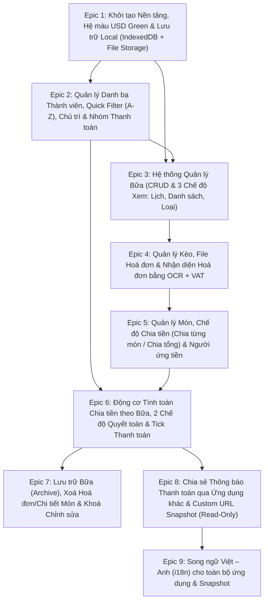

# 04. Phân Rã Epics & Lộ Trình Triển Khai (Epics Breakdown & Roadmap)

Toàn bộ yêu cầu của hệ thống chia tiền được chia thành **8 Epics** rõ ràng theo thứ tự phụ thuộc kỹ thuật và nghiệp vụ.

---

## Tổng quan Sơ đồ Phụ thuộc giữa các Epics



---

## Chi Tiết Từng Epic

### EPIC 1: Khởi tạo Nền tảng, Hệ màu USD Green & Lớp Lưu trữ Local
**Mục tiêu**: Xây dựng khung ứng dụng React + TypeScript, thiết lập hệ thống giao diện màu xanh lá đậm của tiền USD, và xây dựng cơ sở dữ liệu IndexedDB + lưu trữ File hoá đơn trên trình duyệt.

#### Danh sách Tính năng / User Stories:
- **US-1.1**: Khởi tạo dự án Vite + React + TypeScript + Tailwind CSS với bảng màu **USD Dark Green (`#123123`, `#1B4332`, `#2D6A4F`, nền giấy `#F2EFE9`)**.
- **US-1.2**: Thiết kế Schema IndexedDB (thông qua `Dexie.js`) cho 3 tầng dữ liệu: `meals` (Bữa), `sessions` (Kèo), `invoices` (Hoá đơn), `items` (Món), `members` (Danh bạ người), `invoice_files` (File hoá đơn) và `settings`.
- **US-1.3**: Xây dựng dịch vụ quản lý File hoá đơn (`fileStorageService`) sử dụng Origin Private File System (OPFS) kết hợp IndexedDB Blob để lưu, đọc, tải xuống và xoá vật lý các file ảnh hoá đơn.
- **US-1.4**: Khởi tạo dữ liệu mặc định cho hồ sơ **"Tôi"** dùng làm Người chủ trì mặc định.

#### Tiêu chí nghiệm thu (Acceptance Criteria):
- [ ] Giao diện mang đậm phong cách tờ tiền USD (màu xanh lá đậm, nền giấy kem, font số thẳng cột).
- [ ] Dữ liệu lưu bền vững trên trình duyệt sau khi tải lại trang (F5).
- [ ] File ảnh hoá đơn khi thêm/xoá thực sự được lưu thành file và giải phóng dung lượng khi xoá.

---

### EPIC 2: Quản lý Danh bạ Thành viên, Quick Filter (A-Z), Chủ trì & Nhóm Thanh toán
**Mục tiêu**: Cho phép thêm/xoá người vào bữa, tự động lưu lịch sử người từng tham gia để chọn nhanh lần sau qua bộ lọc Alphabet, chỉ định Người chủ trì và gom nhóm thanh toán (cặp đôi / gia đình).

#### Danh sách Tính năng / User Stories:
- **US-2.1**: Lưu trữ danh bạ thành viên toàn cục (`members`). Bất kỳ ai từng được thêm vào một bữa sẽ tự động xuất hiện trong danh sách gợi ý cho các bữa sau.
- **US-2.2**: Xây dựng component **Quick Filter Chọn Người**:
  - Luôn sắp xếp danh sách theo thứ tự **Alphabet (A-Z)** chuẩn Tiếng Việt.
  - Gõ tới đâu lọc danh sách tới đó theo thời gian thực (hỗ trợ tìm kiếm có dấu và không dấu).
  - Nếu từ khoá đang gõ chưa tồn tại trong danh bạ, hiển thị nút **"+ Thêm người mới"** ngay trong bộ lọc để tạo và thêm thẳng vào bữa.
- **US-2.3**: Quản lý hồ sơ **"Tôi"** và cho phép đổi chỉ định **Người chủ trì (Host)** trong từng bữa cụ thể.
- **US-2.4**: Xây dựng tính năng **Gom nhóm thanh toán (`PaymentGroup`)** trong bữa:
  - Cho phép gom 2 hoặc nhiều thành viên (cặp đôi, vợ chồng, gia đình) thành 1 nhóm thanh toán chung.
  - Hỗ trợ đặt tên nhóm (VD: *"Gia đình An - Bình"*), chỉnh sửa hoặc giải tán nhóm.

#### Tiêu chí nghiệm thu (Acceptance Criteria):
- [ ] Danh sách chọn người luôn xếp đúng thứ tự A-Z và lọc tức thì theo từng ký tự gõ vào.
- [ ] Thêm người mới chưa có trong danh bạ chỉ mất 1 cú click hoặc phím `Enter` ngay tại ô Quick Filter.
- [ ] Các thành viên đã thuộc 1 Nhóm thanh toán không thể bị gán trùng vào nhóm thứ 2 trong cùng một bữa.

---

### EPIC 3: Hệ thống Quản lý Bữa (CRUD & 3 Chế độ Hiển thị)
**Mục tiêu**: Quản lý Tầng 1 (**Bữa** - tính theo ngày), hỗ trợ thêm/sửa/xoá bữa và chuyển đổi mượt mà giữa 3 chế độ hiển thị danh sách bữa.

#### Danh sách Tính năng / User Stories:
- **US-3.1**: Tạo mới, chỉnh sửa thông tin chung (Tên bữa, Ngày diễn ra, Ghi chú) và xoá Bữa (cả bữa đang hoạt động lẫn bữa đã lưu trữ).
- **US-3.2**: **Chế độ xem 1 — Theo Ngày/Tháng/Năm (Dùng Lịch / Calendar View)**:
  - Hiển thị lưới lịch theo tháng/năm.
  - Đánh dấu trực quan những ngày có Bữa kèm tổng số tiền, bấm vào ngày để xem các bữa trong ngày hoặc tạo bữa mới cho ngày đó.
- **US-3.3**: **Chế độ xem 2 — Theo Danh sách (Từ mới đến cũ / Chronological List View)**:
  - Sắp xếp các bữa theo thứ tự thời gian từ mới nhất đến cũ nhất, hiển thị tóm tắt số kèo, số người, tổng chi phí và trạng thái thanh toán.
- **US-3.4**: **Chế độ xem 3 — Theo Loại (Bữa còn hoạt động vs Bữa đã lưu trữ / Status View)**:
  - Phân tách rõ danh sách Bữa còn hoạt động (`ACTIVE`) và Bữa đã lưu trữ (`ARCHIVED`).

#### Tiêu chí nghiệm thu (Acceptance Criteria):
- [ ] Chuyển đổi giữa 3 chế độ xem (Lịch / Danh sách Mới->Cũ / Theo Loại) giữ nguyên tính nhất quán dữ liệu.
- [ ] Khi xoá một Bữa, toàn bộ Kèo, Hoá đơn, File ảnh hoá đơn và Món thuộc bữa đó đều bị xoá sạch.

---

### EPIC 4: Quản lý Kèo (Tầng 2), File Hoá đơn & Nhận diện OCR + VAT

> **Trạng thái**: đã triển khai (xem [epic-4/SA.md](./epic-4/SA.md) mục B.10 để biết kết quả kiểm và phần còn lại). Phạm vi cộng thêm so với bản gốc: giảm giá và phí phục vụ cả bill, nén ảnh có gợi ý chất lượng OCR, kèo tự đổi tên theo quán.
**Mục tiêu**: Quản lý các Kèo trong một Bữa, lưu trữ nhiều hoá đơn thành file cho mỗi kèo, chụp/tải ảnh hoá đơn, quét OCR tự động bóc tách thông tin (ngày, quán, món, giá) và tự động phát hiện/tính VAT.

#### Danh sách Tính năng / User Stories:
- **US-4.1**: Thêm, đổi tên, sắp xếp và xoá **Kèo** (nơi thanh toán) trong một Bữa.
- **US-4.1b**: Chọn **người tham gia từng Kèo** (`SessionKeo.participantIds`): mặc định là tất cả mọi người trong Bữa, có thể bỏ bớt hoặc thêm lại; chỉ chọn được trong số người của Bữa. Mọi phép chia tiền của kèo chỉ tính trên những người này.
- **US-4.2**: Quản lý **Hoá đơn** trong Kèo (mỗi kèo có thể có 1 hoặc nhiều hoá đơn; mỗi hoá đơn có thể đính kèm 1 hoặc nhiều file ảnh; hỗ trợ chụp ảnh từ camera hoặc tải file lên; hỗ trợ thêm/xoá file hoá đơn).
- **US-4.3**: Tích hợp **OCR Offline (`Tesseract.js` Tiếng Việt + Tiếng Anh)** kèm bước tiền xử lý ảnh Canvas:
  - Tự động nhận diện **Ngày**, **Tên quán**, **Danh sách món** và **Giá tiền món**.
  - Tự động phát hiện **VAT** (ví dụ `VAT 8%`, `VAT 10%`, hoặc số tiền thuế GTGT cụ thể) trên hoá đơn.
- **US-4.4**: Cơ chế tự động tính và phân bổ VAT vào giá của từng món (theo % hoặc phân bổ tỷ lệ thuận theo số tiền VAT cố định).

#### Tiêu chí nghiệm thu (Acceptance Criteria):
- [ ] Mỗi Kèo có danh sách người tham gia riêng (mặc định tất cả người trong Bữa); người ứng tiền, người chia đều và người ăn món của hoá đơn đều phải thuộc danh sách đó.
- [ ] Mỗi Kèo thêm được nhiều hoá đơn; mỗi hoá đơn lưu thành file ảnh có thể xem lại, tải về hoặc xoá đi.
- [ ] Quét ảnh hoá đơn bằng OCR bóc tách được ngày, tên quán, danh sách món + giá và VAT, cho phép người dùng kiểm tra/sửa nhanh trước khi lưu.
- [ ] Khi hoá đơn có VAT, giá từng món tự động được cộng thêm phần VAT tương ứng để tổng các món khớp 100% tổng thanh toán hoá đơn.

---

### EPIC 5: Quản lý Món (Tầng 3), Chế độ Chia tiền & Người ứng tiền
**Mục tiêu**: Quản lý chi tiết từng món ăn, hỗ trợ thêm hoá đơn bằng tay hoặc chỉ nhập tổng tiền, lựa chọn chia từng món hoặc chia đều theo tổng, và đánh dấu người ứng tiền cho từng hoá đơn.

#### Danh sách Tính năng / User Stories:
- **US-5.1**: Đánh dấu **Người ứng tiền (`payerMemberId`)** cho từng hoá đơn (chọn trong số người tham gia kèo).
- **US-5.2**: Hỗ trợ 2 phương thức nhập hoá đơn:
  - **Nhập chi tiết món (bằng tay hoặc từ OCR)**: Thêm/sửa/xoá từng món (tên món, số lượng, đơn giá).
  - **Chỉ nhập tổng tiền (`TOTAL_ONLY`)**: Không cần nhập món; **bắt buộc** khoá chế độ chia tiền là **"Chia đều theo tổng" (`EQUAL_TOTAL`)**.
- **US-5.3**: Lựa chọn chế độ chia tiền cho hoá đơn có chi tiết món:
  - Chuyển đổi linh hoạt giữa **Chia từng món (`BY_ITEM`)** và **Chia đều theo tổng (`EQUAL_TOTAL`)**.
- **US-5.4**: Gán người ăn cho từng món (khi ở chế độ `BY_ITEM`):
  - Tick chọn nhanh những ai cùng ăn món đó, chỉ trong số người tham gia kèo (mặc định chia đều cho những người được tick).
  - Hỗ trợ điều chỉnh **số phần (`shares`)** nếu một người gọi nhiều phần riêng trong cùng một mục món.

#### Tiêu chí nghiệm thu (Acceptance Criteria):
- [ ] Nếu chọn "Chỉ thêm tổng tiền", giao diện tự động chọn và khoá ở chế độ "Chia tiền đều theo tổng".
- [ ] Nếu có danh sách món, người dùng có thể đổi qua lại giữa "Chia từng món" và "Chia đều theo tổng" bất cứ lúc nào.
- [ ] Có thể thêm, sửa, xoá từng món và chọn người ứng tiền cho mỗi hoá đơn.

---

### EPIC 6: Động cơ Tính toán Chia tiền theo Bữa, 2 Chế độ Quyết toán & Tick Thanh toán
**Mục tiêu**: Tổng hợp toàn bộ số tiền đã ứng và số tiền phải chi của tất cả các kèo trong Bữa, gom nhóm thanh toán (cặp đôi/gia đình), tính toán chuyển khoản theo 2 chế độ (Tự thanh toán vs Nhờ người chủ trì) và theo dõi trạng thái đã thanh toán.

#### Danh sách Tính năng / User Stories:
- **US-6.1**: Tổng hợp chi phí toàn Bữa theo từng thành viên (chi tiết đã ứng ở hoá đơn nào, đã ăn những món nào ở kèo nào); người không tham gia một kèo không bị tính tiền kèo đó.
- **US-6.2**: Gom công nợ theo **Nhóm thanh toán (`PaymentGroup`)**: Cộng tổng số tiền đã ứng và tổng số tiền cần trả của các thành viên trong nhóm rồi tính số dư chênh lệch ròng như 1 cá nhân thanh toán duy nhất.
- **US-6.3**: **Chế độ 1 — Tự thanh toán (`SELF_SETTLEMENT`)**:
  - Tính toán và liệt kê rõ từng cá nhân/nhóm phải trả cho ai bao nhiêu tiền dựa trên số thực chi và người đã ứng tiền.
- **US-6.4**: **Chế độ 2 — Nhờ người chủ trì (`HOST_MEDIATED`)**:
  - Mọi cá nhân/nhóm thiếu tiền sẽ chuyển toàn bộ khoản cần đóng cho **Người chủ trì**; Người chủ trì sẽ thanh toán lại cho những cá nhân/nhóm đã ứng dư tiền.
- **US-6.5**: Tính năng **Tick chọn đã thanh toán**:
  - Ghi nhận trạng thái đã hoàn tất thanh toán sau bữa của từng cá nhân thanh toán / nhóm thanh toán.

#### Tiêu chí nghiệm thu (Acceptance Criteria):
- [ ] Tổng số tiền cần thu luôn khớp chính xác với tổng số tiền cần hoàn trả cho những người đã ứng.
- [ ] Nhóm thanh toán (cặp đôi/gia đình) hiển thị đúng tổng ứng, tổng chi và 1 con số chênh lệch ròng duy nhất.
- [ ] Chuyển đổi giữa "Tự thanh toán" và "Nhờ người chủ trì" cập nhật ngay danh sách lệnh chuyển tiền.
- [ ] Có thể tick / bỏ tick trạng thái "Đã thanh toán" cho từng cá nhân hoặc nhóm thanh toán (khi bữa chưa lưu trữ).

---

### EPIC 7: Lưu trữ Bữa (Archive), Dọn dẹp Hoá đơn/Món & Khoá Chỉnh sửa
**Mục tiêu**: Cho phép lưu trữ bữa sau khi mọi thanh toán đã hoàn tất, tự động xoá toàn bộ file hoá đơn và chi tiết món để chỉ giữ lại chi phí từng kèo, khoá chỉnh sửa bữa đã lưu trữ nhưng vẫn cho phép xoá.

#### Danh sách Tính năng / User Stories:
- **US-7.1**: Kiểm tra điều kiện Lưu trữ bữa:
  - Chặn lưu trữ nếu còn bất kỳ cá nhân / nhóm thanh toán nào (có số dư khác 0) chưa được tick "Đã thanh toán".
- **US-7.2**: Thực thi quy trình Lưu trữ (`Archive Meal`):
  - Lưu lại tổng chi phí của từng Kèo và bảng tổng kết thanh toán vào `Meal.archivedSummary`.
  - Xoá toàn bộ các file ảnh hoá đơn (`invoice_files` / OPFS), bản ghi hoá đơn (`invoices`) và chi tiết từng món (`items`) của bữa đó.
  - Chuyển trạng thái bữa sang `ARCHIVED`.
- **US-7.3**: Giao diện chế độ **Bữa đã lưu trữ (Read-only)**:
  - Khoá toàn bộ thao tác chỉnh sửa (không thể sửa người, nhóm, kèo, hoá đơn, món hay trạng thái thanh toán).
  - Hiển thị thông tin chi phí từng kèo và lịch sử quyết toán đã chốt.
- **US-7.4**: Cho phép **Xoá vĩnh viễn** một bữa đã lưu trữ.

#### Tiêu chí nghiệm thu (Acceptance Criteria):
- [ ] Không thể bấm Lưu trữ nếu chưa tick đủ 100% các khoản thanh toán trong bữa.
- [ ] Sau khi Lưu trữ, bữa hoàn toàn không thể chỉnh sửa được nữa; toàn bộ file ảnh hoá đơn và chi tiết món bị xoá sạch khỏi bộ nhớ, chỉ còn lại thông tin chi phí từng kèo.
- [ ] Bữa đã lưu trữ vẫn có thể bị xoá hoàn toàn khi người dùng bấm Xoá.

---

### EPIC 8: Chia sẻ Thông báo Thanh toán qua Ứng dụng khác & Custom URL Snapshot (Read-Only)
**Mục tiêu**: Đóng gói toàn bộ thông tin của 1 Bữa thành một Custom URL Snapshot (chỉ đọc, không thể sửa đổi khi mở link) và tạo tin nhắn thông báo thanh toán đúng định dạng chuẩn để chia sẻ sang các ứng dụng nhắn tin khác.

#### Danh sách Tính năng / User Stories:
- **US-8.1**: Xây dựng bộ mã hoá & giải mã **Custom URL Snapshot (`snapshotService`)**:
  - Đóng gói toàn bộ thông tin của 1 bữa (Thông tin bữa, Thành viên, Nhóm thanh toán, Kèo, Hoá đơn, Món, Bảng quyết toán) và nén bằng `lz-string` vào tham số URL (`?snapshot=...`).
- **US-8.2**: Xây dựng giao diện **Xem Snapshot Chỉ Đọc (`Read-Only Snapshot Viewer`)**:
  - Khi người dùng mở đường link chứa `?snapshot=...`, hiển thị đầy đủ thông tin bữa đó nhưng **khoá toàn bộ tính năng chỉnh sửa/thêm/xoá** (người mở snapshot tuyệt đối không thể thay đổi thông tin bữa).
- **US-8.3**: Xây dựng bộ định dạng tin nhắn thông báo thanh toán (`formatShareMessage`) theo đúng cấu trúc yêu cầu:
  ```text
  <Tên bữa>
  - <Cá nhân>: nợ <cá nhân> <số tiền>, nợ <cá nhân> <số tiền>,...
  - <Cá nhân> + <cá nhân>: ...
  <Link snapshot>
  ```
- **US-8.4**: Tích hợp chia sẻ sang ứng dụng khác bằng **Web Share API (`navigator.share`)** kèm chức năng sao chép nhanh tin nhắn / link snapshot vào Clipboard.

#### Tiêu chí nghiệm thu (Acceptance Criteria):
- [ ] Custom URL Snapshot mở được trên bất kỳ trình duyệt/thiết bị nào và hiển thị trọn vẹn thông tin bữa mà không cần backend server.
- [ ] Người mở link Snapshot hoàn toàn không thể sửa đổi bất kỳ dữ liệu nào của bữa đó.
- [ ] Nội dung chia sẻ tuân thủ chính xác định dạng `<Tên bữa>`, các dòng `- <Cá nhân>: nợ ...`, dòng nhóm thanh toán `- <Cá nhân> + <cá nhân>: nợ ...`, và dòng cuối là `<Link snapshot>`.
- [ ] Gửi được trực tiếp qua các ứng dụng khác (Zalo, Messenger, Telegram, Tin nhắn...) thông qua menu chia sẻ của thiết bị hoặc sao chép 1 chạm.

---

### EPIC 9: Song ngữ Việt – Anh (i18n) cho toàn bộ ứng dụng & Snapshot

> **Trạng thái**: đã triển khai, còn kiểm thủ công trước khi đóng (xem [epic-9/BR.md](./epic-9/BR.md), [epic-9/SA.md](./epic-9/SA.md)).

**Mục tiêu**: Ứng dụng hỗ trợ tiếng Anh (`en`) bên cạnh tiếng Việt (`vi`), chuyển qua lại bằng công tắc ngôn ngữ. Mọi hiển thị — gồm tên ứng dụng và nội dung Snapshot — đều theo ngôn ngữ đã chọn; trang Snapshot có công tắc ngôn ngữ riêng.

#### Danh sách Tính năng / User Stories:
- **US-9.1**: Hạ tầng i18n (`I18nProvider`, `useT`, từ điển `vi`/`en` cùng tập khoá) và **công tắc ngôn ngữ** trên thanh đầu trang; ghi nhớ lựa chọn, mặc định theo ngôn ngữ trình duyệt.
- **US-9.2**: Chuyển toàn bộ chuỗi giao diện (nhãn, nút, placeholder, `aria-label`, lỗi, trạng thái rỗng) sang từ điển; **tên ứng dụng** đổi theo ngôn ngữ (`<title>`, header, PWA).
- **US-9.3**: Định dạng theo ngôn ngữ: ngày, dấu phân cách số (tiền vẫn là VNĐ), sắp xếp; các giá trị mặc định do hệ thống sinh ("Tôi"/"Me", "Kèo n"/"Venue n") hiển thị theo ngôn ngữ.
- **US-9.4**: Tin nhắn thanh toán (`formatShareMessage`) sinh theo ngôn ngữ; link Snapshot mang tham số `l` ngôn ngữ người gửi.
- **US-9.5**: Trang **Xem Snapshot** có công tắc ngôn ngữ; toàn bộ nội dung đổi theo, không ghi IndexedDB, link cũ vẫn mở được.

#### Tiêu chí nghiệm thu (Acceptance Criteria):
- [ ] Đổi ngôn ngữ đổi tức thì toàn bộ màn hình, không sót chuỗi của ngôn ngữ kia; dữ liệu người dùng nhập không bị dịch.
- [ ] Tên ứng dụng, tin nhắn chia sẻ và trang Snapshot đều theo ngôn ngữ đã chọn; Snapshot đổi ngôn ngữ được ngay trên trang.
- [ ] Số liệu tính toán không đổi giữa hai ngôn ngữ; bố cục không vỡ ở 375 px với tiếng Anh.

---

## Đối chiếu Kiểm tra Đầy đủ Yêu cầu (Requirements Traceability Matrix)

| STT | Yêu cầu từ Người dùng | Tài liệu Thiết kế | Epic phụ trách |
| :-: | :--- | :--- | :--- |
| 1 | Hệ thống quản lý chia tiền 3 tầng: Bữa (ngày), Kèo (nơi thanh toán), Món (từng món) | `01-architecture-and-data-model.md` | Epic 1, 3, 4, 5 |
| 2 | Chụp ảnh hoá đơn, mỗi kèo có thể có nhiều hơn 1 hoá đơn | `01-architecture-and-data-model.md` | Epic 4 |
| 3 | Tự nhận diện nội dung hoá đơn bằng OCR để liệt kê ngày, quán, món, giá tiền món | `02-business-logic-and-algorithms.md` | Epic 4 |
| 4 | Tự phát hiện và tính thêm VAT vào món nếu có | `02-business-logic-and-algorithms.md` | Epic 4 |
| 5 | Lựa chọn chia tiền đều theo tổng thay vì chia từng món | `02-business-logic-and-algorithms.md` | Epic 5 |
| 6 | Thêm hoá đơn bằng tay hoặc thêm tổng tiền. Nếu chỉ thêm tổng tiền, bắt buộc chia theo tổng | `02-business-logic-and-algorithms.md` | Epic 5 |
| 7 | Đánh dấu hoá đơn nào do ai ứng tiền | `01-architecture-and-data-model.md` | Epic 5 |
| 8 | Chia tiền theo bữa | `02-business-logic-and-algorithms.md` | Epic 6 |
| 9 | Thêm người vào bữa, người từng thêm được lưu lại để chọn nhanh lần sau | `01-architecture-and-data-model.md` | Epic 2 |
| 10 | Danh sách chọn người dạng quick filter (gõ tới đâu filter tới đó) xếp theo alphabet; chưa có thì thêm mới | `02-business-logic-and-algorithms.md` | Epic 2 |
| 11 | Lựa chọn tự thanh toán hoặc nhờ người chủ trì | `02-business-logic-and-algorithms.md` | Epic 6 |
| 12 | Gom nhóm thanh toán cho cặp đôi/gia đình, cộng tổng ứng và tổng trả như 1 cá nhân | `02-business-logic-and-algorithms.md` | Epic 2, 6 |
| 13 | Giao diện với màu xanh lá đậm của tiền USD | `03-ui-ux-and-design-system.md` | Epic 1, 3, 4, 5, 6 |
| 14 | Toàn bộ hoá đơn lưu thành file, có thể thêm/xoá hoá đơn | `01-architecture-and-data-model.md` | Epic 1, 4 |
| 15 | Có thể thêm hoặc xoá bữa, kèo, món... | `01-architecture-and-data-model.md` | Epic 3, 4, 5 |
| 16 | Tick chọn đã thanh toán để ghi lại trạng thái thanh toán của cá nhân / nhóm | `02-business-logic-and-algorithms.md` | Epic 6 |
| 17 | Lưu trữ bữa: không thể chỉnh sửa nữa, xoá hết hoá đơn & chi tiết món, chỉ lưu chi phí từng kèo; chỉ lưu trữ khi mọi thanh toán hoàn tất | `02-business-logic-and-algorithms.md` | Epic 7 |
| 18 | Bữa đã lưu trữ vẫn có thể bị xoá | `02-business-logic-and-algorithms.md` | Epic 3, 7 |
| 19 | Giao diện quản lý bữa có 3 dạng: Theo ngày/tháng/năm (dùng lịch), Theo danh sách (mới -> cũ), Theo loại (hoạt động / lưu trữ) | `03-ui-ux-and-design-system.md` | Epic 3 |
| 20 | Chia sẻ qua ứng dụng khác để gửi thông báo thanh toán tiền dạng tin nhắn cho tất cả mọi người | `02-business-logic-and-algorithms.md` | Epic 8 |
| 21 | Snapshot là 1 custom URL chứa toàn bộ thông tin của 1 bữa, người mở snapshot không thể thay đổi thông tin bữa đó | `01-architecture-and-data-model.md`, `02-business-logic-and-algorithms.md` | Epic 8 |
| 23 | Mỗi kèo có một số người tham gia cụ thể (có thể tất cả hoặc một số người trong bữa); chia tiền kèo chỉ tính trên người tham gia kèo | `01-architecture-and-data-model.md` §3.3, `02-business-logic-and-algorithms.md` §1.0 | Epic 2 (dọn khi bỏ người), 4, 5, 6 |
| 22 | Định dạng tin nhắn chia sẻ: `<Tên bữa>`, `- <Cá nhân>: nợ <cá nhân> <số tiền>...`, `- <Cá nhân> + <cá nhân>: ...`, `<Link snapshot>` | `02-business-logic-and-algorithms.md`, `03-ui-ux-and-design-system.md` | Epic 8 |
| 24 | App hỗ trợ tiếng Anh, chuyển qua lại en/vi bằng switch; mọi hiển thị (kể cả tên app và nội dung snapshot) theo ngôn ngữ đã chọn; snapshot đổi được ngôn ngữ bằng switch | `epic-9/BR.md`, `epic-9/SA.md` | Epic 9 |

