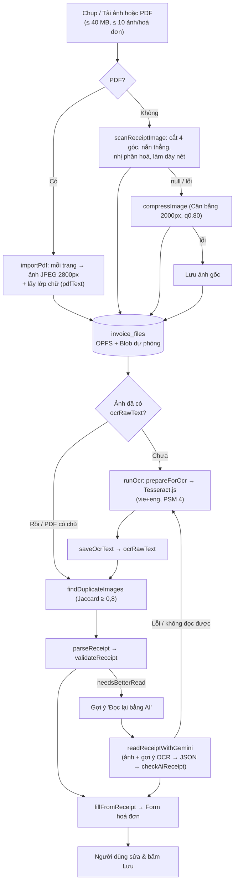

# 05. Hệ Thống Đọc Hoá Đơn (OCR + AI Gemini) — Tổng Hợp Tính Năng

> Tài liệu **tổng hợp theo hiện trạng mã nguồn** (đã đối chiếu với `app/src`). Đây là điểm vào duy nhất để hiểu toàn bộ chuỗi "ảnh/PDF → dữ liệu hoá đơn". Chi tiết nghiệp vụ nằm ở [`epic-4/BR.md`](./epic-4/BR.md) (BR-4.6 … BR-4.18, R-7, R-11, R-13, R-18, R-19) và [`epic-4/SA.md`](./epic-4/SA.md); công thức tiền ở [`02-business-logic-and-algorithms.md`](./02-business-logic-and-algorithms.md) §2–§3. Mô tả riêng pipeline OCR offline (xử lý ảnh, hai lượt nhận diện, bộ phân tích và đối soát tổng) nằm ở [`ocr-pipeline.md`](./ocr-pipeline.md).

---

## 1. Tổng quan

Người dùng chụp/tải ảnh hoặc PDF hoá đơn; app trích **ngày, tên quán, danh sách món (tên – SL – đơn giá – thành tiền), giảm giá, phí phục vụ, VAT, tổng bill** và đổ vào form để người dùng kiểm tra rồi mới lưu. Có **ba đường đọc** với mức ưu tiên khác nhau:

| Đường đọc | Khi dùng | Chạy ở đâu | Cần mạng / khoá |
| :--- | :--- | :--- | :--- |
| **1. Lớp chữ PDF** | Tải PDF có sẵn chữ (hoá đơn điện tử) | Trình duyệt (pdf.js) | Không |
| **2. OCR offline** (mặc định) | Ảnh chụp/tải lên, PDF ảnh quét | Trình duyệt (Tesseract.js, WASM) | Không |
| **3. AI Gemini** (tuỳ chọn) | OCR lệch/thiếu, hoặc người dùng chọn "Đọc bill bằng AI" | Trình duyệt → gọi thẳng Google | Có: mạng + khoá API của người dùng |

Nguyên tắc xuyên suốt:
- **Không đoán**: thứ không chắc thì bỏ trống hoặc đánh dấu `uncertain` để người dùng sửa.
- **Không bao giờ chặn nhập tay** và **không bao giờ làm mất ảnh**: mọi bước xử lý lỗi đều rơi về bước đơn giản hơn (ảnh gốc, nhập tay).
- **Kết quả chỉ điền vào form, chưa lưu** cho tới khi người dùng bấm Lưu.
- **Đối chiếu bằng phép tính của app** (tổng các món − giảm giá + phí + VAT = tổng bill) ở cả đường OCR lẫn AI.

---

## 2. Toàn cảnh luồng xử lý



---

## 3. Giai đoạn 1 — Nhập ảnh / PDF

### 3.1. Ràng buộc
| Hạng mục | Giá trị | Nơi định nghĩa |
| :--- | :--- | :--- |
| Định dạng | JPEG, PNG, WebP, PDF (HEIC bị từ chối, báo đổi sang JPEG) | `invoiceFileService` |
| Dung lượng mỗi tệp | ≤ **40 MB** (`MAX_IMAGE_BYTES`) | `invoiceFileService` |
| Số ảnh mỗi hoá đơn | ≤ **10** (`MAX_IMAGES_PER_INVOICE`); PDF dài hơn chỉ nhận số trang đầu còn chỗ và báo "chỉ nhận n trang đầu" | `invoiceFileService` |
| MIME thiếu (một số Android) | Suy từ đuôi tệp | `addInvoiceImage` |

### 3.2. Ảnh thường — xử lý như máy quét (`addInvoiceImage` → `lib/imageScan.ts` → `lib/documentScan.ts`)
Thứ tự **thử và rơi về**:
1. **`scanReceiptImage`** (ưu tiên): giải mã ảnh (tối đa 4096 px cạnh dài) → chuyển xám → `scanDocument`:
   1. `findDocumentQuad`: dò 4 góc tờ giấy (vùng sáng lớn nhất, ≥ 12% diện tích ảnh, lấp đầy tứ giác ≥ 65%); nếu tờ giấy đã chiếm > 97% ảnh và gần thẳng thì bỏ qua cắt.
   2. `warpToRect`: nắn phối cảnh thành hình chữ nhật, đưa cạnh dài về **2800 px** (phóng tối đa 3×).
   3. **Tài liệu điện tử sạch** (`isCleanDocument`: nền rất sáng và đồng đều, ví dụ ảnh chụp màn hình PDF) → chỉ cắt khung + kéo giãn tương phản, **giữ thang xám**.
   4. Ảnh chụp thường → `binarize` (Bradley thích nghi, ngưỡng tương phản 0,12: chữ đen, nền trắng hoàn toàn, không đổ bóng); nếu đen > 40% diện tích thì coi là đáng ngờ (`null`).
   5. `thicken`: nếu độ dày nét trung vị ≤ 2 px thì làm dày để bắt được chữ in nhiệt mờ.
   6. Lưu **PNG** nếu ≤ **1 MB** (`TARGET_IMAGE_BYTES`), không thì JPEG hạ chất lượng/thu nhỏ dần (`encodeJpegWithin`). Tên tệp thêm hậu tố `-scan`.
2. Nếu bước 1 trả `null`/lỗi → **`compressImage`** mức *Cân bằng* cố định (cạnh dài ≤ 2000 px, JPEG 0,80; không phóng to; ảnh ≤ 400 KB không nén; bản nén lớn hơn gốc thì giữ gốc; ảnh < 1000 px cạnh dài cảnh báo "OCR có thể đọc sai"). Xem `domain/imageQuality.ts`.
3. Nén lỗi → **lưu ảnh gốc**.

Bản gốc không được giữ khi đã quét/nén; dung lượng trước/sau lưu ở `originalSizeBytes` / `sizeBytes`.

### 3.3. PDF (`addInvoicePdf` → `lib/pdfImport.ts` + `lib/pdfText.ts`)
- pdf.js (`pdfjs-dist/legacy`) **nạp lười**, chỉ khi người dùng chọn PDF.
- Mỗi trang dựng thành **JPEG 2800 px** (chất lượng 0,92, nền tô trắng; hệ số dựng tối đa 4×) để xem/tải/OCR như ảnh thường. PDF **không** qua bước cắt khung/nắn thẳng.
- Đồng thời lấy **lớp chữ** của trang: `textItemsToLines` gom mảnh chữ thành dòng theo trục dọc (dung sai ½ chiều cao chữ), xếp theo trục ngang, khoảng cách lớn giữa hai mảnh (> 2,5× cỡ chữ) giữ thành 3 khoảng trắng để bộ phân tích tách cột. Trang có ≥ **20** ký tự (không tính khoảng trắng) thì lưu thẳng vào `ocrRawText` ⇒ **bỏ qua OCR** (chính xác hơn, không tốn ~10 giây/trang).
- Lỗi: PDF có mật khẩu → `PDF_ENCRYPTED`; hỏng → `PDF_INVALID`.

---

## 4. Giai đoạn 2 — OCR offline (`services/ocrService.ts`, `lib/imagePreprocess.ts`)

1. **Tự động chạy** ngay sau khi ảnh được lưu; chỉ quét ảnh **chưa có `ocrRawText`** (đã có thì dùng lại). Nút "Quét lại bill (OCR)" ép quét lại (`force`), và hỏi trước khi ghi đè nếu form đã có dữ liệu do người dùng nhập (R-13).
2. **Tiền xử lý (`prepareForOcr`)**: giải mã theo EXIF → đưa cạnh dài về **2800 px** (phóng tối đa 3×, thu nếu lớn hơn) → thang xám `Y = 0,299R + 0,587G + 0,114B` → kéo giãn tương phản theo phân vị 2%/98% → PNG. Chỉ phục vụ OCR, không đổi ảnh đã lưu. *(Cần chữ cao tối thiểu ~25 px.)*
3. **Tesseract.js v7**, ngôn ngữ `vie` + `eng`; worker, lõi WASM (3 biến thể LSTM: `relaxedsimd`, `simd`, thường) và `traineddata` đóng gói trong `app/public/ocr/` ⇒ **không cần mạng khi quét**.
4. Tham số: `tessedit_pageseg_mode = 4` (một cột, giữ thứ tự dòng/cột giá), `preserve_interword_spaces = 1` (cột đơn giá/SL/thành tiền không dính nhau), `user_defined_dpi = 300`.
5. **Vòng đời worker**: tạo ở lần quét đầu, dùng lại, tự dừng sau **60 giây rảnh**; huỷ (`AbortSignal`) dừng worker và ném `OCR_CANCELLED`. Nhiều ảnh quét lần lượt, tiến trình theo từng ảnh (`OcrProgress`, có nút Huỷ).
6. Lỗi khác → `OCR_FAILED` ("Không quét được ảnh. Bạn vẫn có thể nhập tay"); ảnh vẫn được giữ.

---

## 5. Giai đoạn 3 — Phân tích văn bản (`domain/receiptParser.ts`)

Hàm thuần `parseReceipt(rawText) → ParsedReceipt`, **không ném lỗi**.

**Chuẩn hoá**: sửa chữ giống số dính chữ số (`O→0`, `l/I/|→1`), gộp nhóm nghìn bị tách (`49 000 → 49,000`), bỏ phần thập phân `,00`. Mọi so khớp từ khoá dùng dạng **đã bỏ dấu** (`lib/textFold.ts`: bỏ dấu, `đ→d`, chữ thường) nên bill mất dấu vẫn đọc được; tên món/quán lấy từ dòng gốc.

| Trường | Quy tắc chính |
| :--- | :--- |
| **Ngày** | `dd/mm/yyyy`, `dd-mm-yy`, `Ngày d tháng m năm yyyy`, kể cả hoá đơn song ngữ có chú thích trong ngoặc. Chỉ nhận ngày có thật, năm 2000–2099 (R-7). |
| **Tên quán** | Trong 4 dòng đầu, bỏ địa chỉ/điện thoại/MST/tiêu đề; cộng điểm cho từ khoá (`NHÀ HÀNG`, `QUÁN`, `CAFE`, `LẨU`, `BBQ`…) và chữ viết hoa; hoá đơn điện tử lấy sau "Đơn vị bán hàng (Company):". |
| **VAT / Giảm giá / Phí phục vụ** | Theo từ khoá dòng; **ưu tiên số tiền ghi trên bill** (`FIXED_AMOUNT`), không có mới lấy `%` (`PERCENTAGE`). Số có thể mang dấu `-`/ngoặc → lấy giá trị tuyệt đối. Phí giao hàng/phụ phí app giao đồ ăn cộng dồn vào phí phục vụ; "Đã giảm … tương ứng 20%…" (giảm thuế theo nghị quyết) là giảm giá bằng số tiền, không phải VAT. |
| **Tổng bill** `billTotal` | Dòng `Tổng cộng / Thanh toán / Total`, lấy số cuối dòng; bỏ `Tiền hàng`, `Tạm tính`, `Tiền mặt`, `Tiền thừa`. Nhãn xuống dòng thì lấy số dòng kế. `billSubtotal` = dòng "Tiền hàng/Tạm tính". Nhận cả "Tổng… đã gồm VAT" (`vatIncluded`). |
| **Món** | Ba bố cục: (a) một dòng `tên SL đơn_giá thành_tiền`; (b) một dòng `tên 2 x 150.000 = 300.000`; (c) hai dòng (tên / phép tính). Số lượng đoán theo **số cột số** ở đuôi dòng (1 số = thành tiền; 2 = đơn giá + thành tiền; 3 = SL/đơn giá/thành tiền; ≥ 4 chỉ lấy 3 số cuối). Dòng chỉ chữ ngay trước dòng có giá được ghép vào tên. Loại: tiêu đề/chân trang, địa chỉ, ghi chú món ("Ít đá", "Size L"), rác OCR (QR, đường kẻ), số tiền lẫn trong tên, thành tiền quá nhỏ. Nếu `SL × đơn giá ≠ thành tiền` thì giữ thành tiền trên bill và đặt `uncertain` (form tô vàng). |
| **Bảng hoá đơn điện tử/GTGT** (`parseVatTable`) | Bảng có cột STT: mỗi dòng số thứ tự là một món; tên có thể xuống dòng trước/sau; cột "Đơn vị tính" nằm giữa; chọn cột "trước thuế" khi có cả trước/sau thuế; đếm số dòng đánh số để biết thiếu món (`tableRows.expected` vs `read`). |
| **Bill tách đồ ăn / đồ uống** | Chỉ có hai dòng tổng nhóm → giữ làm hai "món" (`Tổng đồ uống`, `Tổng đồ ăn`). |

---

## 6. Giai đoạn 4 — Đối chiếu & tự sửa (`domain/receiptValidation.ts`)

`validateReceipt(parsed, rawText)` chạy **trước khi điền form**. Mỗi dòng phải có `SL × đơn giá = thành tiền`; cả bill phải có `Σ món − giảm giá + phí phục vụ + VAT = tổng bill` (thứ tự tính theo R-8) và `Σ món = "Tổng tiền hàng"` nếu có.

Lệch thì thử các **kịch bản khác từ cùng văn bản OCR**, chọn kịch bản **ít thay đổi nhất**:
- sửa **một** trong ba số của một dòng (`rowCandidates`; OCR hiếm khi hỏng hai số cùng dòng);
- bỏ dòng "món" thực ra là dòng tổng bị đọc lệch chữ ("Tông Cộng");
- đổi/thêm giảm giá, phí phục vụ, VAT (thử các mức % phổ biến);
- đổi cách tính (phí phục vụ trên tiền hàng trước giảm giá, VAT chỉ trên tiền hàng, giảm giá sau cùng);
- thử nhiều ứng viên làm "tổng bill": dòng "Tổng cộng" đọc được rồi các số ở dòng cuối bill (`trailingAmounts`).

| `status` | Ý nghĩa | Form hiển thị |
| :--- | :--- | :--- |
| `OK` | Khớp ngay | Thông báo xanh |
| `CORRECTED` | Khớp sau khi sửa; `notes` nói đã sửa gì, dòng sửa được đánh dấu | Thông báo + dòng tô vàng |
| `MISMATCH` | Mọi kịch bản đều lệch; giữ số đọc được | Cảnh báo (`role="alert"`) để sửa tay |
| `UNVERIFIED` | Không có dòng tổng/không có món để đối chiếu | Thông báo, tự so với ảnh |

`needsBetterRead(check)` = `MISMATCH` ∨ `UNVERIFIED` ∨ không có món ∨ còn `missingRows` ⇒ form hiện hộp gợi ý **"Đọc lại bằng AI"**. Kết quả `receipt` được chuyển thành trạng thái ô nhập bởi `fillFromReceipt` (`components/invoices/receiptFormState.ts`); `hasUserEntries` quyết định có phải hỏi trước khi ghi đè (`pendingFill`).

---

## 7. Giai đoạn 5 — Đọc bằng AI Gemini (tuỳ chọn)

Thành phần: `services/geminiService.ts` (gọi API, khoá, mô hình), `domain/aiReceipt.ts` (lời nhắc, lược đồ, đổi/đối chiếu kết quả — hàm thuần), `components/invoices/GeminiSettingsDialog.tsx` (cài đặt).

### 7.1. Cấu hình & quyền riêng tư
- Khoá Gemini API **do người dùng tự nhập**, lưu `localStorage` (`fee-calculator.geminiApiKey`), mô hình ở `fee-calculator.geminiModel` (mặc định `gemini-3.6-flash`, xoá khoá/mô hình bằng cách để trống). Lấy khoá miễn phí tại aistudio.google.com/apikey.
- Ảnh + gợi ý OCR được gửi **thẳng từ trình duyệt tới `generativelanguage.googleapis.com`** (header `x-goog-api-key`); **app không có máy chủ trung gian**. Hộp cài đặt và hộp gợi ý đều cảnh báo ảnh có thể chứa thông tin cá nhân. Đây là chức năng **duy nhất** của hệ thống gửi dữ liệu ra ngoài thiết bị, và chỉ khi người dùng chủ động.

### 7.2. Các điểm vào
1. **"Đọc lại bằng AI"** ở hộp gợi ý khi `needsBetterRead` (sau OCR).
2. **"Đọc bill bằng AI"**: nếu chưa có ảnh thì hỏi chụp hay tải ảnh; ảnh mới chọn từ luồng này (`via = 'ai'`) **chỉ đọc bằng AI, không chạy OCR trước**.
3. Chưa có khoá → mở `GeminiSettingsDialog`, lưu xong **tự đọc tiếp** (`readAfterSave`).

### 7.3. Quy trình `readReceiptWithGemini(images, hints)`
1. Chuẩn bị ảnh (`prepareImage`): ≤ 1,5 MB gửi nguyên bản; lớn hơn thì thu về cạnh dài 2000 px, JPEG 0,85; lỗi thì gửi nguyên. Tối đa **6 ảnh** (`MAX_AI_IMAGES`), tất cả thuộc **một** hoá đơn.
2. Lời nhắc (`buildAiPrompt`): văn bản OCR (cắt 6000 ký tự), các dòng món bộ phân tích đã đọc + tổng, số dòng bảng đếm được, các vấn đề `validateReceipt` đã tìm ra — **chỉ làm gợi ý**, "ảnh mới là sự thật".
3. Gọi `generateContent` với `temperature 0`, `responseMimeType: application/json`, `responseSchema` (`AI_RESPONSE_SCHEMA`) và system prompt `AI_SYSTEM_PROMPT`. Các quy tắc chính của prompt: liệt kê **mọi dòng** của bảng và khai báo `itemRowCount`; số tiền là đồng, nguyên; chiết khấu không phải món; phí phục vụ dạng phụ thu vào `serviceAmount` (còn "Phí dịch vụ" là dòng của bảng như hoá đơn Grab thì giữ là món); `vatIncludedInPrices` khi giá đã gồm VAT; tự kiểm tổng trước khi trả; bill tách đồ ăn/đồ uống thì trả đúng hai dòng tổng nhóm; ngày `YYYY-MM-DD`.
4. `aiToParsedReceipt`: bỏ dòng thiếu tên/số tiền ≤ 0; giảm giá, phí, VAT luôn là `FIXED_AMOUNT`; `vatIncludedInPrices` ⇒ bỏ `vatAmount`, đặt `vatIncluded`.
5. `checkAiReceipt` (đối chiếu bằng `computeBill`): số món phải bằng `itemRowCount`; tổng tính được phải bằng `total`. Không khớp ⇒ tạo danh sách `problems`.
6. **Đọc lại một lần** (`MAX_ROUNDS = 2`): gửi lại hội thoại kèm `problems` ("Return the corrected JSON"); **giữ kết quả có ít vấn đề hơn**. Kết quả luôn kèm ghi chú "Đã đọc bằng AI (Gemini). Hãy xem lại các món so với ảnh" và `check.status` (`OK` / `MISMATCH` / `UNVERIFIED`).

### 7.4. Lỗi & dự phòng
| Tình huống | Mã / thông báo |
| :--- | :--- |
| Không có khoá | `AI_NO_KEY` → mở cài đặt AI |
| 401/403 / "api key" | "Gemini từ chối khoá API…" |
| 429 | "hết hạn mức hoặc đang quá tải…" |
| Mất mạng | "Không kết nối được tới Gemini…" |
| Bị chặn (`blockReason`), rỗng, JSON hỏng | `AI_FAILED` với thông báo tương ứng |
| Người dùng huỷ | `OCR_CANCELLED` (không báo lỗi) |

Mọi `AI_FAILED` ⇒ form **tự chuyển sang OCR offline** (`scanImages(false, "AI chưa đọc được (…) nên chuyển sang OCR.")`).

---

## 8. Phát hiện ảnh trùng (`domain/imageDuplicates.ts`, `findDuplicateImages`)

- Sau khi quét, so `ocrRawText` của ảnh mới với ảnh **cùng bữa** (cùng hoá đơn hoặc hoá đơn khác).
- `textTokens`: bỏ dấu, chỉ giữ chữ/số, bỏ từ 1 ký tự → tập từ. `textSimilarity` = **Jaccard**; từ **0,8** trở lên là trùng; dưới **8** từ thì không kết luận (trả 0).
- Hiển thị tên hai ảnh, mức giống, nút **Xoá ảnh trùng** (xoá ảnh mới) / **Giữ lại**. Chỉ cảnh báo, không tự xoá. Trùng với ảnh **cùng hoá đơn** thì **không điền lại form**.

---

## 9. Dữ liệu liên quan

| Trường / bảng | Vai trò |
| :--- | :--- |
| `invoice_files.ocrRawText` | Văn bản thô của ảnh (từ OCR hoặc lớp chữ PDF); có giá trị ⇒ không quét lại; dữ liệu để phát hiện ảnh trùng và làm gợi ý cho AI. `undefined` = chưa quét, chuỗi rỗng = đã quét nhưng không có chữ. |
| `invoice_files.originalSizeBytes`, `sizeBytes`, `compression` | Dung lượng trước/sau xử lý và cách xử lý (`ORIGINAL` cho ảnh đã quét/PDF; `BALANCED` khi rơi về nén). |
| `localStorage` `fee-calculator.geminiApiKey`, `…geminiModel` | Cấu hình AI, **chỉ trên trình duyệt này**, không vào IndexedDB, không vào Snapshot URL. |
| `Invoice.vendorName`, `invoiceDate` | Điền từ kết quả đọc; tên quán còn kích hoạt tự đổi tên kèo (BR-4.10). |

Khi **Lưu trữ bữa**, toàn bộ ảnh (và `ocrRawText`) bị xoá cùng file.

---

## 10. Bản đồ mã nguồn

```text
app/src/
├─ lib/
│  ├─ documentScan.ts        # Hình học + nhị phân hoá + làm dày (thuần, test được)
│  ├─ imageScan.ts           # Cầu nối Canvas cho documentScan, chọn PNG/JPEG ≤ ~1 MB
│  ├─ imageCompress.ts       # Giải mã giới hạn, nén JPEG (TARGET_IMAGE_BYTES)
│  ├─ imagePreprocess.ts     # Tiền xử lý riêng cho Tesseract (xám, giãn tương phản, 2800 px)
│  ├─ pdfImport.ts           # PDF → ảnh trang + lớp chữ (pdf.js, nạp lười)
│  ├─ pdfText.ts             # Mảnh chữ có toạ độ → dòng (thuần)
│  └─ textFold.ts            # Bỏ dấu tiếng Việt cho so khớp
├─ services/
│  ├─ invoiceFileService.ts  # addInvoiceImage / addInvoicePdf / saveOcrText / findDuplicateImages
│  ├─ ocrService.ts          # Worker Tesseract.js, runOcr, huỷ, tự dừng
│  └─ geminiService.ts       # Khoá/mô hình, gọi API, đọc lại 1 lần
├─ domain/
│  ├─ receiptParser.ts       # Văn bản → ParsedReceipt
│  ├─ receiptValidation.ts   # Đối chiếu + tự sửa + needsBetterRead
│  ├─ aiReceipt.ts           # Prompt, schema, đổi & kiểm kết quả AI
│  ├─ imageQuality.ts        # Kế hoạch nén & cảnh báo ảnh nhỏ
│  ├─ imageDuplicates.ts     # Jaccard phát hiện ảnh trùng
│  └─ billMath.ts            # computeBill dùng chung (R-8)
└─ components/invoices/
   ├─ InvoiceFormDialog.tsx      # Điều phối: scanImages, readWithAi, startAi, pendingFill
   ├─ InvoiceFilesStrip.tsx      # Chụp / tải ảnh-PDF, danh sách ảnh
   ├─ OcrProgress.tsx            # Thanh tiến trình + Huỷ
   ├─ GeminiSettingsDialog.tsx   # Khoá & mô hình Gemini
   └─ receiptFormState.ts        # fillFromReceipt, hasUserEntries
app/public/ocr/                 # worker.min.js, tesseract-core-*.{js,wasm}, vie/eng.traineddata
```

---

## 11. Hằng số & ngưỡng tổng hợp

| Hằng số | Giá trị | Ở đâu |
| :--- | :--- | :--- |
| Dung lượng tệp / số ảnh | 40 MB / 10 | `invoiceFileService` |
| Giải mã ảnh tối đa | 4096 px cạnh dài | `imageCompress` |
| Cạnh dài ảnh quét / ảnh OCR / trang PDF | 2800 px | `documentScan`, `imagePreprocess`, `pdfImport` |
| Hệ số phóng tối đa (quét / OCR / PDF) | 3× / 3× / 4× | như trên |
| Ảnh lưu sau quét | ≤ 1 MB (`TARGET_IMAGE_BYTES`) | `imageCompress` |
| Nén dự phòng | 2000 px, JPEG 0,80, bỏ qua nếu ≤ 400 KB | `imageQuality` |
| Cảnh báo ảnh nhỏ | < 1000 px (POOR), ≤ 1400 px hoặc q ≤ 0,6 (RISKY) | `imageQuality` |
| Lớp chữ PDF hợp lệ | ≥ 20 ký tự | `pdfText` |
| Worker OCR rảnh tự dừng | 60 s | `ocrService` |
| Ảnh trùng | Jaccard ≥ 0,8, ≥ 8 từ | `imageDuplicates` |
| AI: ảnh tối đa / số vòng / cạnh dài / chất lượng | 6 / 2 / 2000 px / 0,85 | `geminiService` |
| AI: gửi nguyên ảnh nếu | ≤ 1,5 MB | `geminiService` |
| AI: văn bản OCR kèm theo | ≤ 6000 ký tự | `aiReceipt` |

---

## 12. Hạn chế đã biết

- **OCR**: tên món có thể sai dấu; ngày có thể rớt một chữ số; ảnh 2800 px mất ~10 giây/ảnh; lần quét đầu chậm vì khởi tạo worker. Người dùng luôn sửa được trong form.
- **PDF ảnh quét** không qua bước cắt khung/nắn thẳng; PDF dùng font mã hoá lạ có thể cho lớp chữ sai.
- **AI** cần mạng, khoá riêng, có hạn mức; không đảm bảo đúng tuyệt đối — luôn có ghi chú yêu cầu xem lại so với ảnh.
- Chưa hỗ trợ quét mã QR hoá đơn điện tử, HEIC.
- Kịch bản tự sửa là heuristic: một số bill có khoản app chưa hỗ trợ (tip, làm tròn) sẽ để `MISMATCH` và không chặn lưu (R-11).

---

## 13. Kiểm thử hiện có

| Phạm vi | Test |
| :--- | :--- |
| Phân tích văn bản | `domain/receiptParser.test.ts`, fixture `domain/__fixtures__/receipts.ts` |
| Đối chiếu / tự sửa | `domain/receiptValidation.test.ts` |
| Ảnh quét (số học) | `lib/documentScan.test.ts`, `lib/imagePreprocess.test.ts` |
| Chất lượng & nén | `domain/imageQuality.test.ts` |
| Ảnh trùng | `domain/imageDuplicates.test.ts` |
| OCR service | `services/ocrService.test.ts` |
| Gemini | `services/geminiService.test.ts` |
| PDF | `services/invoiceFilePdf.test.ts` |
| Lưu file | `services/fileStorageService.test.ts`, `services/invoiceService.test.ts` |
| Form | `components/invoices/InvoiceFormDialog.test.tsx`, `receiptFormState.test.ts` |

> pdf.js, Canvas và Tesseract thật không chạy trong jsdom nên phần này được kiểm bằng thủ công / fixture văn bản.
