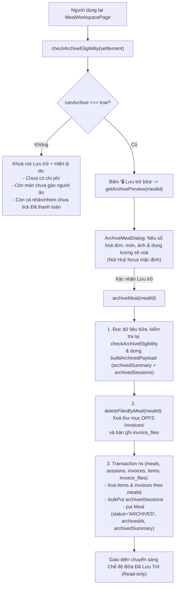
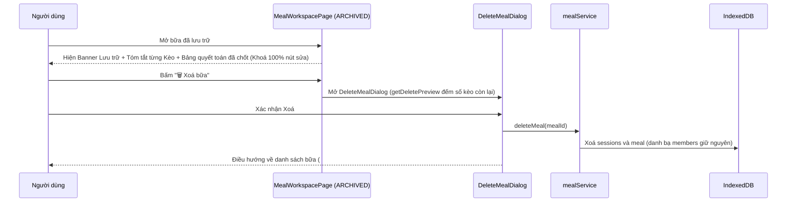

# Epic 7 — System Analysis (SA)

**Epic 7**: Lưu trữ Bữa (Archive), Dọn dẹp Hoá đơn/Món & Khoá Chỉnh sửa · **Trạng thái**: Đã triển khai (còn kiểm thủ công trên trình duyệt trước khi đóng)

Tài liệu đi cùng: [BR](./BR.md) · [Kiến trúc & Data model §3.2–3.6](../01-architecture-and-data-model.md) · [Nghiệp vụ §7.2](../02-business-logic-and-algorithms.md) · [UI §4.2, §4.5](../03-ui-ux-and-design-system.md) · [Epic 6 SA](../epic-6/SA.md)

---

### B.1. Công nghệ / thư viện sử dụng
Dùng lại toàn bộ stack hiện có: React 19 · TypeScript · Tailwind CSS · Dexie 4 + `dexie-react-hooks` · `lucide-react` · Vitest + `fake-indexeddb` + jsdom + Testing Library. **Không thêm thư viện mới.**

- Tái sử dụng `deleteFilesByMeal(mealId)` trong `services/fileStorageService.ts` (Epic 1) để dọn sạch thư mục OPFS `/invoices/<mealId>` và bản ghi `invoice_files`.
- Tái sử dụng `computeMealSettlement` trong `domain/settlementEngine.ts` (Epic 6) để kiểm tra điều kiện tiên quyết và trích xuất dữ liệu quyết toán sang `ArchivedMealSummary`.
- Tái sử dụng `formatBytes` trong `lib/bytes.ts` (Epic 4) để hiển thị dung lượng ảnh được giải phóng khi lưu trữ.

### B.2. Cấu trúc mã nguồn

```text
app/src/
├─ types/index.ts                              # Không đổi (ArchivedMealSummary & SessionKeo.archived* đã có sẵn)
├─ db/db.ts                                    # Không đổi (không nâng version schema Dexie)
├─ domain/
│  ├─ archiveRules.ts                          # MỚI, THUẦN: checkArchiveEligibility, buildArchivedPayload
│  └─ archiveRules.test.ts                     # MỚI: unit test cho R-1…R-3 (chặn lưu trữ & đóng gói dữ liệu)
├─ services/
│  ├─ archiveService.ts                        # MỚI: getArchivePreview, archiveMeal
│  ├─ archiveService.test.ts                   # MỚI: test tích hợp lưu trữ bữa, xoá invoices/items/files, khoá sửa
│  └─ peopleErrors.ts                          # SỬA: thêm mã ARCHIVE_EMPTY_MEAL, ARCHIVE_UNASSIGNED_ITEMS,
│                                              #   ARCHIVE_UNPAID_ENTITIES
├─ components/
│  ├─ meals/
│  │  ├─ ArchiveMealDialog.tsx                 # MỚI: hộp xác nhận lưu trữ nêu số lượng hoá đơn/món/ảnh sẽ xoá
│  │  └─ ArchiveMealDialog.test.tsx            # MỚI
│  └─ sessions/
│     ├─ SessionCard.tsx                       # SỬA: hiển thị tóm tắt đã chốt (số hoá đơn, người ứng, tổng kèo)
│     │                                        #   khi bữa ở trạng thái ARCHIVED (R-6)
│     └─ SessionsPanel.tsx                     # SỬA: truyền archivedSummary xuống SessionCard khi ARCHIVED
└─ pages/
   ├─ MealWorkspacePage.tsx                    # SỬA: thêm nút "🔒 Lưu trữ bữa" + cảnh báo điều kiện lưu trữ
   │                                           #   + banner ARCHIVED đầy đủ theo UI §4.5
   └─ MealWorkspacePage.test.tsx               # SỬA: thêm test luồng lưu trữ và giao diện chỉ đọc sau lưu trữ
```

### B.3. Thành phần & trách nhiệm

| Thành phần | Trách nhiệm | Phụ thuộc |
| :--- | :--- | :--- |
| `domain/archiveRules` | Hàm thuần kiểm tra điều kiện lưu trữ (`checkArchiveEligibility` theo R-1) và đóng gói `ArchivedMealSummary` cùng danh sách `SessionKeo` đã cập nhật `archivedTotalAmount` / `archivedPayerSummary` (`buildArchivedPayload` theo R-2, R-3). **Không chạm DB/DOM** | `domain/settlementEngine`, `types`, `services/peopleErrors` |
| `services/archiveService` | Đọc dữ liệu bữa, tính xem trước dung lượng/số bản ghi sẽ dọn (`getArchivePreview`), thực thi quy trình lưu trữ nguyên tử (`archiveMeal` theo R-4: xoá file OPFS + `invoice_files`, xoá `items` + `invoices`, cập nhật `sessions` + `meals`) | `db`, `domain/archiveRules`, `domain/settlementEngine`, `services/fileStorageService`, `services/peopleErrors` |
| `components/meals/ArchiveMealDialog` | Hiển thị hộp thoại xác nhận lưu trữ: liệt kê số hoá đơn, số món, số file ảnh và dung lượng byte sẽ xoá vĩnh viễn; nút Huỷ được focus mặc định | `ConfirmDialog`, `services/archiveService`, `lib/bytes` |
| `components/sessions/SessionCard` | Khi `meal.status === 'ARCHIVED'`, hiển thị số lượng hoá đơn đã chốt (`invoiceCount`), danh sách người đã ứng trong kèo (`archivedPayerSummary`) và tổng chi phí kèo (`archivedTotalAmount`), thay vì báo "Chưa có hoá đơn" | `lib/money` |
| `pages/MealWorkspacePage` | Hiển thị nút `🔒 Lưu trữ bữa` (kích hoạt khi `eligibility.canArchive === true`, hoặc hiện lý do chưa thể lưu trữ khi chưa đủ điều kiện); hiển thị Banner lưu trữ chuẩn UI §4.5 khi `meal.status === 'ARCHIVED'` | `domain/archiveRules`, `ArchiveMealDialog`, `SettlementPanel` |

### B.4. Thiết kế dữ liệu

**Không đổi schema IndexedDB, không nâng version Dexie, không đổi interface trong `types/index.ts`.**
Các trường phục vụ Lưu trữ đã được thiết kế sẵn từ Epic 1 ([01 §3.2, §3.3, §3.6](../01-architecture-and-data-model.md)):
- Trên `Meal`: `status: 'ACTIVE' | 'ARCHIVED'`, `archivedAt?: string`, `archivedSummary?: ArchivedMealSummary`.
- Trên `SessionKeo`: `archivedTotalAmount?: number`, `archivedPayerSummary?: Array<{ memberId: string; paidAmount: number }>`.

Bất biến dữ liệu sau khi `archiveMeal(mealId)` hoàn tất:

| Mã | Bất biến |
| :-: | :--- |
| **I-E7-1** | `meal.status === 'ARCHIVED'`, `meal.archivedAt` là chuỗi ISO hợp lệ, và `meal.archivedSummary` tồn tại đầy đủ. |
| **I-E7-2** | Số bản ghi trong bảng `invoices`, `items`, `invoice_files` có `mealId` đó đều bằng `0`; thư mục OPFS `/invoices/<mealId>` đã bị xoá. |
| **I-E7-3** | Các bản ghi `sessions` của `mealId` vẫn được giữ lại, mỗi bản ghi có `archivedTotalAmount` khớp với `sessionsSummary` trong `meal.archivedSummary`, và $\sum_{s} s.\text{archivedTotalAmount} = \text{meal.archivedSummary.totalMealAmount}$. |
| **I-E7-4** | Mọi phần tử trong `meal.archivedSummary.entitiesSummary` có `isPaid === true`. |

### B.5. Luồng xử lý chính

**5.1. Kiểm tra điều kiện & Thực thi Lưu trữ Bữa (`archiveMeal`)**


**5.2. Xem và Xoá Bữa Đã Lưu Trữ (US-7.3, US-7.4)**


### B.6. Giao diện lập trình nội bộ

**Mã lỗi bổ sung vào `services/peopleErrors.ts`**:

| `code` | Khi nào ném |
| :--- | :--- |
| `ARCHIVE_EMPTY_MEAL` | Lưu trữ bữa chưa có hoá đơn hoặc tổng chi phí bằng `0` (R-1) |
| `ARCHIVE_UNASSIGNED_ITEMS` | Lưu trữ bữa khi vẫn còn món ở chế độ `BY_ITEM` chưa có người ăn (`unassignedItemCount > 0`, R-1) |
| `ARCHIVE_UNPAID_ENTITIES` | Lưu trữ bữa khi còn thực thể có `netBalance !== 0` chưa được tick `isPaid` (R-1); `detail.unpaidEntityNames` chứa danh sách tên thực thể chưa thanh toán |

**`domain/archiveRules.ts` (Hàm thuần)**:

```ts
export type ArchiveBlockerReason =
  | 'ALREADY_ARCHIVED'
  | 'NO_COST'
  | 'UNASSIGNED_ITEMS'
  | 'UNPAID_ENTITIES';

export interface ArchiveEligibility {
  canArchive: boolean;
  reason?: ArchiveBlockerReason;
  unassignedItemCount: number;
  unpaidEntityNames: string[];
  message?: string; // Thông báo tiếng Việt giải thích rõ vì sao chưa lưu trữ được
}

/** Kiểm tra một bữa đã đủ điều kiện lưu trữ hay chưa (BR-7.1, R-1). */
export function checkArchiveEligibility(settlement: MealSettlementResult): ArchiveEligibility;

/** Đóng gói dữ liệu lưu trữ cho Meal và danh sách SessionKeo trước khi xoá invoices/items (R-2, R-3). */
export function buildArchivedPayload(input: {
  meal: Meal;
  sessions: ReadonlyArray<SessionKeo>;
  invoices: ReadonlyArray<Invoice>;
  settlement: MealSettlementResult;
  nowIso: string;
}): {
  archivedMeal: Meal;
  archivedSessions: SessionKeo[];
  archivedSummary: ArchivedMealSummary;
};
```

**`services/archiveService.ts`**:

```ts
export interface ArchivePreview {
  invoiceCount: number;
  fileCount: number;
  totalFileBytes: number;
}

/** Đếm số lượng hoá đơn, món, file ảnh và tổng dung lượng sẽ được dọn khi lưu trữ (BR-7.2). */
export function getArchivePreview(mealId: string): Promise<ArchivePreview>;

/** Thực thi lưu trữ bữa và dọn dẹp hoá đơn/món/ảnh (BR-7.3, R-1…R-4). */
export function archiveMeal(mealId: string, now?: Date): Promise<Meal>;
```

**Component UI chính**:

| Component | Props chính | Hành vi |
| :--- | :--- | :--- |
| `ArchiveMealDialog` | `mealId: string`, `mealTitle: string`, `onClose: () => void`, `onArchived: () => void` | Tải `getArchivePreview(mealId)` và hiển thị trong `ConfirmDialog`: *"Lưu trữ bữa **{mealTitle}** sẽ khoá chỉnh sửa vĩnh viễn và xoá {invoiceCount} hoá đơn cùng {fileCount} file ảnh ({formatBytes(totalFileBytes)}) để giải phóng bộ nhớ. Vẫn giữ lại chi phí từng kèo, các món và lịch sử quyết toán."* |

### B.7. Yêu cầu phi chức năng

| Nhóm | Yêu cầu |
| :--- | :--- |
| **An toàn dữ liệu** | Không bao giờ xoá `invoices`, `items` hay `invoice_files` nếu `checkArchiveEligibility` chưa thoả mãn 100%; nếu bước ghi DB gặp lỗi, toàn bộ transaction tự rollback; nếu xoá file OPFS chạy trước thì dữ liệu số tiền trong DB vẫn còn nguyên để bấm Lưu trữ lại |
| **Giải phóng dung lượng thật** | Sau khi `archiveMeal` chạy xong, `getTotalStorageBytes()` giảm đúng bằng tổng `sizeBytes` của các ảnh thuộc bữa vừa lưu trữ |
| **Khả dụng (A11y & Mobile)** | Nút "Lưu trữ bữa" khi chưa đủ điều kiện không chỉ làm mờ mà có dòng chú thích rõ ràng (`aria-describedby`) nêu tên những cá nhân/nhóm chưa thanh toán; hộp xác nhận điều khiển hoàn toàn bằng bàn phím, nút Huỷ được focus mặc định |

### B.8. Rủi ro & hạn chế đã biết

| # | Rủi ro / Hạn chế | Hướng xử lý |
| :-: | :--- | :--- |
| 1 | Người dùng bấm Lưu trữ nhầm khi chưa xem kỹ chi tiết món lần cuối | Yêu cầu 2 lớp bảo vệ: (1) phải tick đủ 100% các khoản thanh toán trước đó, và (2) hộp xác nhận `ArchiveMealDialog` nêu rõ số lượng bản ghi sẽ bị xoá vĩnh viễn với nút `Huỷ` là mặc định |
| 2 | Thành viên trong danh bạ được đổi tên sau khi bữa đã lưu trữ | `ArchivedMealSummary` lưu trực tiếp `entityName`, `memberNames`, `fromEntityName`, `toEntityName` tại thời điểm chốt sổ (snapshot lịch sử), đồng thời lưu `entityId` và `archivedPayerSummary[].memberId` để tra cứu khi cần |
| 3 | Bữa có kèo rỗng (kèo được tạo nhưng có 0 hoá đơn) khi lưu trữ | `buildArchivedPayload` vẫn giữ kèo đó với `archivedTotalAmount = 0`, `invoiceCount = 0` để bảo toàn lịch sử các kèo đã đi trong bữa |

### B.9. Ma trận truy vết kiểm thử

| User Story | BR | Bài kiểm thử dự kiến | Trạng thái |
| :-: | :-: | :--- | :-: |
| US-7.1 | BR-7.1 | `archiveRules.test.ts`: `checkArchiveEligibility` từ chối bữa chưa có chi phí (`NO_COST`), bữa còn món chưa gán (`UNASSIGNED_ITEMS`), bữa còn thực thể `netBalance !== 0` chưa tick `isPaid` (`UNPAID_ENTITIES` kèm đúng tên thực thể), và cho phép khi 100% đã tick hoặc mọi thực thể có `netBalance === 0` (AC-1). `archiveService.test.ts`: `archiveMeal` ném đúng mã lỗi `ARCHIVE_*` | Đạt (`archiveRules.test`: checkArchiveEligibility; `archiveService.test`: ARCHIVE_* codes) |
| US-7.2 | BR-7.2, BR-7.3 | `archiveRules.test.ts`: `buildArchivedPayload` đóng gói đúng `ArchivedMealSummary` và `SessionKeo.archived*`. `archiveService.test.ts`: `getArchivePreview` đếm đúng số bản ghi & dung lượng byte; `archiveMeal` xoá sạch `invoices`, `items`, `invoice_files` của bữa (giữ nguyên bữa khác), cập nhật `sessions` và chuyển `meal.status = 'ARCHIVED'` (AC-2, AC-4) | Đạt (`archiveRules.test`: buildArchivedPayload; `archiveService.test`: xoá invoices/items/files; `ArchiveMealAction.test`: xác nhận) |
| US-7.3 | BR-7.4 | `archiveService.test.ts`: mọi hàm sửa bữa/người/nhóm/kèo/hoá đơn/quyết toán đều ném `MEAL_ARCHIVED` sau khi lưu trữ. `MealWorkspacePage.test.tsx`: luồng tick đủ thanh toán $\rightarrow$ bấm Lưu trữ $\rightarrow$ xác nhận `ArchiveMealDialog` $\rightarrow$ hiện Banner lưu trữ, tóm tắt từng kèo (số hoá đơn, người ứng, tổng kèo), bảng quyết toán chỉ đọc, ẩn toàn bộ nút sửa (AC-2, AC-5, AC-6) | Đạt một phần (`archiveService.test`: MEAL_ARCHIVED cho các service; tóm tắt kèo và banner chưa có test component) |
| US-7.4 | BR-7.5 | `MealWorkspacePage.test.tsx` & `MealsPage.test.tsx`: xoá vĩnh viễn bữa vừa được lưu trữ qua `archiveMeal`, kiểm tra IndexedDB không còn `meal` và `sessions` của bữa đó (AC-3) | Đạt (`archiveService.test`: `deleteMeal` sau lưu trữ) |

### B.10. Việc còn lại để đóng Epic
1. Kiểm trình duyệt: danh sách bữa ở 3 chế độ xem hiển thị "Đã lưu trữ" sau khi lưu trữ (AC-6) — **chưa thực hiện**.
2. Kiểm trình duyệt ở 375 px cho màn bữa đã lưu trữ (AC-7) — **chưa thực hiện**.
3. Thêm test component cho tóm tắt kèo đã chốt (`SessionCard`) — **chưa thực hiện**.

**Rủi ro còn mở**
- Thứ tự "xoá file trước, DB sau" (R-4) có nghĩa là nếu transaction DB lỗi sau khi file đã xoá thì hoá đơn còn lại nhưng ảnh đã mất. Đây là đánh đổi đã chấp nhận theo R-4; cần cân nhắc thêm bước kiểm tra/khôi phục nếu gặp thực tế.

**Lệch so với thiết kế đã ghi nhận khi triển khai**
- `archiveMeal(mealId, now)` trả `Promise<void>`, không trả `Meal`.
- Thêm `ArchiveMealAction` (nút "Lưu trữ bữa" và lý do khoá) gắn vào `actionsSlot` của Khu vực 3.
- Lỗi lưu trữ mang `detail.unpaidEntityNames` và `unassignedItemCount` để UI hiển thị.
