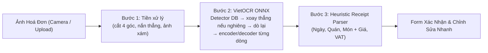

# OCR Hoá Đơn Offline: Xử Lý Ảnh, Nhận Diện Và Bóc Tách (`VietOCR ONNX`)

> Tách từ [02. Nghiệp vụ Tính toán](./02-business-logic-and-algorithms.md) (mục 3). Quy tắc nghiệp vụ liên quan: BR-4.7, BR-4.13, BR-4.16 đến BR-4.20 trong [epic-4/BR.md](./epic-4/BR.md).
>
> Tài liệu này chỉ mô tả pipeline OCR offline. Tổng hợp toàn bộ chuỗi "ảnh/PDF → dữ liệu hoá đơn", gồm đường đọc bằng AI trên máy và luồng PDF, xem [05. Hệ thống đọc hoá đơn](./05-ocr-and-receipt-reading.md).

Chạy hoàn toàn trên trình duyệt, không gọi mạng khi quét, pipeline OCR gồm ba bước:

## Bước 1: Tiền xử lý ảnh (`lib/imageScan.ts`, `lib/documentScan.ts`, `lib/imagePreprocess.ts`)

### 1a. Lúc lưu ảnh (`scanReceiptImage`)
- Tìm 4 góc tờ hoá đơn, cắt và nắn phối cảnh, đưa cạnh dài về **2800 px** (phóng tối đa 3 lần). Không tìm thấy tờ giấy thì giữ cả ảnh.
- **Giữ thang xám, không nhị phân hoá.** Ảnh được lưu là ảnh hoá đơn đã cắt và nắn thẳng ở mức xám. Hàm `scanDocument` nhận `keepGray: 'always'` nên không qua bước Bradley và không làm dày nét.
- Mã hoá: PNG nếu ≤ **1 MB** (`TARGET_IMAGE_BYTES`), không thì JPEG hạ chất lượng/thu nhỏ dần (BR-4.16). Ảnh xám thường rơi vào JPEG. Tên tệp thêm hậu tố `-scan`.

### 1b. Trước khi nhận dạng (`prepareForOcr`, `lib/imagePreprocess.ts`)
- Giải mã theo EXIF, đưa cạnh dài về **2800 px** (phóng tối đa 3×, thu nếu lớn hơn), chuyển xám `Y = 0,299R + 0,587G + 0,114B`, kéo giãn tương phản theo phân vị 2% và 98%, rồi xuất PNG.
- Chỉ phục vụ OCR, không đổi ảnh đã lưu. Quét luôn đọc bản đã lưu của ảnh.

**Vì sao giữ ảnh xám**: VietOCR là mạng học sâu (detector DB và recognizer vgg_seq2seq) được huấn luyện trên ảnh xám. Nhị phân hoá làm nét mờ bị đứt, nên detector bỏ sót dòng; ảnh xám giữ nguyên nét để detector và recognizer đều đọc được.

## Bước 2: Nhận diện bằng VietOCR ONNX (`services/ocrService.ts`, `workers/vietOcrWorker.ts`, `domain/vietOcr.ts`)

Worker giữ ba session ONNX (`det.onnx` là detector, `vietocr_encoder.onnx` và `vietocr_decoder.onnx` là recognizer) cùng `vietocr.json`, đặt trong `public/ocr/vietocr/`. Chạy WASM một luồng, không cần WebGPU hay cross-origin isolation. Worker giữ model trong RAM giữa các lần quét, tự dừng sau **15 giây** rảnh, và dừng ngay khi đóng form hoặc ẩn app (`memoryLifecycle`). Không có dự phòng: lỗi thì báo cho người dùng nhập tay.

### 2a. Phát hiện dòng chữ (detector DB)
- Chọn kích thước đầu vào (`detectorInputSize`): cạnh lớn nhất ≤ **960**, hai cạnh là bội số của 32. Ảnh được chuẩn hoá ImageNet, xếp CHW, rồi detector trả về **bản đồ xác suất**.
- `findTextBoxes`: ngưỡng xác suất **0,3** để lấy vùng liên thông (4 hướng); bỏ vùng dưới 4 điểm hoặc có điểm trung bình dưới **0,5**; mở rộng hộp theo unclip **×2** để bao trọn dấu tiếng Việt.

### 2b. Xoay thẳng dòng nghiêng
- `estimateSkewAngle` dùng chính bản đồ xác suất. Từ các vùng dài (≥ 50 pixel, tỉ lệ dài/rộng ≥ 4), lấy trung vị hướng trục chính của từng vùng. Cần ít nhất 3 vùng dài; góc có trị tuyệt đối trên 30° bị coi là ước lượng sai và trả về 0. Dương là dòng đi xuống về bên phải.
- Nếu |góc| ≥ **0,5°**: ảnh được xoay quanh tâm (nền trắng) để làm thẳng dòng, rồi detector chạy lại trên ảnh đã xoay. Mọi bước sau dùng ảnh đã xoay, nên toạ độ hộp cũng là toạ độ trên ảnh đã xoay. Phần góc ảnh xoay ra ngoài khung bị mất, không đọc được.
- Nếu góc nhỏ hơn ngưỡng, dùng lại bản đồ lần đầu, không dò lại.

**Vì sao cần bước này**: hộp chữ nhật thẳng đứng ôm cả dòng trên và dòng dưới khi bill nghiêng từ 4° trở lên. Recognizer khi đó đọc ra chữ rác, và `ocrLayout` ghép tên món với giá của dòng khác. Đã kiểm chứng bằng Python: ước lượng góc từ các vùng chữ, xoay thẳng rồi dò lại, thì bill nghiêng 4° và 8° đọc đúng hết.

### 2c. Cắt dòng và nhận dạng
- Mỗi hộp được quy về toạ độ ảnh gốc (hoặc ảnh đã xoay), cắt và thu về **cao 32 px** (`REC_HEIGHT`) với lọc chất lượng cao. Chiều rộng theo `recognizerWidth`: tỉ lệ giữ nguyên, làm tròn lên bội 10, kẹp trong khoảng 32–512 px.
- Encoder nhận tensor CHW chia 255. Decoder giải mã tham lam (greedy) từ token SOS đến EOS hoặc hết `max_seq_length`. Dòng rỗng bị bỏ.
- Tiến trình báo theo từng dòng (`PROGRESS`). Kết quả là danh sách `OcrWord` (văn bản và hộp), rồi `ocrLayout` gom các từ thành dòng và cột theo toạ độ để parser đọc.

## Bước 3: Bộ Phân Tích Hoá Đơn Thông Minh (`domain/receiptParser.ts`)
Hàm thuần: văn bản vào, dữ liệu gợi ý ra. Nguyên tắc: **không đoán**; thứ không chắc thì bỏ trống hoặc đánh dấu để người dùng xem lại.

0. **Chuẩn hoá dòng**: sửa lỗi OCR ở chỗ dính với chữ số (`O` → `0`; `l`, `I`, `|` đứng trước chữ số → `1`), gọn khoảng trắng. Thêm:
   - **Dọn ký tự viền bảng**: `|`, `¦`, `[`, `]`, `{`, `}`, `_` và chuỗi từ 3 ký tự `-` `=` `~` `—` `.` liên tiếp (đường kẻ bảng bị OCR đọc thành chữ) được thay bằng khoảng trắng **trước khi tách số**, để `106.000]` thành `106.000` và dòng món `-..| Bún Ốc Lẫn 2| 53.000 106.000]` không bị mất. Dấu `-` đơn lẻ trong tên món (`Bún - Chả`) và số âm giữ nguyên.
   - **Dấu chấm / phẩy thừa sau số**: `90.000.`, `1.`, `130,000,` (vết mực hoặc đường kẻ bị đọc thành dấu câu) bỏ dấu cuối trước khi tách số. Nếu không, token không còn là số nên cả dòng món bị bỏ (bill Matchandeul: `Mì gói 1 90.000. 90,000` và `Mì lạnh … 1. - 130,000 130,000` mất vì lý do này).
   - **Ký hiệu `đ` bị đọc thành chữ số**: số tiền có nhóm cuối **4 chữ số** (`176.0004`, `476.0000`) thì bỏ chữ số cuối, vì số tiền đúng chỉ có nhóm nghìn 3 chữ số; đó là chữ `đ` / `₫` bị đọc thành `4` hoặc `0`.
   - **Nhãn bị lệch dấu**: các từ khoá `tổng` khớp cả `Téng`, `Teng`, `Tõng` (dạng đã bỏ dấu: `t[oe]ng`), nên `Téng thanh toán 176.000đ` vẫn được nhận là dòng tổng.
   - **Mọi so khớp từ khoá dùng dạng đã bỏ dấu** (`fold`: bỏ dấu, `đ` → `d`, chữ thường), nên bill mà OCR đọc mất dấu vẫn cho kết quả đúng. Tên món và tên quán được lấy từ dòng gốc.
1. **Ngày**: `dd/mm/yyyy`, `dd-mm-yy` (năm 2 chữ số là 20xx), hoặc `Ngày d tháng m năm yyyy`. Chỉ nhận ngày có thật và trong khoảng 2000–2099; không có thì bỏ trống.
2. **Tên quán**: trong 4 dòng đầu, bỏ dòng địa chỉ, điện thoại, mã số thuế và tiêu đề; điểm cao hơn cho dòng có từ khoá (`NHÀ HÀNG`, `QUÁN`, `CAFE`, `LẨU`, `BBQ`, …) và viết hoa.
3. **VAT**: dòng có `VAT` / `GTGT` / `Thuế`. Nếu dòng có số tiền thì lấy `FIXED_AMOUNT` (khớp bill), không thì lấy `PERCENTAGE` từ `%`.
4. **Giảm giá** (`Giảm giá`, `Chiết khấu`, `Khuyến mãi`, `Discount`) và **Phí phục vụ** (`Phí phục vụ`, `Service`): cùng quy tắc như VAT; số tiền có thể mang dấu `-` hoặc ngoặc, lấy giá trị tuyệt đối.
5. **Đọc dòng theo cột trái / phải**: mỗi dòng tách thành *nhãn bên trái* (chữ) và *số bên phải* (số tiền cuối dòng). Đơn vị tiền tệ (`đ`, `₫`, `VND`, `vnđ`, `k`) **có thể có hoặc không**; có thì bỏ đi, không thì vẫn đọc bình thường.
   - **Cột phải luôn là thành tiền của món** (`lineTotal`), là con số đáng tin nhất nên được đọc **trước tiên** và được giữ nguyên ở các bước sau. Cùng lúc ghi lại **số lượng** nếu đọc được (`2`, `2x`, `x2`, `2 x 150.000`) để dùng ở bước 10.
   - Dòng **không phải món** thì không vào danh sách: tiêu đề, địa chỉ, ngày giờ, số điện thoại, mã số thuế, số hoá đơn / số bàn / mã giao dịch (chuỗi số dài, hoặc đứng sau nhãn `MST`, `Số`, `No`, `Bàn`, `Mã`), dòng VAT / giảm giá / phí phục vụ / tổng / tạm tính / tiền mặt / tiền thừa.
   - **Số quá dài và lẻ không phải tiền**: số có **hơn 8 chữ số** (tính cả số 0 đứng đầu) mà **không chia hết cho 100** (`001070016165` mã số thuế, `2506041166` số hoá đơn, `888803155678` số tài khoản) bị bỏ khỏi các số tiền của dòng; dòng chỉ còn số loại này thì không phải món. Số dài chia hết cho 100 vẫn được coi là tiền.
   - Ba bố cục món được nhận: **một dòng** `Bò Mỹ nhúng 2 150.000 300.000`; **có phép tính** `Lẩu bò 2 x 150.000 = 300.000`; **hai dòng** (tên ở trên, `2 x 150.000 = 300.000` ở dưới). Dòng chỉ có tên và một số cuối được coi là 1 phần với thành tiền là số đó.
   - **Dòng tổng nhóm** (`Drink`, `Food`, `Tổng đồ uống`, `Tổng đồ ăn`…) là **subtotal của một nhóm món**, không phải món. Quy tắc:
     1. **Không bao giờ thay các món đã đọc bằng hai dòng nhóm.** (Lỗi cũ: chỉ cần một món đọc thiếu thì tổng các món lệch tổng nhóm và *toàn bộ* món bị xoá, chỉ còn hai dòng `Tổng đồ uống`, `Tổng đồ ăn`; bill Matchandeul có 7 món, đọc được 5, mất cả 5.)
     2. Chỉ khi **không đọc được món nào** thì dùng các dòng nhóm làm "món" (mỗi nhóm một dòng, `Tổng đồ uống` / `Tổng đồ ăn`) để vẫn chia được tiền.
     3. **Đối soát theo nhóm**: mỗi dòng nhóm khép nhóm các món đứng ngay trên nó (từ dòng nhóm trước, hoặc đầu bảng). Tổng các món của nhóm phải bằng số trên dòng nhóm; **nhóm nào thiếu** thì thêm một dòng **"Món chưa đọc được"** (thành tiền = phần thiếu, `uncertain`) vào đúng nhóm, kèm ghi chú nêu tên nhóm và số tiền thiếu (ví dụ "Food: các món cộng được 1.290.000, dòng Food ghi 1.510.000, thiếu 220.000"). Không giới hạn 10% như bước 8 vì tổng nhóm là số đáng tin; nhóm nào đã khớp thì giữ nguyên.
     4. Nhóm có tổng các món **lớn hơn** dòng nhóm thì giữ nguyên các món, báo lệch (không tự xoá món).
     5. Không phân nhóm được (ví dụ không có món nào nằm trên dòng nhóm) thì đối soát chung: `Σ nhóm` so với `Σ món`.
     6. Dòng nhóm vẫn là số để đối chiếu tổng: `Σ các dòng nhóm` phải bằng `readTotal` (trừ giảm giá, phí, VAT), dùng làm nguồn xác nhận thứ hai cho tổng bill.
6. **Tổng đọc được** (`readTotal`):
   - Dòng có nhãn trái là `Tổng`, `Tổng cộng`, `Tổng thanh toán`, `Tổng tiền`, `Amount`, `Total`, `Total amount` → **xác nhận chính là tổng** (độ tin cậy cao).
   - **Dòng số cuối cùng của bill** có khả năng cao là tổng. Nếu không có dòng nào mang nhãn tổng thì lấy dòng này làm `readTotal` với độ tin cậy thấp (đánh dấu để người dùng xem lại); nếu nhãn của nó là tổng thì xác nhận như trên.
   - Bỏ qua `Tiền hàng`, `Tạm tính`, `Subtotal`, `Tiền mặt`, `Tiền thừa`: các dòng này **không** được nhận là tổng.
7. **Loại subtotal lọt vào danh sách món**: xét các dòng **gần cuối** phần món (sát khu vực tổng / VAT). Dòng nào có giá trị **> 75% `readTotal`** gần như chắc chắn là subtotal chứ không phải món. Khi đó thử bỏ dòng ấy; **nếu giữ lại làm tổng tính được tăng gấp đôi** (`tổng tính được ≈ 2 × readTotal`) thì **loại hẳn** khỏi danh sách món. Dòng lớn mà bỏ ra không làm tổng khớp thì giữ nguyên (có thể đó là món đắt thật).
8. **Đối soát tổng** (làm trước mọi việc điền tên / đơn giá). Tính:

   `tổng tính được (calcTotal) = Σ thành tiền món − giảm giá + phí phục vụ + VAT` (theo thứ tự R-8), rồi so với `readTotal`, với dung sai làm tròn nhỏ (≈ 1.000 đ hoặc 0,5%):

   | Tình huống | Chẩn đoán | Xử lý |
   |---|---|---|
   | `calcTotal ≈ readTotal` | Khớp | Chuyển sang bước 9 |
   | `calcTotal ≈ 2 × readTotal` | Có 1 subtotal đang bị tính như món | Tìm dòng (thường gần cuối) có giá ≈ `calcTotal − readTotal`, loại khỏi món |
   | `calcTotal > readTotal` một chút | Giảm giá / thuế / phí phục vụ bị đọc thành món (hai khoản này thường nằm cuối) | Tìm trong các dòng cuối một dòng (hoặc hai) có giá = phần chênh; nhãn giảm giá / dấu âm → chuyển thành giảm giá, nhãn thuế / phí → chuyển thành VAT / phí phục vụ; rồi tính lại |
   | `calcTotal < readTotal` một chút | Thiếu 1 món | Kiểm lại ma trận món: dòng đã bị loại nhầm, dòng chỉ có số chưa gắn tên, dòng ghép sai. Có dòng ứng viên giá = phần thiếu thì thêm vào; không có thì thêm 1 món **"Món chưa đọc được"** với thành tiền = phần thiếu, đánh dấu `uncertain` |
   | Vẫn lệch sau các bước trên | Không tự giải thích được | Giữ nguyên kết quả, đánh dấu `uncertain`, hiện cảnh báo lệch với số tiền chênh |

   Mỗi lần sửa danh sách đều tính lại `calcTotal`. Tối đa mỗi bill một lần loại subtotal và một lần chuyển giảm giá / thuế; **không bao giờ sửa `readTotal` hay thành tiền của món** để cho khớp.
9. **Chỉ khi thành tiền từng món, VAT, giảm giá, phí và tổng đã khớp bill** mới đọc thêm phần còn lại (bước 10, 11); nếu chưa khớp thì bỏ qua và để người dùng sửa.
10. **Điền đơn giá × số lượng**: lấy số lượng đã ghi ở bước 5 và đơn giá đọc được. Nếu `SL × đơn giá ≠ thành tiền` thì **sửa đúng một số** (thành tiền giữ nguyên), theo thứ tự ưu tiên:
    - SL ≠ 1 và số lượng đọc được: thử **SL = 1**, đơn giá = thành tiền (phần lớn món có SL 1; OCR hay đọc "1" thành "4", "7", "l");
    - không được thì **đơn giá = thành tiền ÷ SL** (khi chia hết);
    - không cách nào khớp thì để nguyên và đánh dấu `uncertain`.
    Các món đã tự sửa đánh dấu `uncertain` (form tô vàng, BR-4.8). Bước này chạy trong đối soát ở `receiptValidation.ts` (`rowCandidates`), sau khi tổng đã được kiểm.
    **Nhầm chữ số `1` ↔ `4`** (ảnh mờ hoặc chụp nghiêng làm mất nét nghiêng của `1` hoặc khép nét của `4`): khi cần sửa một dòng (bước này, và cả bước 8 khi tổng lệch), ngoài các cách sửa trên còn thử **hoán đổi `1` ↔ `4` ở từng chữ số** của SL, đơn giá, thành tiền (mỗi lần đổi tối đa 1–2 chữ số, ít chữ số đổi nhất được ưu tiên). Cách đọc chỉ được nhận khi nó làm **`SL × đơn giá = thành tiền`** đúng; nếu có nhiều cách, chọn cách làm **tổng các món khớp `readTotal`** (bước 8).
    - **Tổng bill có dòng lặp lại** (`Tiền hàng`, `Tổng thanh toán`, `Còn phải thu` thường cùng một số): các dòng này đọc lệch nhau thì lấy **số xuất hiện nhiều nhất**; nếu cả ba khác nhau thì thử hoán đổi `1` ↔ `4` để chúng trùng nhau, rồi mới dùng làm `readTotal`.
    - Không cách nào khớp thì giữ nguyên số đọc được và đánh dấu `uncertain` (không đoán).

11. **Đọc tên món**: tên nên chứa **nhiều chữ**; số ở cuối tên giữ tối đa **4 chữ số** (`Bia 33`, `Bia 1964`); số từ 3.000 trở lên trong tên được coi là số tiền và bỏ khỏi tên; nếu số cuối dài hơn 4 chữ số thì bỏ hết số đó khỏi tên (không cắt bớt). Số đứng đầu dòng (STT, mã món) bị coi là mã và bỏ khỏi tên. Tên không còn chữ nào thì để `Món chưa rõ tên` và đánh dấu `uncertain`. Tên lấy từ dòng gốc (có dấu).
12. **Phần còn lại để người dùng tự sửa** trong Form Kiểm Tra Hoá Đơn.

> [!TIP]
> Sau khi OCR bóc tách xong, kết quả được đổ trực tiếp vào **Form Kiểm Tra Hoá Đơn** để người dùng có thể sửa lại bất kỳ ký tự hay con số nào chưa chuẩn chỉ với 1 chạm trước khi lưu.

---
