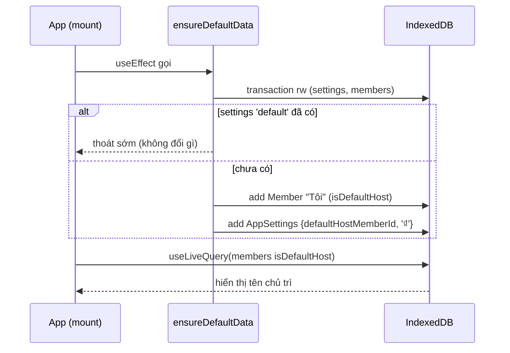
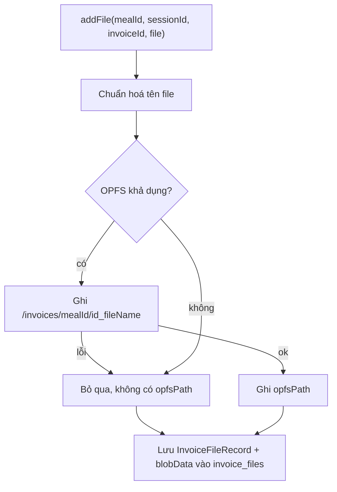

<!-- Nguyên văn documentation/epic-1/SA.md (System Analysis) tại thời điểm chuyển sang OpenSpec, 2026-11-11. Tài liệu lịch sử: có thể không còn khớp code hiện tại; hành vi hiện hành nằm ở openspec/specs/. -->

# Epic 1 — System Analysis (SA)

**Epic 1**: Khởi tạo Nền tảng, Hệ màu USD Green & Lớp Lưu trữ Local · **Trạng thái**: đã triển khai (code tại `app/`)

Tài liệu đi cùng: [BR](./BR.md) · [Kiến trúc & Data model](../01-architecture-and-data-model.md)

---

### B.1. Công nghệ
Vite 8 · React 19 · TypeScript 6 · Tailwind CSS 3 · Dexie 4 + `dexie-react-hooks` · lucide-react · Vitest + fake-indexeddb + jsdom.

### B.2. Cấu trúc mã nguồn

```text
app/
├─ tailwind.config.js        # token màu USD, font
├─ vite.config.ts            # cấu hình vitest (jsdom)
└─ src/
   ├─ index.css              # Tailwind + component classes (.card, .btn-*, .money, .badge-active)
   ├─ App.tsx                # shell: header, trang mẫu, gọi ensureDefaultData
   ├─ types/index.ts         # toàn bộ interface (theo 01-architecture §3)
   ├─ db/
   │  ├─ db.ts               # class UsdSplitDB, export `db`
   │  ├─ normalize.ts        # normalizeName()
   │  ├─ seed.ts             # ensureDefaultData()
   │  └─ db.test.ts
   └─ services/
      ├─ fileStorageService.ts
      └─ fileStorageService.test.ts
```

### B.3. Thành phần & trách nhiệm

| Thành phần | Trách nhiệm | Phụ thuộc |
| :--- | :--- | :--- |
| `types` | Định nghĩa kiểu dữ liệu dùng chung cho mọi Epic | — |
| `db` | Mở IndexedDB `usd-split`, khai báo bảng và index | `types`, Dexie |
| `normalize` | Chuẩn hoá chuỗi tìm kiếm tiếng Việt | — |
| `seed` | Tạo hồ sơ chủ app + settings (idempotent) | `db`, `normalize` |
| `fileStorageService` | CRUD file hoá đơn trên OPFS + Blob | `db`, `types` |
| `App` | Gọi seed khi mount, hiển thị chủ trì qua `useLiveQuery` | `db`, `seed` |

### B.4. Thiết kế dữ liệu IndexedDB (DB `usd-split`, version 1)

| Bảng | Kiểu | Khoá chính + index |
| :--- | :--- | :--- |
| `meals` | `Meal` | `id`, `date`, `status`, `updatedAt` |
| `sessions` | `SessionKeo` | `id`, `mealId`, `orderIndex` |
| `invoices` | `Invoice` | `id`, `mealId`, `sessionId` |
| `items` | `InvoiceItem` | `id`, `mealId`, `sessionId`, `invoiceId` |
| `members` | `Member` | `id`, `normalizedName`, `lastUsedAt` |
| `invoice_files` | `InvoiceFileRecord` | `id`, `mealId`, `sessionId`, `invoiceId` |
| `settings` | `AppSettings` | `id` (cố định `'default'`) |

Ghi chú thiết kế:
- Index `mealId` trên `sessions`, `invoices`, `items`, `invoice_files` phục vụ xoá hàng loạt khi xoá/lưu trữ bữa (Epic 3, 7).
- `PaymentGroup`, `settlementStatuses`, `archivedSummary` nằm nhúng trong `Meal`, không có bảng riêng.
- Khoá là UUID (`crypto.randomUUID`). Ngày lưu dạng chuỗi ISO.

### B.5. Luồng xử lý

**Khởi động & seed**


**Thêm file hoá đơn**


**Đọc / xoá**
- `getFileBlob`: đọc OPFS trước, lỗi hoặc không có → dùng `blobData`.
- `deleteFile` / `deleteFilesBy{Invoice,Session,Meal}`: xoá file OPFS (nếu có `opfsPath`) rồi xoá bản ghi; theo bữa còn xoá đệ quy thư mục `/invoices/<mealId>`.

### B.6. Giao diện lập trình (API nội bộ)

| Hàm | Mô tả |
| :--- | :--- |
| `ensureDefaultData(): Promise<void>` | Seed idempotent |
| `normalizeName(s): string` | Bỏ dấu, thường, `đ→d`, trim |
| `addFile(input): Promise<InvoiceFileRecord>` | Thêm file, `input.ocrRawText?` tuỳ chọn |
| `getFileBlob(id): Promise<Blob \| undefined>` | Đọc nội dung |
| `downloadFile(id): Promise<boolean>` | Tải về qua object URL; `false` nếu thiếu dữ liệu |
| `deleteFile(id)` | Xoá 1 file |
| `deleteFilesByInvoice(id)` / `...BySession(id)` / `...ByMeal(id)` | Xoá hàng loạt |
| `listFilesByInvoice(id)` | Liệt kê, sắp theo `createdAt` |
| `getTotalStorageBytes()` | Tổng dung lượng file |

### B.7. Yêu cầu phi chức năng

| Nhóm | Yêu cầu | Hiện trạng |
| :--- | :--- | :--- |
| Bền vững | Dữ liệu còn sau F5 | Đạt (test đóng/mở lại DB) |
| Tương thích | Trình duyệt không có OPFS vẫn chạy | Đạt qua Blob fallback |
| Hiệu năng | Build gọn | JS 323 kB (gzip 103 kB) |
| Bảo mật/riêng tư | Dữ liệu chỉ ở trình duyệt người dùng | Không gửi ra ngoài (trừ tải font Google Fonts) |
| Khả dụng | Focus ring rõ, tương phản chữ/nền cao | Có `focus-visible` ring `usd-green-600` |

### B.8. Rủi ro & hạn chế đã biết

| Mục | Mô tả | Hướng xử lý |
| :--- | :--- | :--- |
| Đường OPFS mới test thủ công trên 1 trình duyệt | Test tự động chạy trên jsdom (không có OPFS), chỉ phủ Blob fallback; đường OPFS đã chạy thủ công trên trình duyệt trong app (thêm, đọc, xoá theo bữa đều đạt) | Thử thêm trên Safari/Firefox; cân nhắc e2e (Playwright) |
| Lưu Blob trùng | Mỗi file nằm 2 nơi (OPFS + IndexedDB) → tốn gấp đôi dung lượng | Chấp nhận để đảm bảo tương thích; xem lại nếu dung lượng thành vấn đề |
| Xoá bản ghi vs file | Xoá không nằm trong 1 transaction với OPFS; có thể sót file nếu gián đoạn | Bổ sung bước dọn mồ côi khi khởi động (Epic 7) |
| Phụ thuộc Google Fonts | Offline lần đầu dùng font dự phòng | Tự host font hoặc cache bằng service worker (PWA) |
| Chưa có migration | DB đang ở version 1 | Thêm `version(n).upgrade` khi đổi schema |
| Tiền tệ | `currencySymbol` mặc định `₫` theo seed | Cho đổi trong màn hình cài đặt (sau) |

### B.9. Ma trận truy vết kiểm thử

| User Story | BR | Kiểm thử |
| :-: | :-: | :--- |
| US-1.1 | BR-1.2 | `vite build` + đã xem giao diện trên trình duyệt (xanh lá, nền kem, số thẳng cột) |
| US-1.2 | BR-1.3 | `db.test.ts` (persist qua close/open) |
| US-1.3 | BR-1.4, 1.7 | `fileStorageService.test.ts` (thêm, đọc, xoá lẻ, xoá theo bữa — đường Blob) + chạy thủ công đường OPFS trên trình duyệt (đạt) |
| US-1.4 | BR-1.5, 1.6 | `db.test.ts` (tạo 1 lần, gọi 2 lần không trùng) |

### B.10. Việc còn lại để đóng Epic 1
1. Kiểm tra F5 giữ dữ liệu (AC-2) và thử đường OPFS trên Safari/Firefox (AC-3).

---

## Phụ lục: Business Requirements gốc của Epic 1

Nguyên văn `documentation/epic-1/BR.md` tại thời điểm chuyển sang OpenSpec (2026-11-11). `proposal.md` và các delta spec của change này được chuyển từ tài liệu này.

# Epic 1 — Business Requirements (BR)

**Epic 1**: Khởi tạo Nền tảng, Hệ màu USD Green & Lớp Lưu trữ Local · **Trạng thái**: đã triển khai (code tại `app/`)

Tài liệu đi cùng: [SA](./SA.md) · [Epics & Roadmap](../04-epics-and-roadmap.md)

---

### A.1. Bối cảnh & Mục tiêu nghiệp vụ
Người dùng cần một ứng dụng chia tiền nhóm chạy hoàn toàn trên trình duyệt, không cần server, mang phong cách tờ USD. Epic 1 tạo nền móng để các Epic sau (danh bạ, bữa, kèo, hoá đơn...) chỉ việc dùng lại: giao diện thống nhất, dữ liệu bền vững và nơi lưu file hoá đơn.

### A.2. Các bên liên quan
| Vai trò | Quan tâm |
| :--- | :--- |
| Tôi | Dùng app một mình trên thiết bị của mình; là Người chủ trì mặc định |
| Thành viên nhóm | Chỉ xem snapshot (Epic 8), không dùng DB của Epic 1 |
| Dev / Epic 2–8 | Cần schema ổn định, service lưu file, theme dùng chung |

### A.3. Yêu cầu nghiệp vụ (BR)

| Mã | Yêu cầu | Truy vết |
| :-: | :--- | :--- |
| **BR-1.1** | Ứng dụng hoạt động 100% client-side, không backend, không cần mạng để lưu/tính toán. | US-1.1, 1.2 |
| **BR-1.2** | Giao diện phải mang phong cách tiền USD: xanh lá đậm, nền giấy kem, số tiền thẳng cột. | US-1.1, YC#13 |
| **BR-1.3** | Dữ liệu 3 tầng (Bữa – Kèo – Món) cùng hoá đơn, danh bạ, file và cài đặt phải lưu bền vững; tải lại trang (F5) không mất dữ liệu. | US-1.2, YC#1 |
| **BR-1.4** | Mọi ảnh hoá đơn được lưu thành file thật, xem lại/tải về/xoá được; xoá thì giải phóng dung lượng. | US-1.3, YC#14 |
| **BR-1.5** | Có sẵn hồ sơ "Tôi" làm Người chủ trì mặc định ngay lần mở đầu tiên, không cần người dùng cấu hình. | US-1.4 |
| **BR-1.6** | Khởi tạo dữ liệu mặc định phải an toàn khi chạy nhiều lần (không tạo trùng hồ sơ). | US-1.4 |
| **BR-1.7** | Việc xoá Bữa/Kèo/Hoá đơn (Epic 3, 4, 7) phải xoá được toàn bộ file liên quan; Epic 1 cung cấp năng lực này. | US-1.3, YC#17 |

### A.4. Quy tắc nghiệp vụ (Business Rules)

| Mã | Quy tắc |
| :-: | :--- |
| **R-1** | Bảng màu cố định: `#0A1F16`, `#123123`, `#1B4332`, `#2D6A4F`, `#40916C`, `#D8F3DC` (xanh); `#FAF8F5`, `#F2EFE9`, `#E4DFD5` (giấy); vàng `#CA8A04` (chủ trì/lưu trữ/VAT); đỏ `#DC2626` (số âm, xoá). |
| **R-2** | Mọi cột số tiền dùng font số tabular (`tabular-nums`, mono) để thẳng hàng. |
| **R-3** | Chỉ có đúng **một** hồ sơ chủ app (`isDefaultHost = true`); `settings.defaultHostMemberId` trỏ tới hồ sơ đó. |
| **R-4** | Tên hiển thị gốc được giữ nguyên; `normalizedName` (bỏ dấu, chữ thường, `đ→d`) dùng cho tìm kiếm và sắp xếp A-Z ở Epic 2. |
| **R-5** | Mỗi file hoá đơn luôn có bản Blob trong IndexedDB; OPFS chỉ là bản bổ sung. Lỗi OPFS không được làm hỏng thao tác của người dùng. |
| **R-6** | Xoá file phải xoá cả bản vật lý (OPFS) lẫn bản ghi DB. Xoá theo bữa phải xoá cả thư mục `/invoices/<mealId>`. |
| **R-7** | Tên file được chuẩn hoá (bỏ dấu, `đ→d`, ký tự lạ → `_`) trước khi lưu. |
| **R-8** | "Ứng trước" = một người thanh toán toàn bộ một hoá đơn; những người còn lại bị ghi nợ phần của mình khi kết toán (Epic 5, 6). Epic 1 chỉ cung cấp trường `Invoice.payerMemberId`. |

### A.5. Tiêu chí nghiệm thu (nghiệp vụ)
- [ ] AC-1: Giao diện xanh lá đậm, nền giấy kem, số tiền thẳng cột.
- [ ] AC-2: Tải lại trang (F5), hồ sơ "Tôi" vẫn còn và không bị nhân đôi.
- [ ] AC-3: Thêm file hoá đơn → đọc lại được; xoá → bản ghi và file biến mất, dung lượng giảm.

### A.6. Ngoài phạm vi
Giao diện quản lý bữa, danh bạ, nhập hoá đơn, OCR, quyết toán, snapshot (Epic 2–8). PWA/service worker chưa nằm trong Epic 1.
