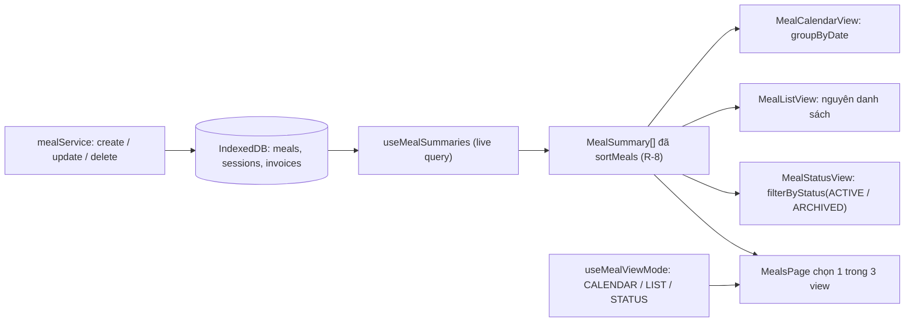
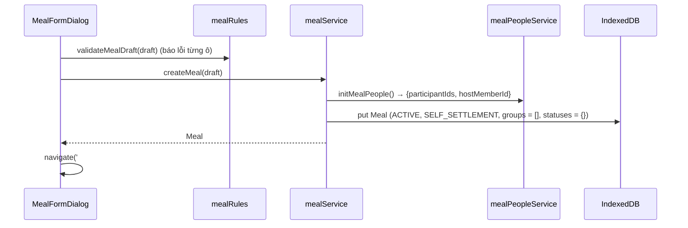
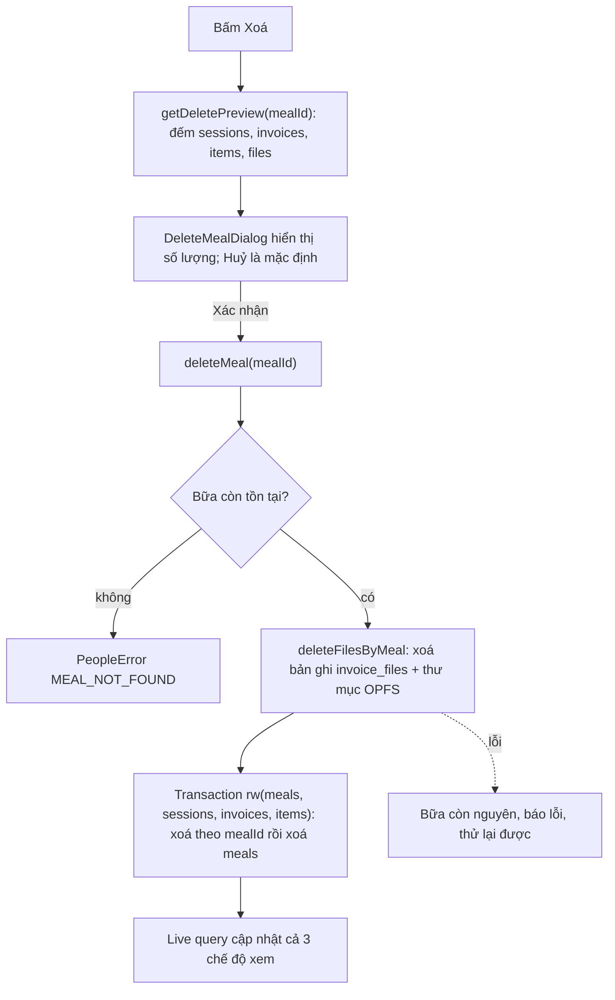
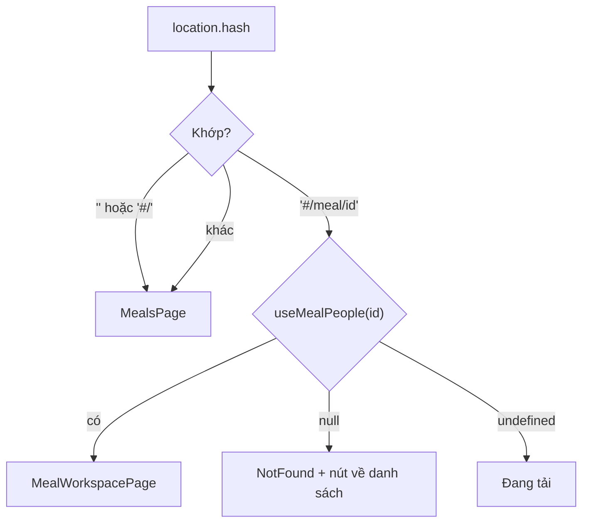

<!-- Nguyên văn documentation/epic-3/SA.md (System Analysis) tại thời điểm chuyển sang OpenSpec, 2026-11-11. Tài liệu lịch sử: có thể không còn khớp code hiện tại; hành vi hiện hành nằm ở openspec/specs/. -->

# Epic 3 — System Analysis (SA)

**Epic 3**: Hệ thống Quản lý Bữa (CRUD & 3 Chế độ Xem: Lịch, Danh sách, Loại) · **Trạng thái**: đã triển khai (code tại `app/`); build, lint và 174 test tự động đạt; kiểm thủ công trên trình duyệt mới làm một phần, xem B.9–B.10

Tài liệu đi cùng: [BR](./BR.md) · [Kiến trúc & Data model](../01-architecture-and-data-model.md) · [Nghiệp vụ](../02-business-logic-and-algorithms.md) · [UI §4.1–4.2](../03-ui-ux-and-design-system.md) · [Epic 2 SA](../epic-2/SA.md)

---

### B.1. Công nghệ
Dùng lại stack hiện có: React 19 · TypeScript · Tailwind · Dexie 4 + `dexie-react-hooks` · lucide-react · Vitest + fake-indexeddb + jsdom + Testing Library. **Không thêm thư viện nào** (kể cả thư viện router và lịch):

- **Điều hướng**: hash routing tự viết (~40 dòng, hook `useHashRoute`) vì chỉ có hai màn hình. `#/…` tránh xung đột với tham số `?snapshot=` của Epic 8 và không cần cấu hình máy chủ (PWA tĩnh).
- **Lịch**: tự dựng lưới tháng bằng hàm thuần `buildMonthGrid`; tránh thư viện lịch nặng và khó chỉnh theo giao diện USD.
- **Ngày**: dùng chuỗi `YYYY-MM-DD` (đúng `Meal.date`) và `Date` cục bộ; **không** dùng `toISOString().slice(0,10)` cho ngày (lệch UTC; `PeopleSandbox` hiện làm vậy, sẽ bị xoá).
- **Định dạng**: `Intl.NumberFormat('vi-VN')` cho tiền, hàm tự viết cho ngày `dd/mm/yyyy` và thứ trong tuần.
- **Modal**: phần tử `<dialog>` gốc (`showModal()` cho sẵn focus trap, `Esc`, lớp phủ). jsdom chưa hỗ trợ đầy đủ `showModal`; test sẽ bổ sung polyfill nhỏ trong file setup (xem B.8).

### B.2. Cấu trúc mã nguồn

```text
app/src/
├─ types/index.ts                     # THÊM MealSummary, MealViewMode (không đổi interface đã có)
├─ db/db.ts                           # không đổi (không nâng version schema)
├─ lib/
│  ├─ dates.ts                        # MỚI: todayLocal, isValidYmd, formatDateVi, buildMonthGrid, shiftMonth, weekdayLabels
│  ├─ dates.test.ts                   # gồm cả test formatMoney
│  └─ money.ts                        # MỚI: formatMoney
├─ domain/
│  ├─ mealRules.ts                    # MỚI, THUẦN: cleanMealTitle, defaultMealTitle, validateMealDraft, sortMeals,
│  │                                  #   groupByDate, paymentEntities, summarizeMeal, filterByStatus
│  └─ mealRules.test.ts
├─ services/
│  ├─ peopleErrors.ts                 # THÊM mã INVALID_TITLE, INVALID_DATE, INVALID_NOTE
│  ├─ mealService.ts                  # MỚI: createMeal, updateMealInfo, getDeletePreview, deleteMeal
│  └─ mealService.test.ts
├─ hooks/
│  ├─ useMealSummaries.ts             # MỚI: MealSummary[] đã xếp (useLiveQuery trên meals/sessions/invoices)
│  ├─ useHashRoute.ts                 # MỚI: route hiện tại + navigate()
│  ├─ useMealViewMode.ts              # MỚI: chế độ xem + lưu localStorage (try/catch)
│  └─ useMealPeople.ts                # không đổi
├─ components/
│  ├─ ui/
│  │  ├─ Modal.tsx                    # MỚI: <dialog> có tiêu đề, đóng bằng Esc, trả focus
│  │  ├─ ConfirmDialog.tsx            # MỚI: xác nhận, Huỷ là mặc định (R-7, BR-3.12)
│  │  └─ Modal.test.tsx
│  ├─ meals/
│  │  ├─ MealViewSwitcher.tsx         # MỚI: 3 tab chế độ xem (role="tablist")
│  │  ├─ MealCard.tsx                 # MỚI: thẻ bữa dùng chung cho List/Status/khung ngày
│  │  ├─ MealCalendarView.tsx         # MỚI: lưới lịch + khung bữa trong ngày
│  │  ├─ MealListView.tsx             # MỚI
│  │  ├─ MealStatusView.tsx           # MỚI
│  │  ├─ MealFormDialog.tsx           # MỚI: tạo / sửa (dùng chung)
│  │  ├─ DeleteMealDialog.tsx         # MỚI: xác nhận kèm số lượng sẽ mất
│  │  └─ *.test.tsx                   # test component (mục B.9)
│  ├─ profile/MyProfileDialog.tsx     # MỚI: đổi tên "Tôi" (chuyển từ HostNameEditor của PeopleSandbox)
│  └─ people/                         # SỬA nhỏ: ParticipantList, PaymentGroupPanel, PaymentGroupDialog
│                                     #   thay window.confirm bằng ConfirmDialog (BR-3.12)
├─ pages/
│  ├─ MealsPage.tsx                   # MỚI: tiêu đề + switcher + 1 trong 3 view + nút "+ Tạo bữa"
│  ├─ MealWorkspacePage.tsx           # MỚI: thanh đầu bữa + Khu vực 1 (Epic 2) + ô giữ chỗ Khu vực 2, 3
│  └─ PeopleSandbox.tsx               # XOÁ (Epic 2 đã hẹn Epic 3 thay thế)
└─ App.tsx                            # SỬA: header + chọn trang theo route + nút Hồ sơ của tôi
```

### B.3. Thành phần & trách nhiệm

| Thành phần | Trách nhiệm | Phụ thuộc |
| :--- | :--- | :--- |
| `lib/dates` | Mọi phép tính ngày thuần: kiểm tra `YYYY-MM-DD` có thật (R-2), hôm nay theo giờ địa phương, định dạng hiển thị, dựng lưới tháng tuần bắt đầu Thứ 2 (R-12), cộng/trừ tháng | không |
| `lib/money` | `formatMoney(n)` → `1.620.000 ₫`, số nguyên VNĐ | `Intl` |
| `domain/mealRules` | Chuẩn hoá và kiểm hợp lệ tên/ngày/ghi chú (R-1…R-3), thứ tự bữa (R-8), thực thể thanh toán và tiến độ (R-10), tóm tắt bữa từ dữ liệu thô (R-9, R-11), gom bữa theo ngày cho lịch. **Không chạm DB** | `lib/dates`, `services/peopleErrors` |
| `mealService` | Vòng đời bữa: tạo (R-4), sửa (R-5), xem trước dữ liệu bị xoá (R-7), xoá dây chuyền (R-6). Mỗi hàm ghi là một transaction trừ phần xoá file | `db`, `mealPeopleService.initMealPeople`, `fileStorageService.deleteFilesByMeal`, `mealRules` |
| `useMealSummaries` | Đọc `meals`, đếm `sessions`, cộng `invoices.totalAmount` theo bữa trong **một** live query, trả `MealSummary[]` đã `sortMeals`. Là **nguồn duy nhất** cho cả ba chế độ xem (BR-3.7, BR-3.8) | `db`, `mealRules` |
| `useHashRoute` | Phân tích `location.hash` thành `{ name: 'home' } \| { name: 'meal', id } \| { name: 'notFound' }`, `navigate(path)`, lắng nghe `hashchange` | không |
| `useMealViewMode` | Đọc/ghi `usd-split.mealView` trong `localStorage` bọc try/catch; mặc định `LIST` (R-16) | không |
| `Modal` / `ConfirmDialog` | Hộp thoại dùng chung: tiêu đề có nhãn ARIA, `Esc` đóng, trả focus về nút gọi, nút Huỷ focus mặc định | `<dialog>` |
| `MealCalendarView` | Lưới lịch, chọn ngày, khung bữa trong ngày, nút "+ Tạo bữa mới cho ngày này" | `buildMonthGrid`, `groupByDate`, `MealCard` |
| `MealListView`, `MealStatusView` | Danh sách thẻ theo R-8; tab theo R-15 | `MealCard` |
| `MealCard` | Hiển thị tóm tắt (ngày, tên, huy hiệu trạng thái, số kèo, số người, tổng tiền, tiến độ) và nút Mở / Xoá | `formatMoney`, `formatDateVi` |
| `MealFormDialog` | Form tạo/sửa; kiểm tra bằng `validateMealDraft` để báo lỗi từng ô trước khi gọi service; nhận `initialDate` | `mealService` |
| `DeleteMealDialog` | Gọi `getDeletePreview` hiển thị số lượng, rồi `deleteMeal` | `mealService` |
| `MealWorkspacePage` | Dùng `useMealPeople(id)`; bố cục UI §4.2; Khu vực 1 gắn `MemberQuickFilter`, `ParticipantList`, `HostSelector`, `PaymentGroupPanel` (props như `PeopleSandbox` cũ); `readOnly` khi `ARCHIVED` | Epic 2, `useMembers` |
| `MyProfileDialog` | Đổi tên hồ sơ "Tôi" qua `renameMember` | `memberService` |

Quy ước giữ nguyên Epic 2: component chỉ đọc DB qua hook và chỉ ghi qua service; không gọi `db` trực tiếp trong component.

### B.4. Thiết kế dữ liệu

**Không đổi schema, không nâng version Dexie.** `Meal` (file 01 §3.2) đã đủ trường; các index `meals.date`, `meals.status`, `sessions.mealId`, `invoices.mealId`, `items.mealId`, `invoice_files.mealId` đã có từ Epic 1 và đủ cho xoá dây chuyền. Lọc/gom bữa chạy trong bộ nhớ vì số bữa nhỏ (mục tiêu 1.000 bữa, B.7).

Kiểu thêm vào `types/index.ts` (chỉ kiểu hiển thị, không lưu DB):

```typescript
export type MealViewMode = 'CALENDAR' | 'LIST' | 'STATUS';

export interface MealSummary {
  meal: Meal;
  sessionCount: number;      // R-11
  participantCount: number;  // R-11
  totalAmount: number;       // R-9 (0 nếu chưa có chi phí)
  hasCost: boolean;          // false → hiển thị "Chưa có chi phí"
  paidCount: number;         // R-10
  entityCount: number;       // R-10
}
```

Bất biến cho mọi `Meal` do Epic 3 tạo, cộng thêm với I-1…I-6 của Epic 2:

| # | Bất biến |
| :-: | :--- |
| I-E3-1 | `title` đã qua `cleanMealTitle`, độ dài 1–100 (sau khi áp tên mặc định); `date` là `YYYY-MM-DD` hợp lệ trong [2000-01-01, 2099-12-31]; `note` hoặc vắng mặt hoặc 1–500 ký tự |
| I-E3-2 | Sau `deleteMeal`: không còn bản ghi nào có `mealId` đó ở `sessions`, `invoices`, `items`, `invoice_files`, và không còn thư mục OPFS `/invoices/<mealId>` |
`localStorage`: khoá `usd-split.mealView` ∈ `CALENDAR | LIST | STATUS`. Giá trị lạ → dùng mặc định. Đây là tiện ích theo thiết bị, không phải dữ liệu nghiệp vụ nên không đưa vào `settings` và không cần nâng schema.

### B.5. Luồng xử lý chính

**Dữ liệu chảy từ DB đến ba chế độ xem (BR-3.7)**


**Tạo bữa**


**Xoá bữa dây chuyền (R-6)**

Lý do xoá file trước: nếu xoá DB trước rồi xoá file lỗi thì file OPFS thành "mồ côi" không còn bản ghi nào trỏ tới để dọn. Xoá file trước thì tệ nhất là bữa mất ảnh nhưng còn nguyên để thử xoá lại.

**Điều hướng**


**Dựng lưới lịch (R-12)**: `buildMonthGrid(year, month)` lấy ngày 1 của tháng, lùi về Thứ 2 gần nhất làm ô đầu, sinh tuần liên tiếp cho đến khi phủ hết ngày cuối tháng; mỗi ô `{ ymd, day, inMonth, isToday }`. Tất cả tính bằng thành phần năm/tháng/ngày của `Date` cục bộ rồi định dạng thủ công thành `YYYY-MM-DD`.

### B.6. Giao diện lập trình nội bộ

**Lỗi**: dùng lại `PeopleError` của Epic 2 để UI chỉ cần một bộ xử lý lỗi; thêm 3 mã:

| `code` | Khi nào |
| :--- | :--- |
| `INVALID_TITLE` | Tên bữa quá 100 ký tự (tên rỗng **không** lỗi vì có tên mặc định, R-1) |
| `INVALID_DATE` | Ngày không đúng `YYYY-MM-DD`, không có thật, hoặc ngoài [2000-01-01, 2099-12-31] (R-2) |
| `INVALID_NOTE` | Ghi chú quá 500 ký tự (R-3) |

`MEAL_NOT_FOUND`, `MEAL_ARCHIVED` đã có. Mọi hàm ghi trong B.6 chạy trong transaction và không ghi gì nếu ném lỗi (trừ `deleteMeal`, xem R-6).

**`lib/dates.ts`** (thuần)

| Hàm | Mô tả |
| :--- | :--- |
| `todayLocal(now = new Date()): string` | `YYYY-MM-DD` theo giờ địa phương |
| `isValidYmd(s: string): boolean` | Đúng định dạng `^\d{4}-\d{2}-\d{2}$` và là ngày có thật (kiểm bằng cách dựng `Date` rồi so lại các thành phần); không kiểm khoảng |
| `formatDateVi(ymd): string` | `19/10/2026` |
| `buildMonthGrid(year, month): CalendarDay[]` | Lưới tuần bắt đầu Thứ 2; `month` 1–12 |
| `shiftMonth(year, month, delta): {year, month}` | Cộng/trừ tháng, qua năm đúng |
| `WEEKDAY_LABELS` | `['T2','T3','T4','T5','T6','T7','CN']` |

**`domain/mealRules.ts`** (thuần)

| Hàm | Mô tả |
| :--- | :--- |
| `cleanMealTitle(raw): string` | R-1: trim, gộp khoảng trắng, bỏ ký tự điều khiển; **không** đổi hoa/thường |
| `defaultMealTitle(ymd): string` | `Bữa 19/10/2026` |
| `validateMealDraft(draft: { title: string; date: string; note?: string }): { title: string; date: string; note?: string }` | Trả bản đã chuẩn hoá (tên mặc định nếu rỗng, `note` bỏ nếu rỗng); ném `INVALID_TITLE` / `INVALID_DATE` / `INVALID_NOTE`. UI dùng để báo lỗi từng ô trước khi lưu |
| `sortMeals<T extends { date: string; createdAt: string }>(items: T[]): T[]` | R-8; trả mảng mới |
| `groupByDate(summaries): Map<string, MealSummary[]>` | Cho lịch; mỗi nhóm giữ thứ tự R-8 |
| `paymentEntities(meal): string[]` | R-10: `paymentGroups.map(id)` cộng các `participantIds` chưa thuộc nhóm nào |
| `summarizeMeal({ meal, sessionCount, invoices }): MealSummary` | R-9…R-11. `ACTIVE`: `totalAmount = Σ invoice.totalAmount`, `hasCost = invoices.length > 0`; `ARCHIVED`: từ `archivedSummary` (`hasCost = archivedSummary !== undefined`). Tiến độ đếm `isPaid` theo `settlementStatuses` hoặc `entitiesSummary` |

**`services/mealService.ts`**

| Hàm | Mô tả |
| :--- | :--- |
| `createMeal(draft: MealDraft, now = new Date()): Promise<Meal>` | `validateMealDraft`, `initMealPeople()`, `put` bản ghi R-4 trong một transaction; trả `Meal` |
| `updateMealInfo(mealId, draft): Promise<Meal>` | Đọc bữa; `MEAL_NOT_FOUND` / `MEAL_ARCHIVED`; áp `validateMealDraft`; chỉ ghi `title`, `date`, `note`, `updatedAt` (không đụng trường khác) |
| `getDeletePreview(mealId): Promise<{ sessions: number; invoices: number; items: number; files: number }>` | Đếm theo index `mealId`; `MEAL_NOT_FOUND` nếu không có bữa |
| `deleteMeal(mealId): Promise<void>` | Luồng B.5. Cho phép cả `ACTIVE` lẫn `ARCHIVED`. Thành viên danh bạ không bị đụng |

**Hook**

| Hook | Trả về |
| :--- | :--- |
| `useMealSummaries()` | `MealSummary[]` đã `sortMeals`; `undefined` khi đang tải. Live query một lần đọc `meals`, `sessions` (đếm theo `mealId`), `invoices` (cộng theo `mealId`) |
| `useHashRoute()` | `{ route, navigate(path: string): void }` |
| `useMealViewMode()` | `[mode: MealViewMode, setMode]`; ghi `localStorage` trong try/catch |

**Component chính**

| Component | Props | Hành vi |
| :--- | :--- | :--- |
| `Modal` | `open`, `title`, `onClose`, `children` | `<dialog>`; `showModal()` khi `open`; `Esc`/nút đóng gọi `onClose`; trả focus về phần tử đã mở |
| `ConfirmDialog` | `open`, `title`, `message`, `confirmLabel`, `tone?: 'danger'`, `onConfirm`, `onCancel` | Nút Huỷ được focus mặc định (R-7); `onConfirm` có thể async, hiện trạng thái đang xử lý và lỗi |
| `MealCard` | `summary`, `onOpen`, `onDelete` | Huy hiệu `Đang hoạt động` (`badge-active`) / `Đã lưu trữ` (vàng `usd-gold-600`, icon khoá); số tiền dùng lớp `money` |
| `MealCalendarView` | `summaries`, `onCreateForDate(ymd)`, `onOpen`, `onDelete` | State cục bộ: `year`, `month`, `selectedYmd` (mặc định hôm nay); R-12…R-14 |
| `MealListView` | `summaries`, `onOpen`, `onDelete` | R-8, R-18 (trạng thái rỗng) |
| `MealStatusView` | `summaries`, `onOpen`, `onDelete` | R-15; `role="tablist"` |
| `MealFormDialog` | `mode: 'create' \| 'edit'`, `meal?`, `initialDate?`, `onClose`, `onSaved(meal)` | Ô Tên (placeholder là tên mặc định), ô Ngày (`<input type="date">` min/max theo R-2), ô Ghi chú; lỗi hiển thị dạng text cạnh ô |
| `DeleteMealDialog` | `mealId`, `title`, `date`, `onClose`, `onDeleted` | Tải preview rồi hiện câu "Sẽ xoá vĩnh viễn: n kèo, n hoá đơn, n món, n file ảnh. Không thể hoàn tác." |
| `MealWorkspacePage` | `mealId` | UI §4.2: thanh đầu + Khu vực 1 (khối Epic 2) + hai ô giữ chỗ "Danh sách Kèo — sẽ có ở Epic 4" và "Bảng quyết toán — sẽ có ở Epic 6"; không có nút Lưu trữ (Epic 7) |

Giao diện tuân [03 §2–4](../03-ui-ux-and-design-system.md): header `usd-green-900` + đường vàng, thẻ giấy `.card`, nút `btn-primary` / `btn-secondary` / `btn-danger`, số tiền font tabular; các nút và ô nhập cao tối thiểu 44 px; không dùng màu làm tín hiệu duy nhất (trạng thái luôn kèm chữ).

### B.7. Yêu cầu phi chức năng

| Nhóm | Yêu cầu |
| :--- | :--- |
| Bền vững | Tạo/sửa là một transaction; F5 không mất bữa; chế độ xem được nhớ (R-16) |
| Hiệu năng | Với 1.000 bữa, tính `MealSummary` và dựng một chế độ xem < 50 ms; ô lịch chỉ render bữa của đúng 35–42 ngày hiển thị (lọc bằng `groupByDate`, không lọc lại từng ô) |
| Tương thích | `<dialog>`, `Intl` và `localStorage` có sẵn ở Safari/Chrome/Firefox hiện hành; không dùng API mới hơn; `<input type="date">` rơi về ô văn bản `YYYY-MM-DD` nếu trình duyệt không hỗ trợ (R-2 vẫn kiểm) |
| Khả dụng | Điều khiển hoàn toàn bằng bàn phím: tab chế độ xem dùng `←/→`; lưới lịch là `role="grid"` với `↑↓←→` đổi ngày chọn, `Enter` chọn; hộp thoại `Esc` đóng; trạng thái hiển thị bằng chữ + biểu tượng; vùng chạm ≥ 44 px; không cuộn ngang ở 375 px |
| Bảo mật/riêng tư | Dữ liệu chỉ lưu cục bộ; tên/ghi chú hiển thị qua React (tự thoát HTML), không `dangerouslySetInnerHTML`; hash route chỉ nhận `id` dạng UUID, giá trị lạ → `notFound` |
| Bảo trì | Mọi quyết định (kiểm hợp lệ, sắp xếp, tóm tắt, lưới ngày) nằm ở `domain/` và `lib/` thuần, component chỉ ghép nối |

### B.8. Rủi ro, hạn chế & câu hỏi mở

| Mục | Mô tả | Hướng xử lý |
| :--- | :--- | :--- |
| Múi giờ | `Meal.date` là chuỗi ngày cục bộ; thiết bị đổi múi giờ thì "hôm nay" đổi, ngày của bữa cũ không đổi | Chấp nhận (đúng bản chất "bữa theo ngày"); không dùng UTC cho ngày; có test `todayLocal` với giờ sát nửa đêm |
| Tổng tiền/tiến độ chưa có dữ liệu thật | Hoá đơn (Epic 4), tick thanh toán (Epic 6), `archivedSummary` (Epic 7) chưa có | Công thức R-9, R-10 kiểm bằng dữ liệu giả lập ghi trực tiếp vào bảng; kiểm lại bằng dữ liệu thật khi Epic 4–7 xong (ghi vào B.10) |
| Tiến độ thanh toán thô | Đếm cả thực thể số dư 0 (R-10) | Epic 6 tinh chỉnh `paymentEntities`/`summarizeMeal`; đã ghi hạn chế trong BR |
| Đọc toàn bộ `sessions`/`invoices` | `useMealSummaries` quét hai bảng đầy đủ | Ổn với quy mô cá nhân; nếu chậm thì thêm đếm/tổng vào `Meal` (cần nâng schema) hoặc đọc theo `mealId` của tháng đang xem |
| Dùng lại `PeopleError` cho lỗi bữa | Tên lớp lệch nghĩa ("People") | Chấp nhận để UI có một bộ xử lý lỗi; đổi tên thành `AppError` là việc dọn dẹp riêng nếu muốn |
| jsdom và `<dialog>` | jsdom chưa cài đủ `showModal()`/`close()` | Bổ sung polyfill tối giản trong setup của Vitest; nếu vẫn khó thì `Modal` rơi về `div role="dialog"` trong môi trường test. Kiểm bàn phím thật trên trình duyệt (B.10) |
| Bữa nháp Epic 2 còn lại | Người dùng đã chạy Epic 2 có bữa `Bữa thử nghiệm (Epic 2)` trong IndexedDB | R-19: coi như bữa thường, người dùng tự xoá |
| Hash route và Epic 8 | Snapshot dùng `?snapshot=` hoặc `#/snapshot/<chuỗi>` (file 01 §3.7) | `useHashRoute` chừa nhánh `snapshot` để Epic 8 mở rộng; nếu Epic 8 chọn `#/snapshot/…` thì thêm một route, không phải đổi cấu trúc |
| `localStorage` bị chặn | Chế độ riêng tư / chặn dữ liệu site | try/catch, rơi về mặc định (R-16) |
| Kiểm thủ công | Chưa thực hiện vì chưa có code | B.10 |

**Người tham gia từng kèo (yêu cầu bổ sung của anh)**: mỗi kèo có `participantIds` riêng ⊆ người trong bữa và chia tiền chỉ tính trên họ. Thay đổi dữ liệu chung đã ghi ở [01 §3.3](../01-architecture-and-data-model.md), [02 §1.0](../02-business-logic-and-algorithms.md), [03 §4.2](../03-ui-ux-and-design-system.md), [04](../04-epics-and-roadmap.md) (US-4.1b). Tác động tới Epic 3: kiểu `SessionKeo` thêm trường (không đổi schema Dexie vì không có index mới); `deleteMeal` xoá kèo nên danh sách người đi theo; `removeParticipant` tự gỡ người khỏi các kèo (Epic 2 R-12e, đã code + 2 test). UI chọn người tham gia kèo, kiểm tra payer/consumer/equalSplit ⊆ kèo là việc của Epic 4–5. Giả định em đã chọn: `equalSplitParticipantIds` của hoá đơn vẫn có thể tick bớt nhưng luôn ⊆ người tham gia kèo.

**Câu hỏi đã chốt** (anh xác nhận toàn bộ theo mặc định):

| Mã | Câu hỏi | Quyết định |
| :-: | :--- | :--- |
| Q-1 | Chế độ xem mặc định khi mở app lần đầu là gì? Spec thứ tự "Lịch, Danh sách, Loại" nhưng chưa nói mặc định | **Danh sách** (mới → cũ): hữu ích nhất trên di động, ít thao tác nhất; sau đó nhớ lựa chọn lần trước |
| Q-2 | Tạo bữa xong có chuyển thẳng vào màn chi tiết không? | **Có**, vì bước kế tiếp luôn là thêm người |
| Q-3 | Điều hướng bằng hash route tự viết, không thêm thư viện router? | **Có** (`#/` và `#/meal/<id>`), tránh thêm phụ thuộc cho 2 màn hình |
| Q-4 | Tên bữa để trống có tự đặt `Bữa dd/mm/yyyy` hay bắt buộc nhập? | **Tự đặt** (R-1) cho nhanh |
| Q-5 | Có cho tạo bữa ở ngày tương lai (bữa dự kiến) không? | **Có** (R-2) |
| Q-6 | Màn hình hẹp, ô lịch chỉ hiện chấm + số bữa, xem chi tiết ở khung bên dưới (R-12)? | **Có** |
| Q-7 | Thay toàn bộ `window.confirm` của Epic 2 bằng modal của app trong Epic này (BR-3.12)? | **Có**, Epic 2 đã hẹn việc này ở Epic 3 |
| Q-8 | Đổi tên hồ sơ "Tôi" đặt ở đâu khi bỏ `PeopleSandbox`? | Nút "Hồ sơ của tôi" trên header, mở hộp thoại nhỏ (BR-3.11) |
| Q-9 | Bữa nháp `Bữa thử nghiệm (Epic 2)` cũ có tự xoá không? | **Không tự xoá**, để người dùng quyết (R-19) |
| Q-10 | Chưa có nút "Lưu trữ bữa" ở Epic 3, nên không có cách tạo bữa `ARCHIVED` bằng giao diện để thử. Chấp nhận kiểm thử bữa lưu trữ bằng test tự động (ghi bản ghi `ARCHIVED` thẳng vào DB) và chờ Epic 7 để kiểm thủ công? | **Chấp nhận** |

### B.9. Ma trận truy vết kiểm thử

Kết quả chạy thật ngày 2026-10-19 trong `app/`: `npm run build` đạt; `npx oxlint` thoát mã 0; `npx vitest run` **174/174 đạt** (17 file; Epic 3 thêm 70 test, Epic 2 thêm 2 test cho R-12e, Epic 1–2 giữ nguyên 102 test, chạy lặp 5 lần không flaky). Kiểm thủ công trên dev server (trình duyệt trong app, cổng 5174, IndexedDB trống) chỉ ở các mục ghi rõ "trình duyệt".

| User Story | BR | Kiểm thử | Kết quả |
| :-: | :-: | :--- | :-: |
| US-3.1 | BR-3.1, 3.2 | `lib/dates.test.ts` (13 test, gồm cả `formatMoney`): `isValidYmd`/`isYmdInRange`, `todayLocal` sát nửa đêm (AC-14). `domain/mealRules.test.ts` (14): `cleanMealTitle`, tên mặc định, mọi nhánh `INVALID_*`. `services/mealService.test.ts` (11): `createMeal` đúng R-4 và host = "Tôi" (AC-3, AC-4), hai bữa độc lập; `updateMealInfo` chỉ đổi 3 trường + `updatedAt`, từ chối `ARCHIVED`/không tồn tại (AC-5). `pages/MealsPage.test.tsx`: tạo bữa qua giao diện rồi mở, lỗi từng ô khi ngày sai. `pages/MealWorkspacePage.test.tsx`: sửa thông tin | Đạt (tự động). Trình duyệt: tạo bữa bằng bàn phím, ngày mặc định hôm nay, tên mặc định hiện làm placeholder: đạt |
| US-3.1 | BR-3.3 | `mealService.test.ts`: `deleteMeal` xoá `sessions`, `invoices`, `items`, `invoice_files` của bữa, giữ nguyên bữa khác và `members` (AC-2); xoá bữa `ARCHIVED`; bữa không có con; `getDeletePreview` đếm đúng; `MEAL_NOT_FOUND`. `MealsPage.test.tsx`: hộp xác nhận nêu số kèo, Huỷ focus mặc định, Huỷ không xoá, xác nhận xoá | Đạt (tự động). Trình duyệt: xoá bằng bàn phím (`Esc` đóng và trả focus, `Tab`+`Enter` xoá), IndexedDB còn 0 bữa và nguyên 2 thành viên: đạt. **Chưa kiểm**: xoá file ảnh vật lý trong OPFS thật (chưa có hoá đơn/ảnh để thử), nhánh `deleteFilesByMeal` lỗi giữa chừng |
| US-3.1 | BR-3.9, 3.10, 3.11 | `MealWorkspacePage.test.tsx` (7): tiêu đề, chủ trì, tổng chi, khối Quick Filter; thêm người trong bữa thật (AC-10); bữa `ARCHIVED` chỉ đọc nhưng xoá được (AC-8); bữa không tồn tại hiện thông báo và nút về danh sách; `MyProfileDialog` đổi tên và từ chối tên trùng (AC-11) | Đạt (tự động). Trình duyệt: mở `#/meal/<id>`, thêm "Bình", F5 vẫn còn bữa và người (AC-9, AC-4 của Epic 2): đạt. **Chưa kiểm trong trình duyệt**: đổi tên "Tôi", đường dẫn tới bữa không tồn tại |
| US-3.1 | BR-3.12 | `components/ui/Modal.test.tsx` (6): `Esc`/nút Đóng, trả focus, Huỷ focus mặc định, lỗi từ `onConfirm` hiện trong hộp. `MealWorkspacePage.test.tsx`: bỏ người đã tick thanh toán dùng `ConfirmDialog` và không gọi `window.confirm` (AC-12). Test Epic 2 không phải sửa vì không test nhánh `window.confirm` | Đạt (tự động). Trình duyệt: `<dialog>` modal thật (`:modal` đúng), Huỷ focus mặc định, `Esc` đóng: đạt |
| US-3.2 | BR-3.4 | `dates.test.ts`: `buildMonthGrid` (bắt đầu Thứ 2, 4/5/6 hàng, tháng 2 nhuận), `shiftMonth` qua năm. `MealsPage.test.tsx`: đánh dấu ngày có bữa kèm tên, khung ngày liệt kê cả bữa lưu trữ, "Tạo bữa mới cho ngày này" điền sẵn ngày, đổi tháng và "Hôm nay", phím mũi tên đổi ngày (AC-6) | Đạt (tự động). Trình duyệt: lưới tháng 10/2026 đúng (19/10 là Thứ 2, ô có nhãn bữa, tô ngày chọn), bản 375 px hiện chấm số bữa: đạt. **Chưa kiểm trong trình duyệt**: đổi tháng/năm, tạo bữa từ ngày chọn |
| US-3.3 | BR-3.5, 3.8 | `mealRules.test.ts`: `sortMeals` (mới → cũ, cùng ngày theo `createdAt`), `summarizeMeal` (R-9…R-11, gồm bữa lưu trữ), `paymentEntities`. `MealsPage.test.tsx`: thứ tự thẻ và các trường (AC-7), trạng thái rỗng | Đạt (tự động). Tổng tiền và tiến độ mới kiểm bằng dữ liệu giả lập vì chưa có hoá đơn thật |
| US-3.4 | BR-3.6, 3.10 | `MealsPage.test.tsx`: tab Đang hoạt động/Đã lưu trữ kèm số đếm, bữa lưu trữ có Xoá và không có Sửa, tab lưu trữ rỗng có lời giải thích (AC-8) | Đạt (tự động). Trình duyệt: tab "Đang hoạt động (1) / Đã lưu trữ (0)" ở 375 px: đạt. Chưa có bữa `ARCHIVED` thật để thử trong trình duyệt (cần Epic 7) |
| US-3.2–3.4 | BR-3.7 | `MealsPage.test.tsx`: tạo/đổi tên bữa ở nền thì cả ba chế độ cập nhật ngay (AC-1); chế độ xem được nhớ sau khi mở lại (AC-9). `hooks/viewHooks.test.ts` (6): `parseRoute` (giá trị lạ → danh sách), `readViewMode` mặc định `LIST` và chịu được `localStorage` ném lỗi | Đạt (tự động). Trình duyệt: chọn Lịch, F5 vẫn ở Lịch: đạt |
| Epic 2 R-12e | BR-2.10 | `mealPeopleService.test.ts` (+2): bỏ người gỡ họ khỏi `participantIds` mọi kèo của bữa đó, không đụng kèo bữa khác; bị chặn bởi hoá đơn thì danh sách kèo giữ nguyên | Đạt (tự động) |
| Cả 4 US | tất cả | `npm run build`, `npx oxlint`, `npx vitest run` toàn bộ | Đạt: build thành công, lint mã 0, 174/174 test |
| AC-13 | phi chức năng | Trình duyệt 375 px trên trang Lịch và Loại: không cuộn ngang (`scrollWidth` = 375), không có nút/ô nào thấp hơn 44 px; sửa nhãn tab "Danh sách" bị xuống dòng | Đạt cho hai trang này. **Chưa kiểm** ở 375 px: màn chi tiết bữa, các hộp thoại tạo/sửa |

### B.10. Việc còn lại để đóng Epic
1. **Kiểm thủ công còn thiếu** (xem cột Kết quả B.9): đổi tháng/năm và tạo bữa từ ngày chọn trên Lịch; sửa thông tin bữa và đổi tên "Tôi" trong trình duyệt; đường dẫn tới bữa không tồn tại; màn chi tiết và hộp thoại ở 375 px; điều khiển Lịch hoàn toàn bằng bàn phím; Safari/Firefox (mới chỉ chạy trình duyệt trong app).
2. **Chờ Epic khác để kiểm bằng dữ liệu thật**: xoá bữa có hoá đơn và ảnh thật kèm file OPFS vật lý (Epic 4), tổng tiền và tiến độ thanh toán (Epic 4, 6), bữa `ARCHIVED` thật (Epic 7). Nhánh lỗi giữa chừng của `deleteFilesByMeal` chưa có test.
3. Test `MealsPage` kiểm trực tiếp qua giao diện; chưa có test riêng cho từng component (`MealCard`, `MealCalendarView`…) và test riêng `MyProfileDialog` ngoài một ca trong `MealWorkspacePage.test.tsx`. Chấp nhận vì đã phủ qua trang; bổ sung nếu component bị tách ra dùng chỗ khác.
4. Dọn tài liệu khi đóng: đánh dấu việc bàn giao Epic 2 #6 đã xong (dùng `initMealPeople()`, thay `PeopleSandbox`, thay `window.confirm`) và ghi chú ở Epic 1 BR R-4 về `normalizedName` (việc Epic 2 còn nợ).
5. Bàn giao: **Epic 4** thêm Kèo vào Khu vực 2, kèm chọn người tham gia từng kèo (`SessionKeo.participantIds`, mặc định cả bữa, US-4.1b) và kiểm tra payer/consumer/equalSplit ⊆ người trong kèo; **Epic 6** gắn Quyết toán vào Khu vực 3 và tinh chỉnh `paymentEntities`; **Epic 7** thêm nút Lưu trữ và ghi `archivedSummary`; **Epic 8** thêm route snapshot vào `useHashRoute`.

---

## Phụ lục: Business Requirements gốc của Epic 3

Nguyên văn `documentation/epic-3/BR.md` tại thời điểm chuyển sang OpenSpec (2026-11-11). `proposal.md` và các delta spec của change này được chuyển từ tài liệu này.

# Epic 3 — Business Requirements (BR)

**Epic 3**: Hệ thống Quản lý Bữa (CRUD & 3 Chế độ Xem: Lịch, Danh sách, Loại) · **Trạng thái**: đã triển khai; tiêu chí nghiệm thu bên dưới đánh dấu theo kết quả thật ở [SA B.9](./SA.md)

Tài liệu đi cùng: [SA](./SA.md) · [Epics & Roadmap](../04-epics-and-roadmap.md) · [Epic 2 BR](../epic-2/BR.md) · [UI §4.1–4.2](../03-ui-ux-and-design-system.md)

---

### A.1. Bối cảnh & Mục tiêu nghiệp vụ
Sau Epic 1–2, ứng dụng đã có kho dữ liệu, danh bạ, chủ trì và nhóm thanh toán, nhưng **chưa có cách tạo hay tìm lại một Bữa thật**: người và nhóm đang gắn vào một bữa nháp cố định (`PeopleSandbox`). Epic 3 biến Bữa (Tầng 1, tính theo ngày) thành đối tượng người dùng quản lý được:

1. **Tạo, sửa, xoá Bữa** (cả bữa đang hoạt động lẫn bữa đã lưu trữ — riêng việc sửa chỉ cho bữa đang hoạt động).
2. **Tìm lại bữa theo ba cách nhìn** trên cùng một dữ liệu: Lịch (ngày/tháng/năm), Danh sách (mới → cũ), Loại (đang hoạt động / đã lưu trữ).
3. **Mở một Bữa** vào màn hình chi tiết, nơi đặt khối Thành viên / Chủ trì / Nhóm thanh toán của Epic 2 và chừa sẵn chỗ cho Kèo (Epic 4) và Quyết toán (Epic 6).
4. **Thay trang thử `PeopleSandbox`** bằng luồng thật, không làm mất khả năng đổi tên hồ sơ "Tôi" (BR-2.7 của Epic 2).

Epic này chỉ lo **vòng đời và việc tìm kiếm/hiển thị Bữa**. Kèo, hoá đơn, món, tính tiền, tick thanh toán, lưu trữ và chia sẻ thuộc Epic 4–8; Epic 3 chỉ hiển thị các con số đó khi đã có và hiện giá trị rỗng khi chưa có.

### A.2. Các bên liên quan
| Vai trò | Quan tâm |
| :--- | :--- |
| Tôi (chủ app) | Tạo bữa nhanh (vài giây), tìm lại bữa cũ theo ngày hoặc theo trạng thái, xoá bữa không cần |
| Người chủ trì / thành viên | Gián tiếp: bữa phải hiển thị đúng người, đúng ngày |
| Dev Epic 4–8 | Cần một Bữa tồn tại với `participantIds`, `hostMemberId` nhất quán; màn hình chi tiết có sẵn khung để gắn Kèo, Quyết toán, nút Lưu trữ, Chia sẻ; hàm xoá bữa dọn đủ mọi bảng con |
| Epic 7 (Lưu trữ) | Bữa `ARCHIVED` phải hiển thị và xoá được, nhưng không sửa được |

### A.3. Yêu cầu nghiệp vụ (BR)

| Mã | Yêu cầu | Truy vết |
| :-: | :--- | :--- |
| **BR-3.1** | Tạo Bữa mới với Tên bữa, Ngày diễn ra, Ghi chú (tuỳ chọn). Bữa mới ở trạng thái `ACTIVE`, chủ trì là "Tôi" và "Tôi" tự nằm trong danh sách tham gia. Tạo xong chuyển thẳng vào màn hình chi tiết bữa để thêm người. | US-3.1, YC#1, YC#15 |
| **BR-3.2** | Sửa Tên bữa, Ngày, Ghi chú của bữa đang hoạt động. Bữa đã lưu trữ không sửa được. | US-3.1, YC#15 |
| **BR-3.3** | Xoá Bữa (đang hoạt động **hoặc** đã lưu trữ) kèm hộp xác nhận nêu rõ sẽ mất những gì. Xoá là xoá sạch: toàn bộ Kèo, Hoá đơn, Món, bản ghi file hoá đơn và file vật lý (OPFS) của bữa đó; bữa khác không bị ảnh hưởng. | US-3.1, YC#14, YC#15, YC#18 |
| **BR-3.4** | **Chế độ xem Lịch**: lưới lịch theo tháng với chọn Năm/Tháng nhanh, nút "Hôm nay", tuần bắt đầu từ Thứ 2. Ngày có Bữa được đánh dấu kèm tên bữa và tổng tiền. Bấm vào một ngày để xem các bữa trong ngày đó và/hoặc tạo bữa mới đã điền sẵn ngày ấy. | US-3.2, YC#19 |
| **BR-3.5** | **Chế độ xem Danh sách**: mọi bữa xếp từ mới nhất đến cũ nhất; mỗi thẻ hiển thị ngày, tên, trạng thái, số kèo, số người, tổng chi phí, tiến độ thanh toán, nút Mở và Xoá. | US-3.3, YC#19 |
| **BR-3.6** | **Chế độ xem Loại**: tách hai phân khu "Đang hoạt động" (`ACTIVE`) và "Đã lưu trữ" (`ARCHIVED`), có đếm số bữa mỗi phân khu; bữa đã lưu trữ chỉ còn Mở (xem, chỉ đọc) và Xoá. | US-3.4, YC#19, YC#18 |
| **BR-3.7** | Chuyển qua lại giữa ba chế độ xem luôn cho cùng một tập dữ liệu: tạo/sửa/xoá ở một chế độ thì hai chế độ còn lại cập nhật ngay, không cần tải lại. Ứng dụng nhớ chế độ xem lần trước trên thiết bị. | US-3.2–3.4 |
| **BR-3.8** | Tóm tắt của mỗi bữa (số kèo, số người, tổng chi phí, tiến độ thanh toán) được tính từ dữ liệu thật, dùng chung một nguồn cho cả ba chế độ xem. Bữa chưa có hoá đơn hiển thị "Chưa có chi phí", không hiển thị số 0 gây hiểu nhầm. | US-3.3, US-3.2 |
| **BR-3.9** | Màn hình chi tiết Bữa (Meal Workspace): thanh đầu hiển thị tên, ngày, trạng thái, chủ trì, tổng chi; Khu vực 1 chứa khối Thành viên / Chủ trì / Nhóm thanh toán của Epic 2; Khu vực 2 (Kèo) và Khu vực 3 (Quyết toán) hiện ô giữ chỗ ghi rõ epic sẽ làm. Có nút Quay lại, Sửa thông tin, Xoá bữa. Mở được trực tiếp bằng đường dẫn và còn nguyên sau khi tải lại trang (F5). | US-3.1, ghi chú bàn giao Epic 2 |
| **BR-3.10** | Bữa đã lưu trữ mở ở chế độ chỉ đọc: khối người/nhóm/chủ trì khoá (dùng cờ `readOnly` đã có ở Epic 2), ẩn nút Sửa; vẫn có nút Xoá. | US-3.4, ràng buộc với Epic 7 |
| **BR-3.11** | Hồ sơ "Tôi" vẫn đổi tên được từ giao diện chính (chuyển từ `PeopleSandbox` lên thanh đầu trang, mục "Hồ sơ của tôi"), giữ nguyên quy tắc Epic 2 (không xoá được, tên capitalized, không trùng). | BR-2.7 (Epic 2), US-2.3 |
| **BR-3.12** | Mọi hành động phá huỷ hoặc làm mất trạng thái (xoá bữa, bỏ người đang tick "Đã thanh toán", đổi/giải tán nhóm có tick) dùng hộp xác nhận đúng giao diện USD thay cho `window.confirm`. | Nợ kỹ thuật B.8 Epic 2, US-3.1 |

### A.4. Quy tắc nghiệp vụ (Business Rules)

| Mã | Quy tắc |
| :-: | :--- |
| **R-1** | **Tên bữa**: bỏ khoảng trắng đầu/cuối, gộp nhiều khoảng trắng liên tiếp, bỏ ký tự điều khiển; tối đa 100 ký tự. **Giữ nguyên chữ hoa/thường người dùng gõ** (khác tên người ở Epic 2). Để trống thì tự đặt `Bữa <dd/mm/yyyy>` theo ngày của bữa; hai bữa cùng tên được phép (phân biệt bằng ngày). |
| **R-2** | **Ngày bữa**: định dạng `YYYY-MM-DD`, phải là ngày có thật trên lịch (từ chối `2026-02-30`), trong khoảng `2000-01-01` đến `2099-12-31`. Cho phép ngày tương lai (bữa dự kiến). "Hôm nay" và ngày mặc định khi tạo luôn tính theo **giờ địa phương** của thiết bị, không phải UTC (tạo bữa lúc 00:30 giờ Việt Nam vẫn ra đúng ngày hôm đó). |
| **R-3** | **Ghi chú**: tuỳ chọn, bỏ khoảng trắng đầu/cuối, tối đa 500 ký tự; để trống thì không lưu trường `note`. Giữ nguyên xuống dòng. |
| **R-4** | **Giá trị khởi tạo của bữa mới**: `status = ACTIVE`; `participantIds = [Tôi]` và `hostMemberId = defaultHostMemberId` (lấy từ `initMealPeople()` của Epic 2); `settlementMode = SELF_SETTLEMENT`; `paymentGroups = []`; `settlementStatuses = {}`; `createdAt = updatedAt = now`. |
| **R-5** | **Sửa**: chỉ bữa `ACTIVE`. Sửa Tên/Ngày/Ghi chú cập nhật `updatedAt`; không đụng người, chủ trì, nhóm, kèo, hoá đơn. Đổi ngày bữa **không** đổi ngày in trên hoá đơn (`Invoice.invoiceDate` là dữ liệu riêng). Bữa `ARCHIVED` bị từ chối (`MEAL_ARCHIVED`). |
| **R-6** | **Xoá bữa (dây chuyền)**: xoá theo thứ tự (1) file hoá đơn của bữa, gồm cả file OPFS và bản ghi `invoice_files`; (2) trong **một transaction** xoá `items`, `invoices`, `sessions` của bữa rồi xoá chính `meals`. Nếu bước (1) lỗi giữa chừng thì bữa còn nguyên và thử xoá lại được; bữa không bao giờ biến mất khi còn dữ liệu con "mồ côi" của nó. Thành viên trong danh bạ **không** bị xoá (Epic 2 R-15). Xoá không hoàn tác được. |
| **R-7** | **Hộp xác nhận xoá** nêu tên bữa, ngày và số lượng sẽ mất: số kèo, hoá đơn, món, file ảnh. Bữa chưa có gì thì chỉ nêu tên và ngày. Nút huỷ là nút mặc định được focus. |
| **R-8** | **Thứ tự bữa ở mọi nơi**: `date` giảm dần; cùng ngày thì `createdAt` giảm dần (bữa tạo sau đứng trước). Trong ô lịch và danh sách trong ngày dùng cùng thứ tự đó. |
| **R-9** | **Tổng chi phí của bữa**: bữa `ACTIVE` = tổng `Invoice.totalAmount` của mọi hoá đơn thuộc bữa; bữa `ARCHIVED` = `archivedSummary.totalMealAmount`, nếu thiếu thì coi như chưa có chi phí. Hiển thị theo định dạng VNĐ có dấu phân cách hàng nghìn, chữ số thẳng cột. Epic 3 chưa tạo được hoá đơn nên mọi bữa mới đều là "Chưa có chi phí"; công thức được kiểm thử bằng dữ liệu giả lập. |
| **R-10** | **Tiến độ thanh toán**: *thực thể thanh toán* = mỗi nhóm thanh toán là 1, cộng mỗi người tham gia chưa thuộc nhóm nào. Hiển thị `<đã tick>/<tổng thực thể> đã thanh toán` khi bữa có chi phí (R-9); bữa chưa có chi phí hiển thị "Chưa có chi phí". Với bữa `ARCHIVED` lấy từ `archivedSummary.entitiesSummary` (`isPaid`). *Hạn chế đã biết*: Epic 6 sẽ tinh chỉnh để thực thể có số dư bằng 0 không bị tính; Epic 3 đếm mọi thực thể. |
| **R-11** | **Số kèo / số người**: số kèo = số bản ghi `sessions` của bữa (bữa `ARCHIVED` giữ nguyên các `sessions`, nên vẫn đếm đúng); số người = `participantIds.length` của **bữa** (số người từng kèo có thể ít hơn, do Epic 4 quản lý — mỗi kèo có danh sách người tham gia riêng, là tập con của người trong bữa, xem [02 §1.0](../02-business-logic-and-algorithms.md)). Xoá bữa xoá luôn các kèo cùng danh sách người của chúng (R-6). |
| **R-12** | **Lịch**: tuần bắt đầu Thứ 2; lưới đủ số tuần chạm tháng đang xem (5 hoặc 6 hàng); các ngày thuộc tháng liền kề hiển thị mờ nhưng vẫn có đánh dấu bữa và bấm được (bấm thì chuyển sang tháng đó). Ngày hôm nay có viền nhấn; ngày đang chọn tô nền xanh USD. Một ô hiển thị tối đa 2 bữa (tên + tổng tiền), từ bữa thứ 3 là "+N bữa nữa". Trên màn hình hẹp (< 640 px) ô chỉ hiện chấm đánh dấu và số bữa; chi tiết nằm ở khung danh sách bữa trong ngày bên dưới. |
| **R-13** | **Chọn ngày trên lịch**: mặc định chọn hôm nay khi mở chế độ Lịch. Khung bên dưới liệt kê các bữa của ngày đang chọn (cả `ACTIVE` lẫn `ARCHIVED`, bữa lưu trữ có biểu tượng khoá) và nút **"+ Tạo bữa mới cho ngày này"** điền sẵn ngày đó (người dùng vẫn đổi được). Ngày không có bữa hiển thị lời nhắc tạo bữa. |
| **R-14** | **Điều hướng lịch**: nút tháng trước/sau, ô chọn Tháng và Năm (2000–2099), nút "Hôm nay". Đổi tháng không làm mất ngày đang chọn nếu ngày đó vẫn nằm trong lưới. |
| **R-15** | **Chế độ Loại**: hai tab "Đang hoạt động (n)" và "Đã lưu trữ (n)", mặc định tab đầu; trong mỗi tab bữa xếp theo R-8. Tab rỗng hiển thị câu giải thích ngắn (ví dụ tab lưu trữ: "Chưa có bữa nào được lưu trữ. Bữa chỉ lưu trữ được khi mọi khoản thanh toán đã hoàn tất."). |
| **R-16** | **Nhớ chế độ xem**: lưu lựa chọn (`CALENDAR` / `LIST` / `STATUS`) cục bộ trên thiết bị; mặc định `LIST`. Nếu không đọc/ghi được bộ nhớ cục bộ (chế độ riêng tư) thì dùng mặc định và vẫn chuyển chế độ bình thường trong phiên. |
| **R-17** | **Điều hướng**: có hai màn hình, "Danh sách bữa" (`#/`) và "Chi tiết bữa" (`#/meal/<id>`). Đường dẫn tới bữa không tồn tại (đã xoá hoặc gõ sai) hiển thị thông báo "Không tìm thấy bữa này" kèm nút về danh sách, không để trắng màn hình. Xoá bữa từ màn chi tiết thì quay về danh sách. |
| **R-18** | **Trạng thái rỗng**: lần đầu mở app (chưa có bữa nào) hiển thị lời giới thiệu ngắn và nút lớn "+ Tạo bữa đầu tiên" thay vì danh sách trống. |
| **R-19** | **Bữa nháp cũ**: bữa `Bữa thử nghiệm (Epic 2)` có thể còn trong trình duyệt của người dùng từ Epic 2; nó được đối xử như một bữa bình thường (xem, sửa, xoá được), không có xử lý đặc biệt. |

### A.5. Tiêu chí nghiệm thu (nghiệp vụ)

Hai tiêu chí đầu lấy từ [04 — Epic 3](../04-epics-and-roadmap.md); các tiêu chí sau do BR/SA bổ sung.

- [x] AC-1: Chuyển đổi giữa 3 chế độ xem (Lịch / Danh sách Mới→Cũ / Theo Loại) giữ nguyên tính nhất quán dữ liệu: cùng số bữa, cùng tên, ngày, tổng tiền; thao tác ở chế độ này hiện ngay ở chế độ kia. *(BR-3.7, BR-3.8)* **Đã kiểm: tự động.**
- [x] AC-2: Khi xoá một Bữa, toàn bộ Kèo, Hoá đơn, File ảnh hoá đơn (bản ghi và file OPFS) và Món thuộc bữa đó đều bị xoá sạch; bữa khác và danh bạ nguyên vẹn. *(BR-3.3, R-6)* **Đã kiểm: tự động; chưa thử file OPFS thật.**
- [x] AC-3: Tạo bữa với Tên/Ngày/Ghi chú hợp lệ thành công và mở thẳng màn chi tiết; để trống tên thì tên tự đặt theo ngày; ngày không có thật hoặc ngoài khoảng bị từ chối kèm thông báo. *(BR-3.1, R-1…R-3)* **Đã kiểm: tự động + trình duyệt.**
- [x] AC-4: Bữa mới có "Tôi" là chủ trì và là người tham gia duy nhất; bữa A thêm/đổi người không ảnh hưởng bữa B. *(R-4, Epic 2 AC-6)* **Đã kiểm: tự động.**
- [x] AC-5: Sửa Tên/Ngày/Ghi chú của bữa `ACTIVE` lưu được và cập nhật ở cả ba chế độ xem; sửa bữa `ARCHIVED` bị từ chối. *(BR-3.2, R-5)* **Đã kiểm: tự động; chưa thử trong trình duyệt.**
- [x] AC-6: Chế độ Lịch đánh dấu đúng các ngày có bữa kèm tên và tổng tiền; bấm ngày liệt kê đúng các bữa trong ngày; "Tạo bữa mới cho ngày này" điền sẵn đúng ngày; đổi tháng/năm và "Hôm nay" hoạt động; ngày đầu/cuối tháng và tháng 2 năm nhuận hiển thị đúng. *(BR-3.4, R-12…R-14)* **Đã kiểm: tự động; trình duyệt mới xem lưới.**
- [x] AC-7: Chế độ Danh sách xếp mới → cũ; hai bữa cùng ngày thì bữa tạo sau đứng trước; thẻ đủ các trường BR-3.5. *(BR-3.5, R-8)* **Đã kiểm: tự động.**
- [x] AC-8: Chế độ Loại tách đúng Đang hoạt động / Đã lưu trữ kèm số đếm; bữa đã lưu trữ có Xoá, không có Sửa. *(BR-3.6, BR-3.10)* **Đã kiểm: tự động; chưa có bữa ARCHIVED thật.**
- [x] AC-9: Sau F5, bữa còn nguyên, chế độ xem lần trước được nhớ, và đường dẫn `#/meal/<id>` mở lại đúng bữa. Đường dẫn tới bữa không tồn tại hiển thị thông báo, không lỗi trắng trang. *(R-16, R-17, BR-3.9)* **Đã kiểm: tự động + trình duyệt (F5, đường dẫn bữa, nhớ chế độ xem).**
- [x] AC-10: Màn chi tiết bữa dùng được đầy đủ các khối người/chủ trì/nhóm của Epic 2 (thêm người bằng Quick Filter, đổi chủ trì, tạo/sửa/giải tán nhóm) và các test Epic 1–2 vẫn đạt. *(BR-3.9)* **Đã kiểm: tự động + trình duyệt.**
- [x] AC-11: Đổi được tên hồ sơ "Tôi" từ giao diện chính; "Tôi" vẫn không xoá được. *(BR-3.11)* **Đã kiểm: tự động; chưa thử trong trình duyệt.**
- [x] AC-12: Mọi hành động xoá/mất trạng thái dùng hộp xác nhận của app (không còn `window.confirm`), điều khiển được bằng bàn phím (`Esc` đóng, `Tab` không thoát khỏi hộp), nút Huỷ được focus mặc định. *(BR-3.12, R-7)* **Đã kiểm: tự động + trình duyệt (xoá bằng bàn phím).**
- [ ] AC-13: Dùng được trên màn hình ≤ 375 px không bị cuộn ngang; mọi nút/ô chạm cao tối thiểu 44 px; điều khiển hoàn toàn bằng bàn phím. *(phi chức năng)* **Trạng thái: một phần: Lịch và Loại ở 375 px đạt; chưa kiểm màn chi tiết và hộp thoại.**
- [x] AC-14: Ngày mặc định và "Hôm nay" theo giờ địa phương, không lệch ngày do múi giờ. *(R-2)* **Đã kiểm: tự động.**

### A.6. Ngoài phạm vi
- Thêm/sửa/xoá **Kèo**, chọn **người tham gia từng kèo** (US-4.1b), **Hoá đơn**, **Món**, chụp ảnh, OCR, VAT (Epic 4–5). Khu vực 2 của màn chi tiết chỉ là ô giữ chỗ. Epic 3 chỉ bảo đảm kiểu dữ liệu `SessionKeo.participantIds` đã có và `removeParticipant` (Epic 2) tự gỡ người khỏi các kèo (Epic 2 R-12e).
- Tính tiền, bảng quyết toán, chọn chế độ thanh toán, tick "Đã thanh toán" (Epic 6). Khu vực 3 chỉ là ô giữ chỗ.
- Hành động **Lưu trữ bữa** và dọn dẹp dữ liệu khi lưu trữ (Epic 7). Epic 3 chỉ *hiển thị* và *xoá* bữa `ARCHIVED`; chưa có nút chuyển một bữa sang `ARCHIVED`.
- Chia sẻ, Snapshot URL (Epic 8).
- Tìm kiếm/lọc bữa theo chữ, sắp xếp theo tiêu chí khác, phân trang, nhân đôi bữa, xoá nhiều bữa cùng lúc, thùng rác/hoàn tác xoá.
- Quản lý danh bạ như màn riêng (giữ nguyên ngoài phạm vi của Epic 2); chỉ có đổi tên "Tôi" (BR-3.11).
- Đồng bộ nhiều thiết bị; thống kê theo tháng/năm; xuất dữ liệu.
