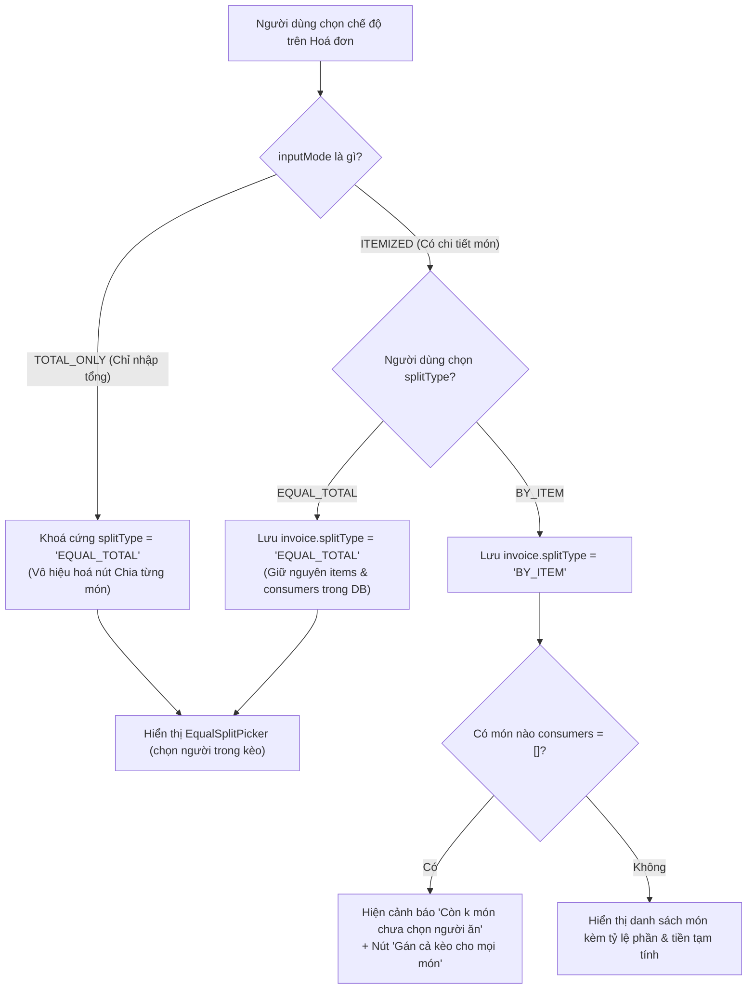
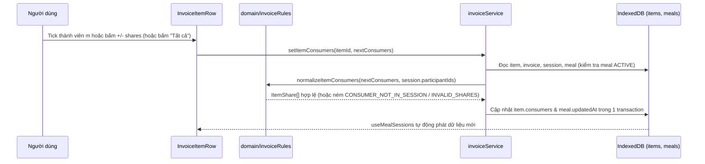
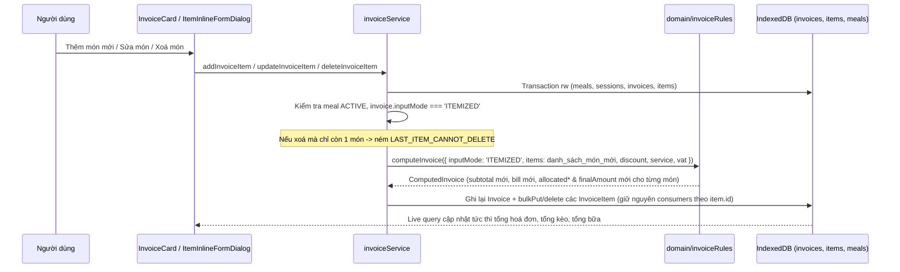

<!-- Nguyên văn documentation/epic-5/SA.md (System Analysis) tại thời điểm chuyển sang OpenSpec, 2026-11-11. Tài liệu lịch sử: có thể không còn khớp code hiện tại; hành vi hiện hành nằm ở openspec/specs/. -->

# Epic 5 — System Analysis (SA)

**Epic 5**: Quản lý Món (Tầng 3), Chế độ Chia tiền (Chia từng món / Chia tổng) & Người ứng tiền · **Trạng thái**: Đã triển khai (còn kiểm thủ công trên trình duyệt ở 375 px trước khi đóng)

Tài liệu đi cùng: [BR](./BR.md) · [Kiến trúc & Data model](../01-architecture-and-data-model.md) · [Nghiệp vụ §1–2](../02-business-logic-and-algorithms.md) · [UI §4.2, §4.4](../03-ui-ux-and-design-system.md) · [Epic 4 SA](../epic-4/SA.md)

---

### B.1. Công nghệ / thư viện sử dụng
Dùng lại toàn bộ stack hiện có: React 19 · TypeScript · Tailwind CSS (hệ màu USD Green) · Dexie 4 + `dexie-react-hooks` · `lucide-react` · Vitest + `fake-indexeddb` + jsdom + Testing Library. **Không thêm bất kỳ thư viện mới nào.**

- **Tính toán phân bổ tiền món**: Tái sử dụng `computeBill` và `allocateInvoiceItems` trong `domain/billMath.ts` cùng `computeInvoice` trong `domain/invoiceRules.ts` (đã xây dựng ở Epic 4).
- **Đồng bộ giao diện thời gian thực**: Hook `useMealSessions(mealId)` (Epic 4) đã trả về `SessionView[]` gồm `session`, `invoices: Array<{ invoice, items }>`, `total`, `hasCost` qua `useLiveQuery`; mọi cập nhật trên bảng `invoices` và `items` ở Epic 5 tự động phản ánh lên UI mà không cần state đệm ngoài DB.

### B.2. Cấu trúc mã nguồn

```text
app/src/
├─ types/index.ts                              # Không đổi (Invoice, InvoiceItem, ItemShare đã đủ trường)
├─ db/db.ts                                    # Không đổi (không nâng version schema Dexie)
├─ domain/
│  ├─ invoiceRules.ts                          # SỬA: bổ sung kiểm tra splitType, equalSplitParticipantIds,
│  │                                           #   consumers/shares (normalizeItemConsumers, validateEqualSplit,
│  │                                           #   previewItemConsumerShares, countUnassignedItems)
│  └─ invoiceRules.test.ts                     # SỬA: thêm unit test cho các quy tắc R-1…R-8, R-11 của Epic 5
├─ services/
│  ├─ peopleErrors.ts                          # SỬA: thêm mã SPLIT_TYPE_LOCKED, EQUAL_SPLIT_EMPTY,
│  │                                           #   SPLIT_MEMBER_NOT_IN_SESSION, CONSUMER_NOT_IN_SESSION,
│  │                                           #   INVALID_SHARES, ITEM_NOT_FOUND, LAST_ITEM_CANNOT_DELETE
│  ├─ invoiceService.ts                        # SỬA: mở rộng createInvoice/updateInvoice nhận splitType &
│  │                                           #   equalSplitParticipantIds; thêm setInvoicePayer,
│  │                                           #   setInvoiceSplitType, setEqualSplitParticipants,
│  │                                           #   addInvoiceItem, updateInvoiceItem, deleteInvoiceItem,
│  │                                           #   setItemConsumers, setAllItemsConsumers
│  └─ invoiceService.test.ts                   # SỬA: thêm test tích hợp cho toàn bộ hàm mới của Epic 5
├─ components/
│  ├─ sessions/
│  │  └─ SessionCard.tsx                       # SỬA: thay dòng hoá đơn rút gọn bằng <InvoiceCard/> mở rộng Tầng 3
│  └─ invoices/
│     ├─ InvoiceFormDialog.tsx                 # SỬA: cho phép chọn splitType (khoá khi TOTAL_ONLY) lúc tạo/sửa
│     ├─ InvoiceCard.tsx                       # MỚI: thẻ hoá đơn trong kèo (người ứng, chuyển chế độ chia,
│     │                                        #   chọn người chia đều hoặc danh sách món Tầng 3)
│     ├─ EqualSplitPicker.tsx                  # MỚI: chọn người chia đều (equalSplitParticipantIds ⊆ P_s)
│     ├─ InvoiceItemRow.tsx                    # MỚI: dòng món Tầng 3 + gán người ăn (tick + chỉnh shares) + sửa/xoá
│     ├─ ItemInlineFormDialog.tsx              # MỚI: hộp thoại nhỏ thêm / sửa nhanh 1 món sau khi lưu hoá đơn
│     └─ InvoiceCard.test.tsx                  # MỚI: test tương tác Tầng 3, chế độ chia, người ứng, gán người ăn
```

### B.3. Thành phần & trách nhiệm

| Thành phần | Trách nhiệm | Phụ thuộc |
| :--- | :--- | :--- |
| `domain/invoiceRules` | Hàm thuần kiểm tra ràng buộc `inputMode` ↔ `splitType` (R-2, R-3), kiểm tra `equalSplitParticipantIds` $\subseteq P_s$ (R-4), chuẩn hoá và kiểm tra `ItemShare[]` (`shares` nguyên dương, không trùng, $\subseteq P_s$, R-5), tính số tiền tạm tính mỗi người trên 1 món (R-11), đếm số món chưa có người ăn (R-6). **Không chạm DB/DOM** | `domain/billMath`, `lib/dates`, `services/peopleErrors` |
| `services/invoiceService` | Thực thi các giao dịch ghi nguyên tử cho hoá đơn và món: đổi người ứng (`setInvoicePayer`), đổi cách chia (`setInvoiceSplitType`), đổi danh sách chia đều (`setEqualSplitParticipants`), thêm/sửa/xoá món đơn lẻ kèm tính lại phân bổ toàn hoá đơn (`addInvoiceItem`, `updateInvoiceItem`, `deleteInvoiceItem`), cập nhật người ăn và số phần của một món hoặc toàn bộ món trong hoá đơn (`setItemConsumers`, `setAllItemsConsumers`) | `db`, `domain/invoiceRules`, `services/mealPeopleService` (`loadActiveMeal`), `services/peopleErrors` |
| `components/invoices/InvoiceCard` | Hiển thị chi tiết 1 hoá đơn trong `SessionCard`: chọn nhanh Người ứng tiền (BR-5.1), thanh chuyển chế độ `BY_ITEM` / `EQUAL_TOTAL` (khoá khi `TOTAL_ONLY`, BR-5.2, BR-5.4), cảnh báo số món chưa gán người ăn (BR-5.8), hiển thị `EqualSplitPicker` hoặc danh sách `InvoiceItemRow` + nút "+ Thêm món" | `services/invoiceService`, `EqualSplitPicker`, `InvoiceItemRow`, `ItemInlineFormDialog`, `ConfirmDialog` |
| `components/invoices/EqualSplitPicker` | Hiển thị các pill thành viên thuộc kèo ($P_s$) để tick/bỏ tick vào `equalSplitParticipantIds`, nút "Chọn tất cả ($|P_s|$)", và hiển thị số tiền tạm tính mỗi người ($T_{\text{invoice}} / N$) | `services/invoiceService`, `lib/money` |
| `components/invoices/InvoiceItemRow` | Hiển thị 1 món (tên, SL $\times$ đơn giá, điều chỉnh phân bổ, `finalAmount`); khi `splitType === 'BY_ITEM'` hiển thị bộ chọn người ăn (các pill thành viên trong kèo, nút "Tất cả", bộ tăng/giảm `shares` $- / +$ khi người đó được chọn, số tiền tạm tính của từng người); nút Sửa / Xoá món | `domain/invoiceRules`, `services/invoiceService`, `lib/money` |
| `components/invoices/ItemInlineFormDialog` | Modal thêm mới hoặc sửa một món (`name`, `quantity`, `unitPrice`, `rawAmount` tuỳ chọn) của hoá đơn `ITEMIZED` đã lưu | `Modal`, `services/invoiceService`, `lib/money` |
| `components/invoices/InvoiceFormDialog` | Mở rộng form tạo/sửa hoá đơn của Epic 4: hiển thị lựa chọn `splitType` (`BY_ITEM` / `EQUAL_TOTAL`), tự động chuyển và khoá ở `EQUAL_TOTAL` khi đang chọn tab `TOTAL_ONLY` | `Modal`, `services/invoiceService`, `domain/invoiceRules` |

### B.4. Thiết kế dữ liệu

**Không đổi schema, không nâng version Dexie, không đổi interface trong `types/index.ts`.**
Các bảng `invoices` và `items` cùng các kiểu `Invoice`, `InvoiceItem`, `ItemShare`, `InvoiceInputMode`, `InvoiceSplitType` đã được định nghĩa đầy đủ từ Epic 1 & Epic 4 ([01 §3.3–3.4](../01-architecture-and-data-model.md)).

Các bất biến dữ liệu (Invariants) do Epic 5 thiết lập và duy trì:

| Mã | Bất biến |
| :-: | :--- |
| **I-E5-1** | `invoice.payerMemberId ∈ session.participantIds` với mọi hoá đơn thuộc kèo `session`. |
| **I-E5-2** | `invoice.inputMode === 'TOTAL_ONLY' ⇒ invoice.splitType === 'EQUAL_TOTAL'` và số bản ghi `items` của `invoice.id` bằng `0`. |
| **I-E5-3** | `invoice.equalSplitParticipantIds ⊆ session.participantIds`, không có phần tử trùng, và `invoice.equalSplitParticipantIds.length >= 1`. |
| **I-E5-4** | Với mọi `item` thuộc `invoice`: `item.consumers` không có `memberId` trùng; mọi `c.memberId ∈ session.participantIds`; mọi `c.shares` là số nguyên thoả `1 <= c.shares <= 999`. |
| **I-E5-5** | Sau mọi thao tác thêm/sửa/xoá món đơn lẻ trên hoá đơn `ITEMIZED`, luôn có ít nhất 1 món, `orderIndex` liên tục `0..M-1`, và $\sum_{i} \text{finalAmount}_i = \text{invoice.totalAmount}$ tuyệt đối (R-7, R-8). |

### B.5. Luồng xử lý chính

**5.1. Chuyển đổi chế độ nhập & chế độ chia tiền (`inputMode` ↔ `splitType`)**


**5.2. Gán người ăn và điều chỉnh số phần (`shares`) cho món (US-5.4)**


**5.3. Thêm / Sửa / Xoá một món sau khi hoá đơn đã lưu (R-7, R-8)**


### B.6. Giao diện lập trình nội bộ

**Mã lỗi bổ sung vào `services/peopleErrors.ts` (`PeopleErrorCode`)**:

| `code` | Khi nào ném |
| :--- | :--- |
| `SPLIT_TYPE_LOCKED` | Đặt `splitType = 'BY_ITEM'` hoặc thao tác món đơn lẻ trên hoá đơn có `inputMode === 'TOTAL_ONLY'` (R-2) |
| `EQUAL_SPLIT_EMPTY` | Danh sách `equalSplitParticipantIds` rỗng (R-4) |
| `SPLIT_MEMBER_NOT_IN_SESSION` | Có ID trong `equalSplitParticipantIds` không thuộc `session.participantIds` (R-1, R-4) |
| `CONSUMER_NOT_IN_SESSION` | Có `memberId` trong `consumers` không thuộc `session.participantIds` (R-1, R-5) |
| `INVALID_SHARES` | `shares` không phải số nguyên hoặc $< 1$ hoặc $> 999$ (R-5) |
| `ITEM_NOT_FOUND` | Không tìm thấy `InvoiceItem` theo `itemId` |
| `LAST_ITEM_CANNOT_DELETE` | Xoá món duy nhất còn lại của một hoá đơn `ITEMIZED` (R-8) |

**Hàm thuần bổ sung vào `domain/invoiceRules.ts`**:

```ts
export const MAX_ITEM_SHARES = 999;

/** Kiểm tra ràng buộc inputMode và splitType (R-2, R-3). */
export function resolveSplitType(inputMode: InvoiceInputMode, requested?: InvoiceSplitType): InvoiceSplitType;

/** Kiểm tra và khử trùng lặp equalSplitParticipantIds ⊆ sessionParticipantIds (R-4). */
export function validateEqualSplit(
  equalSplitIds: string[],
  sessionParticipantIds: string[],
): string[];

/** Chuẩn hoá danh sách người ăn của 1 món: bỏ shares === 0, kiểm tra ⊆ sessionParticipantIds và 1 <= shares <= 999 (R-5). */
export function normalizeItemConsumers(
  consumers: ItemShare[],
  sessionParticipantIds: string[],
): ItemShare[];

/** Tính số tiền tạm tính (làm tròn đồng) và tổng số phần của từng người trên 1 món để hiển thị UI (R-11). */
export function previewItemConsumerShares(
  finalAmount: number,
  consumers: ItemShare[],
): Array<{ memberId: string; shares: number; totalShares: number; approxAmount: number }>;

/** Đếm số món chưa có người ăn khi hoá đơn ở chế độ BY_ITEM (R-6, BR-5.8). */
export function countUnassignedItems(
  splitType: InvoiceSplitType,
  items: ReadonlyArray<Pick<InvoiceItem, 'consumers'>>,
): number;
```

**Hàm dịch vụ bổ sung / mở rộng trong `services/invoiceService.ts`**:

```ts
// Mở rộng InvoiceDraft (tương thích ngược với Epic 4: nếu không truyền thì mặc định như cũ):
export interface InvoiceDraft extends InvoiceRulesDraft {
  id?: string;
  sessionId: string;
  payerMemberId: string;
  splitType?: InvoiceSplitType;               // Mặc định: 'EQUAL_TOTAL'
  equalSplitParticipantIds?: string[];        // Mặc định: session.participantIds
  autoNameSession?: boolean;
}

/** Đổi nhanh người ứng tiền của hoá đơn (BR-5.1, R-1). */
export function setInvoicePayer(invoiceId: string, payerMemberId: string): Promise<Invoice>;

/** Chuyển chế độ chia tiền BY_ITEM <-> EQUAL_TOTAL; từ chối nếu TOTAL_ONLY (BR-5.2, BR-5.4, R-2, R-3). */
export function setInvoiceSplitType(invoiceId: string, splitType: InvoiceSplitType): Promise<Invoice>;

/** Cập nhật danh sách người chia đều của hoá đơn (BR-5.5, R-4). */
export function setEqualSplitParticipants(invoiceId: string, memberIds: string[]): Promise<Invoice>;

/** Thêm 1 món vào cuối hoá đơn ITEMIZED và tính lại phân bổ toàn hoá đơn (BR-5.3, R-7). */
export function addInvoiceItem(
  invoiceId: string,
  itemDraft: Omit<ItemDraft, 'id'> & { consumers?: ItemShare[] },
): Promise<InvoiceResult>;

/** Sửa thông tin 1 món trong hoá đơn ITEMIZED (giữ nguyên consumers) và tính lại phân bổ (BR-5.3, R-7). */
export function updateInvoiceItem(
  itemId: string,
  patch: Omit<ItemDraft, 'id'>,
): Promise<InvoiceResult>;

/** Xoá 1 món khỏi hoá đơn ITEMIZED (chặn nếu là món cuối cùng) và tính lại phân bổ (BR-5.3, R-7, R-8). */
export function deleteInvoiceItem(itemId: string): Promise<InvoiceResult>;

/** Gán danh sách người ăn + số phần cho 1 món (BR-5.6, BR-5.7, R-5). */
export function setItemConsumers(itemId: string, consumers: ItemShare[]): Promise<InvoiceItem>;

/** Gán nhanh cùng một danh sách người ăn (shares = 1) cho mọi món (hoặc chỉ các món đang trống) của hoá đơn (BR-5.6, R-6). */
export function setAllItemsConsumers(
  invoiceId: string,
  memberIds: string[],
  mode?: 'ALL_ITEMS' | 'UNASSIGNED_ONLY',
): Promise<InvoiceItem[]>;
```

**Component UI chính**:

| Component | Props chính | Hành vi |
| :--- | :--- | :--- |
| `InvoiceCard` | `row: InvoiceRow`, `index: number`, `session: SessionKeo`, `sessionMembers: Member[]`, `readOnly: boolean`, `onEditInvoice: () => void`, `onDeleteInvoice: () => void`, `onError: (msg: string) => void` | Hiển thị header hoá đơn (tên quán, ngày, tổng tiền, nút sửa/xoá hoá đơn), ô chọn nhanh Người ứng tiền (`<select>` hoặc pill trong `sessionMembers`), bộ nút chuyển `Chia từng món` / `Chia đều theo tổng` (nút `Chia từng món` bị `disabled` kèm chú thích khi `inputMode === 'TOTAL_ONLY'`), và phần thân: `EqualSplitPicker` (nếu `EQUAL_TOTAL`) hoặc danh sách `InvoiceItemRow` + nút `+ Thêm món` (nếu `BY_ITEM` hoặc khi người dùng mở xem chi tiết món) |
| `EqualSplitPicker` | `invoice: Invoice`, `sessionMembers: Member[]`, `readOnly: boolean`, `onError: (msg: string) => void` | Các nút pill `aria-pressed` cho từng thành viên trong kèo; nút "Chọn tất cả"; hiển thị mức chia tạm tính `formatMoney(Math.round(invoice.totalAmount / count))` mỗi người |
| `InvoiceItemRow` | `item: InvoiceItem`, `splitType: InvoiceSplitType`, `sessionMembers: Member[]`, `readOnly: boolean`, `canDelete: boolean`, `onEdit: () => void`, `onDelete: () => void`, `onError: (msg: string) => void` | Hiển thị tên món, `quantity × unitPrice`, dòng phụ nếu có giảm giá/phí DV/VAT phân bổ, `finalAmount`. Nếu `splitType === 'BY_ITEM'`: hiển thị nút chọn người ăn (pill), nút "Tất cả", và với mỗi người đã chọn có cụm chỉnh số phần `[-]` `shares` `[+]` kèm tiền tạm tính |
| `ItemInlineFormDialog` | `invoiceId: string`, `existing?: InvoiceItem`, `onClose: () => void`, `onSaved: () => void` | Hộp thoại thêm hoặc sửa nhanh 1 món (Tên món, Số lượng, Đơn giá, Thành tiền tuỳ chọn) |

### B.7. Yêu cầu phi chức năng

| Nhóm | Yêu cầu |
| :--- | :--- |
| **Bền vững & Nguyên tử** | Mọi thao tác thêm/sửa/xoá món hoặc đổi chế độ chia đều chạy trong transaction của IndexedDB; không bao giờ xảy ra trạng thái `Σ item.finalAmount !== invoice.totalAmount` |
| **Hiệu năng** | Tick chọn người ăn hoặc tăng/giảm `shares` phản hồi dưới 16 ms trên UI; tính lại phân bổ cho hoá đơn 50 món dưới 5 ms |
| **Khả dụng (A11y & Mobile)** | Mọi nút pill chọn người, nút `[-]` / `[+]` chỉnh `shares`, nút chuyển `splitType` có kích thước vùng chạm tối thiểu $44 \times 44\text{ px}$; dùng `aria-pressed` cho nút bật/tắt người ăn và `aria-label` rõ ràng (VD: `"Tăng số phần của Bình cho món Bia Tiger"`); không cuộn ngang ở màn hình $375\text{ px}$ |
| **Bảo mật & Toàn vẹn** | Không nhận dữ liệu thành viên ngoài `session.participantIds`; thoát HTML tự động qua React |

### B.8. Rủi ro & hạn chế đã biết

| # | Rủi ro / Hạn chế | Hướng xử lý |
| :-: | :--- | :--- |
| 1 | Hoá đơn đã tạo từ Epic 4 đều đang có `splitType = 'EQUAL_TOTAL'` và `consumers = []` | Hoàn toàn tương thích: khi người dùng chuyển hoá đơn sang `BY_ITEM`, UI hiện ngay cảnh báo món chưa có người ăn (BR-5.8) kèm nút 1 chạm "Gán cả kèo cho mọi món" (`setAllItemsConsumers`) |
| 2 | Sai số làm tròn khi hiển thị tiền tạm tính từng người trên 1 món (`previewItemConsumerShares`) | Hiển thị rõ là số tạm tính (đã làm tròn đồng để người dùng nhẩm nhanh); bảng quyết toán cuối bữa ở Epic 6 cộng dồn số thực (`float`) trên toàn bữa rồi mới làm tròn và bù $\pm 1\text{đ}$ theo đúng [02 §1.2](../02-business-logic-and-algorithms.md) |
| 3 | Mật độ thông tin trên màn hình hẹp ($375\text{ px}$) khi 1 món có 8–10 người ăn và đều hiện bộ chỉnh `shares` | Các pill người chưa chọn hiển thị gọn; chỉ những người **đã được tick ăn món đó** mới hiện cụm `[-]` `s phần` `[+]` hoặc mở dòng phụ ngay bên dưới món để không tràn ngang |
| 4 | Sửa hoá đơn bằng `InvoiceFormDialog` (Epic 4) sau khi đã gán `consumers` ở Epic 5 | `invoiceService.updateInvoice` (Epic 4) đã ghép món theo `item.id` để bảo toàn `consumers`; Epic 5 giữ nguyên cơ chế này và bổ sung kiểm tra lọc bỏ những `consumer.memberId` không còn trong kèo (nếu có) |

### B.9. Ma trận truy vết kiểm thử

| User Story | BR | Bài kiểm thử dự kiến | Trạng thái |
| :-: | :-: | :--- | :-: |
| US-5.1 | BR-5.1, BR-5.9 | `invoiceService.test.ts`: `setInvoicePayer` đổi người ứng hợp lệ, từ chối người ngoài kèo (`PAYER_NOT_IN_SESSION`) và bữa `ARCHIVED` (`MEAL_ARCHIVED`). `InvoiceCard.test.tsx`: đổi người ứng ngay trên thẻ hoá đơn | Đạt (`invoiceService.test`: setInvoicePayer; `InvoiceCard.test`: đổi người ứng trên thẻ) |
| US-5.2 | BR-5.2, BR-5.3, BR-5.9 | `invoiceRules.test.ts`: `resolveSplitType` khoá `TOTAL_ONLY -> EQUAL_TOTAL`. `invoiceService.test.ts`: `setInvoiceSplitType` ném `SPLIT_TYPE_LOCKED` khi `TOTAL_ONLY`; `addInvoiceItem` / `updateInvoiceItem` / `deleteInvoiceItem` tính lại đúng `totalAmount` và `allocated*`, giữ nguyên `consumers`, chặn xoá món cuối (`LAST_ITEM_CANNOT_DELETE`). `InvoiceCard.test.tsx`: thêm/sửa/xoá món trên UI, `ConfirmDialog` khi xoá món đã có người ăn | Đạt (`invoiceService.test`: SPLIT_TYPE_LOCKED, add/update/deleteInvoiceItem, LAST_ITEM; `invoiceRules.test`: resolveSplitType) |
| US-5.3 | BR-5.4, BR-5.5, BR-5.8 | `invoiceRules.test.ts`: `validateEqualSplit`, `countUnassignedItems`. `invoiceService.test.ts`: chuyển `BY_ITEM <-> EQUAL_TOTAL` bảo toàn `consumers`; `setEqualSplitParticipants` từ chối danh sách rỗng (`EQUAL_SPLIT_EMPTY`) hoặc người ngoài kèo (`SPLIT_MEMBER_NOT_IN_SESSION`). `InvoiceCard.test.tsx`: đổi qua lại 2 chế độ chia và tick chọn người trong `EqualSplitPicker` | Đạt (`invoiceRules.test`: validateEqualSplit, countUnassignedItems; `invoiceService.test`; `InvoiceCard.test`: đổi chế độ và tick người chia đều) |
| US-5.4 | BR-5.6, BR-5.7, BR-5.8 | `invoiceRules.test.ts`: `normalizeItemConsumers` (bỏ `shares=0`, chặn trùng, chặn ngoài kèo, chặn `shares < 1` hoặc `> 999`), `previewItemConsumerShares`. `invoiceService.test.ts`: `setItemConsumers`, `setAllItemsConsumers` (`ALL_ITEMS` & `UNASSIGNED_ONLY`), tích hợp với `setSessionParticipants` chặn bỏ người đang là `consumer` (`SESSION_MEMBER_IN_USE`). `InvoiceCard.test.tsx`: tick người ăn, chỉnh `shares`, bấm "Tất cả", kiểm tra cảnh báo món chưa gán | Đạt (`invoiceRules.test`: normalizeItemConsumers, previewItemConsumerShares; `invoiceService.test`: setItemConsumers, setAllItemsConsumers; `InvoiceCard.test`: shares, cảnh báo) |

### B.10. Việc còn lại để đóng Epic
1. Kiểm thủ công trên trình duyệt ở 375 px và bằng bàn phím cho Tầng 3 (`InvoiceCard`, `InvoiceItemRow`, `ItemInlineFormDialog`) — **chưa thực hiện**.
2. Viết test component cho `ItemInlineFormDialog` (thêm/sửa món trên UI) và khoá chỉ đọc khi `ARCHIVED` ở tầng giao diện — **chưa thực hiện**.

**Lệch so với thiết kế đã ghi nhận khi triển khai**
- `InvoiceCard` gắn nút "Gán cả kèo cho các món trống" (`setAllItemsConsumers`, chế độ `UNASSIGNED_ONLY`) thay cho "Gán cả kèo cho mọi món", để không ghi đè người ăn đã chọn.
- Hoá đơn `ITEMIZED` ở chế độ `EQUAL_TOTAL` vẫn hiện danh sách món để sửa; chỉ ẩn bộ chọn người ăn.
- Dùng thêm `setItemConsumers`/`setAllItemsConsumers` ghi trực tiếp, không qua `InvoiceFormDialog`; `InvoiceFormDialog` chỉ chọn `splitType`.

---

## Phụ lục: Business Requirements gốc của Epic 5

Nguyên văn `documentation/epic-5/BR.md` tại thời điểm chuyển sang OpenSpec (2026-11-11). `proposal.md` và các delta spec của change này được chuyển từ tài liệu này.

# Epic 5 — Business Requirements (BR)

**Epic 5**: Quản lý Món (Tầng 3), Chế độ Chia tiền (Chia từng món / Chia tổng) & Người ứng tiền · **Trạng thái**: Đã triển khai (còn kiểm thủ công trên trình duyệt ở 375 px trước khi đóng)

Tài liệu đi cùng: [SA](./SA.md) · [Epics & Roadmap](../04-epics-and-roadmap.md) · [Kiến trúc & Data model §3.3–3.4](../01-architecture-and-data-model.md) · [Nghiệp vụ §1–2](../02-business-logic-and-algorithms.md) · [UI §4.2, §4.4](../03-ui-ux-and-design-system.md) · [Epic 4 BR](../epic-4/BR.md)

---

### A.1. Bối cảnh & Mục tiêu nghiệp vụ
Sau Epic 4, người dùng đã tạo được Kèo, thêm Hoá đơn kèm ảnh và quét OCR bóc tách danh sách món, giảm giá, phí phục vụ và VAT. Tuy nhiên, theo ranh giới đã chốt ở [Epic 4 BR A.1](../epic-4/BR.md), mọi hoá đơn do Epic 4 lưu đều đang cố định `splitType = 'EQUAL_TOTAL'`, danh sách chia đều luôn lấy trọn người trong kèo, các món có `consumers = []`, và thẻ kèo (`SessionCard`) mới chỉ hiển thị dòng tóm tắt hoá đơn chứ chưa mở ra Tầng 3 (danh sách món, chế độ chia và gán người ăn).

Epic 5 hoàn thiện **Tầng 3 (Món)** và cơ chế chia tiền ở cấp Hoá đơn để cung cấp dữ liệu đầu vào đầy đủ, chính xác cho động cơ quyết toán của Epic 6:

1. **Người ứng tiền (`payerMemberId`)**: Hiển thị rõ và cho phép chọn/đổi nhanh người đã trả toàn bộ hoá đơn ngay trên thẻ hoá đơn lẫn trong form hoá đơn, chỉ trong phạm vi người tham gia kèo.
2. **Hai phương thức nhập & Ràng buộc chế độ chia**:
   - Hoá đơn **Chỉ nhập tổng tiền (`TOTAL_ONLY`)**: Bắt buộc khoá cứng chế độ chia là **Chia đều theo tổng (`EQUAL_TOTAL`)**.
   - Hoá đơn **Nhập chi tiết món (`ITEMIZED`)**: Cho phép chuyển đổi linh hoạt giữa **Chia từng món (`BY_ITEM`)** và **Chia đều theo tổng (`EQUAL_TOTAL`)** bất cứ lúc nào mà không làm mất danh sách món hay cấu hình người ăn đã gán.
3. **Quản lý Món (Tầng 3) sau khi lưu hoá đơn**: Xem danh sách từng món kèm giá gốc, phần giảm giá/phí phục vụ/VAT phân bổ và giá cuối (`finalAmount`); thêm món mới, sửa hoặc xoá từng món trực tiếp và tự động tính lại phân bổ của toàn hoá đơn.
4. **Phạm vi người chia tiền**:
   - Khi ở `EQUAL_TOTAL`: Chọn những ai trong kèo tham gia chia đều hoá đơn này (`equalSplitParticipantIds`), mặc định là toàn bộ người trong kèo.
   - Khi ở `BY_ITEM`: Tick chọn nhanh những ai trong kèo cùng ăn từng món và chỉnh **số phần (`shares`)** khi một người dùng nhiều phần trong cùng một mục món; cảnh báo rõ những món chưa có người ăn.

### A.2. Các bên liên quan
| Vai trò | Quan tâm |
| :--- | :--- |
| Tôi (chủ app) | Chuyển nhanh giữa chia đều cả bill và chia theo món; tick người ăn trong vài chạm ngay trên màn chi tiết bữa; sửa/thêm/xoá lẻ một món mà không phải quét lại bill |
| Người ứng tiền | Hoá đơn ghi nhận đúng mình là người ứng toàn bộ `totalAmount`; đổi người ứng dễ dàng nếu lúc đầu chọn nhầm |
| Thành viên tham gia kèo | Chỉ bị tính tiền ở những hoá đơn/món mình thực sự dùng và đúng tỷ lệ số phần (`shares`) đã gọi |
| Dev Epic 6 (Quyết toán) | Mọi hoá đơn có `payerMemberId`, `splitType`, `equalSplitParticipantIds` và `items[].consumers` hợp lệ, nhất quán với `SessionKeo.participantIds` để tính `Paid(m)` và `Owed(m)` |
| Dev Epic 7–8 (Lưu trữ & Snapshot) | Dữ liệu Tầng 3 đầy đủ để xuất sang `MealSnapshotPayload` hoặc kiểm tra trước khi lưu trữ |

### A.3. Yêu cầu nghiệp vụ (BR)

| Mã | Yêu cầu | Truy vết |
| :-: | :--- | :--- |
| **BR-5.1** | Mỗi hoá đơn phải có đúng một **Người ứng tiền (`payerMemberId`)** thuộc danh sách người tham gia kèo (`SessionKeo.participantIds`). Người dùng chọn khi tạo hoá đơn hoặc đổi nhanh ngay trên thẻ hoá đơn. | US-5.1, YC#7, YC#23 |
| **BR-5.2** | Hỗ trợ đầy đủ 2 chế độ nhập hoá đơn (`ITEMIZED` và `TOTAL_ONLY`). Khi hoá đơn ở chế độ `TOTAL_ONLY`, hệ thống **bắt buộc đặt và khoá cứng** `splitType = 'EQUAL_TOTAL'`, vô hiệu hoá lựa chọn "Chia từng món" ở cả giao diện lẫn tầng dịch vụ. | US-5.2, YC#5, YC#6 |
| **BR-5.3** | Quản lý chi tiết từng **Món (`InvoiceItem`)** của hoá đơn `ITEMIZED`: hiển thị danh sách món ngay trong thẻ hoá đơn (tên, SL, đơn giá, điều chỉnh phân bổ, thành tiền sau điều chỉnh `finalAmount`); cho phép **thêm món mới, sửa món, xoá món** sau khi hoá đơn đã lưu và tự động tính lại tổng hoá đơn cùng phân bổ giảm giá/phí phục vụ/VAT cho tất cả các món. | US-5.2, YC#1, YC#15 |
| **BR-5.4** | Với hoá đơn `ITEMIZED`, người dùng chuyển đổi tức thì giữa **Chia từng món (`BY_ITEM`)** và **Chia đều theo tổng (`EQUAL_TOTAL`)** ngay trên thẻ hoá đơn hoặc trong form. Khi chuyển sang `EQUAL_TOTAL` rồi quay lại `BY_ITEM`, danh sách người ăn (`consumers`) đã gán ở từng món vẫn được giữ nguyên. | US-5.3, YC#5 |
| **BR-5.5** | Khi hoá đơn ở chế độ `EQUAL_TOTAL` (cả `ITEMIZED` lẫn `TOTAL_ONLY`), người dùng xem và tick chọn danh sách người cùng chia đều hoá đơn (`equalSplitParticipantIds`) trong số người tham gia kèo (mặc định gồm tất cả người trong kèo; có nút chọn nhanh "Tất cả người trong kèo"). | US-5.3, YC#5, YC#23 |
| **BR-5.6** | Khi hoá đơn ở chế độ `BY_ITEM`, mỗi món cho phép tick chọn những người cùng ăn trong số người tham gia kèo (`SessionKeo.participantIds`), mặc định mỗi người được tick có `shares = 1`. Hỗ trợ nút chọn nhanh **"Tất cả ($k$ người)"** cho từng món hoặc áp dụng cho mọi món chưa gán trong hoá đơn. | US-5.4, YC#1, YC#23 |
| **BR-5.7** | Khi một món ở chế độ `BY_ITEM` có người gọi nhiều phần riêng (VD: uống 3 lon bia trong mục 10 lon), người dùng chỉnh được **số phần (`shares`)** nguyên dương ($\ge 1$) cho từng người ăn món đó; giao diện hiển thị ngay tỷ lệ phần (`s_{i,m} / S_i`) và số tiền tạm tính của mỗi người ở món đó. | US-5.4, YC#1 |
| **BR-5.8** | Cảnh báo trực quan trên thẻ hoá đơn và từng dòng món khi hoá đơn đang ở chế độ `BY_ITEM` nhưng còn món chưa được gán người ăn (`consumers.length === 0`), để người dùng không bỏ sót món khi quyết toán. | US-5.3, US-5.4, YC#1 |
| **BR-5.9** | Bảo toàn tính nhất quán với người tham gia kèo và trạng thái bữa: không thể gán người ngoài kèo làm người ứng, người chia đều hay người ăn món; khi bữa ở trạng thái `ARCHIVED`, toàn bộ thao tác đổi người ứng, đổi chế độ chia, thêm/sửa/xoá món và gán người ăn đều bị khoá chỉ đọc. | US-5.1–5.4, YC#17, YC#23 |

### A.4. Quy tắc nghiệp vụ (Business Rules)

| Mã | Quy tắc |
| :-: | :--- |
| **R-1** | **Phạm vi thành viên trong hoá đơn**: Mọi `payerMemberId`, mọi phần tử trong `equalSplitParticipantIds` và mọi `consumers[].memberId` của các món thuộc hoá đơn **phải thuộc `SessionKeo.participantIds`** của kèo chứa hoá đơn đó ([02 §1.0](../02-business-logic-and-algorithms.md)). Bất kỳ ID nào nằm ngoài `SessionKeo.participantIds` đều bị từ chối với mã lỗi tương ứng (`PAYER_NOT_IN_SESSION`, `SPLIT_MEMBER_NOT_IN_SESSION`, `CONSUMER_NOT_IN_SESSION`). |
| **R-2** | **Ràng buộc `TOTAL_ONLY` → `EQUAL_TOTAL`**: Nếu `invoice.inputMode === 'TOTAL_ONLY'` thì `invoice.splitType` bắt buộc bằng `'EQUAL_TOTAL'` và hoá đơn không có bản ghi `InvoiceItem` nào ([02 §1.1](../02-business-logic-and-algorithms.md)). Mọi yêu cầu đặt `splitType = 'BY_ITEM'` hoặc thêm món vào hoá đơn `TOTAL_ONLY` đều bị từ chối (`SPLIT_TYPE_LOCKED`). Nếu người dùng đổi một hoá đơn từ `ITEMIZED` sang `TOTAL_ONLY` trong form sửa hoá đơn, hệ thống tự động ép `splitType = 'EQUAL_TOTAL'` và xoá các món cũ của hoá đơn đó sau khi người dùng bấm Lưu. |
| **R-3** | **Chuyển đổi `BY_ITEM` ↔ `EQUAL_TOTAL` trên hoá đơn `ITEMIZED`**: Đổi `splitType` không làm thay đổi tiền hàng, giảm giá, phí phục vụ, VAT hay danh sách món. Khi chuyển từ `BY_ITEM` sang `EQUAL_TOTAL`, dữ liệu `consumers` trên các bản ghi `InvoiceItem` **được giữ nguyên trong DB** (không xoá) để nếu người dùng chuyển lại `BY_ITEM` thì không phải tick lại từ đầu; tuy nhiên khi tính tiền ở chế độ `EQUAL_TOTAL`, hệ thống chỉ chia theo `equalSplitParticipantIds` ([02 §1.2](../02-business-logic-and-algorithms.md)). |
| **R-4** | **Danh sách người chia đều (`equalSplitParticipantIds`)**: Không chứa ID trùng lặp, là tập con khác rỗng của `SessionKeo.participantIds` ($1 \le |\text{equalSplitParticipantIds}| \le |P_s|$). Nếu người dùng bỏ chọn hết khiến danh sách rỗng, hệ thống từ chối (`EQUAL_SPLIT_EMPTY`). Khi tạo hoá đơn mới, mặc định `equalSplitParticipantIds = [...session.participantIds]`. |
| **R-5** | **Danh sách người ăn của món (`consumers: ItemShare[]`)**: Mỗi `memberId` xuất hiện tối đa 1 lần trong `item.consumers` và phải thuộc `SessionKeo.participantIds`. Trường `shares` phải là **số nguyên dương** ($1 \le \text{shares} \le 999$). Khi người dùng mới tick chọn một người vào món, mặc định `shares = 1`. Khi bỏ tick hoặc giảm `shares` về 0, người đó được gỡ khỏi `item.consumers`. |
| **R-6** | **Món chưa có người ăn (`consumers.length === 0`)**: Hệ thống **cho phép lưu** món có `consumers = []` (vì người dùng mới quét OCR/nhập món xong tại Epic 4 hoặc đang thêm món trước rồi mới gán người ăn sau). Khi hoá đơn vừa được chuyển sang `BY_ITEM` lần đầu mà tất cả các món đều đang có `consumers = []`, hệ thống hỗ trợ thao tác 1 chạm **"Gán tất cả người trong kèo cho mọi món"** (hoặc gán theo từng món). Nếu một món trong hoá đơn `BY_ITEM` vẫn có `consumers = []`, giao diện hiển thị nhãn cảnh báo màu vàng đồng (`Chưa chọn người ăn`) và đếm số món chưa gán trên tiêu đề hoá đơn. |
| **R-7** | **Thêm, sửa, xoá món đơn lẻ sau khi đã lưu hoá đơn**: Chỉ áp dụng cho hoá đơn `ITEMIZED` của bữa `ACTIVE`. Mỗi khi thêm, sửa (`name`, `quantity`, `unitPrice`, `rawAmount`) hoặc xoá một món, hệ thống tính lại toàn bộ `subtotalAmount`, `discountAmount`, `serviceAmount`, `vatAmount`, `totalAmount` của hoá đơn và phân bổ lại `allocatedDiscountAmount`, `allocatedServiceAmount`, `allocatedVatAmount`, `finalAmount` cho toàn bộ các món còn lại theo đúng công thức phần dư lớn nhất ([02 §2](../02-business-logic-and-algorithms.md), R-8 Epic 4) trong **cùng một transaction**. Khi sửa món, danh sách `consumers` của món đó và các món khác được giữ nguyên. |
| **R-8** | **Xoá món cuối cùng của hoá đơn `ITEMIZED`**: Hoá đơn `ITEMIZED` bắt buộc có ít nhất 1 món (`INVALID_ITEM`). Nếu hoá đơn chỉ còn 1 món duy nhất, nút xoá món đó bị khoá (kèm gợi ý xoá cả hoá đơn hoặc chuyển hoá đơn sang chế độ *Chỉ nhập tổng tiền*), và tầng dịch vụ từ chối xoá món cuối cùng. Khi xoá một món đã có `consumers` được gán, hiển thị `ConfirmDialog` xác nhận trước khi xoá. |
| **R-9** | **Đồng bộ khi thay đổi người tham gia kèo (`SessionKeo.participantIds`)**: Giữ nguyên quy tắc đã cài ở `sessionService.setSessionParticipants` (Epic 4): không cho phép bỏ một thành viên khỏi kèo nếu người đó đang là `payerMemberId` của bất kỳ hoá đơn nào hoặc đang nằm trong `consumers` của bất kỳ món nào trong kèo (`SESSION_MEMBER_IN_USE`). Người được thêm mới vào kèo không tự động bị thêm vào `consumers` hay `equalSplitParticipantIds` của các hoá đơn/món đã tạo trước đó. |
| **R-10** | **Tương tác với trạng thái "Đã thanh toán" (`settlementStatuses`)**: Khi bữa đã có người/nhóm được tick `isPaid = true` (sau Epic 6), mọi thay đổi làm ảnh hưởng số tiền phải trả hoặc đã ứng (đổi `payerMemberId`, đổi `splitType`, đổi `equalSplitParticipantIds`, thêm/sửa/xoá món, đổi `consumers`/`shares`) đều tự động cập nhật `meal.updatedAt`. (Việc cảnh báo hoặc xử lý số dư thay đổi thuộc Epic 6; ở Epic 5 các hàm ghi vẫn thực thi nguyên tử trên bảng `invoices`/`items`/`meals`). |
| **R-11** | **Hiển thị số tiền tạm tính trên từng món**: Khi xem chi tiết món ở chế độ `BY_ITEM` và món đã có $S_i = \sum s_{i,m} > 0$, giao diện hiển thị số tiền tạm tính của mỗi người ăn $\text{round}(F_i \times s_{i,m} / S_i)$ để người dùng dễ đối chiếu tại chỗ; phép tính quyết toán chính thức của cả bữa (giữ số thực cộng dồn rồi làm tròn ở bước cuối) thuộc Epic 6 ([02 §1.2](../02-business-logic-and-algorithms.md)). |

### A.5. Tiêu chí nghiệm thu (nghiệp vụ)

Ba tiêu chí đầu lấy từ [04 — Epic 5](../04-epics-and-roadmap.md); các tiêu chí sau do BR/SA bổ sung.

- [x] AC-1: Nếu chọn "Chỉ nhập tổng tiền" (`TOTAL_ONLY`), giao diện và tầng dịch vụ tự động chọn và khoá ở chế độ "Chia đều theo tổng" (`EQUAL_TOTAL`), không cho chuyển sang "Chia từng món". *(BR-5.2, R-2)* **Đạt ở tầng dịch vụ (`invoiceService.test`); khoá nút UI chưa có test riêng.**
- [x] AC-2: Nếu hoá đơn có danh sách món (`ITEMIZED`), người dùng có thể đổi qua lại giữa "Chia từng món" (`BY_ITEM`) và "Chia đều theo tổng" (`EQUAL_TOTAL`) bất cứ lúc nào; đổi sang `EQUAL_TOTAL` rồi đổi lại `BY_ITEM` vẫn giữ nguyên người ăn và số phần đã gán cho từng món. *(BR-5.4, R-3)* **Đạt (`invoiceService.test`: đổi qua lại giữ người ăn và số phần).**
- [x] AC-3: Có thể thêm, sửa, xoá từng món ngay trên hoá đơn đã lưu và chọn/đổi người ứng tiền (`payerMemberId`) cho mỗi hoá đơn; tổng hoá đơn và phần giảm giá/phí phục vụ/VAT phân bổ vào từng món tự động cập nhật khớp 100% `totalAmount`. *(BR-5.1, BR-5.3, R-7, R-8)* **Đạt ở tầng dịch vụ (`invoiceService.test`: thêm/sửa/xoá, tổng khớp 100%).**
- [x] AC-4: Người ứng tiền, người chia đều (`equalSplitParticipantIds`) và người ăn từng món (`consumers`) chỉ chọn được trong danh sách người tham gia kèo (`SessionKeo.participantIds`); mọi ID ngoài kèo đều bị chặn. *(BR-5.1, BR-5.5, BR-5.6, R-1)* **Đạt (`invoiceService.test`: PAYER / SPLIT / CONSUMER_NOT_IN_SESSION).**
- [x] AC-5: Ở chế độ `EQUAL_TOTAL`, người dùng tick/bỏ tick được những ai trong kèo tham gia chia đều hoá đơn (tối thiểu 1 người) và có nút chọn nhanh tất cả người trong kèo. *(BR-5.5, R-4)* **Đạt (`InvoiceCard.test`: tick người chia đều; `invoiceService.test`: EQUAL_SPLIT_EMPTY).**
- [x] AC-6: Ở chế độ `BY_ITEM`, mỗi món cho phép tick/bỏ tick người ăn, chọn nhanh tất cả người trong kèo, và chỉnh số phần (`shares` nguyên dương $\ge 1$) cho từng người ăn; hiển thị đúng tỷ lệ phần và số tiền tạm tính. *(BR-5.6, BR-5.7, R-5, R-11)* **Đạt (`InvoiceCard.test`: chỉnh shares; `invoiceService.test`: setItemConsumers).**
- [x] AC-7: Khi hoá đơn ở chế độ `BY_ITEM` có món chưa gán người ăn (`consumers.length === 0`), giao diện hiển thị cảnh báo rõ ràng trên món và trên thẻ hoá đơn; có nút gán nhanh tất cả người trong kèo. *(BR-5.8, R-6)* **Đạt (`InvoiceCard.test`: cảnh báo và gán nhanh cả kèo cho món trống).**
- [x] AC-8: Không cho phép xoá món cuối cùng của hoá đơn `ITEMIZED`; xoá món đã có người ăn hiển thị `ConfirmDialog` của app (Huỷ là mặc định). *(R-8)* **Đạt (`invoiceService.test`: LAST_ITEM_CANNOT_DELETE; `InvoiceCard.test`: ConfirmDialog khi xoá món có người ăn).**
- [x] AC-9: Khi bữa ở trạng thái `ARCHIVED`, mọi thao tác đổi người ứng, đổi chế độ chia, sửa danh sách chia đều, thêm/sửa/xoá món và gán người ăn/số phần đều bị khoá chỉ đọc. *(BR-5.9)* **Đạt ở tầng dịch vụ (`invoiceService.test`: BR-5.9); khoá UI qua prop `readOnly` chưa có test riêng.**
- [ ] AC-10: Dùng tốt trên màn hình $\le 375\text{ px}$ không cuộn ngang, mọi nút chạm $\ge 44\text{ px}$, điều khiển được bằng bàn phím; toàn bộ test của Epic 1–4 vẫn đạt. *(phi chức năng & hồi quy)* ****Chưa thực hiện.** Kiểm trình duyệt 375 px và bàn phím cho Tầng 3 chưa làm; hồi quy: toàn bộ test đạt (399/399).**

### A.6. Ngoài phạm vi
- Tổng hợp chi phí toàn bữa theo từng thành viên/nhóm thanh toán, giải thuật quyết toán (`SELF_SETTLEMENT` / `HOST_MEDIATED`) và tick chọn "Đã thanh toán" (thuộc **Epic 6**).
- Lưu trữ bữa (`ARCHIVED`) và dọn dẹp hoá đơn/món/file khi lưu trữ (thuộc **Epic 7**).
- Chia sẻ tin nhắn thanh toán và mã hoá/hiển thị Custom URL Snapshot (thuộc **Epic 8**).
- Gán người ứng tiền nhiều người trên cùng một hoá đơn (quy tắc hệ thống [01 §3.3](../01-architecture-and-data-model.md), [02 §5.1](../02-business-logic-and-algorithms.md): mỗi hoá đơn có đúng **một** người ứng toàn bộ hoá đơn; nếu 2 người chia nhau trả tại quầy thì tách thành 2 hoá đơn trong cùng kèo).
- Chia món theo số tiền tuyệt đối tuỳ ý cho từng người (hệ thống chia theo tỷ lệ số phần `shares` nguyên dương theo [01 §3.4](../01-architecture-and-data-model.md) và [02 §1.2](../02-business-logic-and-algorithms.md)).
