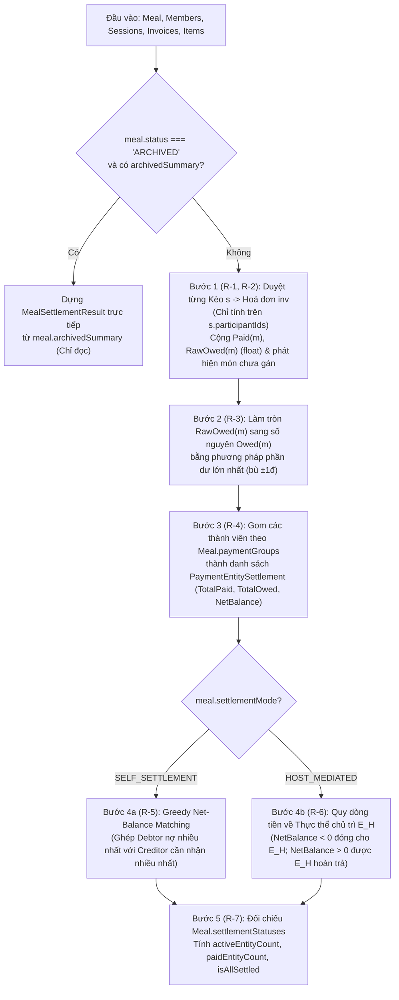
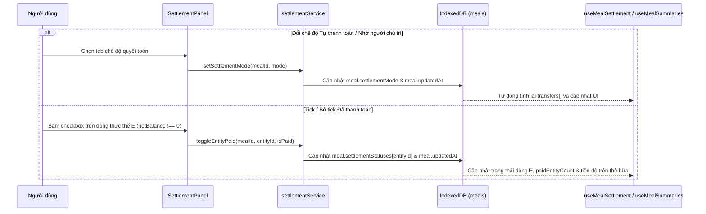

<!-- Nguyên văn documentation/epic-6/SA.md (System Analysis) tại thời điểm chuyển sang OpenSpec, 2026-11-11. Tài liệu lịch sử: có thể không còn khớp code hiện tại; hành vi hiện hành nằm ở openspec/specs/. -->

# Epic 6 — System Analysis (SA)

**Epic 6**: Động cơ Tính toán Chia tiền theo Bữa, 2 Chế độ Quyết toán & Tick Thanh toán · **Trạng thái**: Đã triển khai (còn kiểm thủ công trên trình duyệt ở 375 px trước khi đóng)

Tài liệu đi cùng: [BR](./BR.md) · [Kiến trúc & Data model](../01-architecture-and-data-model.md) · [Nghiệp vụ §1, §5–7.1](../02-business-logic-and-algorithms.md) · [UI §4.2 (Khu vực 3)](../03-ui-ux-and-design-system.md) · [Epic 5 SA](../epic-5/SA.md)

---

### B.1. Công nghệ / thư viện sử dụng
Dùng lại toàn bộ stack hiện có: React 19 · TypeScript · Tailwind CSS · Dexie 4 + `dexie-react-hooks` · `lucide-react` · Vitest + `fake-indexeddb` + jsdom + Testing Library. **Không thêm thư viện mới.**

- Toàn bộ động cơ tính toán chia tiền 3 tầng, gom nhóm thanh toán và giải thuật quyết toán (`SELF_SETTLEMENT` / `HOST_MEDIATED`) được viết bằng **hàm thuần TypeScript** trong `domain/settlementEngine.ts`, không phụ thuộc IndexedDB hay React, để dùng chung cho:
  1. Màn hình chi tiết bữa (`MealWorkspacePage` — Epic 6).
  2. Tiến độ thanh toán ở danh sách bữa (`useMealSummaries` — Epic 3/6).
  3. Đóng gói `ArchivedMealSummary` khi lưu trữ bữa (Epic 7).
  4. Tính toán và hiển thị trên `SnapshotViewer` chỉ đọc (Epic 8).

### B.2. Cấu trúc mã nguồn

```text
app/src/
├─ types/index.ts                              # SỬA: thêm các kiểu kết quả tính toán quyết toán dùng chung
│                                              #   (MemberBreakdown, PaymentEntitySettlement, SettlementTransfer,
│                                              #   MealSettlementResult)
├─ db/db.ts                                    # Không đổi
├─ domain/
│  ├─ settlementEngine.ts                      # MỚI, THUẦN: computeMealSettlement, computeSelfSettlementTransfers,
│  │                                           #   computeHostMediatedTransfers
│  ├─ settlementEngine.test.ts                 # MỚI: unit test toàn diện cho R-1…R-7 (chia lẻ, gom nhóm, P2P, chủ trì)
│  ├─ mealRules.ts                             # SỬA: cập nhật summarizeMeal nhận thêm dữ liệu sessions & items
│  │                                           #   để tính tiến độ thanh toán chuẩn theo thực thể có netBalance !== 0 (BR-6.9)
│  └─ mealRules.test.ts                        # SỬA: thêm test tiến độ thanh toán tinh chỉnh
├─ services/
│  ├─ settlementService.ts                     # MỚI: setSettlementMode, toggleEntityPaid, setAllEntitiesPaid
│  ├─ settlementService.test.ts                # MỚI: test ghi DB cho chế độ quyết toán & tick thanh toán
│  └─ peopleErrors.ts                          # SỬA: thêm mã ENTITY_NOT_FOUND, INVALID_SETTLEMENT_MODE
├─ hooks/
│  ├─ useMealSettlement.ts                     # MỚI: live query đọc meal + members + sessions + invoices + items
│  │                                           #   và trả về MealSettlementResult
│  └─ useMealSummaries.ts                      # SỬA: truyền thêm sessions & items vào summarizeMeal (BR-6.9)
├─ components/
│  └─ settlement/
│     ├─ SettlementPanel.tsx                   # MỚI: Khu vực 3 trên MealWorkspacePage (chuyển chế độ, cảnh báo
│     │                                        #   món chưa gán, bảng thực thể + tick thanh toán, danh sách chuyển khoản)
│     ├─ EntitySettlementRow.tsx               # MỚI: dòng thực thể (cá nhân/nhóm), ứng/chi/chênh lệch, checkbox Đã TT
│     ├─ TransferInstructionList.tsx           # MỚI: danh sách hướng dẫn chuyển tiền ("A chuyển cho B: X ₫")
│     ├─ MemberBreakdownDialog.tsx             # MỚI: modal giải trình chi tiết từng khoản ứng & ăn của thành viên (BR-6.2)
│     └─ SettlementPanel.test.tsx              # MỚI: test giao diện Khu vực 3
└─ pages/
   └─ MealWorkspacePage.tsx                    # SỬA: thay ô giữ chỗ Khu vực 3 bằng <SettlementPanel/>
```

### B.3. Thành phần & trách nhiệm

| Thành phần | Trách nhiệm | Phụ thuộc |
| :--- | :--- | :--- |
| `domain/settlementEngine` | Tính toán thuần toàn bộ kết quả quyết toán của một Bữa từ `{ meal, members, sessions, invoices, items }`: chi tiết từng thành viên (`MemberBreakdown`), làm tròn phần dư lớn nhất (R-3), gộp thực thể thanh toán (`PaymentEntitySettlement`, R-4), sinh lệnh chuyển tiền theo `SELF_SETTLEMENT` (R-5) và `HOST_MEDIATED` (R-6), kiểm tra `isAllSettled` (R-7). **Không chạm DB/DOM** | `types` |
| `domain/mealRules` | Cập nhật `summarizeMeal` để dùng kết quả `computeMealSettlement` (khi có dữ liệu kèo/hoá đơn/món) nhằm chỉ đếm các thực thể có `netBalance !== 0` vào tiến độ thanh toán (BR-6.9) | `domain/settlementEngine`, `lib/dates`, `services/peopleErrors` |
| `services/settlementService` | Ghi vào bảng `meals` trong transaction: đổi `settlementMode` (`setSettlementMode`), bật/tắt trạng thái `isPaid` của một thực thể (`toggleEntityPaid`), hoặc đánh dấu nhanh tất cả thực thể đã thanh toán (`setAllEntitiesPaid`) | `db`, `services/mealPeopleService` (`loadActiveMeal`), `domain/mealRules`, `services/peopleErrors` |
| `hooks/useMealSettlement` | Đọc thời gian thực `meal`, `members`, `sessions`, `invoices`, `items` của `mealId` qua `useLiveQuery` và gọi `computeMealSettlement` | `db`, `domain/settlementEngine` |
| `components/settlement/SettlementPanel` | Hiển thị Khu vực 3: nút chuyển `Tự thanh toán` / `Nhờ người chủ trì`, hộp cảnh báo nếu còn món chưa gán người ăn (BR-6.8), bảng thực thể (`EntitySettlementRow`), hướng dẫn chuyển tiền (`TransferInstructionList`), và chỗ gắn nút Chia sẻ (Epic 8) | `useMealSettlement`, `services/settlementService`, `MemberBreakdownDialog` |
| `components/settlement/MemberBreakdownDialog` | Hiển thị bảng giải trình chi tiết cho 1 thành viên hoặc 1 nhóm thanh toán: danh sách hoá đơn đã ứng và danh sách từng kèo $\rightarrow$ hoá đơn $\rightarrow$ món đã tiêu dùng kèm công thức chia | `Modal`, `lib/money` |

### B.4. Thiết kế dữ liệu

**Không đổi schema IndexedDB, không nâng version Dexie.**
Bảng `meals` đã có sẵn các trường `settlementMode: SettlementMode`, `paymentGroups: PaymentGroup[]`, `settlementStatuses: Record<string, { isPaid: boolean; paidAt?: string }>` và `archivedSummary?: ArchivedMealSummary` từ Epic 1 ([01 §3.2, §3.6](../01-architecture-and-data-model.md)).

Bổ sung các interface kết quả tính toán (chỉ dùng trong bộ nhớ, không lưu bảng mới) vào `types/index.ts`:

```typescript
export interface MemberChargeLine {
  sessionId: string;
  sessionName: string;
  invoiceId: string;
  vendorName?: string;
  kind: 'EQUAL_TOTAL' | 'BY_ITEM';
  itemName?: string;           // Có khi kind === 'BY_ITEM'
  shares?: number;             // Số phần của thành viên ở món này
  totalShares?: number;        // Tổng số phần của món hoặc số người chia đều hoá đơn
  sourceAmount: number;        // totalAmount của hoá đơn (nếu EQUAL_TOTAL) hoặc finalAmount của món
  rawCost: number;             // Số thực trước làm tròn cuối bữa
}

export interface MemberBreakdown {
  memberId: string;
  memberName: string;
  paidInvoices: Array<{
    invoiceId: string;
    sessionId: string;
    sessionName: string;
    vendorName?: string;
    amount: number;
  }>;
  chargeLines: MemberChargeLine[];
  totalPaid: number;           // Số nguyên đồng
  rawOwed: number;             // Số thực cộng dồn trước làm tròn
  totalOwed: number;           // Số nguyên đồng sau làm tròn & bù ±1đ (R-3)
  netBalance: number;          // totalPaid - totalOwed
}

export interface PaymentEntitySettlement {
  entityId: string;            // memberId (cá nhân lẻ) hoặc paymentGroupId (nhóm)
  entityName: string;          // Tên cá nhân hoặc tên nhóm
  isGroup: boolean;
  memberIds: string[];
  memberNames: string[];
  representativeId?: string;
  totalPaid: number;           // Σ Paid(m)
  totalOwed: number;           // Σ Owed(m)
  netBalance: number;          // totalPaid - totalOwed (+ nhận lại, - trả thêm, 0 cân bằng)
  isPaid: boolean;             // true nếu netBalance === 0 hoặc settlementStatuses[entityId]?.isPaid === true
  paidAt?: string;
}

export interface SettlementTransfer {
  fromEntityId: string;
  fromEntityName: string;
  toEntityId: string;
  toEntityName: string;
  amount: number;              // Số nguyên đồng > 0
}

export interface MealSettlementResult {
  mealId: string;
  status: MealStatus;
  settlementMode: SettlementMode;
  hostMemberId: string;
  hostEntityId: string;        // Thực thể chứa hostMemberId
  totalMealAmount: number;     // Tổng mọi hoá đơn trong bữa
  assignedAmount: number;      // Tổng tiền đã có người nhận chia
  unassignedAmount: number;    // Tổng tiền của các món BY_ITEM chưa có người ăn (R-2)
  unassignedItemCount: number; // Số món BY_ITEM chưa có người ăn
  memberBreakdowns: MemberBreakdown[];
  entities: PaymentEntitySettlement[];
  transfers: SettlementTransfer[];
  activeEntityCount: number;   // Số thực thể có netBalance !== 0
  paidEntityCount: number;     // Số thực thể có netBalance !== 0 đã tick isPaid
  isAllSettled: boolean;       // Điều kiện mở khoá Lưu trữ bữa cho Epic 7 (R-7)
}
```

### B.5. Luồng xử lý chính

**5.1. Pipeline tính toán Quyết toán toàn Bữa (`computeMealSettlement`)**


**5.2. Chuyển chế độ quyết toán & Tick chọn "Đã thanh toán"**


### B.6. Giao diện lập trình nội bộ

**Mã lỗi bổ sung vào `services/peopleErrors.ts`**:

| `code` | Khi nào ném |
| :--- | :--- |
| `ENTITY_NOT_FOUND` | `entityId` truyền vào `toggleEntityPaid` không phải là nhóm thanh toán hay thành viên độc lập của bữa |
| `INVALID_SETTLEMENT_MODE` | Giá trị `settlementMode` không thuộc `'SELF_SETTLEMENT' \| 'HOST_MEDIATED'` |

**`domain/settlementEngine.ts` (Hàm thuần)**:

```ts
export interface SettlementEngineInput {
  meal: Meal;
  members: ReadonlyArray<Member>;
  sessions: ReadonlyArray<SessionKeo>;
  invoices: ReadonlyArray<Invoice>;
  items: ReadonlyArray<InvoiceItem>;
}

/** Tính toàn bộ bảng quyết toán, thực thể, lệnh chuyển tiền và trạng thái hoàn tất của bữa (R-1…R-8). */
export function computeMealSettlement(input: SettlementEngineInput): MealSettlementResult;

/** Thuật toán Greedy Net-Balance Matching cho chế độ Tự thanh toán (R-5, 02 §6.1). */
export function computeSelfSettlementTransfers(
  entities: ReadonlyArray<Pick<PaymentEntitySettlement, 'entityId' | 'entityName' | 'netBalance'>>,
): SettlementTransfer[];

/** Thuật toán quy đầu mối về Thực thể chủ trì cho chế độ Nhờ người chủ trì (R-6, 02 §6.2). */
export function computeHostMediatedTransfers(
  entities: ReadonlyArray<Pick<PaymentEntitySettlement, 'entityId' | 'entityName' | 'netBalance'>>,
  hostEntityId: string,
): SettlementTransfer[];
```

**`services/settlementService.ts`**:

```ts
/** Đổi chế độ quyết toán của bữa (BR-6.5). Từ chối nếu bữa ARCHIVED. */
export function setSettlementMode(mealId: string, mode: SettlementMode): Promise<Meal>;

/** Ghi nhận hoặc bỏ ghi nhận trạng thái Đã thanh toán cho một thực thể (BR-6.7, R-7). */
export function toggleEntityPaid(
  mealId: string,
  entityId: string,
  isPaid: boolean,
  now?: Date,
): Promise<Meal>;

/** Đánh dấu nhanh tất cả các thực thể đang truyền vào là đã thanh toán (tiện ích khi chốt sổ). */
export function setAllEntitiesPaid(
  mealId: string,
  entityIds: string[],
  isPaid: boolean,
  now?: Date,
): Promise<Meal>;
```

**Component UI chính**:

| Component | Props chính | Hành vi |
| :--- | :--- | :--- |
| `SettlementPanel` | `meal: Meal`, `readOnly: boolean`, `actionsSlot?: ReactNode` | Khu vực 3 của `MealWorkspacePage`: hiển thị bộ chuyển chế độ `Tự thanh toán` / `Nhờ người chủ trì (<Tên chủ trì>)`, cảnh báo món chưa gán (nếu `unassignedItemCount > 0`), bảng `EntitySettlementRow`, khối `TransferInstructionList`, và `actionsSlot` (để Epic 7/8 gắn nút Lưu trữ / Chia sẻ) |
| `EntitySettlementRow` | `entity: PaymentEntitySettlement`, `readOnly: boolean`, `onTogglePaid: (paid: boolean) => void`, `onOpenBreakdown: () => void` | Hiển thị tên cá nhân hoặc nhóm (kèm biểu tượng nhóm và danh sách thành viên con), `Ứng: X ₫`, `Chi: Y ₫`, `NetBalance` (`+` xanh lá / `-` đỏ / `0` cân bằng), nút xem giải trình chi tiết, và checkbox `Đã thanh toán` (ẩn/khoá nếu `netBalance === 0` hoặc `readOnly`) |
| `TransferInstructionList` | `transfers: SettlementTransfer[]`, `settlementMode: SettlementMode`, `hasCost: boolean` | Liệt kê rõ từng dòng lệnh chuyển khoản: `<fromEntityName> chuyển cho <toEntityName>: <formatMoney(amount)>` |
| `MemberBreakdownDialog` | `open: boolean`, `breakdown: MemberBreakdown \| null`, `onClose: () => void` | Hộp thoại giải trình chi tiết các hoá đơn đã ứng và từng dòng chi phí (`EQUAL_TOTAL` / `BY_ITEM`) của thành viên |

### B.7. Yêu cầu phi chức năng

| Nhóm | Yêu cầu |
| :--- | :--- |
| **Độ chính xác toán học** | Tuyệt đối không thất thoát 1 đồng nào: $\sum \text{Owed}(m) = T_{\text{assigned}}$, và khi mọi món đã có người ăn thì $\sum \text{NetBalance}(E) = 0$ và tổng tiền các lệnh chuyển khoản ở `SELF_SETTLEMENT` bằng đúng $\sum_{\text{NetBalance}(E) > 0} \text{NetBalance}(E)$ |
| **Hiệu năng** | `computeMealSettlement` chạy dưới $5\text{ ms}$ cho một bữa có 20 thành viên, 10 kèo, 30 hoá đơn và 300 món |
| **Khả dụng (A11y & Mobile)** | Checkbox "Đã thanh toán" và nút mở giải trình có vùng chạm $\ge 44 \times 44\text{ px}$; số dư âm/dương ngoài màu sắc (`usd-green-700` / `usd-red-600`) luôn kèm dấu `+` / `-` và nhãn chữ (`Nhận lại` / `Phải trả` / `Đã cân bằng`); bảng không cuộn ngang ở màn hình $375\text{ px}$ |

### B.8. Rủi ro & hạn chế đã biết

| # | Rủi ro / Hạn chế | Hướng xử lý |
| :-: | :--- | :--- |
| 1 | Khi bữa có món `BY_ITEM` chưa được gán người ăn (`unassignedAmount > 0`), tổng tiền đã ứng ($T_{\text{meal}}$) lớn hơn tổng tiền đã phân bổ ($T_{\text{assigned}}$), nên $\sum \text{NetBalance}(E) = \text{unassignedAmount} > 0$ | Trong `computeSelfSettlementTransfers` và `computeHostMediatedTransfers`, thuật toán ghép cặp vẫn chạy an toàn với điều kiện dừng `while (creditors.length > 0 && debtors.length > 0)` (không bao giờ lặp vô tận), đồng thời UI hiện cảnh báo nổi bật yêu cầu gán người ăn cho các món còn sót (R-2, BR-6.8) |
| 2 | Người chủ trì (`hostMemberId`) nằm trong một `PaymentGroup` (ví dụ cặp đôi vợ chồng chủ trì) | Theo [02 §6.2](../02-business-logic-and-algorithms.md) và R-6, cả nhóm $E_H$ chứa chủ trì đóng vai trò là đầu mối thu/chi trong chế độ `HOST_MEDIATED`, tránh việc 2 người trong cùng một nhóm thanh toán lại phải chuyển tiền cho nhau |
| 3 | Thay đổi hoá đơn/món ở Khu vực 2 sau khi đã tick "Đã thanh toán" ở Khu vực 3 | Nếu một thực thể sau khi sửa hoá đơn chuyển sang `netBalance === 0` thì tự coi là đã cân bằng; nếu vẫn `netBalance !== 0` thì giữ trạng thái tick hoặc người dùng tự bỏ tick (riêng việc thêm/bỏ thành viên khỏi nhóm thanh toán đã tự xoá `settlementStatuses` liên quan từ Epic 2 R-13) |

### B.9. Ma trận truy vết kiểm thử

| User Story | BR | Bài kiểm thử dự kiến | Trạng thái |
| :-: | :-: | :--- | :-: |
| US-6.1 | BR-6.1, BR-6.2, BR-6.8 | `settlementEngine.test.ts`: tính `Paid(m)` và `Owed(m)` qua nhiều kèo/hoá đơn (`EQUAL_TOTAL` + `BY_ITEM` có `shares` khác nhau); người không thuộc `session.participantIds` có chi phí bằng 0 ở kèo đó (AC-5); chia lẻ cho 3, 6, 7 người và bù phần dư $\pm 1\text{đ}$ khớp 100% tổng hoá đơn (AC-1); phát hiện `unassignedItemCount` & `unassignedAmount` (AC-7). `SettlementPanel.test.tsx`: mở `MemberBreakdownDialog` xem giải trình (AC-6) | Đạt (`settlementEngine.test`; cảnh báo chưa gán: dữ liệu kiểm, hiển thị chưa có test riêng) |
| US-6.2 | BR-6.3, BR-6.6 | `settlementEngine.test.ts`: gom nhiều thành viên vào `PaymentGroup`, kiểm tra `totalPaid`, `totalOwed`, `netBalance` của nhóm bằng tổng các thành viên con (AC-2); thành viên lẻ giữ nguyên thực thể riêng | Đạt (`settlementEngine.test`: gom nhóm) |
| US-6.3 | BR-6.4, BR-6.6 | `settlementEngine.test.ts`: `computeSelfSettlementTransfers` tối ưu số giao dịch với nhiều chủ nợ và nhiều con nợ, tổng tiền chuyển khớp tuyệt đối tổng dư dương (AC-1, AC-3) | Đạt (`settlementEngine.test`: `computeSelfSettlementTransfers`) |
| US-6.4 | BR-6.5, BR-6.6 | `settlementEngine.test.ts`: `computeHostMediatedTransfers` khi chủ trì đứng lẻ và khi chủ trì thuộc một `PaymentGroup`; con nợ chuyển cho chủ trì, chủ trì hoàn trả cho người ứng dư. `settlementService.test.ts` & `SettlementPanel.test.tsx`: đổi qua lại 2 chế độ quyết toán (AC-3) | Đạt (`settlementEngine.test`: `computeHostMediatedTransfers`; `SettlementPanel.test`: đổi chế độ ghi DB) |
| US-6.5 | BR-6.7, BR-6.9 | `settlementService.test.ts`: `toggleEntityPaid`, `setAllEntitiesPaid`, chặn khi bữa `ARCHIVED`. `mealRules.test.ts`: `summarizeMeal` chỉ đếm thực thể có `netBalance !== 0` vào tiến độ thanh toán (AC-8). `SettlementPanel.test.tsx`: tick/bỏ tick checkbox trên UI (AC-4) | Đạt (`settlementService.test`; `SettlementPanel.test`; `mealRules.test`: BR-6.9) |

### B.10. Việc còn lại để đóng Epic
1. Kiểm thủ công trên trình duyệt ở 375 px cho Khu vực 3 của một bữa thật (đã kiểm bản snapshot dùng cùng component hiển thị) — **chưa thực hiện**.
2. Thêm test cho cảnh báo món chưa gán trên Khu vực 3 và mở giải trình từ màn bữa — **chưa thực hiện**.

**Lệch so với thiết kế đã ghi nhận khi triển khai**
- `SettlementPanel` nhận `meal`, `readOnly`, `actionsSlot` và tự gọi `useMealSettlement`, thay vì nhận `MealSettlementResult` từ ngoài.
- `MemberBreakdownDialog` nhận `breakdowns: MemberBreakdown[]` (một thực thể nhóm có nhiều thành viên) thay vì một `breakdown`.
- Tick "Đã thanh toán" dùng `toggleEntityPaid` và `setAllEntitiesPaid` (nút "Đánh dấu tất cả đã thanh toán").
- Bữa đã lưu trữ dựng kết quả từ `archivedSummary` trong `computeMealSettlement` (không cần truy vấn bảng đã xoá).

---

## Phụ lục: Business Requirements gốc của Epic 6

Nguyên văn `documentation/epic-6/BR.md` tại thời điểm chuyển sang OpenSpec (2026-11-11). `proposal.md` và các delta spec của change này được chuyển từ tài liệu này.

# Epic 6 — Business Requirements (BR)

**Epic 6**: Động cơ Tính toán Chia tiền theo Bữa, 2 Chế độ Quyết toán & Tick Thanh toán · **Trạng thái**: Đã triển khai (còn kiểm thủ công trên trình duyệt ở 375 px trước khi đóng)

Tài liệu đi cùng: [SA](./SA.md) · [Epics & Roadmap](../04-epics-and-roadmap.md) · [Kiến trúc & Data model §3.2, §3.6](../01-architecture-and-data-model.md) · [Nghiệp vụ §1, §5–7.1](../02-business-logic-and-algorithms.md) · [UI §4.2 (Khu vực 3)](../03-ui-ux-and-design-system.md) · [Epic 5 BR](../epic-5/BR.md)

---

### A.1. Bối cảnh & Mục tiêu nghiệp vụ
Sau Epic 1–5, ứng dụng đã có đầy đủ dữ liệu 3 tầng: Bữa (thành viên, chủ trì, nhóm thanh toán), Kèo (người tham gia từng kèo), Hoá đơn (người ứng tiền, chế độ chia, điều chỉnh giảm giá/phí phục vụ/VAT) và Món (người ăn kèm số phần `shares`). Tuy nhiên, **Khu vực 3 (Bảng quyết toán)** trên màn hình chi tiết bữa vẫn đang là ô giữ chỗ, và tiến độ thanh toán ở danh sách bữa (Epic 3 R-10) mới chỉ đếm thô trên số lượng thực thể.

Epic 6 xây dựng **động cơ tính toán chia tiền toàn bữa** và hoàn thiện **Khu vực 3 (Bảng quyết toán cuối bữa)**:

1. **Tổng hợp chi phí cá nhân trên toàn Bữa**: Tính chính xác số tiền mỗi thành viên đã ứng trước (`Paid(m)`) và số tiền thực tế tiêu dùng (`Owed(m)`) qua tất cả các kèo/hoá đơn/món, kèm bảng giải trình chi tiết (ai ứng ở hoá đơn nào, ăn món gì ở kèo nào).
2. **Gom công nợ theo Nhóm thanh toán (`PaymentGroup`)**: Gộp tổng tiền đã ứng và tổng tiền phải chi của các thành viên thuộc cùng cặp đôi/gia đình thành một Thực thể thanh toán (`PaymentEntity`) duy nhất với một số dư ròng (`NetBalance`).
3. **Hai chế độ quyết toán linh hoạt**:
   - **Tự thanh toán (`SELF_SETTLEMENT`)**: Tối ưu hoá số lượng giao dịch chuyển khoản trực tiếp giữa người nợ và người ứng dư.
   - **Nhờ người chủ trì (`HOST_MEDIATED`)**: Quy toàn bộ dòng tiền phải thu và phải hoàn trả về đầu mối Người chủ trì của bữa.
4. **Theo dõi trạng thái "Đã thanh toán"**: Cho phép tick/bỏ tick hoàn tất thanh toán cho từng cá nhân hoặc nhóm thanh toán có phát sinh công nợ, đồng thời tinh chỉnh chỉ số tiến độ thanh toán của bữa (bàn giao từ Epic 3 R-10).

### A.2. Các bên liên quan
| Vai trò | Quan tâm |
| :--- | :--- |
| Tôi (chủ app / Người chủ trì) | Nhìn ngay ai cần đóng bao nhiêu, cần hoàn lại cho ai bao nhiêu; đổi qua lại giữa "Tự thanh toán" và "Nhờ người chủ trì" chỉ với 1 chạm; tick ghi nhận ai đã chuyển khoản xong |
| Thành viên & Cặp đôi / Gia đình | Xem được明細 (giải trình) từng khoản mình ăn ở từng kèo để tin tưởng con số cuối cùng; nhóm gia đình chỉ cần chuyển khoản 1 lần cho cả nhóm |
| Dev Epic 7 (Lưu trữ bữa) | Cần kết quả quyết toán chuẩn và trạng thái `isAllSettled` (100% thực thể có `netBalance !== 0` đã tick thanh toán và không còn món chưa gán người ăn) để kích hoạt nút Lưu trữ và đóng gói `ArchivedMealSummary` |
| Dev Epic 8 (Chia sẻ & Snapshot) | Cần danh sách lệnh chuyển tiền (`transfers`) và thông tin thực thể thanh toán để định dạng tin nhắn đòi tiền và hiển thị trên Snapshot Viewer |

### A.3. Yêu cầu nghiệp vụ (BR)

| Mã | Yêu cầu | Truy vết |
| :-: | :--- | :--- |
| **BR-6.1** | Tổng hợp chi phí toàn Bữa cho từng thành viên tham gia bữa: tính tổng tiền đã ứng (`Paid(m)`) từ các hoá đơn mà `payerMemberId === m`, và tổng tiền tiêu dùng (`Owed(m)`) từ các hoá đơn chia đều (`EQUAL_TOTAL`) và các món ăn (`BY_ITEM`) trong các kèo mà thành viên đó tham gia. Người không nằm trong `SessionKeo.participantIds` của kèo nào thì chi phí phát sinh ở kèo đó bằng `0`. | US-6.1, YC#8, YC#23 |
| **BR-6.2** | Cung cấp chế độ **Xem giải trình chi tiết theo từng thành viên**: cho phép bấm vào một cá nhân (hoặc từng người trong nhóm) để xem họ đã ứng những hoá đơn nào và bị tính tiền ở những kèo/hoá đơn/món nào kèm số tiền tương ứng. | US-6.1, YC#8 |
| **BR-6.3** | Gom công nợ theo **Nhóm thanh toán (`PaymentGroup`)**: các thành viên thuộc cùng một nhóm được gộp thành một Thực thể thanh toán (`PaymentEntity`) duy nhất có $\text{TotalPaid}(E) = \sum \text{Paid}(m)$, $\text{TotalOwed}(E) = \sum \text{Owed}(m)$ và số dư ròng $\text{NetBalance}(E) = \text{TotalPaid}(E) - \text{TotalOwed}(E)$. Thành viên không thuộc nhóm nào là một Thực thể thanh toán độc lập. | US-6.2, YC#12 |
| **BR-6.4** | Hỗ trợ **Chế độ 1 — Tự thanh toán (`SELF_SETTLEMENT`)**: sử dụng thuật toán tối ưu dòng tiền (Greedy Net-Balance Matching) để sinh danh sách lệnh chuyển tiền trực tiếp từ thực thể thiếu tiền ($\text{NetBalance} < 0$) sang thực thể ứng dư ($\text{NetBalance} > 0$) với số giao dịch tối thiểu. | US-6.3, YC#11, 02 §6.1 |
| **BR-6.5** | Hỗ trợ **Chế độ 2 — Nhờ người chủ trì (`HOST_MEDIATED`)**: mọi thực thể khác đầu mối chủ trì nếu có $\text{NetBalance} < 0$ sẽ chuyển $|\text{NetBalance}|$ cho đầu mối chủ trì; nếu có $\text{NetBalance} > 0$ sẽ được đầu mối chủ trì chuyển hoàn trả $\text{NetBalance}$. Cho phép chuyển đổi tức thì giữa `SELF_SETTLEMENT` và `HOST_MEDIATED` và lưu lựa chọn vào `Meal.settlementMode`. | US-6.4, YC#11, 02 §6.2 |
| **BR-6.6** | Hiển thị **Bảng tổng hợp Thực thể thanh toán** và **Hướng dẫn chuyển tiền chi tiết** ngay tại Khu vực 3 của màn hình chi tiết bữa theo đúng hệ màu USD Green (số tiền nhận lại màu xanh lá kèm dấu `+`, số tiền phải trả màu đỏ kèm dấu `-`, font chữ số thẳng cột). | US-6.2–6.4, YC#8, YC#13 |
| **BR-6.7** | Cho phép **Tick / bỏ tick "Đã thanh toán"** (`Meal.settlementStatuses[entityId]`) cho từng Thực thể thanh toán có $\text{NetBalance} \neq 0$ khi bữa đang `ACTIVE`. Thực thể có $\text{NetBalance} = 0$ được hiển thị trạng thái "Đã cân bằng" (không cần tick). | US-6.5, YC#16, 02 §7.1 |
| **BR-6.8** | Cảnh báo trên Bảng quyết toán nếu trong bữa còn hoá đơn `BY_ITEM` có món chưa được gán người ăn (`unassignedItemCount > 0`), nêu rõ tên kèo/hoá đơn và tổng số tiền chưa phân bổ để người dùng bổ sung trước khi chốt thanh toán. | US-6.1, ràng buộc với Epic 5 BR-5.8 |
| **BR-6.9** | Tinh chỉnh **Tiến độ thanh toán của Bữa** trên cả 3 chế độ xem danh sách bữa (Epic 3 R-10): chỉ đếm các Thực thể thanh toán thực sự có phát sinh chênh lệch ($\text{NetBalance} \neq 0$) trên mẫu số `<đã tick>/<cần thanh toán> đã thanh toán`; nếu mọi thực thể đều có $\text{NetBalance} = 0$ (và bữa có chi phí đã phân bổ đủ) thì hiển thị hoàn tất. | US-6.5, bàn giao Epic 3 B.10 |

### A.4. Quy tắc nghiệp vụ (Business Rules)

| Mã | Quy tắc |
| :-: | :--- |
| **R-1** | **Tính chi phí của một thành viên $m$ trên từng hoá đơn $inv$ thuộc kèo $s$** ([02 §1](../02-business-logic-and-algorithms.md)):<br>- Nếu $m \notin s.\text{participantIds}$: $\text{Paid}_{inv}(m) = 0$ và $\text{Cost}_{inv}(m) = 0$.<br>- Tiền đã ứng: $\text{Paid}_{inv}(m) = inv.\text{totalAmount}$ nếu $inv.\text{payerMemberId} === m$, ngược lại bằng $0$.<br>- Tiền tiêu dùng $\text{Cost}_{inv}(m)$ (tính bằng số thực `float` chưa làm tròn):<br>  + Nếu $inv.\text{splitType} === \text{'EQUAL\_TOTAL'}$: với $P_{eq} = inv.\text{equalSplitParticipantIds} \cap s.\text{participantIds}$, nếu $m \in P_{eq}$ và $|P_{eq}| > 0$ thì $\text{Cost}_{inv}(m) = inv.\text{totalAmount} / |P_{eq}|$, ngược lại bằng $0$.<br>  + Nếu $inv.\text{splitType} === \text{'BY\_ITEM'}$: với mỗi món $i$ của $inv$, gọi $C_i = \{(u, s_{i,u}) \in i.\text{consumers} \mid u \in s.\text{participantIds}, s_{i,u} > 0\}$ và $S_i = \sum_{(u, s_{i,u}) \in C_i} s_{i,u}$. Nếu $(m, s_{i,m}) \in C_i$ và $S_i > 0$ thì $\text{Cost}_i(m) = i.\text{finalAmount} \times (s_{i,m} / S_i)$, ngược lại bằng $0$. Tổng $\text{Cost}_{inv}(m) = \sum_{i \in inv} \text{Cost}_i(m)$. |
| **R-2** | **Xử lý món chưa gán người ăn (`unassignedAmount`)**: Nếu một món $i$ thuộc hoá đơn `BY_ITEM` có $S_i = 0$ (chưa có ai ăn), giá trị $i.\text{finalAmount}$ được cộng vào `unassignedAmount` của bữa (không tự ý chia cho ai). Tổng chi phí đã được phân bổ của bữa là $T_{\text{assigned}} = T_{\text{meal}} - \text{unassignedAmount}$. Khi `unassignedAmount > 0`, Bảng quyết toán vẫn tính trên phần $T_{\text{assigned}}$ đã có người ăn nhưng hiển thị hộp cảnh báo màu vàng đồng nêu rõ số món và số tiền chưa có người nhận, đồng thời đánh dấu bữa **chưa đủ điều kiện lưu trữ** (`isAllSettled = false`). |
| **R-3** | **Làm tròn tiền tiêu dùng cấp thành viên và bù phần dư ($\pm 1\text{đ}$)** ([02 §1.2](../02-business-logic-and-algorithms.md)):<br>- Cộng dồn số thực trên toàn bữa cho mỗi thành viên $m \in \text{Meal.participantIds}$: $\text{RawOwed}(m) = \sum_{inv \in B} \text{Cost}_{inv}(m)$.<br>- Để đảm bảo **Tổng tiền cần thu khớp 100% Tổng tiền đã phân bổ** ($\sum_{m} \text{Owed}(m) = T_{\text{assigned}}$) và không lệch khi gộp vào nhóm, áp dụng phương pháp phần dư lớn nhất (Largest Remainder Method):<br>  1. Với mỗi $m$, lấy phần nguyên $\text{base}(m) = \lfloor \text{RawOwed}(m) \rfloor$ và phần lẻ thập phân $\text{frac}(m) = \text{RawOwed}(m) - \text{base}(m)$.<br>  2. Phần thiếu cần bù: $\Delta = \text{round}\big(T_{\text{assigned}} - \sum_{m} \text{base}(m)\big)$ (luôn là số nguyên $0 \le \Delta < |\text{Meal.participantIds}|$).<br>  3. Sắp xếp các thành viên có $\text{RawOwed}(m) > 0$ theo $\text{frac}(m)$ giảm dần; nếu $\text{frac}(m)$ bằng nhau (trong sai số $10^{-9}$) thì ưu tiên theo thứ tự xuất hiện trong `Meal.participantIds` (người đầu tiên nhận phần lệch $\pm 1\text{đ}$ đúng như [02 §1.2](../02-business-logic-and-algorithms.md)). Cộng thêm $1\text{đ}$ cho $\Delta$ thành viên đầu tiên. |
| **R-4** | **Ánh xạ sang Thực thể thanh toán (`PaymentEntity`)** ([02 §5.2](../02-business-logic-and-algorithms.md)):<br>- Mỗi `group` trong `Meal.paymentGroups` (có $\ge 2$ thành viên thuộc bữa) tạo thành một thực thể nhóm (`isGroup = true`, `entityId = group.id`, `entityName = group.name`, `representativeId = group.representativeId`, `memberIds = group.memberIds`).<br>- Mỗi thành viên trong `Meal.participantIds` không thuộc bất kỳ `PaymentGroup` nào tạo thành một thực thể cá nhân (`isGroup = false`, `entityId = member.id`, `entityName = member.name`, `memberIds = [member.id]`).<br>- Với mỗi thực thể $E$: $\text{TotalPaid}(E) = \sum_{m \in E} \text{Paid}(m)$, $\text{TotalOwed}(E) = \sum_{m \in E} \text{Owed}(m)$, và $\text{NetBalance}(E) = \text{TotalPaid}(E) - \text{TotalOwed}(E)$.<br>- Bất biến bảo toàn: $\sum_{E} \text{TotalPaid}(E) = T_{\text{meal}}$, $\sum_{E} \text{TotalOwed}(E) = T_{\text{assigned}}$, và khi `unassignedAmount === 0` thì $\sum_{E} \text{NetBalance}(E) = 0$ tuyệt đối. |
| **R-5** | **Thuật toán Tự thanh toán (`SELF_SETTLEMENT`)** ([02 §6.1](../02-business-logic-and-algorithms.md)):<br>- Chỉ chạy ghép cặp hoàn chỉnh khi `unassignedAmount === 0` (hoặc ghép trên phần chênh lệch đã phân bổ). Để tổng nợ bằng tổng nhận ngay cả khi đang còn món chưa gán, với phần đã phân bổ: chỉ tính phần ứng tương ứng hoặc yêu cầu gán hết món; cụ thể khi `unassignedAmount === 0`:<br>  1. Tập chủ nợ $\mathcal{C} = \{E \mid \text{NetBalance}(E) > 0\}$ sắp xếp giảm dần theo $\text{NetBalance}(E)$ (hoà thì giữ thứ tự thực thể).<br>  2. Tập con nợ $\mathcal{D} = \{E \mid \text{NetBalance}(E) < 0\}$ sắp xếp giảm dần theo $|\text{NetBalance}(E)|$ (hoà thì giữ thứ tự thực thể).<br>  3. Lặp lấy đầu tập $D \in \mathcal{D}$ (nợ $d$) và $C \in \mathcal{C}$ (cần nhận $c$): tạo khoản chuyển `fromEntityId = D.entityId`, `toEntityId = C.entityId`, `amount = min(d, c)`; giảm $d$ và $c$ đi `amount`, loại bỏ thực thể đã về $0$. |
| **R-6** | **Thuật toán Nhờ người chủ trì (`HOST_MEDIATED`)** ([02 §6.2](../02-business-logic-and-algorithms.md)):<br>- Xác định **Thực thể chủ trì $E_H$**: là Thực thể thanh toán chứa `Meal.hostMemberId` (nếu chủ trì nằm trong một `PaymentGroup` $G$ thì $E_H = E_G$; nếu chủ trì đứng lẻ thì $E_H = \{ \text{hostMemberId} \}$).<br>- Với mọi Thực thể thanh toán $E \neq E_H$:<br>  + Nếu $\text{NetBalance}(E) < 0$: tạo lệnh chuyển tiền từ $E$ đến $E_H$ với `amount = Math.abs(NetBalance(E))`.<br>  + Nếu $\text{NetBalance}(E) > 0$: tạo lệnh chuyển tiền từ $E_H$ hoàn trả cho $E$ với `amount = NetBalance(E)`.<br>  + Nếu $\text{NetBalance}(E) = 0$: không sinh lệnh chuyển tiền. |
| **R-7** | **Quy tắc Tick "Đã thanh toán" & Tự động dọn trạng thái khi số dư đổi**:<br>- Chỉ các thực thể có $\text{NetBalance}(E) \neq 0$ mới cần người dùng tick `isPaid`. Khi tick, lưu `settlementStatuses[entityId] = { isPaid: true, paidAt: nowIso() }`; khi bỏ tick, xoá khoá `entityId` khỏi `settlementStatuses` (hoặc đặt `isPaid: false`).<br>- Thực thể có $\text{NetBalance}(E) = 0$ luôn được coi là `isPaid = true` (đã cân bằng) mà không cần lưu trong `settlementStatuses`.<br>- **Điều kiện hoàn tất toàn bữa (`isAllSettled`)**: `hasCost === true` VÀ `unassignedItemCount === 0` VÀ mọi thực thể có $\text{NetBalance}(E) \neq 0$ đều có `settlementStatuses[E.entityId]?.isPaid === true`. |
| **R-8** | **Chế độ chỉ đọc khi bữa `ARCHIVED`**: Khi `meal.status === 'ARCHIVED'`, Khu vực 3 đọc dữ liệu trực tiếp từ `meal.archivedSummary` (nếu có) và khoá toàn bộ nút chuyển đổi `settlementMode` cũng như các ô checkbox tick thanh toán. |

### A.5. Tiêu chí nghiệm thu (nghiệp vụ)

Bốn tiêu chí đầu lấy từ [04 — Epic 6](../04-epics-and-roadmap.md); các tiêu chí sau do BR/SA bổ sung.

- [x] AC-1: Tổng số tiền cần thu luôn khớp chính xác 100% với tổng số tiền cần hoàn trả cho những người đã ứng (khi các món đều đã có người ăn), không lệch dù chỉ 1 đồng qua các phép chia lẻ cho 3, 6, 7 người. *(BR-6.1, R-1, R-3, R-4)* **Đạt (`settlementEngine.test`: chia 3, 6, 7 người khớp 100%).**
- [x] AC-2: Nhóm thanh toán (cặp đôi/gia đình) hiển thị đúng tổng ứng, tổng chi của tất cả thành viên trong nhóm và 1 con số chênh lệch ròng (`NetBalance`) duy nhất. *(BR-6.3, R-4)* **Đạt (`settlementEngine.test`: cặp đôi gộp Paid/Owed/NetBalance).**
- [x] AC-3: Chuyển đổi giữa "Tự thanh toán" (`SELF_SETTLEMENT`) và "Nhờ người chủ trì" (`HOST_MEDIATED`) cập nhật ngay danh sách lệnh chuyển tiền và lưu lại lựa chọn của bữa. *(BR-6.4, BR-6.5, R-5, R-6)* **Đạt (`settlementEngine.test`: đầu mối chủ trì; `SettlementPanel.test`: đổi chế độ ghi DB).**
- [x] AC-4: Có thể tick / bỏ tick trạng thái "Đã thanh toán" cho từng cá nhân hoặc nhóm thanh toán có số dư khác 0 (khi bữa chưa lưu trữ); thực thể có số dư bằng 0 hiển thị "Đã cân bằng". *(BR-6.7, R-7)* **Đạt (`SettlementPanel.test`: tick ghi DB, cân bằng không cần tick; `settlementService.test`).**
- [x] AC-5: Người không nằm trong danh sách tham gia của một kèo (`SessionKeo.participantIds`) hoàn toàn không bị tính tiền ở bất kỳ hoá đơn hay món nào thuộc kèo đó. *(BR-6.1, R-1, YC#23)* **Đạt (`settlementEngine.test`: người ngoài kèo có chi phí 0 ở kèo đó).**
- [x] AC-6: Mở xem được bảng giải trình chi tiết của từng thành viên (đã ứng hoá đơn nào, đã ăn món nào/hoá đơn nào ở từng kèo, số tiền bao nhiêu). *(BR-6.2)* **Đạt một phần: `MemberBreakdownDialog` đã kiểm qua `SnapshotViewerPage.test`; mở giải trình trên màn bữa chưa có test.**
- [x] AC-7: Khi còn món ở chế độ `BY_ITEM` chưa có người ăn, Khu vực 3 hiển thị cảnh báo rõ số món và số tiền chưa phân bổ. *(BR-6.8, R-2)* **Đạt một phần: dữ liệu `unassignedItemCount` đã kiểm; cảnh báo hiển thị trên Khu vực 3 chưa có test riêng.**
- [x] AC-8: Tiến độ thanh toán trên thẻ bữa ở cả 3 chế độ xem (Lịch, Danh sách, Loại) phản ánh đúng số thực thể có phát sinh công nợ ($\text{NetBalance} \neq 0$) đã thanh toán. *(BR-6.9, R-7)* **Đạt (`mealRules.test`: BR-6.9 đếm thực thể có số dư khác 0).**
- [ ] AC-9: Dùng tốt trên màn hình $\le 375\text{ px}$, mọi nút/checkbox cao tối thiểu $44\text{ px}$, điều khiển được bằng bàn phím; toàn bộ test Epic 1–5 vẫn đạt. *(phi chức năng & hồi quy)* ****Chưa thực hiện.** Kiểm trình duyệt 375 px trên màn bữa thật chưa làm; hồi quy: toàn bộ test đạt.**

### A.6. Ngoài phạm vi
- Nút "Lưu trữ bữa", xoá hoá đơn/món/ảnh khi lưu trữ và giao diện bữa lưu trữ hoàn chỉnh (thuộc **Epic 7**).
- Nút "Chia sẻ thông báo thanh toán", định dạng bản tin đòi nợ và mã hoá/hiển thị Custom URL Snapshot (thuộc **Epic 8**).
- Thanh toán từng phần (Partial payment) của một cá nhân/nhóm (hệ thống ghi nhận trạng thái hoàn tất thanh toán theo từng thực thể bằng checkbox `isPaid`).
- Tích hợp cổng thanh toán ngân hàng / tạo mã VietQR động (chỉ hiển thị số tiền và hướng dẫn ai chuyển cho ai).
