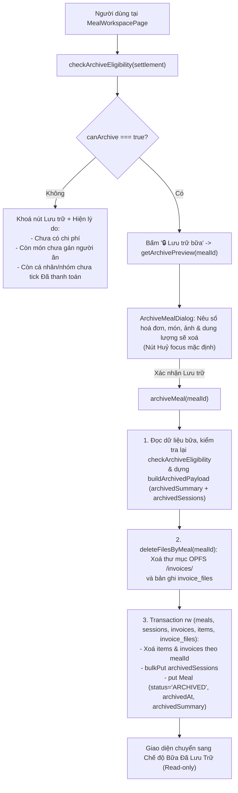
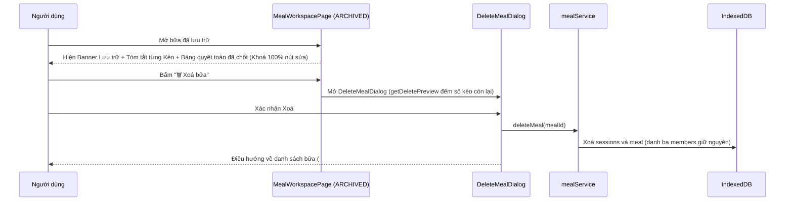

<!-- Nguyên văn documentation/epic-7/SA.md (System Analysis) tại thời điểm chuyển sang OpenSpec, 2026-11-11. Tài liệu lịch sử: có thể không còn khớp code hiện tại; hành vi hiện hành nằm ở openspec/specs/. -->

# Epic 7 — System Analysis (SA)

**Epic 7**: Lưu trữ Bữa (Archive), Dọn dẹp Hoá đơn/Món & Khoá Chỉnh sửa · **Trạng thái**: Đã triển khai (còn kiểm thủ công trên trình duyệt trước khi đóng)

Tài liệu đi cùng: [BR](./BR.md) · [Kiến trúc & Data model §3.2–3.6](../01-architecture-and-data-model.md) · [Nghiệp vụ §7.2](../02-business-logic-and-algorithms.md) · [UI §4.2, §4.5](../03-ui-ux-and-design-system.md) · [Epic 6 SA](../epic-6/SA.md)

---

### B.1. Công nghệ / thư viện sử dụng
Dùng lại toàn bộ stack hiện có: React 19 · TypeScript · Tailwind CSS · Dexie 4 + `dexie-react-hooks` · `lucide-react` · Vitest + `fake-indexeddb` + jsdom + Testing Library. **Không thêm thư viện mới.**

- Tái sử dụng `deleteFilesByMeal(mealId)` trong `services/fileStorageService.ts` (Epic 1) để dọn sạch thư mục OPFS `/invoices/<mealId>` và bản ghi `invoice_files`.
- Tái sử dụng `computeMealSettlement` trong `domain/settlementEngine.ts` (Epic 6) để kiểm tra điều kiện tiên quyết và trích xuất dữ liệu quyết toán sang `ArchivedMealSummary`.
- Tái sử dụng `formatBytes` trong `lib/bytes.ts` (Epic 4) để hiển thị dung lượng ảnh được giải phóng khi lưu trữ.

### B.2. Cấu trúc mã nguồn

```text
app/src/
├─ types/index.ts                              # Không đổi (ArchivedMealSummary & SessionKeo.archived* đã có sẵn)
├─ db/db.ts                                    # Không đổi (không nâng version schema Dexie)
├─ domain/
│  ├─ archiveRules.ts                          # MỚI, THUẦN: checkArchiveEligibility, buildArchivedPayload
│  └─ archiveRules.test.ts                     # MỚI: unit test cho R-1…R-3 (chặn lưu trữ & đóng gói dữ liệu)
├─ services/
│  ├─ archiveService.ts                        # MỚI: getArchivePreview, archiveMeal
│  ├─ archiveService.test.ts                   # MỚI: test tích hợp lưu trữ bữa, xoá invoices/items/files, khoá sửa
│  └─ peopleErrors.ts                          # SỬA: thêm mã ARCHIVE_EMPTY_MEAL, ARCHIVE_UNASSIGNED_ITEMS,
│                                              #   ARCHIVE_UNPAID_ENTITIES
├─ components/
│  ├─ meals/
│  │  ├─ ArchiveMealDialog.tsx                 # MỚI: hộp xác nhận lưu trữ nêu số lượng hoá đơn/món/ảnh sẽ xoá
│  │  └─ ArchiveMealDialog.test.tsx            # MỚI
│  └─ sessions/
│     ├─ SessionCard.tsx                       # SỬA: hiển thị tóm tắt đã chốt (số hoá đơn, người ứng, tổng kèo)
│     │                                        #   khi bữa ở trạng thái ARCHIVED (R-6)
│     └─ SessionsPanel.tsx                     # SỬA: truyền archivedSummary xuống SessionCard khi ARCHIVED
└─ pages/
   ├─ MealWorkspacePage.tsx                    # SỬA: thêm nút "🔒 Lưu trữ bữa" + cảnh báo điều kiện lưu trữ
   │                                           #   + banner ARCHIVED đầy đủ theo UI §4.5
   └─ MealWorkspacePage.test.tsx               # SỬA: thêm test luồng lưu trữ và giao diện chỉ đọc sau lưu trữ
```

### B.3. Thành phần & trách nhiệm

| Thành phần | Trách nhiệm | Phụ thuộc |
| :--- | :--- | :--- |
| `domain/archiveRules` | Hàm thuần kiểm tra điều kiện lưu trữ (`checkArchiveEligibility` theo R-1) và đóng gói `ArchivedMealSummary` cùng danh sách `SessionKeo` đã cập nhật `archivedTotalAmount` / `archivedPayerSummary` (`buildArchivedPayload` theo R-2, R-3). **Không chạm DB/DOM** | `domain/settlementEngine`, `types`, `services/peopleErrors` |
| `services/archiveService` | Đọc dữ liệu bữa, tính xem trước dung lượng/số bản ghi sẽ dọn (`getArchivePreview`), thực thi quy trình lưu trữ nguyên tử (`archiveMeal` theo R-4: xoá file OPFS + `invoice_files`, xoá `items` + `invoices`, cập nhật `sessions` + `meals`) | `db`, `domain/archiveRules`, `domain/settlementEngine`, `services/fileStorageService`, `services/peopleErrors` |
| `components/meals/ArchiveMealDialog` | Hiển thị hộp thoại xác nhận lưu trữ: liệt kê số hoá đơn, số món, số file ảnh và dung lượng byte sẽ xoá vĩnh viễn; nút Huỷ được focus mặc định | `ConfirmDialog`, `services/archiveService`, `lib/bytes` |
| `components/sessions/SessionCard` | Khi `meal.status === 'ARCHIVED'`, hiển thị số lượng hoá đơn đã chốt (`invoiceCount`), danh sách người đã ứng trong kèo (`archivedPayerSummary`) và tổng chi phí kèo (`archivedTotalAmount`), thay vì báo "Chưa có hoá đơn" | `lib/money` |
| `pages/MealWorkspacePage` | Hiển thị nút `🔒 Lưu trữ bữa` (kích hoạt khi `eligibility.canArchive === true`, hoặc hiện lý do chưa thể lưu trữ khi chưa đủ điều kiện); hiển thị Banner lưu trữ chuẩn UI §4.5 khi `meal.status === 'ARCHIVED'` | `domain/archiveRules`, `ArchiveMealDialog`, `SettlementPanel` |

### B.4. Thiết kế dữ liệu

**Không đổi schema IndexedDB, không nâng version Dexie, không đổi interface trong `types/index.ts`.**
Các trường phục vụ Lưu trữ đã được thiết kế sẵn từ Epic 1 ([01 §3.2, §3.3, §3.6](../01-architecture-and-data-model.md)):
- Trên `Meal`: `status: 'ACTIVE' | 'ARCHIVED'`, `archivedAt?: string`, `archivedSummary?: ArchivedMealSummary`.
- Trên `SessionKeo`: `archivedTotalAmount?: number`, `archivedPayerSummary?: Array<{ memberId: string; paidAmount: number }>`.

Bất biến dữ liệu sau khi `archiveMeal(mealId)` hoàn tất:

| Mã | Bất biến |
| :-: | :--- |
| **I-E7-1** | `meal.status === 'ARCHIVED'`, `meal.archivedAt` là chuỗi ISO hợp lệ, và `meal.archivedSummary` tồn tại đầy đủ. |
| **I-E7-2** | Số bản ghi trong bảng `invoices`, `items`, `invoice_files` có `mealId` đó đều bằng `0`; thư mục OPFS `/invoices/<mealId>` đã bị xoá. |
| **I-E7-3** | Các bản ghi `sessions` của `mealId` vẫn được giữ lại, mỗi bản ghi có `archivedTotalAmount` khớp với `sessionsSummary` trong `meal.archivedSummary`, và $\sum_{s} s.\text{archivedTotalAmount} = \text{meal.archivedSummary.totalMealAmount}$. |
| **I-E7-4** | Mọi phần tử trong `meal.archivedSummary.entitiesSummary` có `isPaid === true`. |

### B.5. Luồng xử lý chính

**5.1. Kiểm tra điều kiện & Thực thi Lưu trữ Bữa (`archiveMeal`)**


**5.2. Xem và Xoá Bữa Đã Lưu Trữ (US-7.3, US-7.4)**


### B.6. Giao diện lập trình nội bộ

**Mã lỗi bổ sung vào `services/peopleErrors.ts`**:

| `code` | Khi nào ném |
| :--- | :--- |
| `ARCHIVE_EMPTY_MEAL` | Lưu trữ bữa chưa có hoá đơn hoặc tổng chi phí bằng `0` (R-1) |
| `ARCHIVE_UNASSIGNED_ITEMS` | Lưu trữ bữa khi vẫn còn món ở chế độ `BY_ITEM` chưa có người ăn (`unassignedItemCount > 0`, R-1) |
| `ARCHIVE_UNPAID_ENTITIES` | Lưu trữ bữa khi còn thực thể có `netBalance !== 0` chưa được tick `isPaid` (R-1); `detail.unpaidEntityNames` chứa danh sách tên thực thể chưa thanh toán |

**`domain/archiveRules.ts` (Hàm thuần)**:

```ts
export type ArchiveBlockerReason =
  | 'ALREADY_ARCHIVED'
  | 'NO_COST'
  | 'UNASSIGNED_ITEMS'
  | 'UNPAID_ENTITIES';

export interface ArchiveEligibility {
  canArchive: boolean;
  reason?: ArchiveBlockerReason;
  unassignedItemCount: number;
  unpaidEntityNames: string[];
  message?: string; // Thông báo tiếng Việt giải thích rõ vì sao chưa lưu trữ được
}

/** Kiểm tra một bữa đã đủ điều kiện lưu trữ hay chưa (BR-7.1, R-1). */
export function checkArchiveEligibility(settlement: MealSettlementResult): ArchiveEligibility;

/** Đóng gói dữ liệu lưu trữ cho Meal và danh sách SessionKeo trước khi xoá invoices/items (R-2, R-3). */
export function buildArchivedPayload(input: {
  meal: Meal;
  sessions: ReadonlyArray<SessionKeo>;
  invoices: ReadonlyArray<Invoice>;
  settlement: MealSettlementResult;
  nowIso: string;
}): {
  archivedMeal: Meal;
  archivedSessions: SessionKeo[];
  archivedSummary: ArchivedMealSummary;
};
```

**`services/archiveService.ts`**:

```ts
export interface ArchivePreview {
  invoiceCount: number;
  fileCount: number;
  totalFileBytes: number;
}

/** Đếm số lượng hoá đơn, món, file ảnh và tổng dung lượng sẽ được dọn khi lưu trữ (BR-7.2). */
export function getArchivePreview(mealId: string): Promise<ArchivePreview>;

/** Thực thi lưu trữ bữa và dọn dẹp hoá đơn/món/ảnh (BR-7.3, R-1…R-4). */
export function archiveMeal(mealId: string, now?: Date): Promise<Meal>;
```

**Component UI chính**:

| Component | Props chính | Hành vi |
| :--- | :--- | :--- |
| `ArchiveMealDialog` | `mealId: string`, `mealTitle: string`, `onClose: () => void`, `onArchived: () => void` | Tải `getArchivePreview(mealId)` và hiển thị trong `ConfirmDialog`: *"Lưu trữ bữa **{mealTitle}** sẽ khoá chỉnh sửa vĩnh viễn và xoá {invoiceCount} hoá đơn cùng {fileCount} file ảnh ({formatBytes(totalFileBytes)}) để giải phóng bộ nhớ. Vẫn giữ lại chi phí từng kèo, các món và lịch sử quyết toán."* |

### B.7. Yêu cầu phi chức năng

| Nhóm | Yêu cầu |
| :--- | :--- |
| **An toàn dữ liệu** | Không bao giờ xoá `invoices`, `items` hay `invoice_files` nếu `checkArchiveEligibility` chưa thoả mãn 100%; nếu bước ghi DB gặp lỗi, toàn bộ transaction tự rollback; nếu xoá file OPFS chạy trước thì dữ liệu số tiền trong DB vẫn còn nguyên để bấm Lưu trữ lại |
| **Giải phóng dung lượng thật** | Sau khi `archiveMeal` chạy xong, `getTotalStorageBytes()` giảm đúng bằng tổng `sizeBytes` của các ảnh thuộc bữa vừa lưu trữ |
| **Khả dụng (A11y & Mobile)** | Nút "Lưu trữ bữa" khi chưa đủ điều kiện không chỉ làm mờ mà có dòng chú thích rõ ràng (`aria-describedby`) nêu tên những cá nhân/nhóm chưa thanh toán; hộp xác nhận điều khiển hoàn toàn bằng bàn phím, nút Huỷ được focus mặc định |

### B.8. Rủi ro & hạn chế đã biết

| # | Rủi ro / Hạn chế | Hướng xử lý |
| :-: | :--- | :--- |
| 1 | Người dùng bấm Lưu trữ nhầm khi chưa xem kỹ chi tiết món lần cuối | Yêu cầu 2 lớp bảo vệ: (1) phải tick đủ 100% các khoản thanh toán trước đó, và (2) hộp xác nhận `ArchiveMealDialog` nêu rõ số lượng bản ghi sẽ bị xoá vĩnh viễn với nút `Huỷ` là mặc định |
| 2 | Thành viên trong danh bạ được đổi tên sau khi bữa đã lưu trữ | `ArchivedMealSummary` lưu trực tiếp `entityName`, `memberNames`, `fromEntityName`, `toEntityName` tại thời điểm chốt sổ (snapshot lịch sử), đồng thời lưu `entityId` và `archivedPayerSummary[].memberId` để tra cứu khi cần |
| 3 | Bữa có kèo rỗng (kèo được tạo nhưng có 0 hoá đơn) khi lưu trữ | `buildArchivedPayload` vẫn giữ kèo đó với `archivedTotalAmount = 0`, `invoiceCount = 0` để bảo toàn lịch sử các kèo đã đi trong bữa |

### B.9. Ma trận truy vết kiểm thử

| User Story | BR | Bài kiểm thử dự kiến | Trạng thái |
| :-: | :-: | :--- | :-: |
| US-7.1 | BR-7.1 | `archiveRules.test.ts`: `checkArchiveEligibility` từ chối bữa chưa có chi phí (`NO_COST`), bữa còn món chưa gán (`UNASSIGNED_ITEMS`), bữa còn thực thể `netBalance !== 0` chưa tick `isPaid` (`UNPAID_ENTITIES` kèm đúng tên thực thể), và cho phép khi 100% đã tick hoặc mọi thực thể có `netBalance === 0` (AC-1). `archiveService.test.ts`: `archiveMeal` ném đúng mã lỗi `ARCHIVE_*` | Đạt (`archiveRules.test`: checkArchiveEligibility; `archiveService.test`: ARCHIVE_* codes) |
| US-7.2 | BR-7.2, BR-7.3 | `archiveRules.test.ts`: `buildArchivedPayload` đóng gói đúng `ArchivedMealSummary` và `SessionKeo.archived*`. `archiveService.test.ts`: `getArchivePreview` đếm đúng số bản ghi & dung lượng byte; `archiveMeal` xoá sạch `invoices`, `items`, `invoice_files` của bữa (giữ nguyên bữa khác), cập nhật `sessions` và chuyển `meal.status = 'ARCHIVED'` (AC-2, AC-4) | Đạt (`archiveRules.test`: buildArchivedPayload; `archiveService.test`: xoá invoices/items/files; `ArchiveMealAction.test`: xác nhận) |
| US-7.3 | BR-7.4 | `archiveService.test.ts`: mọi hàm sửa bữa/người/nhóm/kèo/hoá đơn/quyết toán đều ném `MEAL_ARCHIVED` sau khi lưu trữ. `MealWorkspacePage.test.tsx`: luồng tick đủ thanh toán $\rightarrow$ bấm Lưu trữ $\rightarrow$ xác nhận `ArchiveMealDialog` $\rightarrow$ hiện Banner lưu trữ, tóm tắt từng kèo (số hoá đơn, người ứng, tổng kèo), bảng quyết toán chỉ đọc, ẩn toàn bộ nút sửa (AC-2, AC-5, AC-6) | Đạt một phần (`archiveService.test`: MEAL_ARCHIVED cho các service; tóm tắt kèo và banner chưa có test component) |
| US-7.4 | BR-7.5 | `MealWorkspacePage.test.tsx` & `MealsPage.test.tsx`: xoá vĩnh viễn bữa vừa được lưu trữ qua `archiveMeal`, kiểm tra IndexedDB không còn `meal` và `sessions` của bữa đó (AC-3) | Đạt (`archiveService.test`: `deleteMeal` sau lưu trữ) |

### B.10. Việc còn lại để đóng Epic
1. Kiểm trình duyệt: danh sách bữa ở 3 chế độ xem hiển thị "Đã lưu trữ" sau khi lưu trữ (AC-6) — **chưa thực hiện**.
2. Kiểm trình duyệt ở 375 px cho màn bữa đã lưu trữ (AC-7) — **chưa thực hiện**.
3. Thêm test component cho tóm tắt kèo đã chốt (`SessionCard`) — **chưa thực hiện**.

**Rủi ro còn mở**
- Thứ tự "xoá file trước, DB sau" (R-4) có nghĩa là nếu transaction DB lỗi sau khi file đã xoá thì hoá đơn còn lại nhưng ảnh đã mất. Đây là đánh đổi đã chấp nhận theo R-4; cần cân nhắc thêm bước kiểm tra/khôi phục nếu gặp thực tế.

**Lệch so với thiết kế đã ghi nhận khi triển khai**
- `archiveMeal(mealId, now)` trả `Promise<void>`, không trả `Meal`.
- Thêm `ArchiveMealAction` (nút "Lưu trữ bữa" và lý do khoá) gắn vào `actionsSlot` của Khu vực 3.
- Lỗi lưu trữ mang `detail.unpaidEntityNames` và `unassignedItemCount` để UI hiển thị.

---

## Phụ lục: Business Requirements gốc của Epic 7

Nguyên văn `documentation/epic-7/BR.md` tại thời điểm chuyển sang OpenSpec (2026-11-11). `proposal.md` và các delta spec của change này được chuyển từ tài liệu này.

# Epic 7 — Business Requirements (BR)

**Epic 7**: Lưu trữ Bữa (Archive), Dọn dẹp Hoá đơn/Món & Khoá Chỉnh sửa · **Trạng thái**: Đã triển khai (còn kiểm thủ công trên trình duyệt trước khi đóng)

Tài liệu đi cùng: [SA](./SA.md) · [Epics & Roadmap](../04-epics-and-roadmap.md) · [Kiến trúc & Data model §3.2–3.6](../01-architecture-and-data-model.md) · [Nghiệp vụ §7.2](../02-business-logic-and-algorithms.md) · [UI §4.2, §4.5](../03-ui-ux-and-design-system.md) · [Epic 6 BR](../epic-6/BR.md)

---

### A.1. Bối cảnh & Mục tiêu nghiệp vụ
Sau Epic 1–6, người dùng đã quản lý trọn vẹn một Bữa từ lúc tạo, thêm người/nhóm, nhập kèo/hoá đơn/món (kèm ảnh và OCR) cho tới khi tính toán quyết toán và tick xác nhận từng cá nhân/nhóm đã thanh toán. Khi một bữa đã hoàn tất 100% việc thanh toán, các file ảnh hoá đơn nặng (vài trăm KB đến vài MB mỗi tấm) và hàng chục bản ghi chi tiết món không còn nhu cầu chỉnh sửa nữa nhưng lại chiếm dụng bộ nhớ trình duyệt (OPFS & IndexedDB).

Epic 7 xây dựng **quy trình Lưu trữ Bữa (`Archive Lifecycle`)** nhằm giải phóng dung lượng bộ nhớ và đóng băng lịch sử quyết toán của bữa:

1. **Kiểm tra điều kiện tiên quyết trước khi lưu trữ (Guard Rule)**: Chỉ cho phép lưu trữ khi **100% các Thực thể thanh toán có phát sinh công nợ ($\text{NetBalance} \neq 0$) đã được tick "Đã thanh toán"**, bữa đã có chi phí và không còn món nào chưa được gán người ăn. Nếu chưa đạt, hiển thị rõ danh sách những ai chưa thanh toán.
2. **Thực thi Lưu trữ & Dọn dẹp bộ nhớ**: Đóng gói bản tóm tắt cuối cùng (`ArchivedMealSummary` trên `Meal` và `archivedTotalAmount` / `archivedPayerSummary` trên từng `SessionKeo`), xoá sạch toàn bộ file ảnh hoá đơn (OPFS + `invoice_files`), xoá toàn bộ bản ghi `invoices` và `items` của bữa đó, và chuyển trạng thái bữa sang `ARCHIVED`.
3. **Giao diện Bữa đã lưu trữ (Read-only)**: Khoá 100% thao tác chỉnh sửa ở mọi tầng; hiển thị banner thông báo đã lưu trữ, bảng tóm tắt chi phí từng kèo (kèm số lượng hoá đơn và người ứng trước khi xoá) và bảng lịch sử quyết toán đã chốt.
4. **Xoá vĩnh viễn bữa đã lưu trữ**: Cho phép người dùng xoá hẳn bữa đã lưu trữ khỏi hệ thống bất cứ lúc nào.

### A.2. Các bên liên quan
| Vai trò | Quan tâm |
| :--- | :--- |
| Tôi (chủ app) | Chốt sổ những bữa đã thu/trả đủ tiền để không ai vô tình bấm sửa nhầm; giải phóng bộ nhớ ảnh hoá đơn trên điện thoại nhưng vẫn giữ được lịch sử tổng tiền từng kèo và ai đã trả bao nhiêu |
| Thành viên trong bữa | Khi xem lại bữa cũ (hoặc qua link Snapshot sau khi lưu trữ) vẫn thấy rõ tổng chi phí từng kèo và kết quả quyết toán cuối cùng |
| Dev Epic 3–6 | Đóng vòng đời kiểm thử bữa `ARCHIVED` thật trên giao diện (vốn mới chỉ được giả lập trong DB ở Epic 3 và Epic 4) |
| Dev Epic 8 (Snapshot) | Có sẵn `meal.archivedSummary` và `session.archivedTotalAmount` chuẩn để tạo Snapshot URL cho cả những bữa đã lưu trữ |

### A.3. Yêu cầu nghiệp vụ (BR)

| Mã | Yêu cầu | Truy vết |
| :-: | :--- | :--- |
| **BR-7.1** | Kiểm tra điều kiện Lưu trữ bữa (`canArchiveMeal`): chặn thao tác Lưu trữ nếu bữa chưa có chi phí, còn món ở chế độ `BY_ITEM` chưa gán người ăn, hoặc còn bất kỳ Thực thể thanh toán nào có $\text{NetBalance} \neq 0$ chưa được tick "Đã thanh toán" (`isPaid === true`). Hiển thị rõ tên các cá nhân/nhóm chưa hoàn tất thanh toán để người dùng biết lý do nút Lưu trữ bị khoá. | US-7.1, YC#17, 02 §7.2 |
| **BR-7.2** | Trước khi thực hiện Lưu trữ, hiển thị hộp thoại xác nhận (`ArchiveMealDialog` theo chuẩn USD) nêu rõ hành động này **không thể hoàn tác**, liệt kê số lượng hoá đơn và số file ảnh (kèm tổng dung lượng giải phóng; các món được giữ nên không nằm trong danh sách xoá) sẽ bị xoá vĩnh viễn, và những thông tin sẽ được giữ lại. | US-7.2, YC#17, BR-3.12 |
| **BR-7.3** | Thực thi quy trình Lưu trữ (`archiveMeal`):<br>1. Lưu tổng chi phí từng kèo và tóm tắt người ứng vào `SessionKeo.archivedTotalAmount` & `SessionKeo.archivedPayerSummary`, đồng thời lưu bảng tổng kết toàn bữa vào `Meal.archivedSummary`.<br>2. Xoá sạch toàn bộ file ảnh hoá đơn của bữa trong OPFS và bảng `invoice_files`.<br>3. Xoá toàn bộ các bản ghi `items` và `invoices` thuộc bữa đó trong IndexedDB.<br>4. Chuyển `Meal.status = 'ARCHIVED'` và ghi nhận thời điểm `Meal.archivedAt`. | US-7.2, YC#17, 02 §7.2 |
| **BR-7.4** | Giao diện **Bữa đã lưu trữ (`ARCHIVED` Read-only View)**: không hiện banner hay dòng thông báo "đã khoá/chỉ xem" (chỉ có nhãn trạng thái *Đã lưu trữ*); khoá và ẩn 100% thao tác chỉnh sửa (thông tin bữa, thành viên, chủ trì, nhóm thanh toán, kèo, hoá đơn, món, chế độ quyết toán, checkbox thanh toán); ẩn nút chia sẻ thông báo thanh toán và link Snapshot; hiển thị bảng tóm tắt từng Kèo (tên kèo, số hoá đơn từng có, ai đã ứng, tổng tiền kèo, danh sách món được giữ) và bảng lịch sử quyết toán đã chốt. | US-7.3, YC#17, UI §4.5 |
| **BR-7.5** | Cho phép **Xoá vĩnh viễn** một bữa đã lưu trữ (`status === 'ARCHIVED'`) ngay từ màn hình chi tiết bữa hoặc từ cả 3 chế độ xem danh sách bữa (Lịch, Danh sách, Loại) kèm hộp xác nhận. | US-7.4, YC#18 |

### A.4. Quy tắc nghiệp vụ (Business Rules)

| Mã | Quy tắc |
| :-: | :--- |
| **R-1** | **Điều kiện đủ để Lưu trữ bữa (`canArchiveMeal`)**: Một bữa chỉ được phép lưu trữ khi thoả đồng thời 4 điều kiện:<br>1. `meal.status === 'ACTIVE'` (chưa lưu trữ).<br>2. Bữa có ít nhất 1 hoá đơn với tổng chi phí bữa `totalMealAmount > 0` (`ARCHIVE_EMPTY_MEAL`).<br>3. Không còn món nào thuộc hoá đơn `BY_ITEM` chưa được gán người ăn (`unassignedItemCount === 0`, nếu vi phạm báo `ARCHIVE_UNASSIGNED_ITEMS`).<br>4. Mọi Thực thể thanh toán $E$ có $\text{NetBalance}(E) \neq 0$ đều đã được tick `settlementStatuses[E.entityId]?.isPaid === true` (`ARCHIVE_UNPAID_ENTITIES`, kèm danh sách tên các thực thể chưa thanh toán).<br>*Trường hợp đặc biệt*: Nếu bữa có hoá đơn (`totalMealAmount > 0`, `unassignedItemCount === 0`) và mọi thực thể đều có $\text{NetBalance}(E) = 0$ (tự cân bằng ngay từ đầu), bữa được coi là đã hoàn tất 100% thanh toán và **được phép lưu trữ ngay**. |
| **R-2** | **Đóng gói dữ liệu Kèo khi lưu trữ (`SessionKeo.archived*`)**: Với mỗi kèo $s$ của bữa trước khi xoá hoá đơn:<br>- `archivedTotalAmount` = tổng `inv.totalAmount` của mọi hoá đơn thuộc kèo $s$ (bằng `0` nếu kèo không có hoá đơn).<br>- `archivedPayerSummary` = danh sách `{ memberId, paidAmount }` gom nhóm theo `inv.payerMemberId` của các hoá đơn trong kèo $s$ (chỉ giữ những người có `paidAmount > 0`). |
| **R-3** | **Đóng gói `Meal.archivedSummary` (`ArchivedMealSummary`)** ([01 §3.6](../01-architecture-and-data-model.md)):<br>- `totalMealAmount`: tổng tiền toàn bữa từ `MealSettlementResult`.<br>- `sessionsSummary`: mảng theo thứ tự `orderIndex` của các kèo, mỗi phần tử gồm `{ sessionId, sessionName, totalAmount, invoiceCount }`.<br>- `entitiesSummary`: mảng từ `MealSettlementResult.entities`, mỗi phần tử gồm `{ entityId, entityName, isGroup, memberNames, totalPaid, totalOwed, netBalance, isPaid: true }`.<br>- `transfers`: mảng từ `MealSettlementResult.transfers` theo chế độ quyết toán đang chọn lúc lưu trữ, mỗi phần tử gồm `{ fromEntityName, toEntityName, amount }`. |
| **R-4** | **Thứ tự xoá file và cập nhật DB an toàn khi Lưu trữ**: Tuân thủ nguyên tắc an toàn giống `deleteMeal` (Epic 3 R-6):<br>1. Đọc và kiểm tra toàn bộ điều kiện `R-1`, dựng sẵn `archivedSummary` và các bản ghi `SessionKeo` đã gắn `archivedTotalAmount` / `archivedPayerSummary`.<br>2. Gọi `deleteFilesByMeal(mealId)` để xoá toàn bộ file ảnh vật lý trong OPFS `/invoices/<mealId>` và các bản ghi trong `invoice_files`.<br>3. Trong **một transaction `rw`** trên `[db.meals, db.sessions, db.invoices, db.items, db.invoice_files]`: kiểm tra lại bữa còn tồn tại và đang `ACTIVE`, xoá toàn bộ `items` và `invoices` theo `mealId`, đảm bảo `invoice_files` của `mealId` trống, `bulkPut` các `sessions` đã cập nhật, và `put` bản ghi `Meal` mới với `status = 'ARCHIVED'`, `archivedAt = nowIso()`, `updatedAt = nowIso()`, `archivedSummary`. |
| **R-5** | **Tính bất biến một chiều của trạng thái `ARCHIVED`**: Lưu trữ là thao tác **một chiều, không có "Bỏ lưu trữ" (Unarchive)** vì hoá đơn và file ảnh đã bị xoá vĩnh viễn. Mọi service ghi dữ liệu vào bữa (`mealService.updateMealInfo`, `mealPeopleService.*`, `sessionService.*`, `invoiceService.*`, `settlementService.*`, và chính `archiveService.archiveMeal`) đều từ chối thao tác trên bữa có `status === 'ARCHIVED'` với mã lỗi `MEAL_ARCHIVED`. |
| **R-6** | **Hiển thị Kèo của bữa đã lưu trữ**: Khi `meal.status === 'ARCHIVED'`, vì bảng `invoices` không còn bản ghi nào của bữa đó, giao diện Kèo **không** hiển thị câu `"Chưa có hoá đơn trong kèo này"`, mà đọc từ `meal.archivedSummary.sessionsSummary` và `session.archivedPayerSummary` để hiển thị số lượng hoá đơn đã chốt (`Đã chốt N hoá đơn`), danh sách người đã ứng tiền trong kèo đó và tổng chi phí của kèo. |
| **R-7** | **Xoá vĩnh viễn bữa đã lưu trữ (`US-7.4`)**: Sử dụng hàm `deleteMeal(mealId)` (đã hỗ trợ cả `ACTIVE` và `ARCHIVED` từ Epic 3). Khi xoá bữa đã lưu trữ, toàn bộ các bản ghi `sessions` còn giữ lại và bản ghi `meals` (chứa `archivedSummary`) bị xoá hoàn toàn khỏi IndexedDB; danh bạ `members` toàn cục không bị ảnh hưởng. |

### A.5. Tiêu chí nghiệm thu (nghiệp vụ)

Ba tiêu chí đầu lấy từ [04 — Epic 7](../04-epics-and-roadmap.md); các tiêu chí sau do BR/SA bổ sung.

- [x] AC-1: Không thể bấm Lưu trữ nếu bữa chưa có chi phí, còn món chưa gán người ăn, hoặc chưa tick đủ 100% các khoản thanh toán (các cá nhân/nhóm có $\text{NetBalance} \neq 0$) trong bữa; giao diện hiển thị rõ những ai chưa thanh toán. *(BR-7.1, R-1)* **Đạt (`archiveRules.test`, `archiveService.test`, `ArchiveMealAction.test`).**
- [x] AC-2: Sau khi xác nhận Lưu trữ, bữa chuyển sang trạng thái `ARCHIVED` và hoàn toàn không thể chỉnh sửa được nữa ở bất kỳ khu vực nào; toàn bộ file ảnh hoá đơn (`invoice_files` / OPFS), và bản ghi hoá đơn (`invoices`) của bữa bị xoá sạch khỏi bộ nhớ; các món (`items`) được giữ lại cùng thông tin chi phí từng kèo và lịch sử quyết toán trong `archivedSummary`. *(BR-7.3, BR-7.4, R-2…R-5)* **Đạt (`archiveService.test`: xoá invoices, invoice_files, giữ items; sessions giữ tổng; meal ARCHIVED; `MealWorkspacePage.test`: hiện món đã giữ, không có nút chia sẻ).**
- [x] AC-3: Bữa đã lưu trữ vẫn có thể bị xoá hoàn toàn khi người dùng bấm Xoá (từ màn chi tiết bữa hoặc từ 3 chế độ xem danh sách bữa). *(BR-7.5, R-7)* **Đạt (`archiveService.test`: `deleteMeal` cho bữa đã lưu trữ).**
- [x] AC-4: Hộp thoại xác nhận Lưu trữ (`ArchiveMealDialog`) hiển thị đúng số lượng hoá đơn, số file ảnh và dung lượng bộ nhớ sẽ được giải phóng; nút Huỷ được focus mặc định. *(BR-7.2)* **Đạt một phần (`ArchiveMealAction.test`: Huỷ được focus, số hoá đơn/món/file); dung lượng hiển thị chưa có test.**
- [x] AC-5: Màn hình chi tiết của bữa `ARCHIVED` hiển thị đúng banner lưu trữ, tổng chi phí từng kèo kèm số hoá đơn từng có và người đã ứng, cùng bảng kết quả quyết toán và lịch sử chuyển khoản đã chốt. *(BR-7.4, R-6)* **Đạt một phần: tóm tắt đã chốt trong `SessionCard` và banner đã triển khai; chưa có test component riêng.**
- [ ] AC-6: Trên cả 3 chế độ xem bữa (Lịch, Danh sách, Loại — Epic 3), bữa vừa lưu trữ hiển thị huy hiệu `Đã lưu trữ`, giữ nguyên tổng chi phí bữa và tiến độ thanh toán hoàn tất, và chuyển sang tab "Đã lưu trữ" ở chế độ xem Theo Loại. *(BR-7.3, BR-7.4)* ****Chưa thực hiện.** Kiểm 3 chế độ xem danh sách bữa sau lưu trữ chưa làm.**
- [ ] AC-7: Dùng tốt trên màn hình $\le 375\text{ px}$, mọi nút chạm $\ge 44\text{ px}$, điều khiển được bằng bàn phím; toàn bộ test Epic 1–6 vẫn đạt. *(phi chức năng & hồi quy)* ****Chưa thực hiện.** Kiểm 375 px trên trình duyệt chưa làm; hồi quy: toàn bộ test đạt.**

### A.6. Ngoài phạm vi
- Khôi phục / Mở khoá lại (Unarchive) bữa đã lưu trữ (do dữ liệu hoá đơn, món và ảnh đã bị xoá vật lý để tối ưu dung lượng theo đúng yêu cầu cốt lõi YC#17).
- Tự động lưu trữ ngầm khi người dùng vừa tick xong người cuối cùng (việc lưu trữ xoá dữ liệu gốc nên luôn phải do người dùng chủ động bấm nút "Lưu trữ bữa" và xác nhận qua hộp thoại).
- Chia sẻ tin nhắn thanh toán và Custom URL Snapshot (thuộc **Epic 8** — tuy nhiên dữ liệu `archivedSummary` của Epic 7 được thiết kế tương thích hoàn toàn để Epic 8 vẫn tạo được Snapshot URL cho bữa đã lưu trữ).
