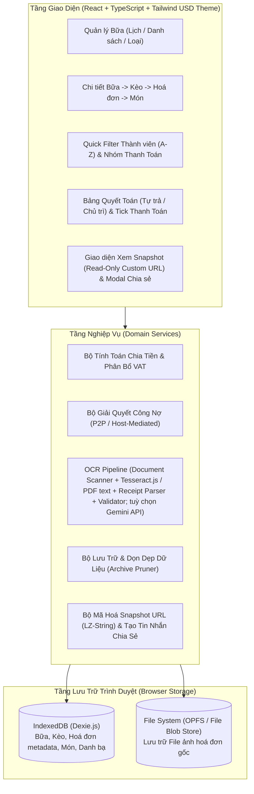
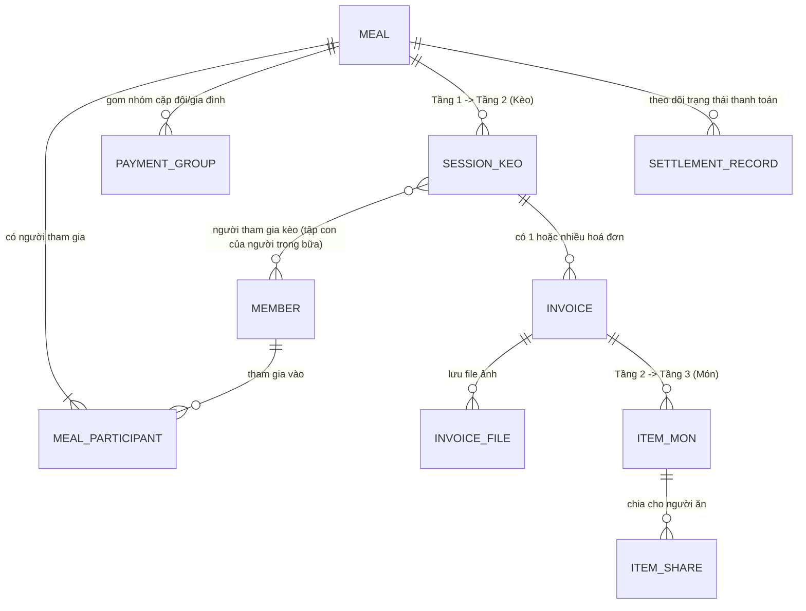
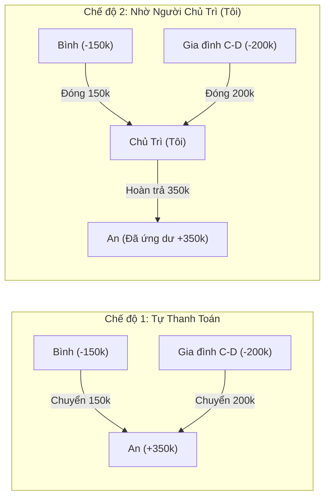
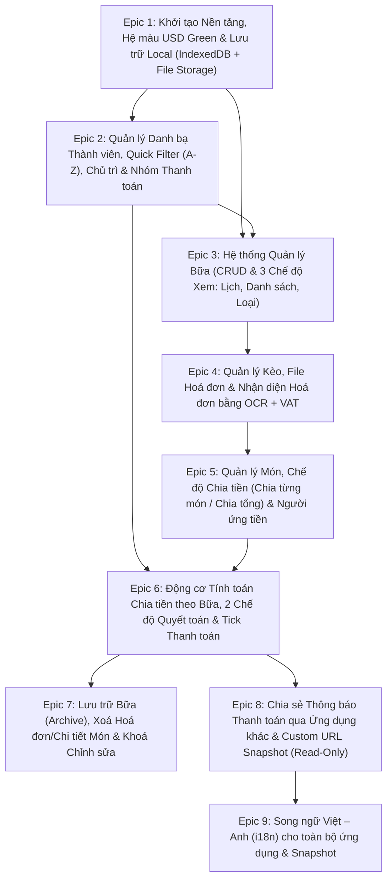

<!-- Nguyên văn documentation/01, 02, 03 (kiến trúc và mô hình dữ liệu, nghiệp vụ và thuật toán, UI/UX và hệ màu) tại thời điểm chuyển sang OpenSpec, 2026-11-11. Tài liệu lịch sử: có thể không còn khớp code hiện tại; hành vi hiện hành nằm ở openspec/specs/. -->

# 01. Kiến Trúc Hệ Thống & Mô Hình Dữ Liệu (Architecture & Data Model)

## 1. Kiến trúc tổng thể (Client-Side Architecture)

Ứng dụng hoạt động hoàn toàn trên trình duyệt (**100% Client-Side Single Page Application / PWA**), không yêu cầu backend server hay kết nối mạng để tính toán và lưu trữ.



---

## 2. Sơ đồ Thực thể Liên kết (Entity-Relationship Diagram)

Hệ thống quản lý dữ liệu xoay quanh cấu trúc phân cấp **3 tầng chính (Bữa -> Kèo -> Món)** kết hợp với **Hoá đơn (Invoice)**, **Thành viên (Member)** và **Nhóm thanh toán (PaymentGroup)**.



---

## 3. Chi tiết Schema Dữ liệu (TypeScript Interfaces & IndexedDB Tables)

### 3.1. Cấu hình Hệ thống & Danh bạ Thành viên (`members`)

Mọi người từng được thêm vào bất kỳ bữa nào đều được lưu vào bảng `members` toàn cục để tái sử dụng nhanh ở các bữa sau qua thanh **Quick Filter (A-Z)**.

```typescript
export interface AppSettings {
  id: 'default';
  defaultHostMemberId: string; // ID của "Tôi" mặc định
  currencySymbol: string;      // Mặc định: '₫' hoặc 'VNĐ'
  createdAt: string;
}

export interface Member {
  id: string;                  // UUID
  name: string;                // Tên hiển thị (VD: "An Nguyễn", "Bình Trần")
  normalizedName: string;      // Chuỗi bỏ dấu viết thường dùng cho Quick Filter & Sort A-Z
  isDefaultHost?: boolean;     // Đánh dấu đây là hồ sơ "Tôi"
  avatarColor: string;         // Mã màu badge đại diện (trong dải màu USD/Emerald)
  createdAt: string;           // ISO Date
  lastUsedAt: string;          // ISO Date (phục vụ thống kê/gợi ý)
}
```

---

### 3.2. Tầng 1: Bữa (`meals`)

Đại diện cho một ngày/cuộc đi ăn chơi của nhóm bạn.

```typescript
export type MealStatus = 'ACTIVE' | 'ARCHIVED';

export type SettlementMode = 'SELF_SETTLEMENT' | 'HOST_MEDIATED';

export interface PaymentGroup {
  id: string;                  // UUID
  mealId: string;              // Thuộc bữa nào
  name: string;                // Tên nhóm (VD: "Gia đình An - Bình", "Cặp đôi C - D")
  memberIds: string[];         // Danh sách memberId gộp chung (tối thiểu 2 người trong bữa)
  representativeId?: string;   // Người đại diện đứng tên thanh toán của nhóm
}

export interface Meal {
  id: string;                  // UUID
  title: string;               // Tên bữa (VD: "Đi ăn cuối tuần Đà Lạt", "Tất niên nhóm ĐH")
  date: string;                // Ngày của bữa (Định dạng YYYY-MM-DD để filter theo Lịch)
  note?: string;               // Ghi chú thêm
  status: MealStatus;          // 'ACTIVE' (Còn hoạt động) | 'ARCHIVED' (Đã lưu trữ)
  
  // Thành viên & Chủ trì trong bữa
  participantIds: string[];    // Danh sách memberId tham gia bữa này
  hostMemberId: string;        // Người chủ trì bữa này (mặc định lấy defaultHostMemberId)
  
  // Cấu hình thanh toán của bữa
  settlementMode: SettlementMode; // 'SELF_SETTLEMENT' (Tự thanh toán) | 'HOST_MEDIATED' (Nhờ người chủ trì)
  paymentGroups: PaymentGroup[];  // Các nhóm gom thanh toán (cặp đôi/gia đình) trong bữa
  
  // Trạng thái tick chọn đã thanh toán
  // Key là ID của Thực thể thanh toán (memberId cá nhân lẻ hoặc paymentGroupId)
  settlementStatuses: Record<string, {
    isPaid: boolean;
    paidAt?: string;
  }>;

  // Dữ liệu tổng hợp giữ lại sau khi Lưu trữ (Archive Snapshot)
  archivedSummary?: ArchivedMealSummary;

  createdAt: string;
  updatedAt: string;
  archivedAt?: string;
}
```

---

### 3.3. Tầng 2: Kèo (`sessions`) & Hoá đơn (`invoices`)

- **Kèo (`Session`)**: Đại diện cho từng nơi/điểm thanh toán trong một Bữa (VD: Kèo 1: Quán Lẩu, Kèo 2: Trà sữa, Kèo 3: Karaoke).
- **Hoá đơn (`Invoice`)**: Mỗi Kèo có thể có **1 hoặc nhiều hoá đơn** (VD: gọi thêm lượt 2 tính bill riêng, hoặc 2 bàn thanh toán 2 bill trong cùng 1 quán).

```typescript
export interface SessionKeo {
  id: string;                  // UUID
  mealId: string;              // Khóa ngoại trỏ tới Meal
  name: string;                // Tên kèo / Địa điểm (VD: "Kèo 1 - Lẩu Bò Gỗ", "Kèo 2 - Karaoke Nice")
  orderIndex: number;          // Thứ tự kèo trong bữa

  // Người tham gia kèo: tập con của Meal.participantIds, có thể là tất cả hoặc chỉ một số người.
  // Mọi phép chia tiền của kèo (EQUAL_TOTAL và BY_ITEM) chỉ tính trên những người này.
  // Kèo mới mặc định gồm toàn bộ người đang có trong bữa; người thêm vào bữa sau đó KHÔNG tự vào kèo cũ.
  participantIds: string[];

  // Khi bữa chuyển sang ARCHIVED, toàn bộ invoices và items bị xoá,
  // chỉ giữ lại tổng chi phí của kèo tại trường này:
  archivedTotalAmount?: number;
  archivedPayerSummary?: Array<{
    memberId: string;
    paidAmount: number;
  }>;

  createdAt: string;
}

export type InvoiceInputMode = 'ITEMIZED' | 'TOTAL_ONLY';
export type InvoiceSplitType = 'BY_ITEM' | 'EQUAL_TOTAL';
export type AdjustmentMode = 'NONE' | 'PERCENTAGE' | 'FIXED_AMOUNT';
export type VatMode = AdjustmentMode;

export interface Invoice {
  id: string;                  // UUID
  mealId: string;              // Khóa ngoại trỏ tới Meal (để truy vấn/xoá nhanh khi Archive)
  sessionId: string;           // Khóa ngoại trỏ tới SessionKeo
  
  vendorName?: string;         // Tên quán nhận diện từ OCR hoặc tự nhập
  invoiceDate?: string;        // Ngày in trên hoá đơn (OCR nhận diện hoặc tự nhập)
  
  // Người ứng tiền thanh toán hoá đơn này
  // "Ứng trước": MỘT người thanh toán TOÀN BỘ hoá đơn này. Người này không bị trừ tiền ở từng món;
  // phần của những người còn lại được ghi thành công nợ với họ khi kết toán (xem 02, mục 5).
  payerMemberId: string;       // ID thành viên đã trả tiền cho hoá đơn này
  
  // Chế độ nhập & Chia tiền của hoá đơn
  inputMode: InvoiceInputMode; // 'ITEMIZED' (Có danh sách món) | 'TOTAL_ONLY' (Chỉ nhập tổng tiền)
  splitType: InvoiceSplitType; // 'BY_ITEM' (Chia từng món) | 'EQUAL_TOTAL' (Chia đều theo tổng)
  // Ràng buộc: Nếu inputMode === 'TOTAL_ONLY' => splitType BẮT BUỘC là 'EQUAL_TOTAL'

  // Danh sách người tham gia chia đều (nếu splitType === 'EQUAL_TOTAL')
  // Luôn là tập con của SessionKeo.participantIds; mặc định bằng đúng danh sách người tham gia kèo,
  // có thể tick bớt nếu có người không dùng hoá đơn này (không thể thêm người ngoài kèo)
  equalSplitParticipantIds: string[];

  // Giá trị tiền: tiền hàng → giảm giá → phí phục vụ → VAT (công thức ở 02, mục 2)
  subtotalAmount: number;      // Tiền hàng trước mọi điều chỉnh (tổng các món hoặc số nhập ở tab chỉ tổng)
  discountMode: AdjustmentMode;  // Giảm giá cả bill: Không / Theo % / Số tiền
  discountValue: number;         // % (VD: 10) hoặc số tiền (VD: 50000)
  discountAmount: number;        // Số tiền giảm thực tế, ≥ 0 (là số trừ đi)
  serviceMode: AdjustmentMode;   // Phí phục vụ cả bill
  serviceValue: number;
  serviceAmount: number;         // Số tiền phí phục vụ thực tế, ≥ 0
  vatMode: VatMode;            // Không VAT / Theo % (VD: 8%, 10%) / Số tiền VAT cố định
  vatValue: number;            // Giá trị % (VD: 8) hoặc số tiền tuyệt đối (VD: 45000)
  vatAmount: number;           // Số tiền VAT quy đổi thực tế
  totalAmount: number;         // Tổng thanh toán = subtotalAmount − discountAmount + serviceAmount + vatAmount

  // Liên kết tới các File ảnh hoá đơn đã lưu
  fileIds: string[];           // Danh sách ID file hoá đơn trong File Storage

  createdAt: string;
}
```

---

### 3.4. Tầng 3: Món (`items`)

Đại diện cho từng món cụ thể trong một Hoá đơn (khi `inputMode === 'ITEMIZED'`).

```typescript
export interface ItemShare {
  memberId: string;            // Người sử dụng món này
  shares: number;              // Số phần/hệ số chia (Mặc định = 1 cho chia đều; có thể chỉnh thành 2, 3...)
}

export interface InvoiceItem {
  id: string;                  // UUID
  mealId: string;              // Khóa ngoại trỏ tới Meal (để xoá hàng loạt khi Archive bữa)
  sessionId: string;           // Khóa ngoại trỏ tới SessionKeo
  invoiceId: string;           // Khóa ngoại trỏ tới Invoice
  
  name: string;                // Tên món (VD: "Bò mỹ nhúng lẩu", "Bia Tiger x10")
  quantity: number;            // Số lượng hiển thị trên bill (VD: 2)
  unitPrice: number;           // Đơn giá (VD: 150000)
  rawAmount: number;           // Thành tiền chưa VAT (quantity * unitPrice hoặc nhập trực tiếp)
  
  // Phần giảm giá, phí phục vụ, VAT của hoá đơn được phân bổ vào món (phương pháp phần dư lớn nhất, 02 mục 2)
  allocatedDiscountAmount: number; // Số trừ đi, ≥ 0
  allocatedServiceAmount: number;
  allocatedVatAmount: number;  // Tiền VAT được tự động phân bổ vào món này (nếu hoá đơn có VAT)
  finalAmount: number;         // rawAmount − allocatedDiscountAmount + allocatedServiceAmount + allocatedVatAmount
  orderIndex?: number;         // Thứ tự dòng món trong hoá đơn (không cần index Dexie)

  // Danh sách người ăn món này và tỷ lệ phần
  consumers: ItemShare[];
}
```

---

### 3.5. Lưu trữ File Hoá đơn (`invoice_files` & OPFS)

Đáp ứng yêu cầu: *"Toàn bộ hoá đơn được lưu thành file, có thể thêm/xoá hoá đơn"* và *"Xoá hết toàn bộ hoá đơn khi lưu trữ bữa"*:

```typescript
export interface InvoiceFileRecord {
  id: string;                  // UUID
  mealId: string;              // Thuộc bữa nào
  sessionId: string;           // Thuộc kèo nào
  invoiceId: string;           // Thuộc hoá đơn nào
  fileName: string;            // Tên file chuẩn hoá (VD: "bill_keo1_20261019_01.jpg")
  mimeType: string;            // image/jpeg, image/png, image/webp
  sizeBytes: number;           // Dung lượng file đã lưu (sau nén)
  originalSizeBytes?: number;  // Dung lượng ảnh gốc trước khi nén (để hiện "trước → sau")
  compression?: CompressionPreset; // Mức nén đã dùng; app luôn dùng BALANCED
  opfsPath?: string;           // Đường dẫn file trong Origin Private File System (/invoices/<mealId>/<fileName>)
  blobData?: Blob;             // Lưu trực tiếp File/Blob trong IndexedDB (đảm bảo tương thích 100% trình duyệt)
  ocrRawText?: string;         // Văn bản thô OCR của ảnh (lưu sau khi quét; có giá trị thì không quét lại, và dùng để phát hiện ảnh trùng)
  createdAt: string;
}
```

#### Cơ chế Quản lý File Hoá đơn:
1. **Thêm File**: Khi người dùng chụp ảnh hoặc chọn file ảnh cho một hoá đơn, ảnh được **nén trước khi lưu ở mức Cân bằng cố định** (cạnh dài tối đa 2000 px, JPEG chất lượng 0,80; BR-4.16), (ưu tiên xử lý kiểu máy quét, xem [05 §3](./05-ocr-and-receipt-reading.md)) sau đó **tự quét OCR** và lưu văn bản vào `ocrRawText` của ảnh (dùng để khỏi quét lại và để phát hiện ảnh trùng, BR-4.17, BR-4.18). Bản nén được ghi thành file vật lý trong thư mục ảo OPFS `/invoices/<mealId>/<fileId>_<fileName>` (đồng thời lưu `Blob` dự phòng trong bảng `invoice_files`), cho phép tải file về máy hoặc mở xem bất cứ lúc nào. Bản gốc không được giữ. Giới hạn: 40 MB/ảnh trước nén, 10 ảnh/hoá đơn, định dạng JPEG/PNG/WebP.
2. **Xoá File đơn lẻ**: Người dùng có thể xoá một file ảnh khỏi hoá đơn -> hệ thống xoá file khỏi OPFS và xoá bản ghi trong `invoice_files`.
3. **Xoá Hoá đơn / Kèo / Bữa**: Tự động xoá toàn bộ các file hoá đơn liên quan để giải phóng bộ nhớ.
4. **Lưu trữ Bữa (Archive)**: Tự động xoá sạch toàn bộ file trong `/invoices/<mealId>/`, xoá toàn bộ bản ghi `invoices`, `invoice_files`, và `items` của bữa đó, chỉ giữ lại thông tin chi phí từng kèo và bảng quyết toán trong `Meal.archivedSummary`.

---

### 3.6. Snapshot Dữ liệu khi Bữa đã Lưu trữ (`ArchivedMealSummary`)

Khi một Bữa chuyển sang trạng thái `ARCHIVED`, hoá đơn và ảnh bị xoá bỏ (các món vẫn được giữ), và người dùng vẫn xem lại được chi phí từng kèo và kết quả thanh toán của bữa đó:

```typescript
export interface ArchivedMealSummary {
  totalMealAmount: number;
  sessionsSummary: Array<{
    sessionId: string;
    sessionName: string;
    totalAmount: number;
    invoiceCount: number; // Số lượng hoá đơn từng có trước khi xoá
  }>;
  entitiesSummary: Array<{
    entityId: string;     // memberId hoặc paymentGroupId
    entityName: string;
    isGroup: boolean;
    memberNames: string[];
    totalPaid: number;    // Tổng tiền đã ứng
    totalOwed: number;    // Tổng tiền phải chi
    netBalance: number;   // Chênh lệch (+ được nhận lại, - phải trả thêm)
    isPaid: boolean;
  }>;
  transfers: Array<{
    fromEntityName: string;
    toEntityName: string;
    amount: number;
  }>;
}
```

---

### 3.7. Cấu trúc Dữ liệu Snapshot Custom URL (`MealSnapshotPayload`)

Đáp ứng yêu cầu: *"Thêm tính năng snapshot là 1 custom URL chứa toàn bộ thông tin của 1 bữa, nhưng người mở snapshot không thể thay đổi thông tin bữa đó"*:

Vì ứng dụng chạy hoàn toàn Client-side (không có Backend Database chung), **Custom URL Snapshot** được thiết kế theo cơ chế **Self-Contained Compressed URL State**:
- Toàn bộ thông tin của 1 Bữa (Thông tin bữa, Thành viên, Nhóm thanh toán, Kèo, Hoá đơn, Món, và Kết quả quyết toán) được đóng gói thành một đối tượng JSON tối ưu `MealSnapshotPayload`, nén bằng thuật toán **LZ-String (`compressToEncodedURIComponent`)** và gắn vào URL dạng:
  `https://<domain>/?snapshot=<chuỗi_mã_hoá_nén>` (hoặc `#/snapshot/<chuỗi_mã_hoá_nén>`).
- Khi bất kỳ ai mở URL này trên trình duyệt của họ:
  1. Ứng dụng giải nén chuỗi `snapshot` trực tiếp từ URL thành `MealSnapshotPayload`.
  2. Hiển thị toàn bộ thông tin chi tiết của Bữa (từ danh sách người tham gia, nhóm thanh toán, từng kèo, từng hoá đơn, từng món cho tới bảng quyết toán cuối bữa).
  3. **Chế độ Chỉ Đọc Tuyệt Đối (Strict Read-Only Mode)**: Dữ liệu từ Snapshot URL chỉ được render trên bộ nhớ tạm (In-memory Viewer), hoàn toàn tách biệt với Database cá nhân của người xem và **vô hiệu hoá 100% thao tác chỉnh sửa/thêm/xoá**.

```typescript
export interface MealSnapshotPayload {
  v: 1;                        // Phiên bản schema snapshot
  exportedAt: string;          // Thời điểm tạo snapshot (ISO Date)
  meal: {
    title: string;
    date: string;
    note?: string;
    status: MealStatus;
    settlementMode: SettlementMode;
    hostMemberId: string;
  };
  members: Array<{
    id: string;
    name: string;
    avatarColor: string;
  }>;
  paymentGroups: Array<{
    id: string;
    name: string;
    memberIds: string[];
  }>;
  sessions: Array<{
    id: string;
    name: string;
    orderIndex: number;
    participantIds: string[];
    archivedTotalAmount?: number;
    invoices: Array<{
      id: string;
      vendorName?: string;
      invoiceDate?: string;
      payerMemberId: string;
      inputMode: InvoiceInputMode;
      splitType: InvoiceSplitType;
      equalSplitParticipantIds: string[];
      subtotalAmount: number;
      discountMode: AdjustmentMode;
      discountValue: number;
      discountAmount: number;
      serviceMode: AdjustmentMode;
      serviceValue: number;
      serviceAmount: number;
      vatMode: VatMode;
      vatValue: number;
      vatAmount: number;
      totalAmount: number;
      items: Array<{
        name: string;
        quantity: number;
        unitPrice: number;
        rawAmount: number;
        allocatedDiscountAmount: number;
        allocatedServiceAmount: number;
        allocatedVatAmount: number;
        finalAmount: number;
        orderIndex?: number;
        consumers: ItemShare[];
      }>;
    }>;
  }>;
  settlementStatuses: Record<string, {
    isPaid: boolean;
    paidAt?: string;
  }>;
  archivedSummary?: ArchivedMealSummary;
}
```


---

# 02. Nghiệp Vụ Tính Toán, OCR, VAT & Thuật Toán Quyết Toán (Business Logic & Algorithms)

Tài liệu này mô tả chi tiết các quy tắc nghiệp vụ, công thức toán học và thuật toán xử lý của ứng dụng.

---

## 1. Quy tắc Nhập Hoá Đơn & Chia Tiền ở Tầng Hoá Đơn / Món

### 1.0. Người tham gia Kèo (phạm vi chia tiền)
Mỗi **Kèo (`SessionKeo`)** có danh sách **người tham gia kèo** `participantIds` $P_s$, là tập con của người tham gia Bữa (có thể bằng toàn bộ hoặc chỉ một số người). **Mọi phép chia tiền của kèo chỉ tính trên $P_s$**:
- Chia đều theo tổng: $N = |P_s|$ hoặc số người được tick trong $P_s$ (`equalSplitParticipantIds` $\subseteq P_s$, mặc định $= P_s$).
- Chia từng món: người ăn của mỗi món $C_i \subseteq P_s$.
- Người ứng tiền của hoá đơn thuộc $P_s$.
- Người không thuộc $P_s$ không phát sinh khoản nợ nào từ kèo đó, kể cả khi họ có trong Bữa.
- Kèo mới mặc định $P_s$ = toàn bộ người đang có trong Bữa; người được thêm vào Bữa sau khi kèo đã tạo không tự vào kèo cũ.
- Kèo có hoá đơn thì $P_s$ không được rỗng; muốn bỏ một người ra khỏi kèo thì người đó không được đang là người ứng, người ăn hay người chia đều của hoá đơn/món trong kèo.

Mỗi **Kèo (`SessionKeo`)** chứa $K \ge 1$ **Hoá đơn (`Invoice`)**. Mỗi hoá đơn phải được gán một **Người ứng tiền (`payerMemberId`)** và hoạt động theo một trong hai chế độ nhập:

### 1.1. Chế độ 1: Chỉ nhập Tổng tiền (`inputMode = 'TOTAL_ONLY'`)
- Người dùng chỉ nhập một con số tổng tiền của hoá đơn (có thể kèm VAT nếu chưa cộng).
- **Ràng buộc bắt buộc**: Hệ thống tự động khoá `splitType = 'EQUAL_TOTAL'` (**Chia tiền đều theo tổng**), không cho phép chọn chia theo từng món.
- Tổng tiền sau VAT của hoá đơn $T_{\text{invoice}}$ được chia đều cho $N$ thành viên tham gia hoá đơn đó (`equalSplitParticipantIds` $\subseteq P_s$, xem 1.0):
  $$\text{Cost}(m) = \frac{T_{\text{invoice}}}{N}$$

### 1.2. Chế độ 2: Nhập Chi tiết từng Món (`inputMode = 'ITEMIZED'`)
Khi hoá đơn có danh sách các món $i \in \{1, \dots, M\}$ (từ OCR hoặc nhập tay), người dùng có quyền lựa chọn 1 trong 2 cách chia cho hoá đơn đó:

1. **Lựa chọn A — Chia đều theo tổng (`splitType = 'EQUAL_TOTAL'`)**:
   - Dù có danh sách món để đối chiếu bill, tổng tiền cuối cùng của hoá đơn $T_{\text{invoice}}$ vẫn được chia đều cho $N$ người tham gia hoá đơn.
2. **Lựa chọn B — Chia theo từng món (`splitType = 'BY_ITEM'`)**:
   - Mỗi món $i$ có giá gốc chưa thuế là $R_i = \text{quantity}_i \times \text{unitPrice}_i$.
   - Sau khi cộng VAT phân bổ (xem Mục 2), giá cuối cùng của món $i$ là $F_i$.
   - Món $i$ có danh sách người cùng ăn $C_i = \{(m, s_{i,m})\}$, trong đó $s_{i,m} > 0$ là số phần của thành viên $m$ (mặc định nếu chỉ tick chọn chia đều thì $s_{i,m} = 1$ cho mọi $m \in C_i$).
   - Tổng số phần của món $i$:
     $$S_i = \sum_{m \in C_i} s_{i,m}$$
   - Số tiền thành viên $m$ phải trả cho món $i$:
     $$\text{Cost}_i(m) = F_i \times \frac{s_{i,m}}{S_i}$$

> [!NOTE]
> **Xử lý sai số làm tròn (Rounding Remainder)**:
> Trong tiền tệ VNĐ, các phép chia cho 3, 6, 7... có thể tạo số lẻ thập phân. Hệ thống giữ độ chính xác số thực (`float`) trong suốt quá trình cộng dồn qua các món và các kèo của cả Bữa, và chỉ làm tròn đến đơn vị đồng (hoặc 100đ/1.000đ tuỳ chọn) ở bước xuất bảng quyết toán cuối cùng, đồng thời bù phần lệch $\pm 1\text{đ}$ vào người đầu tiên để đảm bảo **Tổng tiền cần thu luôn bằng chính xác 100% Tổng tiền đã ứng**.

---

## 2. Giảm Giá, Phí Phục Vụ, VAT & Phân Bổ Vào Món

Mọi tiền trong hoá đơn là **số nguyên đồng**; mỗi khoản được tính theo đúng thứ tự dưới đây (R-8 của Epic 4):

1. **Tiền hàng** $S$: tổng thành tiền gốc các món $R_i = \text{quantity}_i \times \text{unitPrice}_i$ (hoặc số nhập ở tab *Chỉ nhập tổng tiền*).
2. **Giảm giá** $D$ trên $S$ (`discountMode`: `NONE` / `PERCENTAGE` / `FIXED_AMOUNT`); yêu cầu $0 \le D < S$. Tiền hàng sau giảm: $N = S - D$.
3. **Phí phục vụ** $C$ tính trên $N$ (`serviceMode`).
4. **VAT** $V$ tính trên $N + C$ (`vatMode`). Với `PERCENTAGE`: $V = \text{round}\big((N+C) \times p / 100\big)$.
5. **Tổng thanh toán**: $T = N + C + V$.

Với `PERCENTAGE`, phép làm tròn là *nửa lên*; với `FIXED_AMOUNT`, số tiền là số người dùng nhập (hoặc OCR đọc từ bill). Khi bill ghi **cả % và số tiền** cho cùng một khoản, ưu tiên **số tiền** để khớp đúng bill.

> [!NOTE]
> Một số quán tính VAT chỉ trên tiền hàng, không gồm phí phục vụ. Khi đó hãy dùng `FIXED_AMOUNT` với số VAT ghi trên bill. Đây là giả định thứ tự tính đã chốt (D-1, Epic 4).

**Phân bổ vào từng món** (tuần tự, để mỗi khoản cộng lại đúng số của hoá đơn):

$$d_i = \text{alloc}(D, R_i), \quad n_i = R_i - d_i, \quad c_i = \text{alloc}(C, n_i), \quad v_i = \text{alloc}(V, n_i + c_i)$$

$$F_i = n_i + c_i + v_i$$

trong đó $\text{alloc}(X, w_i)$ chia $X$ theo tỷ lệ trọng số $w_i$ bằng số nguyên: mỗi mục nhận $\lfloor X \cdot w_i / \sum w \rfloor$, phần dư còn lại (tối đa 1đ mỗi mục) được cộng cho các mục có phần thập phân lớn nhất, hoà thì mục đứng trước. Phép nhân dùng `BigInt` để không tràn số.

Kết quả đảm bảo tuyệt đối:
$$\sum_i d_i = D, \quad \sum_i c_i = C, \quad \sum_i v_i = V, \quad \sum_i F_i = T$$

**Ví dụ** (tiền hàng 550.000, giảm 10%, phí phục vụ 5%, VAT 8%): $D = 55.000$, $N = 495.000$, $C = 24.750$, $V = 41.580$, $T = 561.330$.

---

## 3. Thuật toán Đọc Hoá Đơn (OCR Offline + AI Gemini tuỳ chọn)

Pipeline OCR offline (xử lý ảnh, nhận diện hai lượt, bộ phân tích và đối soát tổng) được tách thành tài liệu riêng: **[ocr-pipeline.md](./ocr-pipeline.md)**. Tổng hợp toàn bộ chuỗi đọc hoá đơn, gồm AI Gemini và PDF: **[05. Hệ thống đọc hoá đơn](./05-ocr-and-receipt-reading.md)**.

### Bước 4: Đối chiếu & tự sửa (`domain/receiptValidation.ts`)
Kiểm `SL × đơn giá = thành tiền` từng dòng và `Σ món − giảm giá + phí phục vụ + VAT = tổng bill` (R-8). Lệch thì thử các kịch bản khác từ cùng văn bản (sửa một số của một dòng, bỏ dòng tổng bị đọc thành món, đổi/thêm giảm giá-phí-VAT, đổi cách tính) và chọn kịch bản ít thay đổi nhất. Trạng thái: `OK` / `CORRECTED` / `MISMATCH` / `UNVERIFIED`. Không kịch bản nào khớp thì giữ số đọc được và báo người dùng sửa tay.

### Bước 5 (tuỳ chọn): Đọc bằng AI Gemini (`services/geminiService.ts`, `domain/aiReceipt.ts`)
- Kích hoạt khi `needsBetterRead` (lệch tổng, không có tổng, không có món, thiếu dòng) hoặc người dùng chọn "Đọc bill bằng AI". Cần khoá Gemini API của người dùng; ảnh (≤ 6) kèm gợi ý OCR gửi thẳng từ trình duyệt tới Google.
- Trả về JSON theo lược đồ cố định; app đối chiếu lại bằng `computeBill`. Không khớp thì gửi chỗ lệch cho AI **đọc lại một lần**, giữ kết quả ít vấn đề hơn. AI lỗi thì tự chuyển về OCR offline.

---

## 4. Quản Lý Danh Bạ & Quick Filter Chọn Người (A-Z)

1. **Lưu trữ tự động**: Bất kỳ tên người mới nào được thêm vào một Bữa đều được lưu ngay vào bảng `members` trong IndexedDB.
2. **Sắp xếp Alphabet (A-Z)**:
   - Sử dụng `Intl.Collator('vi', { sensitivity: 'base' })` để sắp xếp danh sách tên chuẩn bảng chữ cái Tiếng Việt (An $\rightarrow$ Ánh $\rightarrow$ Bình $\rightarrow$ Cường $\rightarrow$ Đạt...).
3. **Cơ chế Quick Filter (Gõ tới đâu lọc tới đó)**:
   - Chuẩn hoá cả chuỗi tìm kiếm và tên thành viên qua hàm bỏ dấu Tiếng Việt (`removeVietnameseTones(str).toLowerCase()`).
   - Khi người dùng gõ `"an"`, hệ thống lập tức lọc ra `"An"`, `"Anh"`, `"Ẩn"`, `"Văn An"` theo thời gian thực.
   - **Tạo mới tức thì**: Nếu từ khoá đang gõ chưa khớp chính xác (exact match) với thành viên nào trong danh bạ, dòng đầu tiên/cuối cùng trong dropdown hiển thị nút: **`+ Thêm người mới: "<Từ khoá đang gõ>"`** (nhấn `Enter` hoặc click để tạo và thêm thẳng vào bữa).

---

## 5. Gom Nhóm Thanh Toán (Cặp Đôi / Gia Đình) & Tính Toán Theo Bữa

### 5.1. Tổng hợp chi phí cá nhân trên toàn Bữa
> **Quy tắc "ứng trước"**: mỗi hoá đơn có đúng **một** người ứng, người đó trả **toàn bộ** $T_{inv}$ (không phải một phần). Việc ứng không làm đổi phần phải chi của ai; chênh lệch chỉ xuất hiện khi kết toán: người ứng được ghi có $T_{inv}$, mỗi người ăn bị ghi nợ phần $\text{Cost}_{inv}(m)$, nên những người còn lại nợ người ứng phần của mình.

Trong một Bữa $B$, xét tất cả các Kèo $s \in B$ và tất cả các Hoá đơn $inv \in s$:
- **Tổng tiền thành viên $m$ đã ứng trước (`paidByMember`)**:
  $$\text{Paid}(m) = \sum_{\substack{inv \in B \\ \text{payer}(inv) = m}} T_{inv}$$
- **Tổng tiền thành viên $m$ đã tiêu dùng (`owedByMember`)**:
  $$\text{Owed}(m) = \sum_{inv \in B} \text{Cost}_{inv}(m)$$

### 5.2. Ánh xạ sang Thực Thể Thanh Toán (`PaymentEntity`) — Hỗ trợ Gom Nhóm
Một Bữa có thể cấu hình các **Nhóm thanh toán (`PaymentGroup`)** cho cặp đôi hoặc gia đình (VD: Nhóm *"Gia đình A & B"* gồm thành viên $A$ và $B$).
- Những thành viên **không thuộc nhóm nào** là một `PaymentEntity` độc lập: $E = \{m\}$.
- Những thành viên **thuộc cùng một nhóm** $G$ được gộp lại thành một `PaymentEntity` duy nhất: $E_G = \{m_1, m_2, \dots\}$.
- Với mỗi Thực thể thanh toán $E$:
  $$\text{TotalPaid}(E) = \sum_{m \in E} \text{Paid}(m)$$
  $$\text{TotalOwed}(E) = \sum_{m \in E} \text{Owed}(m)$$
  $$\text{NetBalance}(E) = \text{TotalPaid}(E) - \text{TotalOwed}(E)$$

Ý nghĩa của $\text{NetBalance}(E)$:
- $\text{NetBalance}(E) > 0$: Thực thể $E$ đã ứng dư, **cần được nhận lại** số tiền này.
- $\text{NetBalance}(E) < 0$: Thực thể $E$ chi nhiều hơn ứng, **cần phải trả thêm** $|\text{NetBalance}(E)|$.
- $\text{NetBalance}(E) = 0$: Đã cân bằng, không cần trả hay nhận thêm.

---

## 6. Hai Chế Độ Quyết Toán Cuối Bữa (Settlement Modes)

Người dùng có thể chuyển đổi qua lại tức thì giữa 2 chế độ quyết toán cho mỗi Bữa:

### 6.1. Chế độ 1: Tự Thanh Toán (`SELF_SETTLEMENT`)
Mục tiêu: Liệt kê rõ từng cá nhân/nhóm phải chuyển khoản trực tiếp cho ai đã ứng tiền, sao cho tổng số giao dịch chuyển khoản là tối thiểu.

**Thuật toán Tối ưu dòng tiền (Greedy Net-Balance Matching)**:
1. Chia các Thực thể thanh toán thành 2 tập:
   - Tập **Người nhận lại tiền (Creditors)**: $\mathcal{C} = \{E \mid \text{NetBalance}(E) > 0\}$, sắp xếp giảm dần theo $\text{NetBalance}$.
   - Tập **Người phải trả tiền (Debtors)**: $\mathcal{D} = \{E \mid \text{NetBalance}(E) < 0\}$, sắp xếp giảm dần theo $|\text{NetBalance}|$.
2. Lặp khi cả $\mathcal{C}$ và $\mathcal{D}$ đều khác rỗng:
   - Lấy $D \in \mathcal{D}$ đang nợ nhiều nhất (số tiền nợ $d = |\text{NetBalance}(D)|$) và $C \in \mathcal{C}$ đang cần nhận nhiều nhất (số tiền cần nhận $c = \text{NetBalance}(C)$).
   - Tạo lệnh thanh toán: **$D$ trả cho $C$ số tiền $x = \min(d, c)$**.
   - Cập nhật $d \leftarrow d - x$ và $c \leftarrow c - x$.
   - Loại bỏ thực thể có số dư về $0$ khỏi tập tương ứng.

### 6.2. Chế độ 2: Nhờ Người Chủ Trì (`HOST_MEDIATED`)
Mục tiêu: Mọi khoản thanh toán quy về một mối là **Người chủ trì ($H$)** (mặc định là Chủ app, hoặc thành viên được chọn làm chủ trì của bữa đó).
- Nếu Người chủ trì $H$ nằm trong một Nhóm thanh toán $E_H$, thì $E_H$ đóng vai trò là đầu mối chủ trì (hoặc chính cá nhân $H$ nếu $H$ đứng lẻ).
- Với mọi Thực thể thanh toán $E \neq E_H$:
  - **Nếu $\text{NetBalance}(E) < 0$ (Thiếu tiền)**: Tạo khoản phải thu $\rightarrow$ **$E$ chuyển cho Người chủ trì ($H$) số tiền $|\text{NetBalance}(E)|$**.
  - **Nếu $\text{NetBalance}(E) > 0$ (Đã ứng dư)**: Tạo khoản phải trả lại $\rightarrow$ **Người chủ trì ($H$) chuyển trả lại cho $E$ số tiền $\text{NetBalance}(E)$**.



---

## 7. Trạng Thái Thanh Toán & Quy Trình Lưu Trữ Bữa (Archive Lifecycle)

### 7.1. Tick chọn Đã Thanh Toán
- Trong bảng quyết toán của Bữa, mỗi Cá nhân thanh toán hoặc Nhóm thanh toán (có $\text{NetBalance} \neq 0$) có một ô checkbox **"Đã thanh toán"**.
- Khi người dùng tick vào, hệ thống ghi nhận `settlementStatuses[entityId] = { isPaid: true, paidAt: now }`.
- Nếu một thực thể có $\text{NetBalance} = 0$ (không nợ cũng không cần nhận lại), trạng thái mặc định được coi là đã hoàn tất thanh toán.

### 7.2. Điều kiện & Quy trình Lưu Trữ Bữa (Archive)
1. **Điều kiện tiên quyết (Guard Rule)**:
   - Nút **"Lưu trữ bữa"** chỉ được kích hoạt khi **TẤT CẢ** các Cá nhân / Nhóm thanh toán có phát sinh chênh lệch ($\text{NetBalance} \neq 0$) trong bữa đều đã được tick **"Đã thanh toán"** (`isPaid === true`).
   - Nếu còn bất kỳ ai chưa hoàn tất thanh toán, hệ thống khoá nút Lưu trữ và hiển thị cảnh báo rõ ràng những ai chưa thanh toán.
2. **Hành động khi Lưu trữ (Atomic Transaction)**:
   - **Bước 1**: Tính toán và đóng gói `ArchivedMealSummary` (lưu tổng tiền từng kèo `SessionKeo.archivedTotalAmount`, tổng tiền bữa, và lịch sử thanh toán của các cá nhân/nhóm).
   - **Bước 2**: Xoá toàn bộ các file ảnh hoá đơn của bữa đó trong OPFS / `invoice_files`.
   - **Bước 3**: Xoá các bản ghi hoá đơn (`invoices`) thuộc bữa đó trong IndexedDB. **Giữ nguyên các bản ghi món (`items`)** để vẫn xem lại được món của từng kèo.
   - **Bước 4**: Chuyển trạng thái bữa sang `status = 'ARCHIVED'`, ghi nhận `archivedAt`.
3. **Sau khi Lưu trữ**:
   - Bữa chuyển sang chế độ **Chỉ đọc (Read-only)**: Không thể thêm/sửa/xoá kèo, hoá đơn, món, người tham gia hay trạng thái thanh toán.
   - Giao diện chi tiết bữa đã lưu trữ hiển thị danh sách các Kèo kèm tổng chi phí mỗi kèo và bảng kết quả thanh toán cuối cùng.
   - **Xoá bữa đã lưu trữ**: Người dùng vẫn có quyền **Xoá vĩnh viễn** bữa đã lưu trữ khỏi hệ thống.

---

## 8. Cơ Chế Tạo Snapshot Custom URL & Chia Sẻ Tin Nhắn Thanh Toán

### 8.1. Thuật toán Đóng gói & Giải mã Custom URL Snapshot (Read-Only)

Để tạo ra một đường dẫn URL duy nhất chứa toàn bộ thông tin của 1 Bữa mà không cần máy chủ lưu trữ trung gian:

1. **Bước 1 — Thu thập dữ liệu (`buildSnapshotPayload`)**:
   - Đọc thông tin `Meal`, danh sách `Member` tham gia bữa, các nhóm `PaymentGroup`, danh sách `SessionKeo`, danh sách `Invoice` (metadata) và danh sách `InvoiceItem` của bữa đó (hoặc `archivedSummary` nếu bữa đã lưu trữ).
   - Loại bỏ dữ liệu nhị phân nặng (ảnh gốc `Blob`) để đảm bảo URL gọn nhẹ và tương thích với mọi ứng dụng nhắn tin.
2. **Bước 2 — Nén & Tạo Custom URL (`encodeSnapshotUrl`)**:
   - Chuyển đối tượng `MealSnapshotPayload` sang chuỗi JSON.
   - Nén bằng thuật toán **LZ-String (`compressToEncodedURIComponent`)** tạo chuỗi Base64URL an toàn với mọi trình duyệt và ứng dụng chat.
   - Ghép thành Custom URL:
     ```text
     <window.location.origin><window.location.pathname>?snapshot=<encoded_data>
     ```
3. **Bước 3 — Mở & Khóa Chỉnh sửa (`decodeSnapshotUrl`)**:
   - Khi ứng dụng khởi chạy và phát hiện tham số `?snapshot=...` trên thanh địa chỉ:
   - Giải nén chuỗi thành `MealSnapshotPayload`.
   - Kích hoạt **Chế độ Xem Snapshot (`isSnapshotView = true`)**:
     - Hiển thị đầy đủ 3 tầng thông tin của bữa (Bữa $\rightarrow$ Kèo $\rightarrow$ Hoá đơn $\rightarrow$ Món) và Bảng quyết toán cuối bữa.
     - **Khoá toàn bộ quyền chỉnh sửa**: Ẩn và vô hiệu hoá mọi thao tác thêm/sửa/xoá thành viên, nhóm, kèo, hoá đơn, món, đổi chế độ thanh toán, tick thanh toán hay lưu trữ/xoá bữa.

---

### 8.2. Quy tắc Định dạng Nội dung Chia sẻ Tin nhắn Thanh toán

Khi người dùng bấm **"Chia sẻ thông báo thanh toán"**, hệ thống tổng hợp danh sách các khoản nợ (`transfers`) từ chế độ thanh toán hiện tại của Bữa (Tự thanh toán hoặc Nhờ người chủ trì) và định dạng văn bản theo đúng mẫu chuẩn:

#### Cấu trúc mẫu:
```text
<Tên bữa>
- <Cá nhân>: chuyển cho <cá nhân> <số tiền>, chuyển cho <cá nhân> <số tiền>,...
- <Cá nhân> + <cá nhân>: ...
<Link snapshot>
```

#### Quy tắc hiển thị Tên Thực thể (Cá nhân vs Nhóm thanh toán):
1. **Đối với Cá nhân lẻ**: Hiển thị trực tiếp `<Tên cá nhân>` (VD: `Bình`).
2. **Đối với Nhóm thanh toán (Cặp đôi / Gia đình)**: Hiển thị tên các thành viên trong nhóm nối với nhau bằng dấu ` + ` theo đúng quy ước `<Cá nhân> + <cá nhân>` (VD: `Cường + Dung` hoặc `An + Bình + Bé Bông`).
3. **Gom các khoản nợ trên cùng 1 dòng cho mỗi Cá nhân / Nhóm**:
   - Nếu một Cá nhân hoặc Nhóm $E$ có các khoản phải trả cho nhiều người nhận $R_1, R_2, \dots$ với số tiền $A_1, A_2, \dots$:
   - Định dạng thành một dòng duy nhất:
     `- <Tên hiển thị của E>: chuyển cho <Tên R_1> <A_1>, chuyển cho <Tên R_2> <A_2>`
   - Ví dụ thực tế:
     ```text
     Đi ăn cuối tuần Đà Lạt
     - Bình: chuyển cho An 150.000đ, chuyển cho Phương 80.000đ
     - Cường + Dung: chuyển cho An 420.000đ
     https://usdsplit.app/?snapshot=N4IgRg9gTgpiBcIA8AhA...
     ```

---

### 8.3. Chia sẻ qua Ứng dụng khác (Web Share API & Clipboard Fallback)

1. **Chia sẻ trực tiếp qua hệ điều hành (`navigator.share`)**:
   - Trên thiết bị di động (iOS / Android) và trình duyệt hỗ trợ **Web Share API** (Safari macOS, Chrome, Edge...), khi bấm nút **"Gửi qua ứng dụng khác"**, hệ thống gọi:
     ```typescript
     await navigator.share({
       title: meal.title,
       text: formattedShareMessage, // Đã bao gồm Tên bữa, danh sách nợ và Link snapshot ở dòng cuối
     });
     ```
   - Cho phép người dùng chọn gửi ngay vào nhóm chat **Zalo, Messenger, Telegram, iMessage, SMS, Viber...**
2. **Sao chép nhanh (Clipboard & Preview)**:
   - Cung cấp thêm nút **"Sao chép tin nhắn"** và **"Sao chép riêng Link Snapshot"** ngay trong hộp thoại Chia sẻ để người dùng trên máy tính có thể dán (`Ctrl+V` / `Cmd+V`) trực tiếp vào cửa sổ chat.


---

# 03. Giao Diện (UI/UX) & Hệ Màu USD Green

> **Đây là file duy nhất mô tả giao diện.** Mọi thay đổi giao diện cập nhật tại đây.
> Mã nguồn tương ứng: `app/src/components/ui/*` (thành phần dùng chung), `app/src/pages/*`, `app/src/index.css`.

## 1. Nguyên tắc

1. **Gọn**: không có thông tin thừa; nhãn ngắn ("Tham gia:", "Ứng:", "Chi"); thẻ `p-3`, không viền đôi.
2. **Nút = icon**: mọi nút hành động là icon, tên nằm ở `aria-label` + `title` (tooltip). Chỉ giữ chữ ở hộp xác nhận xoá/lưu trữ để tránh bấm nhầm.
3. **Bấm vào nội dung để sửa** (inline edit) thay cho nút "Đổi tên", "Chọn người", "Sửa thông tin".
4. **Theo bước**: bữa được làm qua 4 bước, mỗi bước là một tab ngang.
5. **Không vỡ hàng trên điện thoại**: một bộ nút icon luôn nằm trên một hàng (mỗi nút 40 px, ≤ 3 nút/hàng ở khổ 375 px); chữ dài tự xuống dòng (`break-words`), không đẩy nút xuống.
6. **Fluid**: nội dung `max-w-6xl`, lề `px-3 sm:px-6`; lưới tự chia cột theo bề rộng (xem §6).

## 2. Hệ màu (Design tokens)

| Token | HEX | Vai trò |
| :--- | :--- | :--- |
| `usd-green-950` | `#0A1F16` | Chữ đậm, nền tối |
| `usd-green-900` | `#123123` | Header, nút chính, tab đang chọn |
| `usd-green-800` | `#1B4332` | Hover nút chính, công tắc/viền nhấn |
| `usd-green-700` | `#2D6A4F` | Công tắc bật, nhãn phụ |
| `usd-green-600` | `#40916C` | Focus ring, viền ảnh hoá đơn |
| `usd-green-100` | `#D8F3DC` | Nền "đã thanh toán", hover chữ sửa được |
| `usd-paper-50` | `#FAF8F5` | Bề mặt thẻ |
| `usd-paper-100` | `#F2EFE9` | Nền trang |
| `usd-paper-200` | `#E4DFD5` | Đường kẻ, nền thanh tab |
| `usd-gold-600` | `#CA8A04` | Chủ trì (vương miện), "đã lưu trữ" |
| `usd-red-600` | `#DC2626` | Số âm, nút xoá |

Font: Inter (chữ), JetBrains Mono (số tiền, class `.money`, `tabular-nums`).

## 3. Thành phần dùng chung (`components/ui`)

| Thành phần | Mô tả | Hành vi chính |
| :--- | :--- | :--- |
| `IconButton` | Nút icon 40 px (36 px ≥ `sm`); `tone`: default / primary / outline / danger | `label` bắt buộc → `aria-label` + `title` |
| `Switch` | Công tắc `role="switch"` kèm nhãn | Thay cặp nút chọn một trong hai |
| `InlineText` | Chữ bấm vào hiện ô nhập (text / date / nhiều dòng) | Enter hoặc rời ô = lưu, Esc = huỷ, lỗi hiện ngay dưới ô |
| `Popover` | Khung nổi dưới nội dung; **tờ trượt ở đáy màn hình dưới `sm`** | Bấm ra ngoài / Esc = đóng |
| `PeoplePicker` | Danh sách người dạng chuỗi `An, Bình`; bấm để thêm bớt | Chế độ `multi` (tích chọn), `shares` (kèm số phần `An ×2`), `single` (chọn một); lưu ngay mỗi lần bấm |
| `Collapse` | Khối thu gọn, mặc định đóng | `aria-expanded` |
| `StepTabs` | Thanh tab ngang, mũi tên ←/→ đổi bước | Một hàng, icon trên chữ ở điện thoại |
| `DialogActions` | Chân hộp thoại: ✕ Huỷ, ✓ Lưu | |
| `Modal`, `ConfirmDialog` | `<dialog>` gốc; `size="lg"` cho form hoá đơn | Xác nhận vẫn dùng chữ |

## 4. Màn hình Danh sách Bữa

- Hàng đầu: tiêu đề "Bữa ăn" · bộ chuyển chế độ xem (3 icon: Lịch / Danh sách / Theo loại) · `＋` tạo bữa.
- **Thẻ bữa** (một khối gọn): ngày, tên (bấm để mở), icon khoá nếu đã lưu trữ; dòng số liệu `kèo · người · tổng tiền · đã trả/tổng`; icon mở `→` và xoá `🗑`.
- **Lịch** (PC): lưới tháng bên trái, khung "Ngày đã chọn" bên phải (`lg:grid-cols-[1fr_20rem]`); điện thoại xếp dọc. Nút icon: tháng trước/sau, hôm nay, tạo bữa cho ngày đang chọn.
- **Danh sách / Theo loại**: lưới 1 → 2 → 3 cột theo bề rộng.
- Tạo bữa: hộp thoại nhỏ (tên, ngày, ghi chú) với ✕ / ✓; xong chuyển thẳng sang **Bước 1** của bữa.

## 5. Màn hình Chi tiết Bữa — 4 bước

Đầu trang: `←` · tên bữa · ngày · trạng thái · `🗑`. Bên dưới là thanh bước:

| Bước | Tab | Nội dung |
| :--- | :--- | :--- |
| 1 | Bữa | Thông tin bữa sửa tại chỗ |
| 2 | Người | Thành viên (gồm nhóm thanh toán) |
| 3 | Hoá đơn | Kèo → hoá đơn → món |
| 4 | Chia tiền | Chuyển tiền, quyết toán, lưu trữ, chia sẻ |

Chân mỗi bước: `‹` bước trước · `Bước n/4` · `›` bước sau. Trên PC (`lg`) có **cột tóm tắt** bên phải (người, kèo, tổng chi, đã trả) luôn hiện khi đổi bước.

### 5.1. Bước 1 — Bữa
- **Tên bữa**, **Ngày**, **Ghi chú**: bấm để sửa tại chỗ (`InlineText`).
- **Chủ trì**: dropdown (`HostSelector`) ngay trong thông tin bữa; chỉ liệt kê người đã tham gia.
- **Tổng chi** hiển thị; bữa đã lưu trữ: mọi trường thành chữ tĩnh, có dòng chú thích ngắn.

### 5.2. Bước 2 — Người
- Ô "Thêm người: gõ tên…" (Quick Filter A–Z, không dấu, `＋ Thêm "<tên>"` khi chưa có) và icon `Tạo nhóm thanh toán` (hiện khi có ≥ 2 người). Hộp tạo nhóm chỉ có: tên nhóm (tuỳ chọn), chip chọn người (**người đã ở nhóm khác bị ẩn**), ✕ / ✓.
- **Thành viên** là một dãy chip: người lẻ (avatar, tên, vương miện nếu chủ trì, `✕` bỏ khỏi bữa).
- **Nhóm thanh toán gộp vào thành viên**: nhóm **thay thế** các thành viên của nó bằng một chip duy nhất `👥 Tên nhóm · số người`. Chỉ khi bấm chip, khối chi tiết mới mở: danh sách thành viên, icon sửa nhóm, icon giải tán, `✕` từng người.

### 5.3. Bước 3 — Hoá đơn
Lưới 1 cột (điện thoại) → 2 cột (`xl`). Mỗi **kèo** **mặc định thu gọn**: chỉ hiện `⌄` mở/đóng, tên, tổng tiền, số hoá đơn và icon thao tác; bấm `⌄` để xem tham gia, hoá đơn, món. Khi mở:

```
Lẩu Bò Gỗ                      [↑][↓][🗑]     ← tên bấm để đổi
1.620.000 ₫
Tham gia: An, Bình, Cường                      ← bấm để thêm bớt
Hoá đơn (1)                          [＋]
 ┌ #1 Lẩu Bò Gỗ            702.000 ₫ [✎][🗑]
 │ Ứng: An   (●) Chia từng món                 ← "Ứng" bấm để đổi; công tắc chia
 │ MÓN (2)                          [＋]
 │ ┌ Lẩu bò lớn                       [🗑]     ← tên bấm để đổi
 │ │ 1 × 400.000 ₫ = 400.000 ₫                 ← bấm: sửa SL, đơn giá; thành tiền tự tính
 │ │ Tham gia: An, Bình ×2                     ← bấm: thêm bớt, chỉnh số phần
```
- Chia đều theo tổng: dòng `Chia đều: An, Bình · 810.000 ₫/người` (bấm để chọn, tối thiểu 1 người).
- Món chưa có người ăn: cảnh báo vàng + icon `Gán cả kèo cho các món trống`.
- Hoá đơn chỉ nhập tổng: không có công tắc chia, không có danh sách món.

#### Form thêm/sửa hoá đơn (hộp thoại lớn `lg`)
Thứ tự từ trên xuống:
1. **Ảnh** (khung nét đứt): icon `Chụp ảnh` (chính), `Tải ảnh/PDF lên`, `Quét lại bill (OCR)`, `Đọc bill bằng AI` và `Cài đặt AI (khoá Gemini)`; số ảnh `n/10`; danh sách ảnh gọn (xem / tải / xoá). OCR tự chạy sau khi thêm ảnh; tiến trình có icon `Huỷ quét`.
2. Cảnh báo ảnh trùng, lỗi OCR, đối chiếu tổng (hộp vàng, icon `Xoá ảnh trùng` / `Giữ lại`). Khi OCR đọc chưa chuẩn hiện hộp gợi ý với icon `Đọc lại bằng AI`. Chi tiết luồng: [05](./05-ocr-and-receipt-reading.md).
3. **Quán · Ngày · Ứng** (một hàng 3 cột từ `sm`).
4. **Công tắc**:
   - `Nhập chi tiết món` — **chỉ hiện khi hoá đơn nhập tay** (chưa có ảnh). Tắt = chỉ nhập tổng, luôn chia đều theo tổng.
   - `Chia từng món` — chỉ hiện khi nhập chi tiết món; tắt = chia đều theo tổng.
5. Danh sách món (tên · SL · đơn giá · thành tiền, icon xoá, icon `＋`) hoặc ô **Tiền hàng**.
6. **Giảm giá / Phí phục vụ / VAT** trong khối thu gọn (tự mở nếu đã nhập); 3 cột trên PC.
7. Khung tổng: `Tiền hàng … · Giảm … · Phí … · VAT …` và **Tổng**.
8. Chân: ✕ Huỷ · ✓ Lưu hoá đơn.

### 5.4. Bước 4 — Chia tiền
Thứ tự cố định:
1. Công tắc **`Nhờ chủ trì thu chi (Tên)`** (bật = qua chủ trì, tắt = tự thanh toán).
2. Cảnh báo món chưa có người ăn (nếu có).
3. **Đã thanh toán** — dãy chip bật/tắt, **nằm trên hướng dẫn chuyển tiền**, kèm icon `Đánh dấu tất cả`.
4. **Chuyển tiền** — hướng dẫn ai → ai, số tiền; hiện trước bảng quyết toán (lưới 1 → 2 cột).
5. Dòng trạng thái `Đã thanh toán n/m khoản cần chuyển.`
6. **Bảng quyết toán = slide ngang**: mỗi thẻ là một người/nhóm (`Ứng`, `Chi`, `Nhận lại/Phải trả`), vuốt ngang (scroll-snap); trên PC có icon `‹ ›`.
7. **Chi tiết quyết toán** — khối thu gọn, **mặc định đóng**; mở ra là giải trình từng người (đã ứng hoá đơn nào, tiêu dùng món nào), 2 cột trên PC.
8. Hàng icon: `Chia sẻ thông báo thanh toán`, `Lưu trữ bữa` (khoá + lý do khi chưa đủ điều kiện).

### 5.5. Bữa đã lưu trữ
Huy hiệu khoá vàng; mọi trường chỉ đọc (không còn icon sửa/xoá, không sửa tên/ngày/chủ trì, không tick thanh toán). Kèo hiện tóm tắt đã chốt. Vẫn xoá được bữa.

## 6. Bố cục theo bề rộng (Fluid)

| Vùng | Điện thoại (< 640) | Tablet (≥ 640) | PC (≥ 1024 / 1280) |
| :--- | :--- | :--- | :--- |
| Khung | 1 cột, lề 12 px | lề 24 px | `max-w-6xl`, cột tóm tắt phải 16 rem |
| Thanh bước | icon trên, chữ dưới | icon + chữ một hàng | như tablet |
| Danh sách bữa | 1 cột | 2 cột | 3 cột |
| Lịch | xếp dọc | xếp dọc | lưới + khung ngày 2 cột |
| Kèo | 1 cột | 1 cột | 2 cột (`xl`) |
| Popover chọn người | tờ trượt đáy màn hình | khung nổi 18 rem | khung nổi 18 rem |

## 7. Xem Snapshot (chỉ đọc)

Cùng 4 tab với màn hình chính nhưng không có icon sửa/xoá/thêm, không có ô nhập. Thanh trạng thái trên cùng: `👁 Xem Snapshot · chỉ đọc` + icon `Về trang chủ ứng dụng của tôi`. Bước 4: hướng dẫn chuyển tiền → slide quyết toán → khối chi tiết thu gọn (không có chip đánh dấu).

## 8. Hộp thoại chia sẻ

Công tắc `Chỉ khoản chưa trả`; khung xem trước tin nhắn, mỗi dòng dạng `- Bình: chuyển cho An 150.000 ₫` (không dùng chữ "nợ"); hàng icon `Sao chép toàn bộ tin nhắn`, `Chỉ sao chép Link Snapshot`, `Chia sẻ qua ứng dụng khác` (khi trình duyệt hỗ trợ); dòng "Đã sao chép" hiện 2 giây; dòng "Gửi nhanh qua" liệt kê ứng dụng (Zalo, Messenger, …).

## 9. Khả năng truy cập

- Nút icon luôn có `aria-label`; chữ bấm-để-sửa có `title` "… — bấm để sửa".
- Thanh bước dùng `role="tablist"` / `tab` / `tabpanel`; công tắc dùng `role="switch"`.
- Popover là `role="dialog"` có tên; Esc đóng.
- Vùng chạm ≥ 40 px; focus ring `usd-green-600`.
- Số tiền luôn dùng `.money` (tabular-nums) để thẳng cột.

---

## Phụ lục: Phân rã Epics và lộ trình

Nguyên văn `documentation/04-epics-and-roadmap.md` tại thời điểm chuyển sang OpenSpec (2026-11-11).

# 04. Phân Rã Epics & Lộ Trình Triển Khai (Epics Breakdown & Roadmap)

Toàn bộ yêu cầu của hệ thống chia tiền được chia thành **8 Epics** rõ ràng theo thứ tự phụ thuộc kỹ thuật và nghiệp vụ.

---

## Tổng quan Sơ đồ Phụ thuộc giữa các Epics



---

## Chi Tiết Từng Epic

### EPIC 1: Khởi tạo Nền tảng, Hệ màu USD Green & Lớp Lưu trữ Local
**Mục tiêu**: Xây dựng khung ứng dụng React + TypeScript, thiết lập hệ thống giao diện màu xanh lá đậm của tiền USD, và xây dựng cơ sở dữ liệu IndexedDB + lưu trữ File hoá đơn trên trình duyệt.

#### Danh sách Tính năng / User Stories:
- **US-1.1**: Khởi tạo dự án Vite + React + TypeScript + Tailwind CSS với bảng màu **USD Dark Green (`#123123`, `#1B4332`, `#2D6A4F`, nền giấy `#F2EFE9`)**.
- **US-1.2**: Thiết kế Schema IndexedDB (thông qua `Dexie.js`) cho 3 tầng dữ liệu: `meals` (Bữa), `sessions` (Kèo), `invoices` (Hoá đơn), `items` (Món), `members` (Danh bạ người), `invoice_files` (File hoá đơn) và `settings`.
- **US-1.3**: Xây dựng dịch vụ quản lý File hoá đơn (`fileStorageService`) sử dụng Origin Private File System (OPFS) kết hợp IndexedDB Blob để lưu, đọc, tải xuống và xoá vật lý các file ảnh hoá đơn.
- **US-1.4**: Khởi tạo dữ liệu mặc định cho hồ sơ **"Tôi"** dùng làm Người chủ trì mặc định.

#### Tiêu chí nghiệm thu (Acceptance Criteria):
- [ ] Giao diện mang đậm phong cách tờ tiền USD (màu xanh lá đậm, nền giấy kem, font số thẳng cột).
- [ ] Dữ liệu lưu bền vững trên trình duyệt sau khi tải lại trang (F5).
- [ ] File ảnh hoá đơn khi thêm/xoá thực sự được lưu thành file và giải phóng dung lượng khi xoá.

---

### EPIC 2: Quản lý Danh bạ Thành viên, Quick Filter (A-Z), Chủ trì & Nhóm Thanh toán
**Mục tiêu**: Cho phép thêm/xoá người vào bữa, tự động lưu lịch sử người từng tham gia để chọn nhanh lần sau qua bộ lọc Alphabet, chỉ định Người chủ trì và gom nhóm thanh toán (cặp đôi / gia đình).

#### Danh sách Tính năng / User Stories:
- **US-2.1**: Lưu trữ danh bạ thành viên toàn cục (`members`). Bất kỳ ai từng được thêm vào một bữa sẽ tự động xuất hiện trong danh sách gợi ý cho các bữa sau.
- **US-2.2**: Xây dựng component **Quick Filter Chọn Người**:
  - Luôn sắp xếp danh sách theo thứ tự **Alphabet (A-Z)** chuẩn Tiếng Việt.
  - Gõ tới đâu lọc danh sách tới đó theo thời gian thực (hỗ trợ tìm kiếm có dấu và không dấu).
  - Nếu từ khoá đang gõ chưa tồn tại trong danh bạ, hiển thị nút **"+ Thêm người mới"** ngay trong bộ lọc để tạo và thêm thẳng vào bữa.
- **US-2.3**: Quản lý hồ sơ **"Tôi"** và cho phép đổi chỉ định **Người chủ trì (Host)** trong từng bữa cụ thể.
- **US-2.4**: Xây dựng tính năng **Gom nhóm thanh toán (`PaymentGroup`)** trong bữa:
  - Cho phép gom 2 hoặc nhiều thành viên (cặp đôi, vợ chồng, gia đình) thành 1 nhóm thanh toán chung.
  - Hỗ trợ đặt tên nhóm (VD: *"Gia đình An - Bình"*), chỉnh sửa hoặc giải tán nhóm.

#### Tiêu chí nghiệm thu (Acceptance Criteria):
- [ ] Danh sách chọn người luôn xếp đúng thứ tự A-Z và lọc tức thì theo từng ký tự gõ vào.
- [ ] Thêm người mới chưa có trong danh bạ chỉ mất 1 cú click hoặc phím `Enter` ngay tại ô Quick Filter.
- [ ] Các thành viên đã thuộc 1 Nhóm thanh toán không thể bị gán trùng vào nhóm thứ 2 trong cùng một bữa.

---

### EPIC 3: Hệ thống Quản lý Bữa (CRUD & 3 Chế độ Hiển thị)
**Mục tiêu**: Quản lý Tầng 1 (**Bữa** - tính theo ngày), hỗ trợ thêm/sửa/xoá bữa và chuyển đổi mượt mà giữa 3 chế độ hiển thị danh sách bữa.

#### Danh sách Tính năng / User Stories:
- **US-3.1**: Tạo mới, chỉnh sửa thông tin chung (Tên bữa, Ngày diễn ra, Ghi chú) và xoá Bữa (cả bữa đang hoạt động lẫn bữa đã lưu trữ).
- **US-3.2**: **Chế độ xem 1 — Theo Ngày/Tháng/Năm (Dùng Lịch / Calendar View)**:
  - Hiển thị lưới lịch theo tháng/năm.
  - Đánh dấu trực quan những ngày có Bữa kèm tổng số tiền, bấm vào ngày để xem các bữa trong ngày hoặc tạo bữa mới cho ngày đó.
- **US-3.3**: **Chế độ xem 2 — Theo Danh sách (Từ mới đến cũ / Chronological List View)**:
  - Sắp xếp các bữa theo thứ tự thời gian từ mới nhất đến cũ nhất, hiển thị tóm tắt số kèo, số người, tổng chi phí và trạng thái thanh toán.
- **US-3.4**: **Chế độ xem 3 — Theo Loại (Bữa còn hoạt động vs Bữa đã lưu trữ / Status View)**:
  - Phân tách rõ danh sách Bữa còn hoạt động (`ACTIVE`) và Bữa đã lưu trữ (`ARCHIVED`).

#### Tiêu chí nghiệm thu (Acceptance Criteria):
- [ ] Chuyển đổi giữa 3 chế độ xem (Lịch / Danh sách Mới->Cũ / Theo Loại) giữ nguyên tính nhất quán dữ liệu.
- [ ] Khi xoá một Bữa, toàn bộ Kèo, Hoá đơn, File ảnh hoá đơn và Món thuộc bữa đó đều bị xoá sạch.

---

### EPIC 4: Quản lý Kèo (Tầng 2), File Hoá đơn & Nhận diện OCR + VAT

> **Trạng thái**: đã triển khai (xem [epic-4/SA.md](./epic-4/SA.md) mục B.10 để biết kết quả kiểm và phần còn lại). Phạm vi cộng thêm so với bản gốc: giảm giá và phí phục vụ cả bill, nén ảnh có gợi ý chất lượng OCR, kèo tự đổi tên theo quán.
**Mục tiêu**: Quản lý các Kèo trong một Bữa, lưu trữ nhiều hoá đơn thành file cho mỗi kèo, chụp/tải ảnh hoá đơn, quét OCR tự động bóc tách thông tin (ngày, quán, món, giá) và tự động phát hiện/tính VAT.

#### Danh sách Tính năng / User Stories:
- **US-4.1**: Thêm, đổi tên, sắp xếp và xoá **Kèo** (nơi thanh toán) trong một Bữa.
- **US-4.1b**: Chọn **người tham gia từng Kèo** (`SessionKeo.participantIds`): mặc định là tất cả mọi người trong Bữa, có thể bỏ bớt hoặc thêm lại; chỉ chọn được trong số người của Bữa. Mọi phép chia tiền của kèo chỉ tính trên những người này.
- **US-4.2**: Quản lý **Hoá đơn** trong Kèo (mỗi kèo có thể có 1 hoặc nhiều hoá đơn; mỗi hoá đơn có thể đính kèm 1 hoặc nhiều file ảnh; hỗ trợ chụp ảnh từ camera hoặc tải file lên; hỗ trợ thêm/xoá file hoá đơn).
- **US-4.3**: Tích hợp **OCR Offline (`Tesseract.js` Tiếng Việt + Tiếng Anh)** kèm bước tiền xử lý ảnh Canvas:
  - Tự động nhận diện **Ngày**, **Tên quán**, **Danh sách món** và **Giá tiền món**.
  - Tự động phát hiện **VAT** (ví dụ `VAT 8%`, `VAT 10%`, hoặc số tiền thuế GTGT cụ thể) trên hoá đơn.
- **US-4.4**: Cơ chế tự động tính và phân bổ VAT vào giá của từng món (theo % hoặc phân bổ tỷ lệ thuận theo số tiền VAT cố định).

#### Tiêu chí nghiệm thu (Acceptance Criteria):
- [ ] Mỗi Kèo có danh sách người tham gia riêng (mặc định tất cả người trong Bữa); người ứng tiền, người chia đều và người ăn món của hoá đơn đều phải thuộc danh sách đó.
- [ ] Mỗi Kèo thêm được nhiều hoá đơn; mỗi hoá đơn lưu thành file ảnh có thể xem lại, tải về hoặc xoá đi.
- [ ] Quét ảnh hoá đơn bằng OCR bóc tách được ngày, tên quán, danh sách món + giá và VAT, cho phép người dùng kiểm tra/sửa nhanh trước khi lưu.
- [ ] Khi hoá đơn có VAT, giá từng món tự động được cộng thêm phần VAT tương ứng để tổng các món khớp 100% tổng thanh toán hoá đơn.

---

### EPIC 5: Quản lý Món (Tầng 3), Chế độ Chia tiền & Người ứng tiền
**Mục tiêu**: Quản lý chi tiết từng món ăn, hỗ trợ thêm hoá đơn bằng tay hoặc chỉ nhập tổng tiền, lựa chọn chia từng món hoặc chia đều theo tổng, và đánh dấu người ứng tiền cho từng hoá đơn.

#### Danh sách Tính năng / User Stories:
- **US-5.1**: Đánh dấu **Người ứng tiền (`payerMemberId`)** cho từng hoá đơn (chọn trong số người tham gia kèo).
- **US-5.2**: Hỗ trợ 2 phương thức nhập hoá đơn:
  - **Nhập chi tiết món (bằng tay hoặc từ OCR)**: Thêm/sửa/xoá từng món (tên món, số lượng, đơn giá).
  - **Chỉ nhập tổng tiền (`TOTAL_ONLY`)**: Không cần nhập món; **bắt buộc** khoá chế độ chia tiền là **"Chia đều theo tổng" (`EQUAL_TOTAL`)**.
- **US-5.3**: Lựa chọn chế độ chia tiền cho hoá đơn có chi tiết món:
  - Chuyển đổi linh hoạt giữa **Chia từng món (`BY_ITEM`)** và **Chia đều theo tổng (`EQUAL_TOTAL`)**.
- **US-5.4**: Gán người ăn cho từng món (khi ở chế độ `BY_ITEM`):
  - Tick chọn nhanh những ai cùng ăn món đó, chỉ trong số người tham gia kèo (mặc định chia đều cho những người được tick).
  - Hỗ trợ điều chỉnh **số phần (`shares`)** nếu một người gọi nhiều phần riêng trong cùng một mục món.

#### Tiêu chí nghiệm thu (Acceptance Criteria):
- [ ] Nếu chọn "Chỉ thêm tổng tiền", giao diện tự động chọn và khoá ở chế độ "Chia tiền đều theo tổng".
- [ ] Nếu có danh sách món, người dùng có thể đổi qua lại giữa "Chia từng món" và "Chia đều theo tổng" bất cứ lúc nào.
- [ ] Có thể thêm, sửa, xoá từng món và chọn người ứng tiền cho mỗi hoá đơn.

---

### EPIC 6: Động cơ Tính toán Chia tiền theo Bữa, 2 Chế độ Quyết toán & Tick Thanh toán
**Mục tiêu**: Tổng hợp toàn bộ số tiền đã ứng và số tiền phải chi của tất cả các kèo trong Bữa, gom nhóm thanh toán (cặp đôi/gia đình), tính toán chuyển khoản theo 2 chế độ (Tự thanh toán vs Nhờ người chủ trì) và theo dõi trạng thái đã thanh toán.

#### Danh sách Tính năng / User Stories:
- **US-6.1**: Tổng hợp chi phí toàn Bữa theo từng thành viên (chi tiết đã ứng ở hoá đơn nào, đã ăn những món nào ở kèo nào); người không tham gia một kèo không bị tính tiền kèo đó.
- **US-6.2**: Gom công nợ theo **Nhóm thanh toán (`PaymentGroup`)**: Cộng tổng số tiền đã ứng và tổng số tiền cần trả của các thành viên trong nhóm rồi tính số dư chênh lệch ròng như 1 cá nhân thanh toán duy nhất.
- **US-6.3**: **Chế độ 1 — Tự thanh toán (`SELF_SETTLEMENT`)**:
  - Tính toán và liệt kê rõ từng cá nhân/nhóm phải trả cho ai bao nhiêu tiền dựa trên số thực chi và người đã ứng tiền.
- **US-6.4**: **Chế độ 2 — Nhờ người chủ trì (`HOST_MEDIATED`)**:
  - Mọi cá nhân/nhóm thiếu tiền sẽ chuyển toàn bộ khoản cần đóng cho **Người chủ trì**; Người chủ trì sẽ thanh toán lại cho những cá nhân/nhóm đã ứng dư tiền.
- **US-6.5**: Tính năng **Tick chọn đã thanh toán**:
  - Ghi nhận trạng thái đã hoàn tất thanh toán sau bữa của từng cá nhân thanh toán / nhóm thanh toán.

#### Tiêu chí nghiệm thu (Acceptance Criteria):
- [ ] Tổng số tiền cần thu luôn khớp chính xác với tổng số tiền cần hoàn trả cho những người đã ứng.
- [ ] Nhóm thanh toán (cặp đôi/gia đình) hiển thị đúng tổng ứng, tổng chi và 1 con số chênh lệch ròng duy nhất.
- [ ] Chuyển đổi giữa "Tự thanh toán" và "Nhờ người chủ trì" cập nhật ngay danh sách lệnh chuyển tiền.
- [ ] Có thể tick / bỏ tick trạng thái "Đã thanh toán" cho từng cá nhân hoặc nhóm thanh toán (khi bữa chưa lưu trữ).

---

### EPIC 7: Lưu trữ Bữa (Archive), Dọn dẹp Hoá đơn/Món & Khoá Chỉnh sửa
**Mục tiêu**: Cho phép lưu trữ bữa sau khi mọi thanh toán đã hoàn tất, tự động xoá toàn bộ file ảnh và hoá đơn (giữ lại các món) để giải phóng bộ nhớ, giữ chi phí từng kèo, khoá chỉnh sửa bữa đã lưu trữ nhưng vẫn cho phép xoá.

#### Danh sách Tính năng / User Stories:
- **US-7.1**: Kiểm tra điều kiện Lưu trữ bữa:
  - Chặn lưu trữ nếu còn bất kỳ cá nhân / nhóm thanh toán nào (có số dư khác 0) chưa được tick "Đã thanh toán".
- **US-7.2**: Thực thi quy trình Lưu trữ (`Archive Meal`):
  - Lưu lại tổng chi phí của từng Kèo và bảng tổng kết thanh toán vào `Meal.archivedSummary`.
  - Xoá toàn bộ các file ảnh hoá đơn (`invoice_files` / OPFS), bản ghi hoá đơn (`invoices`) của bữa đó; **các món (`items`) được giữ lại**.
  - Chuyển trạng thái bữa sang `ARCHIVED`.
- **US-7.3**: Giao diện chế độ **Bữa đã lưu trữ (Read-only)**:
  - Khoá toàn bộ thao tác chỉnh sửa (không thể sửa người, nhóm, kèo, hoá đơn, món hay trạng thái thanh toán).
  - Hiển thị thông tin chi phí từng kèo và lịch sử quyết toán đã chốt.
- **US-7.4**: Cho phép **Xoá vĩnh viễn** một bữa đã lưu trữ.

#### Tiêu chí nghiệm thu (Acceptance Criteria):
- [ ] Không thể bấm Lưu trữ nếu chưa tick đủ 100% các khoản thanh toán trong bữa.
- [ ] Sau khi Lưu trữ, bữa hoàn toàn không thể chỉnh sửa được nữa; toàn bộ file ảnh và hoá đơn bị xoá sạch khỏi bộ nhớ, còn lại các món và thông tin chi phí từng kèo; không hiện nút chia sẻ thanh toán cho bữa đã lưu trữ.
- [ ] Bữa đã lưu trữ vẫn có thể bị xoá hoàn toàn khi người dùng bấm Xoá.

---

### EPIC 8: Chia sẻ Thông báo Thanh toán qua Ứng dụng khác & Custom URL Snapshot (Read-Only)
**Mục tiêu**: Đóng gói toàn bộ thông tin của 1 Bữa thành một Custom URL Snapshot (chỉ đọc, không thể sửa đổi khi mở link) và tạo tin nhắn thông báo thanh toán đúng định dạng chuẩn để chia sẻ sang các ứng dụng nhắn tin khác.

#### Danh sách Tính năng / User Stories:
- **US-8.1**: Xây dựng bộ mã hoá & giải mã **Custom URL Snapshot (`snapshotService`)**:
  - Đóng gói toàn bộ thông tin của 1 bữa (Thông tin bữa, Thành viên, Nhóm thanh toán, Kèo, Hoá đơn, Món, Bảng quyết toán) và nén bằng `lz-string` vào tham số URL (`?snapshot=...`).
- **US-8.2**: Xây dựng giao diện **Xem Snapshot Chỉ Đọc (`Read-Only Snapshot Viewer`)**:
  - Khi người dùng mở đường link chứa `?snapshot=...`, hiển thị đầy đủ thông tin bữa đó nhưng **khoá toàn bộ tính năng chỉnh sửa/thêm/xoá** (người mở snapshot tuyệt đối không thể thay đổi thông tin bữa).
- **US-8.3**: Xây dựng bộ định dạng tin nhắn thông báo thanh toán (`formatShareMessage`) theo đúng cấu trúc yêu cầu:
  ```text
  <Tên bữa>
  - <Cá nhân>: nợ <cá nhân> <số tiền>, nợ <cá nhân> <số tiền>,...
  - <Cá nhân> + <cá nhân>: ...
  <Link snapshot>
  ```
- **US-8.4**: Tích hợp chia sẻ sang ứng dụng khác bằng **Web Share API (`navigator.share`)** kèm chức năng sao chép nhanh tin nhắn / link snapshot vào Clipboard.

#### Tiêu chí nghiệm thu (Acceptance Criteria):
- [ ] Custom URL Snapshot mở được trên bất kỳ trình duyệt/thiết bị nào và hiển thị trọn vẹn thông tin bữa mà không cần backend server.
- [ ] Người mở link Snapshot hoàn toàn không thể sửa đổi bất kỳ dữ liệu nào của bữa đó.
- [ ] Nội dung chia sẻ tuân thủ chính xác định dạng `<Tên bữa>`, các dòng `- <Cá nhân>: nợ ...`, dòng nhóm thanh toán `- <Cá nhân> + <cá nhân>: nợ ...`, và dòng cuối là `<Link snapshot>`.
- [ ] Gửi được trực tiếp qua các ứng dụng khác (Zalo, Messenger, Telegram, Tin nhắn...) thông qua menu chia sẻ của thiết bị hoặc sao chép 1 chạm.

---

### EPIC 9: Song ngữ Việt – Anh (i18n) cho toàn bộ ứng dụng & Snapshot

> **Trạng thái**: đã triển khai, còn kiểm thủ công trước khi đóng (xem [epic-9/BR.md](./epic-9/BR.md), [epic-9/SA.md](./epic-9/SA.md)).

**Mục tiêu**: Ứng dụng hỗ trợ tiếng Anh (`en`) bên cạnh tiếng Việt (`vi`), chuyển qua lại bằng công tắc ngôn ngữ. Mọi hiển thị — gồm tên ứng dụng và nội dung Snapshot — đều theo ngôn ngữ đã chọn; trang Snapshot có công tắc ngôn ngữ riêng.

#### Danh sách Tính năng / User Stories:
- **US-9.1**: Hạ tầng i18n (`I18nProvider`, `useT`, từ điển `vi`/`en` cùng tập khoá) và **công tắc ngôn ngữ** trên thanh đầu trang; ghi nhớ lựa chọn, mặc định theo ngôn ngữ trình duyệt.
- **US-9.2**: Chuyển toàn bộ chuỗi giao diện (nhãn, nút, placeholder, `aria-label`, lỗi, trạng thái rỗng) sang từ điển; **tên ứng dụng** đổi theo ngôn ngữ (`<title>`, header, PWA).
- **US-9.3**: Định dạng theo ngôn ngữ: ngày, dấu phân cách số (tiền vẫn là VNĐ), sắp xếp; các giá trị mặc định do hệ thống sinh ("Tôi"/"Me", "Kèo n"/"Venue n") hiển thị theo ngôn ngữ.
- **US-9.4**: Tin nhắn thanh toán (`formatShareMessage`) sinh theo ngôn ngữ; link Snapshot mang tham số `l` ngôn ngữ người gửi.
- **US-9.5**: Trang **Xem Snapshot** có công tắc ngôn ngữ; toàn bộ nội dung đổi theo, không ghi IndexedDB, link cũ vẫn mở được.

#### Tiêu chí nghiệm thu (Acceptance Criteria):
- [ ] Đổi ngôn ngữ đổi tức thì toàn bộ màn hình, không sót chuỗi của ngôn ngữ kia; dữ liệu người dùng nhập không bị dịch.
- [ ] Tên ứng dụng, tin nhắn chia sẻ và trang Snapshot đều theo ngôn ngữ đã chọn; Snapshot đổi ngôn ngữ được ngay trên trang.
- [ ] Số liệu tính toán không đổi giữa hai ngôn ngữ; bố cục không vỡ ở 375 px với tiếng Anh.

---

## Đối chiếu Kiểm tra Đầy đủ Yêu cầu (Requirements Traceability Matrix)

| STT | Yêu cầu từ Người dùng | Tài liệu Thiết kế | Epic phụ trách |
| :-: | :--- | :--- | :--- |
| 1 | Hệ thống quản lý chia tiền 3 tầng: Bữa (ngày), Kèo (nơi thanh toán), Món (từng món) | `01-architecture-and-data-model.md` | Epic 1, 3, 4, 5 |
| 2 | Chụp ảnh hoá đơn, mỗi kèo có thể có nhiều hơn 1 hoá đơn | `01-architecture-and-data-model.md` | Epic 4 |
| 3 | Tự nhận diện nội dung hoá đơn bằng OCR để liệt kê ngày, quán, món, giá tiền món | `02-business-logic-and-algorithms.md` | Epic 4 |
| 4 | Tự phát hiện và tính thêm VAT vào món nếu có | `02-business-logic-and-algorithms.md` | Epic 4 |
| 5 | Lựa chọn chia tiền đều theo tổng thay vì chia từng món | `02-business-logic-and-algorithms.md` | Epic 5 |
| 6 | Thêm hoá đơn bằng tay hoặc thêm tổng tiền. Nếu chỉ thêm tổng tiền, bắt buộc chia theo tổng | `02-business-logic-and-algorithms.md` | Epic 5 |
| 7 | Đánh dấu hoá đơn nào do ai ứng tiền | `01-architecture-and-data-model.md` | Epic 5 |
| 8 | Chia tiền theo bữa | `02-business-logic-and-algorithms.md` | Epic 6 |
| 9 | Thêm người vào bữa, người từng thêm được lưu lại để chọn nhanh lần sau | `01-architecture-and-data-model.md` | Epic 2 |
| 10 | Danh sách chọn người dạng quick filter (gõ tới đâu filter tới đó) xếp theo alphabet; chưa có thì thêm mới | `02-business-logic-and-algorithms.md` | Epic 2 |
| 11 | Lựa chọn tự thanh toán hoặc nhờ người chủ trì | `02-business-logic-and-algorithms.md` | Epic 6 |
| 12 | Gom nhóm thanh toán cho cặp đôi/gia đình, cộng tổng ứng và tổng trả như 1 cá nhân | `02-business-logic-and-algorithms.md` | Epic 2, 6 |
| 13 | Giao diện với màu xanh lá đậm của tiền USD | `03-ui-ux-and-design-system.md` | Epic 1, 3, 4, 5, 6 |
| 14 | Toàn bộ hoá đơn lưu thành file, có thể thêm/xoá hoá đơn | `01-architecture-and-data-model.md` | Epic 1, 4 |
| 15 | Có thể thêm hoặc xoá bữa, kèo, món... | `01-architecture-and-data-model.md` | Epic 3, 4, 5 |
| 16 | Tick chọn đã thanh toán để ghi lại trạng thái thanh toán của cá nhân / nhóm | `02-business-logic-and-algorithms.md` | Epic 6 |
| 17 | Lưu trữ bữa: không thể chỉnh sửa nữa, xoá hoá đơn & ảnh (giữ món), lưu chi phí từng kèo; chỉ lưu trữ khi mọi thanh toán hoàn tất | `02-business-logic-and-algorithms.md` | Epic 7 |
| 18 | Bữa đã lưu trữ vẫn có thể bị xoá | `02-business-logic-and-algorithms.md` | Epic 3, 7 |
| 19 | Giao diện quản lý bữa có 3 dạng: Theo ngày/tháng/năm (dùng lịch), Theo danh sách (mới -> cũ), Theo loại (hoạt động / lưu trữ) | `03-ui-ux-and-design-system.md` | Epic 3 |
| 20 | Chia sẻ qua ứng dụng khác để gửi thông báo thanh toán tiền dạng tin nhắn cho tất cả mọi người | `02-business-logic-and-algorithms.md` | Epic 8 |
| 21 | Snapshot là 1 custom URL chứa toàn bộ thông tin của 1 bữa, người mở snapshot không thể thay đổi thông tin bữa đó | `01-architecture-and-data-model.md`, `02-business-logic-and-algorithms.md` | Epic 8 |
| 23 | Mỗi kèo có một số người tham gia cụ thể (có thể tất cả hoặc một số người trong bữa); chia tiền kèo chỉ tính trên người tham gia kèo | `01-architecture-and-data-model.md` §3.3, `02-business-logic-and-algorithms.md` §1.0 | Epic 2 (dọn khi bỏ người), 4, 5, 6 |
| 22 | Định dạng tin nhắn chia sẻ: `<Tên bữa>`, `- <Cá nhân>: nợ <cá nhân> <số tiền>...`, `- <Cá nhân> + <cá nhân>: ...`, `<Link snapshot>` | `02-business-logic-and-algorithms.md`, `03-ui-ux-and-design-system.md` | Epic 8 |
| 24 | App hỗ trợ tiếng Anh, chuyển qua lại en/vi bằng switch; mọi hiển thị (kể cả tên app và nội dung snapshot) theo ngôn ngữ đã chọn; snapshot đổi được ngôn ngữ bằng switch | `epic-9/BR.md`, `epic-9/SA.md` | Epic 9 |

---

## Phụ lục: README của thư mục documentation

Nguyên văn `documentation/README.md` tại commit 2899edd (2026-11-10), bản cuối trước khi dự án chuyển sang OpenSpec. Mục 5 (quy tắc BR và SA cho từng Epic) đã được thay bằng quy trình OpenSpec.

# 💵 Chia tiền — Ứng Dụng Chia Tiền Nhóm Bạn (3 Tầng: Bữa - Kèo - Món)

## 1. Giới thiệu tổng quan

**Chia tiền (Fee Calculator)** là ứng dụng web (Client-side PWA) hỗ trợ tính tiền, quản lý hoá đơn và quyết toán chi phí thông minh cho nhóm bạn khi đi ăn uống, du lịch hoặc vui chơi cùng nhau.

Ứng dụng lấy cảm hứng thiết kế từ **màu xanh lá đậm cổ điển của đồng Đô-la Mỹ (USD Federal Reserve Note)** kết hợp nền giấy cotton kem sang trọng, rõ ràng, giúp việc theo dõi con số, hoá đơn và thanh toán trực quan như một sổ cái tài chính cá nhân.

---

## 2. Các đặc điểm cốt lõi của hệ thống

1. **Mô hình quản lý phân cấp 3 tầng**:
   - **Tầng 1 — Bữa (Meal / Gathering)**: Tính theo ngày diễn ra cuộc hẹn/đi chơi (chứa danh sách người tham gia, cấu hình nhóm thanh toán, danh sách các kèo, và bảng quyết toán cuối bữa).
   - **Tầng 2 — Kèo (Session / Venue)**: Tính theo từng địa điểm thanh toán trong bữa đó (VD: Kèo 1 Ăn lẩu, Kèo 2 Karaoke, Kèo 3 Cafe). Mỗi kèo có thể chứa **nhiều hơn 1 hoá đơn**.
   - **Tầng 3 — Món (Item)**: Chi tiết từng món ăn/thức uống/dịch vụ trong hoá đơn, hỗ trợ gán người ăn (chia đều hoặc chia theo số phần) và tự động phân bổ thuế VAT.

2. **Quản lý Hoá đơn bằng File & Nhận diện OCR Offline**:
   - Chụp ảnh trực tiếp từ camera hoặc tải ảnh/PDF hoá đơn lên; toàn bộ ảnh hoá đơn được lưu thành file trong bộ nhớ trình duyệt (IndexedDB / OPFS), cho phép xem lại, thêm mới hoặc xoá bỏ.
   - Tích hợp **OCR Offline (Tesseract.js hỗ trợ Tiếng Việt + Tiếng Anh)** kết hợp bộ phân tích cú pháp hoá đơn thông minh để tự động bóc tách: **Ngày**, **Tên quán**, **Danh sách món & Giá tiền**, và **Thuế VAT**, kèm bước **đối chiếu tổng tiền và tự sửa** số đọc sai. PDF có lớp chữ được đọc thẳng (không cần OCR); ảnh trùng trong cùng bữa được cảnh báo.
   - **Đọc bằng AI Gemini (tuỳ chọn)**: khi OCR lệch tổng hoặc thiếu món, người dùng có thể nhập khoá Gemini API của riêng mình để AI đọc lại ảnh; ảnh gửi thẳng từ trình duyệt tới Google, không qua máy chủ nào của app. Mặc định hệ thống vẫn chạy hoàn toàn offline.
   - Cho phép nhập hoá đơn bằng tay (chi tiết từng món) hoặc chỉ nhập **Tổng tiền** (khi chỉ nhập tổng tiền, hệ thống bắt buộc chế độ chia đều theo tổng).

3. **Quản lý Thành viên & Nhóm Thanh toán linh hoạt**:
   - Lưu danh bạ người từng tham gia để chọn nhanh cho các bữa sau.
   - Bộ chọn người dạng **Quick Filter** (gõ tới đâu lọc tới đó), sắp xếp chuẩn **Alphabet (A-Z)**, cho phép thêm nhanh người mới ngay tại ô tìm kiếm nếu chưa tồn tại.
   - Hỗ trợ **Gom nhóm thanh toán (Payment Groups)** dành cho các cặp đôi hoặc gia đình: cộng gộp toàn bộ tiền đã ứng và tiền cần chi của các thành viên trong nhóm thành một đại diện thanh toán duy nhất.

4. **Hai chế độ Quyết toán & Theo dõi Thanh toán**:
   - **Tự thanh toán (Peer-to-Peer)**: Tối ưu hoá công nợ trực tiếp giữa các cá nhân/nhóm dựa trên số tiền thực chi và số tiền ai đã ứng trước.
   - **Nhờ người chủ trì (Host-Mediated)**: Mọi khoản cần đóng sẽ chuyển về cho **Người chủ trì** (mặc định là Chủ app, có thể đổi theo từng bữa), sau đó Người chủ trì thanh toán lại cho những người đã ứng tiền.
   - Có checkbox **Tick chọn đã thanh toán** cho từng cá nhân / nhóm thanh toán.

5. **Lưu trữ Bữa (Archive) & Tối ưu dung lượng**:
   - Chỉ cho phép **Lưu trữ bữa** khi **100% các khoản thanh toán trong bữa đã hoàn tất**.
   - Sau khi lưu trữ: Bữa bị **khoá chỉnh sửa**, hệ thống tự động **xoá toàn bộ file ảnh và hoá đơn** (các món được giữ lại), chỉ giữ thêm tổng chi phí của từng kèo và lịch sử quyết toán; bữa đã lưu trữ không còn nút chia sẻ thanh toán.
   - Bữa đã lưu trữ vẫn có thể xem lại hoặc xoá vĩnh viễn.

6. **Ba chế độ Quản lý & Xem danh sách Bữa**:
   - **Theo Ngày/Tháng/Năm**: Giao diện Lịch (Calendar View) trực quan.
   - **Theo Danh sách**: Sắp xếp theo thời gian từ mới nhất đến cũ nhất (Timeline List View).
   - **Theo Loại**: Phân tách rõ giữa **Bữa còn hoạt động (Active)** và **Bữa đã lưu trữ (Archived)**.

7. **Chia sẻ Thông báo Thanh toán & Custom URL Snapshot (Chỉ đọc)**:
   - Tạo **Custom URL Snapshot** nén toàn bộ thông tin của 1 Bữa (Kèo, Hoá đơn, Món, Bảng chia tiền) trực tiếp vào đường dẫn URL mà không cần server. Người nhận mở link sẽ xem được đầy đủ chi tiết bữa ở chế độ **Chỉ đọc (Read-only)**, không thể chỉnh sửa.
   - Tạo nội dung tin nhắn đòi/nhắc thanh toán chuẩn định dạng rút gọn theo cá nhân và nhóm (`<Cá nhân> + <Cá nhân>: chuyển cho <cá nhân> <số tiền>...`) kèm Link Snapshot, hỗ trợ gửi nhanh qua ứng dụng khác (Zalo, Messenger, Telegram, SMS...) bằng **Web Share API** hoặc sao chép nhanh.

---

## 3. Kiến trúc Công nghệ (Tech Stack)

| Thành phần | Công nghệ lựa chọn | Lý do lựa chọn |
| :--- | :--- | :--- |
| **Framework UI** | React 18+ & TypeScript (Vite) | Tốc độ phản hồi tức thì, kiểm soát chặt chẽ kiểu dữ liệu cho các phép tính tiền tệ. |
| **Styling & Theme** | Tailwind CSS + Lucide Icons | Dễ dàng xây dựng hệ màu USD Dark Green (`#1B4332`, `#2D6A4F`, `#F4F1EA`) đồng nhất. |
| **Cơ sở dữ liệu Local** | IndexedDB (thông qua `Dexie.js`) | Lưu trữ toàn bộ cấu trúc 3 tầng (Bữa, Kèo, Món, Danh bạ, Nhóm) bền vững ngay trên trình duyệt, không cần server. |
| **Lưu trữ File Hoá đơn** | OPFS (Origin Private File System) + IndexedDB Blob Fallback | Lưu ảnh hoá đơn thành file thực sự trên trình duyệt, hỗ trợ đọc/ghi/xoá file nhanh và giải phóng dung lượng thực tế khi xoá hoặc lưu trữ bữa. |
| **Nhận diện OCR** | `tesseract.js` (Traineddata `vie` + `eng`) + Canvas Document Scanner + `pdfjs-dist` (lớp chữ PDF) | Chạy offline trên trình duyệt, miễn phí, mặc định không cần API Key. |
| **Đọc hoá đơn bằng AI (tuỳ chọn)** | Gemini API (`generateContent`, khoá do người dùng nhập, lưu `localStorage`) | Dự phòng khi OCR đọc chưa chuẩn; gọi trực tiếp từ trình duyệt, không có máy chủ trung gian. |
| **Mã hoá Snapshot URL & Chia sẻ** | `lz-string` (Base64URL Compression) + Web Share API (`navigator.share`) | Nén toàn bộ dữ liệu bữa thành chuỗi URL ngắn gọn chạy hoàn toàn client-side và chia sẻ trực tiếp sang ứng dụng nhắn tin. |
| **State Management** | React Context / Zustand + `useLiveQuery` (Dexie) | Đồng bộ dữ liệu thời gian thực giữa Database và UI. |

---

## 4. Danh mục Tài liệu Thiết kế (Documentation Index)

Toàn bộ tài liệu thiết kế hệ thống được chia thành 5 phần chi tiết trong thư mục `documentation/`:

1. [**01. Kiến trúc Hệ thống & Mô hình Dữ liệu (`01-architecture-and-data-model.md`)**](./01-architecture-and-data-model.md)
   - Sơ đồ kiến trúc Client-side, thiết kế Schema IndexedDB, cấu trúc Snapshot Payload, cơ chế lưu trữ File hoá đơn (OPFS/Blob) và luồng dữ liệu.
2. [**02. Nghiệp vụ Tính toán, OCR, VAT, Quyết toán & Chia sẻ Snapshot (`02-business-logic-and-algorithms.md`)**](./02-business-logic-and-algorithms.md)
   - Pipeline OCR chi tiết (xử lý ảnh, nhận diện hai lượt, bộ phân tích và đối soát tổng): [**ocr-pipeline.md**](./ocr-pipeline.md).
   - Công thức tính tiền 3 tầng, phân bổ VAT, thuật toán OCR bóc tách hoá đơn, gom nhóm thanh toán, thuật toán Tự thanh toán vs. Nhờ người chủ trì, định dạng bản tin Chia sẻ & mã hoá Snapshot URL, và quy trình Lưu trữ (Archive).
3. [**03. Thiết kế Giao diện (UI/UX) & Hệ màu USD Green (`03-ui-ux-and-design-system.md`)**](./03-ui-ux-and-design-system.md)
   - Bảng màu USD, Typography, bố cục 3 chế độ xem Bữa, luồng tương tác Quick Filter chọn người, chụp/OCR hoá đơn, bảng thanh toán, Modal Chia sẻ và giao diện Xem Snapshot (Read-only).
4. [**04. Phân rã Epics & Lộ trình Triển khai (`04-epics-and-roadmap.md`)**](./04-epics-and-roadmap.md)
   - Chia nhỏ toàn bộ tính năng thành 9 Epics độc lập kèm User Stories, Acceptance Criteria và thứ tự ưu tiên phát triển.
5. [**05. Hệ thống đọc hoá đơn: OCR + AI Gemini (`05-ocr-and-receipt-reading.md`)**](./05-ocr-and-receipt-reading.md)
   - Tổng hợp theo mã nguồn toàn bộ chuỗi ảnh/PDF → dữ liệu hoá đơn: nhập & quét ảnh, PDF, Tesseract, bộ phân tích, đối chiếu tự sửa, đọc bằng Gemini, phát hiện ảnh trùng, hằng số, bản đồ mã nguồn, hạn chế.
6. **Tài liệu theo Epic** (`documentation/epic-<n>/`, mỗi Epic gồm 2 file — xem quy tắc bắt buộc ở mục 5 bên dưới):
   - Epic 1: [**BR — Yêu cầu nghiệp vụ**](./epic-1/BR.md) · [**SA — Phân tích hệ thống**](./epic-1/SA.md)
   - Epic 2: [**BR — Yêu cầu nghiệp vụ**](./epic-2/BR.md) · [**SA — Phân tích hệ thống**](./epic-2/SA.md) *(đã triển khai, còn kiểm thủ công trước khi đóng)*
   - Epic 3: [**BR — Yêu cầu nghiệp vụ**](./epic-3/BR.md) · [**SA — Phân tích hệ thống**](./epic-3/SA.md) *(đã triển khai, còn kiểm thủ công trước khi đóng)*
   - Epic 4: [**BR — Yêu cầu nghiệp vụ**](./epic-4/BR.md) · [**SA — Phân tích hệ thống**](./epic-4/SA.md) *(đã triển khai, còn kiểm thủ công trước khi đóng)*
   - Epic 5: [**BR — Yêu cầu nghiệp vụ**](./epic-5/BR.md) · [**SA — Phân tích hệ thống**](./epic-5/SA.md) *(đã triển khai, còn kiểm thủ công trước khi đóng)*
   - Epic 6: [**BR — Yêu cầu nghiệp vụ**](./epic-6/BR.md) · [**SA — Phân tích hệ thống**](./epic-6/SA.md) *(đã triển khai, còn kiểm thủ công trước khi đóng)*
   - Epic 7: [**BR — Yêu cầu nghiệp vụ**](./epic-7/BR.md) · [**SA — Phân tích hệ thống**](./epic-7/SA.md) *(đã triển khai, còn kiểm thủ công trước khi đóng)*
   - Epic 8: [**BR — Yêu cầu nghiệp vụ**](./epic-8/BR.md) · [**SA — Phân tích hệ thống**](./epic-8/SA.md) *(đã triển khai, còn kiểm thủ công trước khi đóng)*
   - Epic 9: [**BR — Yêu cầu nghiệp vụ**](./epic-9/BR.md) · [**SA — Phân tích hệ thống**](./epic-9/SA.md) *(đã triển khai, còn kiểm thủ công trước khi đóng)*

---

## 5. Quy tắc BR & SA cho từng Epic (BẮT BUỘC)

Mỗi Epic **phải** có đủ 2 tài liệu trước khi bắt đầu code và được cập nhật trước khi đóng Epic. Epic thiếu BR hoặc SA, hoặc hai file không đúng cấu trúc dưới đây, **không được coi là hoàn thành**.

### 5.1. Vị trí & đặt tên
```text
documentation/epic-<n>/
├─ BR.md   # Business Requirements — "làm gì & vì sao"
└─ SA.md   # System Analysis — "làm thế nào"
```
- `<n>` là số Epic trong [`04-epics-and-roadmap.md`](./04-epics-and-roadmap.md) (không đệm số 0: `epic-1`, `epic-8`).
- Chỉ đúng 2 file này; không gộp BR và SA vào một file, không đặt ở nơi khác.
- Tiêu đề: `# Epic <n> — Business Requirements (BR)` / `# Epic <n> — System Analysis (SA)`, ngay dưới là tên Epic, trạng thái và link chéo BR ↔ SA.

### 5.2. Thứ tự thực hiện
1. **Viết BR** từ mục tiêu, User Stories và Acceptance Criteria của Epic trong file 04.
2. **Viết SA** dựa trên BR + 01/02/03; mọi BR phải có chỗ được giải quyết trong SA.
3. **Code & test** theo SA.
4. **Cập nhật BR/SA** cho khớp thực tế (trạng thái, rủi ro, kết quả kiểm thử) rồi mới đóng Epic.
5. Nếu thiết kế dùng chung (01/02/03) đổi, sửa file đó trước, rồi cập nhật BR/SA của các Epic bị ảnh hưởng.

### 5.3. Cấu trúc bắt buộc của `BR.md`

| Mục | Nội dung |
| :-: | :--- |
| **A.1** | Bối cảnh & mục tiêu nghiệp vụ |
| **A.2** | Các bên liên quan (vai trò – điều quan tâm) |
| **A.3** | Yêu cầu nghiệp vụ `BR-<n>.<k>`, mỗi dòng truy vết tới `US-<n>.x` và yêu cầu người dùng (YC#) trong ma trận file 04 |
| **A.4** | Quy tắc nghiệp vụ `R-<k>` (ràng buộc, công thức, trường hợp biên) |
| **A.5** | Tiêu chí nghiệm thu `AC-<k>` (dạng checkbox, kiểm chứng được) |
| **A.6** | Ngoài phạm vi (những gì Epic này cố ý không làm) |

### 5.4. Cấu trúc bắt buộc của `SA.md`

| Mục | Nội dung |
| :-: | :--- |
| **B.1** | Công nghệ / thư viện sử dụng |
| **B.2** | Cấu trúc mã nguồn (cây thư mục các file thuộc Epic) |
| **B.3** | Thành phần & trách nhiệm (bảng: thành phần – trách nhiệm – phụ thuộc) |
| **B.4** | Thiết kế dữ liệu (bảng/index/trường mới hoặc thay đổi; ghi "không đổi" nếu không có) |
| **B.5** | Luồng xử lý chính (sơ đồ Mermaid: sequence/flowchart) |
| **B.6** | Giao diện lập trình nội bộ (hàm/service/component: chữ ký, hành vi lỗi) |
| **B.7** | Yêu cầu phi chức năng (bền vững, hiệu năng, tương thích, bảo mật, khả dụng) |
| **B.8** | Rủi ro & hạn chế đã biết (kèm hướng xử lý) |
| **B.9** | Ma trận truy vết kiểm thử: User Story → BR → bài test cụ thể (hoặc "chưa thực hiện") |
| **B.10** | Việc còn lại để đóng Epic |

### 5.5. Quy ước chung
- Viết tiếng Việt; tên kiểu/hàm/bảng giữ nguyên tiếng Anh trong dấu `code`.
- Mã định danh ổn định, không tái sử dụng: `BR-<n>.<k>`, `R-<k>`, `AC-<k>` (đánh số trong phạm vi Epic), `US-<n>.<k>` lấy từ file 04.
- Mỗi User Story trong file 04 phải xuất hiện ít nhất một lần ở cột truy vết của BR (A.3) **và** ở ma trận B.9.
- Ghi trung thực: mục chưa kiểm chứng phải ghi "chưa thực hiện", không đánh dấu đạt khi chưa chạy.
- Không lặp lại nội dung đã có ở 01/02/03; chỉ dẫn link tới mục tương ứng.

### 5.6. Điều kiện đóng Epic (Definition of Done)
- [ ] `documentation/epic-<n>/BR.md` và `SA.md` tồn tại, đủ các mục theo 5.3 và 5.4.
- [ ] Mọi User Story của Epic được truy vết trong BR (A.3) và SA (B.9).
- [ ] Mọi tiêu chí nghiệm thu trong file 04 có `AC-<k>` tương ứng và trạng thái thật.
- [ ] Code, test và build đạt; kết quả được ghi vào B.9; việc còn lại (B.10) rỗng hoặc đã chuyển sang Epic khác có ghi chú.

---

## 6. Build GitHub Pages (`docs/`) tự động

GitHub Pages phục vụ từ nhánh `main`, thư mục `/docs` (bản build prod, base `./` để asset dùng đường dẫn tương đối, không chốt cứng tên repo). Hook trong `.githooks/` giữ thư mục này luôn khớp mã nguồn:

- **`post-merge`**: sau mỗi `git merge` / `git pull` vào `main` (kể cả fast-forward), tự build và commit `Build docs (<sha>)` nếu bản build đổi. Gồm cả trường hợp merge PR trên GitHub rồi `git pull` về máy.
- Chỉ chạy trên nhánh `main`, cần `app/node_modules` (thiếu thì bỏ qua và cảnh báo). Bỏ qua bằng `SKIP_PAGES_BUILD=1`; build tay bằng `.githooks/build-docs.sh`.
- Hook được bật nhờ `core.hooksPath=.githooks`, tự đặt khi chạy `npm install` trong `app/` (script `prepare`); máy đã clone sẵn chạy một lần: `git config core.hooksPath .githooks`.

## 7. Quy tắc làm việc với Git (BẮT BUỘC)

- **Không commit trực tiếp lên `main`.** Mọi thay đổi đi qua một branch riêng (ví dụ `feat/...`, `fix/...`, `docs/...`), rồi mở Pull Request vào `main`.
- Hệ quả với hook: `post-merge` chỉ build `docs/` khi có merge/pull vào `main`. Vì vậy mọi thay đổi lên `main` phải qua merge (PR) để `docs/` luôn được build lại.
- Không dùng `--no-verify` hay `SKIP_PAGES_BUILD=1` để lách quy tắc này trừ khi người phụ trách đồng ý.
