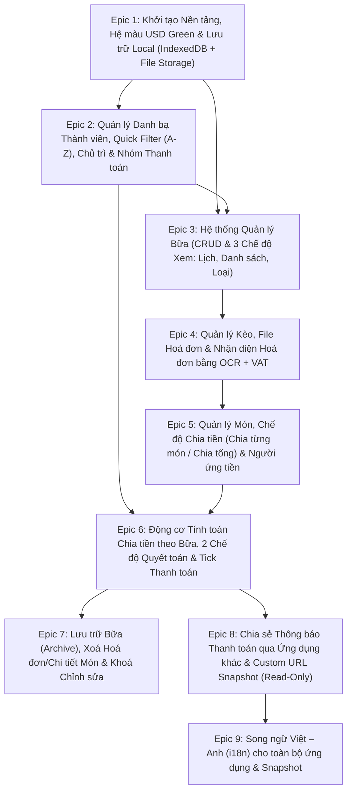

# Tasks

Danh sách việc của thiết kế tổng thể, theo 9 Epic trong file 04 gốc. Mỗi User Story (US) là một việc. Các tiêu chí nghiệm thu (Acceptance Criteria) của Epic là việc con, ghi dưới mỗi nhóm. Các US đều đã triển khai theo README nên được đánh dấu xong. Tiêu chí nghiệm thu giữ trạng thái chưa đánh dấu như trong tài liệu gốc, vì tài liệu gốc không ghi kết quả kiểm từng tiêu chí.

## Sơ đồ phụ thuộc giữa các Epic

Nguyên văn khối mermaid ở đầu file 04 gốc.



## 1. Epic 1: Khởi tạo Nền tảng, Hệ màu USD Green & Lớp Lưu trữ Local

Mục tiêu: xây dựng khung ứng dụng React và TypeScript, thiết lập hệ màu xanh lá đậm của tiền USD, và xây dựng cơ sở dữ liệu IndexedDB cùng lưu trữ File hoá đơn trên trình duyệt.

- [x] 1.1 US-1.1: Khởi tạo dự án Vite, React, TypeScript và Tailwind CSS với bảng màu USD Dark Green (`#123123`, `#1B4332`, `#2D6A4F`, nền giấy `#F2EFE9`).
- [x] 1.2 US-1.2: Thiết kế schema IndexedDB qua `Dexie.js` cho 3 tầng dữ liệu gồm `meals` (Bữa), `sessions` (Kèo), `invoices` (Hoá đơn), `items` (Món), cùng `members` (Danh bạ người), `invoice_files` (File hoá đơn) và `settings`.
- [x] 1.3 US-1.3: Xây dựng dịch vụ quản lý File hoá đơn `fileStorageService`, dùng Origin Private File System (OPFS) kết hợp IndexedDB Blob để lưu, đọc, tải xuống và xoá vật lý các file ảnh hoá đơn.
- [x] 1.4 US-1.4: Khởi tạo dữ liệu mặc định cho hồ sơ "Tôi" dùng làm Người chủ trì mặc định.
- Tiêu chí nghiệm thu:
  - [ ] 1.5 Nghiệm thu: giao diện mang đậm phong cách tờ tiền USD (màu xanh lá đậm, nền giấy kem, font số thẳng cột).
  - [ ] 1.6 Nghiệm thu: dữ liệu lưu bền vững trên trình duyệt sau khi tải lại trang (F5).
  - [ ] 1.7 Nghiệm thu: file ảnh hoá đơn khi thêm hoặc xoá thực sự được lưu thành file và giải phóng dung lượng khi xoá.

## 2. Epic 2: Quản lý Danh bạ Thành viên, Quick Filter (A-Z), Chủ trì & Nhóm Thanh toán

Mục tiêu: cho phép thêm và xoá người vào bữa, tự động lưu lịch sử người từng tham gia để chọn nhanh lần sau qua bộ lọc Alphabet, chỉ định Người chủ trì và gom nhóm thanh toán (cặp đôi hoặc gia đình).

- [x] 2.1 US-2.1: Lưu trữ danh bạ thành viên toàn cục (`members`). Bất kỳ ai từng được thêm vào một bữa sẽ tự động xuất hiện trong danh sách gợi ý cho các bữa sau.
- [x] 2.2 US-2.2: Xây dựng component Quick Filter Chọn Người:
  - Luôn sắp xếp danh sách theo thứ tự Alphabet (A-Z) chuẩn tiếng Việt.
  - Gõ tới đâu lọc danh sách tới đó theo thời gian thực, hỗ trợ tìm kiếm có dấu và không dấu.
  - Nếu từ khoá đang gõ chưa tồn tại trong danh bạ, hiển thị nút "+ Thêm người mới" ngay trong bộ lọc để tạo và thêm thẳng vào bữa.
- [x] 2.3 US-2.3: Quản lý hồ sơ "Tôi" và cho phép đổi chỉ định Người chủ trì (Host) trong từng bữa cụ thể.
- [x] 2.4 US-2.4: Xây dựng tính năng Gom nhóm thanh toán (`PaymentGroup`) trong bữa:
  - Cho phép gom 2 hoặc nhiều thành viên (cặp đôi, vợ chồng, gia đình) thành 1 nhóm thanh toán chung.
  - Hỗ trợ đặt tên nhóm (ví dụ "Gia đình An - Bình"), chỉnh sửa hoặc giải tán nhóm.
- Tiêu chí nghiệm thu:
  - [ ] 2.5 Nghiệm thu: danh sách chọn người luôn xếp đúng thứ tự A-Z và lọc tức thì theo từng ký tự gõ vào.
  - [ ] 2.6 Nghiệm thu: thêm người mới chưa có trong danh bạ chỉ mất 1 cú click hoặc phím `Enter` ngay tại ô Quick Filter.
  - [ ] 2.7 Nghiệm thu: các thành viên đã thuộc 1 nhóm thanh toán không thể bị gán trùng vào nhóm thứ hai trong cùng một bữa.

Ghi chú: README ghi Epic này đã triển khai, còn kiểm thủ công trước khi đóng. Các tiêu chí nghiệm thu chưa được đánh dấu trong tài liệu gốc.

## 3. Epic 3: Hệ thống Quản lý Bữa (CRUD & 3 Chế độ Hiển thị)

Mục tiêu: quản lý Tầng 1 (Bữa, tính theo ngày), hỗ trợ thêm, sửa, xoá bữa và chuyển đổi giữa 3 chế độ hiển thị danh sách bữa.

- [x] 3.1 US-3.1: Tạo mới, chỉnh sửa thông tin chung (Tên bữa, Ngày diễn ra, Ghi chú) và xoá Bữa, cả bữa đang hoạt động lẫn bữa đã lưu trữ.
- [x] 3.2 US-3.2: Chế độ xem 1, theo Ngày, Tháng, Năm (dùng Lịch / Calendar View):
  - Hiển thị lưới lịch theo tháng và năm.
  - Đánh dấu trực quan những ngày có Bữa kèm tổng số tiền. Bấm vào ngày để xem các bữa trong ngày hoặc tạo bữa mới cho ngày đó.
- [x] 3.3 US-3.3: Chế độ xem 2, theo Danh sách (từ mới đến cũ, Chronological List View):
  - Sắp xếp các bữa theo thứ tự thời gian từ mới nhất đến cũ nhất, hiển thị tóm tắt số kèo, số người, tổng chi phí và trạng thái thanh toán.
- [x] 3.4 US-3.4: Chế độ xem 3, theo Loại (bữa còn hoạt động và bữa đã lưu trữ, Status View):
  - Phân tách rõ danh sách bữa còn hoạt động (`ACTIVE`) và bữa đã lưu trữ (`ARCHIVED`).
- Tiêu chí nghiệm thu:
  - [ ] 3.5 Nghiệm thu: chuyển đổi giữa 3 chế độ xem (Lịch, Danh sách mới đến cũ, Theo loại) giữ nguyên tính nhất quán dữ liệu.
  - [ ] 3.6 Nghiệm thu: khi xoá một Bữa, toàn bộ Kèo, Hoá đơn, File ảnh hoá đơn và Món thuộc bữa đó đều bị xoá sạch.

Ghi chú: README ghi Epic này đã triển khai, còn kiểm thủ công trước khi đóng. Các tiêu chí nghiệm thu chưa được đánh dấu trong tài liệu gốc.

## 4. Epic 4: Quản lý Kèo (Tầng 2), File Hoá đơn & Nhận diện OCR + VAT

Mục tiêu: quản lý các Kèo trong một Bữa, lưu trữ nhiều hoá đơn thành file cho mỗi kèo, chụp hoặc tải ảnh hoá đơn, quét OCR tự động bóc tách thông tin (ngày, quán, món, giá) và tự động phát hiện, tính VAT.

Trạng thái theo tài liệu gốc: đã triển khai, xem `documentation/epic-4/SA.md` mục B.10 để biết kết quả kiểm và phần còn lại. Phạm vi cộng thêm so với bản gốc: giảm giá và phí phục vụ áp dụng cho cả bill, nén ảnh có gợi ý chất lượng OCR, kèo tự đổi tên theo quán.

- [x] 4.1 US-4.1: Thêm, đổi tên, sắp xếp và xoá Kèo (nơi thanh toán) trong một Bữa.
- [x] 4.2 US-4.1b: Chọn người tham gia từng Kèo (`SessionKeo.participantIds`). Mặc định là tất cả mọi người trong Bữa, có thể bỏ bớt hoặc thêm lại, và chỉ chọn được trong số người của Bữa. Mọi phép chia tiền của kèo chỉ tính trên những người này.
- [x] 4.3 US-4.2: Quản lý Hoá đơn trong Kèo. Mỗi kèo có thể có 1 hoặc nhiều hoá đơn, mỗi hoá đơn có thể đính kèm 1 hoặc nhiều file ảnh. Hỗ trợ chụp ảnh từ camera hoặc tải file lên, và thêm hoặc xoá file hoá đơn.
- [x] 4.4 US-4.3: Tích hợp OCR offline (`Tesseract.js` tiếng Việt và tiếng Anh) kèm bước tiền xử lý ảnh Canvas:
  - Tự động nhận diện Ngày, Tên quán, danh sách món và giá tiền món.
  - Tự động phát hiện VAT, ví dụ `VAT 8%`, `VAT 10%`, hoặc số tiền thuế GTGT cụ thể, trên hoá đơn.
- [x] 4.5 US-4.4: Cơ chế tự động tính và phân bổ VAT vào giá của từng món, theo phần trăm hoặc phân bổ tỷ lệ thuận theo số tiền VAT cố định.
- Tiêu chí nghiệm thu:
  - [ ] 4.6 Nghiệm thu: mỗi Kèo có danh sách người tham gia riêng (mặc định tất cả người trong Bữa). Người ứng tiền, người chia đều và người ăn món của hoá đơn đều phải thuộc danh sách đó.
  - [ ] 4.7 Nghiệm thu: mỗi Kèo thêm được nhiều hoá đơn. Mỗi hoá đơn lưu thành file ảnh có thể xem lại, tải về hoặc xoá đi.
  - [ ] 4.8 Nghiệm thu: quét ảnh hoá đơn bằng OCR bóc tách được ngày, tên quán, danh sách món và giá, và VAT, cho phép người dùng kiểm tra và sửa nhanh trước khi lưu.
  - [ ] 4.9 Nghiệm thu: khi hoá đơn có VAT, giá từng món tự động được cộng thêm phần VAT tương ứng để tổng các món khớp 100% tổng thanh toán hoá đơn.

Ghi chú: README ghi Epic này đã triển khai, còn kiểm thủ công trước khi đóng. Các tiêu chí nghiệm thu chưa được đánh dấu trong tài liệu gốc.

## 5. Epic 5: Quản lý Món (Tầng 3), Chế độ Chia tiền & Người ứng tiền

Mục tiêu: quản lý chi tiết từng món ăn, hỗ trợ thêm hoá đơn bằng tay hoặc chỉ nhập tổng tiền, lựa chọn chia từng món hoặc chia đều theo tổng, và đánh dấu người ứng tiền cho từng hoá đơn.

- [x] 5.1 US-5.1: Đánh dấu Người ứng tiền (`payerMemberId`) cho từng hoá đơn, chọn trong số người tham gia kèo.
- [x] 5.2 US-5.2: Hỗ trợ 2 phương thức nhập hoá đơn:
  - Nhập chi tiết món, bằng tay hoặc từ OCR: thêm, sửa, xoá từng món gồm tên món, số lượng và đơn giá.
  - Chỉ nhập tổng tiền (`TOTAL_ONLY`): không cần nhập món, bắt buộc khoá chế độ chia tiền là "Chia đều theo tổng" (`EQUAL_TOTAL`).
- [x] 5.3 US-5.3: Lựa chọn chế độ chia tiền cho hoá đơn có chi tiết món. Chuyển đổi linh hoạt giữa Chia từng món (`BY_ITEM`) và Chia đều theo tổng (`EQUAL_TOTAL`).
- [x] 5.4 US-5.4: Gán người ăn cho từng món khi ở chế độ `BY_ITEM`:
  - Tick chọn nhanh những ai cùng ăn món đó, chỉ trong số người tham gia kèo. Mặc định chia đều cho những người được tick.
  - Hỗ trợ điều chỉnh số phần (`shares`) nếu một người gọi nhiều phần riêng trong cùng một mục món.
- Tiêu chí nghiệm thu:
  - [ ] 5.5 Nghiệm thu: nếu chọn "Chỉ thêm tổng tiền", giao diện tự động chọn và khoá ở chế độ "Chia tiền đều theo tổng".
  - [ ] 5.6 Nghiệm thu: nếu có danh sách món, người dùng đổi qua lại giữa "Chia từng món" và "Chia đều theo tổng" bất cứ lúc nào.
  - [ ] 5.7 Nghiệm thu: có thể thêm, sửa, xoá từng món và chọn người ứng tiền cho mỗi hoá đơn.

Ghi chú: README ghi Epic này đã triển khai, còn kiểm thủ công trước khi đóng. Các tiêu chí nghiệm thu chưa được đánh dấu trong tài liệu gốc.

## 6. Epic 6: Động cơ Tính toán Chia tiền theo Bữa, 2 Chế độ Quyết toán & Tick Thanh toán

Mục tiêu: tổng hợp toàn bộ số tiền đã ứng và số tiền phải chi của tất cả các kèo trong Bữa, gom nhóm thanh toán (cặp đôi hoặc gia đình), tính toán chuyển khoản theo 2 chế độ (Tự thanh toán và Nhờ người chủ trì), và theo dõi trạng thái đã thanh toán.

- [x] 6.1 US-6.1: Tổng hợp chi phí toàn Bữa theo từng thành viên, gồm chi tiết đã ứng ở hoá đơn nào và đã ăn những món nào ở kèo nào. Người không tham gia một kèo không bị tính tiền kèo đó.
- [x] 6.2 US-6.2: Gom công nợ theo Nhóm thanh toán (`PaymentGroup`). Cộng tổng số tiền đã ứng và tổng số tiền cần trả của các thành viên trong nhóm, rồi tính số dư chênh lệch ròng như một cá nhân thanh toán duy nhất.
- [x] 6.3 US-6.3: Chế độ 1, Tự thanh toán (`SELF_SETTLEMENT`): tính toán và liệt kê rõ từng cá nhân hoặc nhóm phải trả cho ai bao nhiêu tiền, dựa trên số thực chi và người đã ứng tiền.
- [x] 6.4 US-6.4: Chế độ 2, Nhờ người chủ trì (`HOST_MEDIATED`): mọi cá nhân hoặc nhóm thiếu tiền chuyển toàn bộ khoản cần đóng cho Người chủ trì. Người chủ trì thanh toán lại cho những cá nhân hoặc nhóm đã ứng dư tiền.
- [x] 6.5 US-6.5: Tính năng Tick chọn đã thanh toán. Ghi nhận trạng thái đã hoàn tất thanh toán sau bữa của từng cá nhân hoặc nhóm thanh toán.
- Tiêu chí nghiệm thu:
  - [ ] 6.6 Nghiệm thu: tổng số tiền cần thu luôn khớp chính xác với tổng số tiền cần hoàn trả cho những người đã ứng.
  - [ ] 6.7 Nghiệm thu: nhóm thanh toán (cặp đôi hoặc gia đình) hiển thị đúng tổng ứng, tổng chi và một con số chênh lệch ròng duy nhất.
  - [ ] 6.8 Nghiệm thu: chuyển đổi giữa "Tự thanh toán" và "Nhờ người chủ trì" cập nhật ngay danh sách lệnh chuyển tiền.
  - [ ] 6.9 Nghiệm thu: có thể tick hoặc bỏ tick trạng thái "Đã thanh toán" cho từng cá nhân hoặc nhóm thanh toán, khi bữa chưa lưu trữ.

Ghi chú: README ghi Epic này đã triển khai, còn kiểm thủ công trước khi đóng. Các tiêu chí nghiệm thu chưa được đánh dấu trong tài liệu gốc.

## 7. Epic 7: Lưu trữ Bữa (Archive), Dọn dẹp Hoá đơn/Món & Khoá Chỉnh sửa

Mục tiêu: cho phép lưu trữ bữa sau khi mọi thanh toán đã hoàn tất, tự động xoá toàn bộ file ảnh và hoá đơn (giữ lại các món) để giải phóng bộ nhớ, giữ chi phí từng kèo, khoá chỉnh sửa bữa đã lưu trữ nhưng vẫn cho phép xoá.

- [x] 7.1 US-7.1: Kiểm tra điều kiện lưu trữ bữa. Chặn lưu trữ nếu còn bất kỳ cá nhân hoặc nhóm thanh toán nào có số dư khác 0 chưa được tick "Đã thanh toán".
- [x] 7.2 US-7.2: Thực thi quy trình lưu trữ (`Archive Meal`):
  - Lưu lại tổng chi phí của từng Kèo và bảng tổng kết thanh toán vào `Meal.archivedSummary`.
  - Xoá toàn bộ các file ảnh hoá đơn (`invoice_files` và OPFS) và bản ghi hoá đơn (`invoices`) của bữa đó. Các món (`items`) được giữ lại.
  - Chuyển trạng thái bữa sang `ARCHIVED`.
- [x] 7.3 US-7.3: Giao diện chế độ Bữa đã lưu trữ (chỉ đọc):
  - Khoá toàn bộ thao tác chỉnh sửa, không thể sửa người, nhóm, kèo, hoá đơn, món hay trạng thái thanh toán.
  - Hiển thị thông tin chi phí từng kèo và lịch sử quyết toán đã chốt.
- [x] 7.4 US-7.4: Cho phép xoá vĩnh viễn một bữa đã lưu trữ.
- Tiêu chí nghiệm thu:
  - [ ] 7.5 Nghiệm thu: không thể bấm Lưu trữ nếu chưa tick đủ 100% các khoản thanh toán trong bữa.
  - [ ] 7.6 Nghiệm thu: sau khi lưu trữ, bữa hoàn toàn không thể chỉnh sửa. Toàn bộ file ảnh và hoá đơn bị xoá khỏi bộ nhớ, còn lại các món và thông tin chi phí từng kèo. Không hiện nút chia sẻ thanh toán cho bữa đã lưu trữ.
  - [ ] 7.7 Nghiệm thu: bữa đã lưu trữ vẫn có thể bị xoá hoàn toàn khi người dùng bấm Xoá.

Ghi chú: README ghi Epic này đã triển khai, còn kiểm thủ công trước khi đóng. Các tiêu chí nghiệm thu chưa được đánh dấu trong tài liệu gốc.

## 8. Epic 8: Chia sẻ Thông báo Thanh toán qua Ứng dụng khác & Custom URL Snapshot (Chỉ đọc)

Mục tiêu: đóng gói toàn bộ thông tin của 1 bữa thành một Custom URL Snapshot (chỉ đọc, không thể sửa đổi khi mở link) và tạo tin nhắn thông báo thanh toán đúng định dạng chuẩn để chia sẻ sang các ứng dụng nhắn tin khác.

- [x] 8.1 US-8.1: Xây dựng bộ mã hoá và giải mã Custom URL Snapshot (`snapshotService`). Đóng gói toàn bộ thông tin của 1 bữa (thông tin bữa, thành viên, nhóm thanh toán, kèo, hoá đơn, món, bảng quyết toán) và nén bằng `lz-string` vào tham số URL (`?snapshot=...`).
- [x] 8.2 US-8.2: Xây dựng giao diện Xem Snapshot chỉ đọc (`Read-Only Snapshot Viewer`). Khi người dùng mở đường link chứa `?snapshot=...`, hiển thị đầy đủ thông tin bữa đó nhưng khoá toàn bộ tính năng chỉnh sửa, thêm và xoá. Người mở snapshot không thể thay đổi thông tin bữa.
- [x] 8.3 US-8.3: Xây dựng bộ định dạng tin nhắn thông báo thanh toán (`formatShareMessage`) theo đúng cấu trúc:

  ```text
  <Tên bữa>
  - <Cá nhân>: nợ <cá nhân> <số tiền>, nợ <cá nhân> <số tiền>,...
  - <Cá nhân> + <cá nhân>: ...
  <Link snapshot>
  ```

- [x] 8.4 US-8.4: Tích hợp chia sẻ sang ứng dụng khác bằng Web Share API (`navigator.share`), kèm chức năng sao chép nhanh tin nhắn hoặc link snapshot vào Clipboard.
- Tiêu chí nghiệm thu:
  - [ ] 8.5 Nghiệm thu: Custom URL Snapshot mở được trên bất kỳ trình duyệt hoặc thiết bị nào và hiển thị trọn vẹn thông tin bữa mà không cần backend server.
  - [ ] 8.6 Nghiệm thu: người mở link Snapshot hoàn toàn không thể sửa đổi bất kỳ dữ liệu nào của bữa đó.
  - [ ] 8.7 Nghiệm thu: nội dung chia sẻ tuân thủ chính xác định dạng `<Tên bữa>`, các dòng `- <Cá nhân>: nợ ...`, dòng nhóm thanh toán `- <Cá nhân> + <cá nhân>: nợ ...`, và dòng cuối là `<Link snapshot>`.
  - [ ] 8.8 Nghiệm thu: gửi được trực tiếp qua các ứng dụng khác (Zalo, Messenger, Telegram, Tin nhắn...) thông qua menu chia sẻ của thiết bị hoặc sao chép một chạm.

Ghi chú: README ghi Epic này đã triển khai, còn kiểm thủ công trước khi đóng. Các tiêu chí nghiệm thu chưa được đánh dấu trong tài liệu gốc.

## 9. Epic 9: Song ngữ Việt – Anh (i18n) cho toàn bộ ứng dụng & Snapshot

Mục tiêu: ứng dụng hỗ trợ tiếng Anh (`en`) bên cạnh tiếng Việt (`vi`), chuyển qua lại bằng công tắc ngôn ngữ. Mọi hiển thị, gồm tên ứng dụng và nội dung Snapshot, đều theo ngôn ngữ đã chọn. Trang Snapshot có công tắc ngôn ngữ riêng.

Trạng thái theo tài liệu gốc: đã triển khai, còn kiểm thủ công trước khi đóng, xem `documentation/epic-9/BR.md` và `documentation/epic-9/SA.md`.

- [x] 9.1 US-9.1: Hạ tầng i18n (`I18nProvider`, `useT`, từ điển `vi` và `en` cùng tập khoá) và công tắc ngôn ngữ trên thanh đầu trang. Ghi nhớ lựa chọn, mặc định theo ngôn ngữ trình duyệt.
- [x] 9.2 US-9.2: Chuyển toàn bộ chuỗi giao diện (nhãn, nút, placeholder, `aria-label`, lỗi, trạng thái rỗng) sang từ điển. Tên ứng dụng đổi theo ngôn ngữ (`<title>`, header, PWA).
- [x] 9.3 US-9.3: Định dạng theo ngôn ngữ: ngày, dấu phân cách số (tiền vẫn là VNĐ), sắp xếp. Các giá trị mặc định do hệ thống sinh ("Tôi" và "Me", "Kèo n" và "Venue n") hiển thị theo ngôn ngữ.
- [x] 9.4 US-9.4: Tin nhắn thanh toán (`formatShareMessage`) sinh theo ngôn ngữ. Link Snapshot mang tham số `l` ngôn ngữ của người gửi.
- [x] 9.5 US-9.5: Trang Xem Snapshot có công tắc ngôn ngữ. Toàn bộ nội dung đổi theo, không ghi IndexedDB, và link cũ vẫn mở được.
- Tiêu chí nghiệm thu:
  - [ ] 9.6 Nghiệm thu: đổi ngôn ngữ đổi tức thì toàn bộ màn hình, không sót chuỗi của ngôn ngữ kia. Dữ liệu người dùng nhập không bị dịch.
  - [ ] 9.7 Nghiệm thu: tên ứng dụng, tin nhắn chia sẻ và trang Snapshot đều theo ngôn ngữ đã chọn. Snapshot đổi ngôn ngữ được ngay trên trang.
  - [ ] 9.8 Nghiệm thu: số liệu tính toán không đổi giữa hai ngôn ngữ, và bố cục không vỡ ở 375 px với tiếng Anh.

Ghi chú: tài liệu gốc ghi Epic này đã triển khai, còn kiểm thủ công trước khi đóng. Các tiêu chí nghiệm thu chưa được đánh dấu trong tài liệu gốc.
